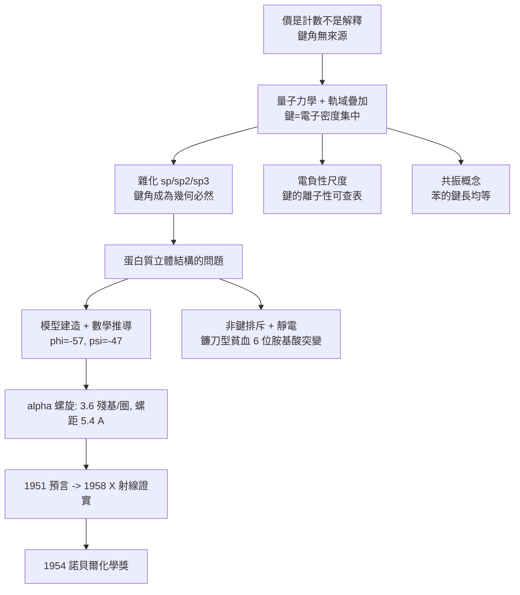

# 1954 · 鮑林與化學鍵

> 1954 諾貝爾化學獎：萊納斯·卡爾·鮑林（Linus Carl Pauling，1901–1994，美國）——表彰「其對化學鍵本質的研究，並將其應用於澄清複雜物質的結構」。化學鍵從描述性的「價」變成可計算的量子概念；同一套理論也讓他畫出了蛋白質的 $\alpha$ 螺旋。

## 懸案（案情提要）

1950 年代，化學家對「化學鍵」的說法已經相當好用了，但骨子裡仍是空的：

- 為什麼碳能形成四個鍵、氧兩個、氮三個？**「價」只是計數，沒有解釋。**
- 為什麼 $\mathrm{H_2O}$ 是折線形、$\mathrm{CO_2}$ 是直線形、$\mathrm{CH_4}$ 是正四面體？**鍵角從何而來？**
- 為什麼 $\mathrm{NH_3}$ 比 $\mathrm{NH_2^-}$ 更易親電子？為什麼 $\mathrm{O_2}$ 有順磁性？**電子的行為無從預測。**
- 兩個原子之間的鍵，究竟是「共享電子」還是別的什麼？

而一場更實際的戰役同步進行：**蛋白質的二級結構**。1940–50 年代，蛋白質的立體結構問題變得尖銳——為什麼毛髮、羊毛、肌肉的彈性與 $\alpha$ 螺旋這樣的規則結構有關？**肽鏈在空間中如何摺疊？**沒有答案，就談不上理解遺傳與代謝。

偵辦人：萊納斯·鮑林——加州理工學院的化學教授。他把**量子力學**引進化學鍵的解釋，並以模型建造＋數學推導，給出蛋白質 $\alpha$ 螺旋的參數。

## 前因

| 年份 | 事件 |
| --- | --- |
| 1901 | 鮑林生於俄勒岡州波特蘭；父是藥劑師。 |
| 1922 | 於俄勒岡州立學院（後為俄勒岡州立大學）取得化學工程學士；入加州理工學院，1925 年博士（導師 Roscoe Dickinson）；後赴哥本哈根（玻爾研究所）學習量子力學。 |
| 1926–1927 | 提出「**電負性**」尺度：鍵的離子性成分決定於成鍵原子的吸引電子能力，並給出第一版數值（$F$ 最高，之後 H、O、N、C 等）。 |
| 1928–1931 | 引入**雜化軌域**概念：碳的 $s$ 與 $p$ 軌域混成，解釋甲烷的正四面體與四個等價的 $\mathrm{C{-}H}$ 鍵；並提出鍵的方向性來自軌域的疊加。 |
| 1931–1935 | 建立**價鍵理論（VB theory）**：鍵＝軌域的疊加，共振（resonance）概念被引入化學語言（苯的兩個 Kekulé 式為共振極限式）。 |
| 1936 | 《化學鍵的本質》（*The Nature of the Chemical Bond*）第一版問世，成為二十世紀最被引用的化學書之一。 |
| 1948–1951 | 與 Niemann 合作以模型推導**蛋白質的 $\alpha$ 螺旋**；1951 年發表（其後續的 $\beta$ 摺板由他與其合作者提出）。 |
| 1954 | 獲諾貝爾化學獎（同年《科學》刊登他的〈 Toward a molecular theory of biological organization〉 等）。 |
| 1957 | 發起反核測試運動，組織科學家反對核武器並提交《appeal to stop the bomb race》；1962 年獲諾貝爾和平獎。 |
| 1960s | 推廣「正分子醫學」（megavitamin therapy）與維生素 C 的應用；其維生素 C 主張（每日數公克）在主流醫學界未被接受。 |

## 調查

**偵查一：鍵的量子解釋——「鍵」是電子函數的極大值。**

鮑林的核心思想是：**共價鍵的本質是兩個原子核之間電子密度的一個「極大值區」**。用量子力學的語言描述：

$$\text{鍵} \equiv \text{原子核間電子密度}\ \psi^2 \text{ 的集中}$$

因此「價」有了解釋：**電子數目與可用軌域數共同決定了最多能形成幾個鍵**：

$$\text{碳：} \; 1s^2\,2s^2\,2p^2 \xrightarrow{\text{激發/混成}} \underbrace{sp^3}_{\text{4 個等價軌域}} \;\Rightarrow\; 4 \text{ 個 } \sigma \text{ 鍵}$$

**偵查二：雜化——幾何的來源。**

| 混成 | 軌域數 | 理想鍵角 | 典型 |
| --- | --- | --- | --- |
| $sp$ | 2 | $180^\circ$ | $\mathrm{CO_2}$、乙炔 |
| $sp^2$ | 3 | $120^\circ$ | 苯環、乙烯 |
| $sp^3$ | 4 | $109.5^\circ$ | 甲烷、$\mathrm{NH_3}$（略偏 $107^\circ$）、$\mathrm{H_2O}$（$104.5^\circ$） |

**鍵角不再是經驗事實，而是幾何必然**——這解决了化學教育中最大的不解之謎。

**偵查三：電負性——鍵的「極性刻度」。**

鮑林定義電負性 $\chi$ 為原子在成鍵時吸引電子的能力，並以**鍵能的不等性**定量化：

$$\Delta = D(\mathrm{A{-}B}) - \frac{1}{2}\left[D(\mathrm{A{-}A}) + D(\mathrm{B{-}B})\right]$$

$\Delta$ 越大，鍵的離子性越強。鮑林給出第一版數值（後由他本人 1932 年修正，並以 Mulliken 的電離能與電子親和能平均加以定義）：

| 元素 | F | O | Cl | N | Br | S | C | I | H |
| --- | --- | --- | --- | --- | --- | --- | --- | --- | --- |
| $\chi$ | 4.0 | 3.5 | 3.0 | 3.0 | 2.8 | 2.5 | 2.5 | 2.5 | 2.1 |

$$\chi_X - \chi_Y \approx 0.5\sqrt{\Delta}$$

**這把「化學親和力」的古老問題轉換成可查表的數值**（MSO 標度；2020 年後另有比重負性）。

**偵查四：共振——描述分子的一種新語言。**

鮑林推廣的共振概念指出：**真實分子是若干「價鍵極限式」的線性組合**，而非任何單一結構式：

$$\text{苯} = \text{兩個 Kekulé 式} + \text{若干 charge-separated 式} \quad\Longrightarrow\quad \text{鍵長均等（}1.39\ \text{Å）}$$

這解釋了苯的鍵長介於單鍵與雙鍵之間，也解釋了羰基的偶極矩與還原性。

**偵查五：模型建造與 $\alpha$ 螺旋——蛋白質的形狀。**

1951 年鮑林與尼曼（Neumann）以硬紙板模型（每個胺基酸殘基用一塊板代表肽平面）**推導**胜肽鏈的穩定構形。他們問兩個問題：

1. 肽平面是否平？——**是**（部分雙鍵性質，$\omega = 180^\circ$）；
2. 每個 $\alpha$ 碳的兩個鍵（$\mathrm{N{-}C_\alpha}$ 與 $\mathrm{C_\alpha{-}C'}$）的旋轉角（$\phi$、$\psi$）最佳值為何？

答案是 $\phi = -57^\circ$、$\psi = -47^\circ$，形成**每圈 3.6 個殘基、螺距 $5.4\ \text{Å}$、每殘基上升 $1.5\ \text{Å}$** 的螺旋：

$$\alpha\text{-螺旋：} \; \text{每圈 } 3.6 \text{ 殘基},\; \text{螺距 } 5.4\ \text{Å},\; \text{每殘基上升 } 1.5\ \text{Å}$$

**檢驗方法極其漂亮**：若此模型正確，則螺旋內的氫鍵必須是 $\mathrm{C{=}O}(i) \cdots \mathrm{H{-}N}(i+4)$——這正是後來 X 射線所證實的（佩魯茨與肯德魯的 1958 年結構完全印證了 $\alpha$ 螺旋與 $\beta$ 摺板的存在，見 [1962-佩魯茨與血紅蛋白](1962-佩魯茨與血紅蛋白.md)）。

**偵查六：非鍵作用與疾病——一個諾獎之外的應用。**

鮑林與其合作者計算了**非鍵原子間的排斥作用**（van der Waals 排斥 + 靜電）對蛋白質結構的影響，並以此解釋**鐮刀型貧血病的分子病理**：血紅蛋白的 $\beta$ 鏈第 6 位胺基酸由**麩胺酸（Glu，帶負電）突變為纈胺酸（Val，疏水）**，使蛋白質表面出現疏水斑點而凝聚成纖維：

$$\mathrm{Glu}^{-}\ (\text{親水、帶負電}) \;\longrightarrow\; \mathrm{Val}\ (\text{疏水})$$

這是第一個以**單一胺基酸置換**解釋的分子疾病——分子生物學的醫學面由此開啟。

## 理論裁決

**判決一：鍵的定義。** 鮑林給出的定義至今仍是最常用的教學語言：

$$\text{化學鍵} \equiv \text{兩原子核之間電子密度集中的區域};\qquad \text{鍵級} \approx \frac{\text{鍵數}}{\text{鍵長}}$$

**判決二：電負性的定量意義。** 電負性差決定鍵的離子性與分子的偶極矩：

$$\mu \approx q \cdot d \quad (\text{部分電荷 } q \times \text{鍵長 } d)$$

$$\text{電負性差愈大} \Rightarrow \text{鍵愈離子} \Rightarrow \text{分子的極性愈強}$$

這解釋了親核反應的選擇性、酸鹼強弱、配位化學（見 [1913-維爾納與配位化學](1913-維爾納與配位化學.md)）的穩定常數，以及今日藥物設計的「Lipinski 五規則」中「HBA/HBC（受體/給體）」的計算基礎。

**判決三：蛋白質二級結構的幾何學。** $\alpha$ 螺旋與 $\beta$ 摺板的參數（$3.6$ 殘基/圈、$1.5\ \text{Å}$/殘基、氫鍵 $i \to i+4$）**在結構被 X 射線量出之前就被算出來**——這是模型方法論最著名的成功案例，也是「物理模型 + 化學直覺」的典範。

**判決四：蛋白質結構的物理限制。** 鮑林指出：蛋白質之所以能摺疊成少數幾種規則結構，是因為**非鍵作用（氫鍵、靜電、凡德瓦耳斯）強烈偏好特定的幾何排列**，任何偏離都會付出能量代價：

$$\Delta G_{\text{fold}} = \Delta H - T\Delta S,\qquad \text{偏好由「局部氫鍵飽和 + 疏水核心」決定}$$

**這是「疏水坍縮（hydrophobic collapse）」理論的早期版本**，並在 1970 年代由 protein folding 的統計物理（見 [1977-普里高津與耗散結構](1977-普里高津與耗散結構.md) 與 [2024-貝克與蛋白質設計](2024-貝克與蛋白質設計.md)）接續發展。

**判決五：方法的示範力。** 鮑林與其合作者的研究風格被稱為「鮑林方法」：**用理論（量子力學、數學、模型）預測性質，再用實驗檢驗**。這種風格在 1950 年代化學界擴散，並在 1960–70 年代的理論化學復興（見 [1998-科恩與量子化學](1998-科恩與量子化學.md)）中達到頂峰。

## 後果

| 領域 | 影響 |
| --- | --- |
| 化學教育 | 雜化、電負性、共振、氫鍵、$\alpha$ 螺旋寫進全球化學與生物學課本，成為共同語言；《化學鍵的本質》被稱為「二十世紀最重要的化學書」。 |
| 結構生物學 | $\alpha$ 螺旋與 $\beta$ 摺板的預言（1951）與證實（1958），使蛋白質結構研究有了框架；DNA 的雙螺旋也沿用同一套鍵與幾何語言（見 [1962-佩魯茨與血紅蛋白](1962-佩魯茨與血紅蛋白.md) 與 DNA 相關卷宗）。 |
| 分子疾病 | 鐮刀型貧血（1956–57 年由鮑林等以非鍵作用解釋）開啟分子醫學；此後鐮刀型貧血的分子機制成為遺傳學的教科書案例。 |
| 材料科學 | 共價鍵的方向性與雜化觀念，是設計新型半導體、光伏材料與金屬合金的基礎（同一「鍵的理論」也直通 [1966-馬利肯與分子軌域](1966-馬利肯與分子軌域.md) 與 [1976-利普斯科姆與硼烷](1976-利普斯科姆與硼烷.md)）。 |
| 公共事務 | 鮑林是唯一獲得過**化學獎與和平獎**的科學家（1954、1962）；他的反核測試運動使其成為「科學家的社會責任」運動的象徵人物。 |
| 科學爭議 | 他晚年推廣的「正分子醫學」（大劑量維生素 C 治療癌症等）在主流醫學界未獲接受——**同一個人的兩種公共形象，也是科學聲譽的另一面。** |

## 關聯

- [1901-凡特荷夫與物理化學](1901-凡特荷夫與物理化學.md)：化學親和力的定量問題，正是鮑林的電負性要回答的對象。
- [1902-費歇爾與醣類偵探學](1902-費歇爾與醣類偵探學.md)：費歇爾的鎖鑰學說與立體化學，在鮑林的鍵理論中得到物理解釋。
- [1913-維爾納與配位化學](1913-維爾納與配位化學.md)：配位數與幾何的語言，被雜化理論補上了電子層的解釋。
- [1953-施陶丁格與高分子](1953-施陶丁格與高分子.md)：同一時期、同一門（加州理工）的另一條主線——大分子的結構與統計。
- [1958-桑格與胰島素序列](1958-桑格與胰島素序列.md)：鮑林與其合作人桑格的終身友誼與互補（結構與序列）。
- [1962-佩魯茨與血紅蛋白](1962-佩魯茨與血紅蛋白.md)：$\alpha$ 螺旋的預言在此獲得 X 射線證實。
- [1998-科恩與量子化學](1998-科恩與量子化學.md)：鮑林的鍵理論在密度泛函理論時代被更精確地取代與延伸。
