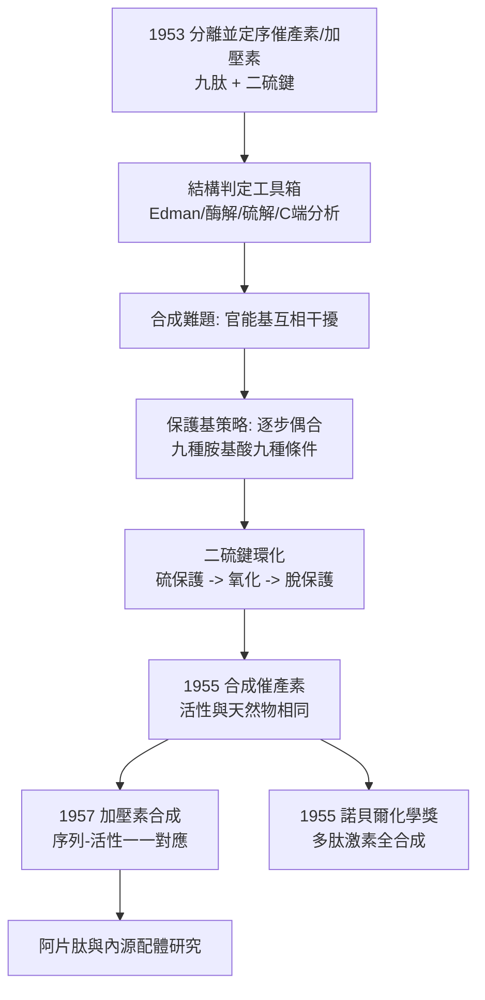

# 1955 · 迪維尼奧與多肽的里程碑

> 1955 諾貝爾化學獎：文森特·迪維尼奧（Vincent du Vigneaud，1901–1978，美國）——表彰「其對生化學上重要之硫化合物之研究，尤其是其對多肽激素之首次合成」。人類第一次完整地合成了一個**激素**：催產素。

## 懸案（案情提要）

1950 年代初，生物學界有一批「小分子大作用」的物質，它們的結構與功能問題幾乎同時爆發：

- **催產素（oxytocin）**：1953 年由杜·維利奧（du Vigneaud）小組從牛腦下垂體後葉分離，並測得結構——它是一個**九肽**，含一個二硫鍵橋（$\mathrm{Cys{-}S{-}S{-}Cys}$），這在 1950 年代是史無前例的結構細節。**它是哺乳動物第一個被完全定序的胜肽激素。**
- **加壓素（vasopressin）**：結構與催產素極相似（同樣是九肽、同樣有二硫鍵），但生理作用完全相反——一個催產、一個抗利尿。
- 更大的問題在於：**這些胜肽能不能被「製造」？**如果能，肽類激素就可以像維生素那樣被工業化生產；如果不能，人工合成胜肽激素就永遠停在紙上。
- 而更根本的問題是：**胜肽化學的難度**。要合成一個九肽，你需要：保護基化學、縮合試劑、純化、鑑定……每一步都可能失敗九成。

偵辦人：文森特·迪維尼奧。他在 1953 年完成催產素與加壓素的結構測定，**1955 年完成催產素的總合成**——這是生物活性多肽的第一次全合成。

## 前因

| 年份 | 事件 |
| --- | --- |
| 1901 | 迪維尼奧生於伊利諾伊州；於羅切斯特大學完成化學訓練並取得博士學位（1924）。 |
| 1927 | 任康奈爾大學醫學院藥理化學教授，並進入「生物體內硫的化學」的研究主線。 |
| 1920s–30s | 研究**含硫化合物（生物體內的硫）**：半胱胺酸、甲硫胺酸、維生素 $\mathrm{B_1}$（硫胺素）的結構；1935 年定出硫胺素的結構（其學生與合作者包括 E. T. 斯普enger等人）。 |
| 1942–1946 | 與科恩（Cornforth）合作，定出**青黴素**的結構（1945）——同樣是含硫化合物，同樣需要結構判定。 |
| 1950–1953 | 研究**腦下垂體後葉的多肽激素**：1953 年分離並定出**催產素**與**加壓素**的結構（九肽，含二硫鍵）。 |
| 1953–1955 | 完成**催產素的總合成**（含二硫鍵環化步驟），並驗證其生物活性。 |
| 1955 | 獲諾貝爾化學獎。 |
| 1957–1958 | 與其合作者（包括 H. B. 博恩（Bodamer）、S. 方塔納（Fontana））完成**加壓素**的合成。 |
| 1960s | 研究** oxytocin 與加壓素在結構上的最小差異**如何導致功能的分歧（活性部位的胺基酸置換）。 |
| 1978 | 逝於紐約。 |

## 調查

**偵查一：結構的拆解——九肽的每一格都要定位。**

催產素與加壓素的序列（九個胺基酸）：

$$\text{催產素：} \; \mathrm{Cys{-}Tyr{-}Ile{-}Gln{-}Asn{-}Cys{-}Pro{-}Leu{-}Gly{-}NH_2}\ (\text{含 } \mathrm{Cys^1{-}S{-}S{-}Cys^6})$$

$$\text{加壓素：} \; \mathrm{Cys{-}Tyr{-}Phe{-}Gln{-}Asn{-}Cys{-}Pro{-}Arg{-}Gly{-}NH_2}$$

結構判定的手段是當時的多肽化學工具箱：

1. **Edman 降解（1950s）**：逐步從 N 端切下並鑑定胺基酸（見 [1958-桑格與胰島素序列](1958-桑格與胰島素序列.md)）；
2. **酶解**：用胰蛋白酶（切在 Arg/Lys 後）、胰凝乳蛋白酶（切在 Phe/Tyr 後）等切出片段，再各自分析；
3. **二硫鍵的定位**：用Performic酸氧化或用苯汞衍生物保護硫，再以氫解還原，最終確認 $\mathrm{Cys{-}Cys}$ 橋；
4. **C 端判定**：用羧肽酶（carboxypeptidase）切下末端胺基酸，確認 C 端為 Gly–Gly–NH$_2$（C 端酰胺化）。

**偵查二：合成的策略——保護基的棋盤。**

要合成 $\mathrm{Cys{-}Tyr{-}Ile{-}Gln{-}Asn{-}Cys{-}Pro{-}Leu{-}Gly}$，問題是：

- 若逐步延長胜肽鏈，**每一個胺基酸都有多個官能基**（胺基、羧基、側鏈），會互相反應；
- 因此必須「保護」不需要反應的官能基，且在適當時機「去保護」。

迪維尼奧的方法是**逐步偶合（stepwise coupling）**：從 C 端開始，每次加上一個保護好的胺基酸：

$$\mathrm{H_2N{-}Gly{-}COOH} \xrightarrow{+\ \text{Boc-Pro}} \mathrm{Boc{-}Pro{-}Gly{-}OH} \xrightarrow{+\ \text{Boc-Leu}} \cdots \xrightarrow{+\ \text{Boc-Cys}} \mathrm{Boc{-}Cys{-}(S-S){-}Cys{-}Tyr{-}\cdots{-}Gly{-}OH}$$

每一個胺基酸都需要專屬的保護基與脫保護條件（酸、鹼、還原、硫解各不相同）——**九個胺基酸的九種保護策略，組合成一份「保護基的棋盤」。**

**偵查三：二硫鍵的環化——本案最關鍵的一步。**

最後的難題是形成分子內的 $\mathrm{Cys{-}S{-}S{-}Cys}$ 橋（20 員環）。迪維尼奧的解法是**先保護硫、再氧化成二硫、最後去保護**：

$$\mathrm{Cys{-}SH} \xrightarrow{\text{保護}} \mathrm{Cys{-}S{-}Benzyl} \xrightarrow{\text{接上另一段}} \mathrm{Cys(Bz){-}S{-}S{-}Cys(Bz)} \xrightarrow{\text{Na/H}_2\text{液氨}} \mathrm{Cys{-}S{-}S{-}Cys}$$

**最終產物的生物活性與天然催產素完全相同**——這是合成生物學的里程碑：活性不只取決於序列，也取決於三維構形（此時是「二硫鍵把環鎖住」的構形）。

**偵查四：活性的驗證——每一個位置都有意義。**

迪維尼奧後續研究（尤其與其合作者的結構—活性比較）顯示：把九個胺基酸中的任何一個換成別的，活性即大幅下降。例如：

$$\text{催產素（}Ile^3\text{）}\quad \text{vs}\quad \text{加壓素（}Phe^3\text{）}\quad\Longrightarrow\quad \text{一個胺基酸之差 = 兩種截然不同的生理作用}$$

這把「序列—構形—功能」三者串成一條線，是分子生物學「中心法則」確立前的關鍵一步。

**偵查五：同一套方法的廣度。**

迪維尼奧小組的合成技術隨後被用於：
- **加壓素**（1957–58）與其衍生物（去精胺加壓素、1-desamino-8-lysine vasopressin 等——今日臨床使用的血管張力素類似物）；
- **腦啡肽（enkephalin）**（1970 年代由其學生奧利（Olefsky）與其後續工作者合成，開啟阿片類的內源配體研究）；
- **促腎上腺皮質激素（ACTH）** 的片段合成。

## 理論裁決

**判決一：多肽合成的可行性判準。** 迪維尼奧的工作確立了胜肽合成的定量邏輯：**每一步偶合的產率必須夠高，總產率才不會崩潰**。以九步偶合為例，若每步產率為 $p$，總產率為：

$$P = p^{9}$$

若 $p = 0.9$，則 $P \approx 0.39$；若 $p = 0.8$，則 $P \approx 0.13$；**每一步都必須近乎定量，總合成才可行**——這就是「保護基策略」存在的理由（見 [1902-費歇爾與醣類偵探學](1902-費歇爾與醣類偵探學.md) 費歇爾的胜肽合成僅到二胜肽；迪維尼奧把它推進到九胜肽與激素活性）。

**判決二：序列—構形—功能的鏈條。** 本案首次以**合成**的方式證明：

$$\text{一級序列} \xrightarrow{\text{摺疊（受二硫鍵等約束）}} \text{三維構形} \xrightarrow{} \text{生理功能}$$

且**最小的序列差異即可改變功能**（$\mathrm{Ile}^3 \to \mathrm{Phe}^3$ 即為催產與抗利尿之別）——這是「序列是功能的充分信息」這一命題的第一個實驗證明。

**判決三：C 端酰胺化的意義。** 迪維尼奧發現催產素的 C 端是 **Gly–NH$_2$**（C 端酰胺化），而非游離羧基：

$$\text{酰胺化} \;\Longrightarrow\; \text{中性 C 端} \;\Longrightarrow\; \text{對氨端受體的親和力與穩定性提升}$$

這項細節展示了「末端修飾的功能意義」，並在今日的半合成胜肽藥物設計中仍是常規考量（醋酸加壓素、去氨加壓素等）。

**判決四：化學與生物的閉環。** 這是 1950 年代的一道分水嶺：

$$\text{天然物} \xrightarrow{\text{分離}} \text{結構} \xrightarrow{\text{合成}} \text{純品} \xrightarrow{\text{活性驗證}} \text{機制確認}$$

在此之前，生化學是「分離與描述」的學問；在此之後，它有了「重建與檢驗」的能力。**這條閉環正是 1953–58 年間桑格（序列）與佩魯茨（結構）所共同完成的偉大工程的組成部分**（見 [1958-桑格與胰島素序列](1958-桑格與胰島素序列.md)）。

## 後果

| 領域 | 影響 |
| --- | --- |
| 胜肽化學 | 保護基、偶合試劑（DCC、活化酯）與二硫鍵環化的技術體系成型，是 1960–80 年代多肽化學與藥物開發的基礎。 |
| 產科與內分泌 | 催產素（子宮收縮）與加壓素（抗利尿、血管收縮）的合成藥物成為產科標準用藥；後者的類似物成為重症醫學的升壓藥。 |
| 神經科學 | 腦啡肽與內啡肽的發現（1970 年代），確立「體內有自產的嗎啡樣物質」——開啟阿片類受體研究（2012 年諾貝爾生理醫學獎的相關卷宗，見 [2012-萊夫科維茨與GPCR](2012-萊夫科維茨與GPCR.md) 的藥理學前史）。 |
| 蛋白質化學 | 胜肽合成的成功，讓「蛋白質可用化學方法建構」成為信念，直接鼓勵了固相合成（見 [1984-梅里菲爾德與固相合成](1984-梅里菲爾德與固相合成.md)）與重組 DNA 時代的「先化學合成基因、再讓細菌表現」的思路（見 [1980-伯格與重組DNA](1980-伯格與重組DNA.md)）。 |
| 科學史註記 | 迪維尼奧的小組由藥理化學家與有機化學家組成，是 1950 年代**「有機化學 + 生理學」跨領域典範**的代表。 |

## 關聯

- [1902-費歇爾與醣類偵探學](1902-費歇爾與醣類偵探學.md)：費歇爾在 1900 年代已合成上百條胜肽並確立「蛋白質是胜肽鏈」，但停在無活性的片段；本案是它的終局。
- [1946-薩姆納與酵素結晶](1946-薩姆納與酵素結晶.md)：蛋白質能被結晶與純化，是結構與序列工作的前提。
- [1954-鮑林與化學鍵](1954-鮑林與化學鍵.md)：鮑林與迪維尼奧同為康奈爾—加州理工世代的科學圈，胜肽的鍵與構形語言來自鮑林。
- [1958-桑格與胰島素序列](1958-桑格與胰島素序列.md)：胜肽定序的另一支——從天然物讀出序列，與本案的「從序列做出天然物」互補。
- [1984-梅里菲爾德與固相合成](1984-梅里菲爾德與固相合成.md)：把逐條偶合的手工流程自動化。
- [1980-伯格與重組DNA](1980-伯格與重組DNA.md)：胜肽合成的雄心，延伸成重組遺傳工程。
