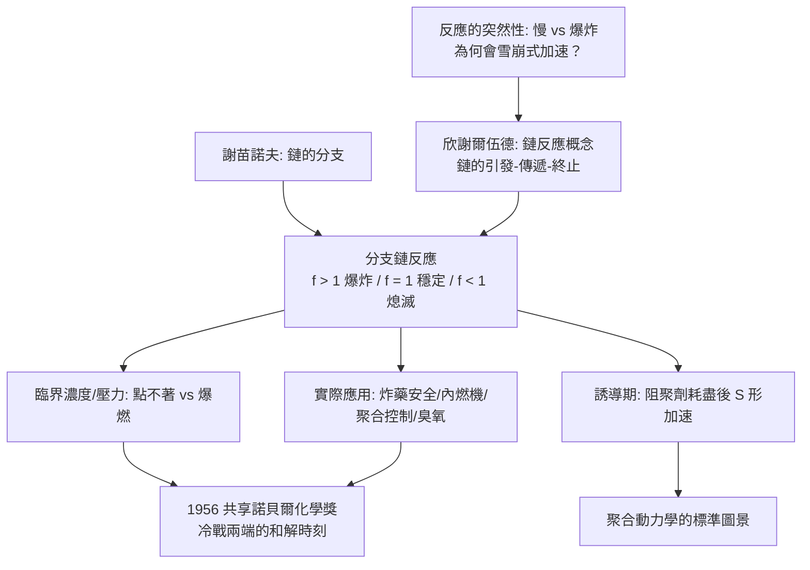

# 1956 · 欣謝爾伍德與謝苗諾夫——爆炸的數學

> 1956 諾貝爾化學獎（共享）：西里爾·諾曼·欣謝爾伍德爵士（Sir Cyril Norman Hinshelwood，1897–1967，英國）與尼古拉·尼古拉耶维奇·謝苗諾夫（Nikolay Nikolayevich Semyonov，1896–1986，蘇聯）——表彰「其對化學變換機構的研究」。兩位分處冷戰兩端的科學家，因同一門學問而共享一座獎。

## 懸案（案情提要）

化學反應的速率問題，有一個一直難以解釋的現象：

- 某些反應在低溫下慢得幾乎不動（煤的氧化、食物的腐敗、爆炸物的引爆）；
- 但只要溫度略升，或有一個「起爆」的刺激，**反應會突然加速到難以控制**——有時是爆炸。
- 為什麼會有這樣的**突然性**？為什麼有時是「漸進式」的燃燒，有時卻是「雪崩式」的爆炸？

更尖銳的追問來自實際需求：**爆炸怎麼防？燃燒怎麼控制？**第一次大戰的壕溝僵局讓人明白：爆炸性反應不僅是理論問題，還是國安問題；而 1930 年代的航空燃料、高壓合成、鍋爐爆炸，又把它推上工業安全的高度。

另有一樁怪案：**某些反應有「 inducement（誘導期）」——加入某一種物質後，原本緩慢的反應會突然加速**，就像被「點燃」了。

偵辦人：欣謝爾伍德（牛津，燃燒與鏈反應）與謝苗諾夫（莫斯科，化學變換的機構理論）。兩人獨立發展出**鏈反應理論**，並在同一年獲得同一座獎——這是諾貝爾獎史上少見的「冷戰和解」時刻。

## 前因

| 年份 | 事件 |
| --- | --- |
| 1896 / 1897 | 謝苗諾夫生於莫斯科；欣謝爾伍德生於倫敦。 |
| 1910s–1920s | 謝苗諾夫在彼得堡的物理化學研究所（吉尼斯（H. Minak）與庫茲涅佐夫（Kuznetsov）的研究群）研究化學反應的速率與機構；1920 年代研究**燃燒與爆炸**、以及表面反應。 |
| 1920s–1930s | 欣謝爾伍德在牛津研究燃燒、爆炸與**鏈反應（chain reaction）**；1932 年出版《化學反應的鏈理論》，明確提出鏈的產生、傳遞與終止。 |
| 1920s | 謝苗諾夫提出**鏈反應的分支（branching）概念**與「混合鏈反應」理論；1927 年出版《化學反應機構》（*Chemical Kinetics and Non-equilibrium Processes*）。 |
| 1930s | 兩人共同建立「鏈反應」與「分支鏈反應」的通用語言，並以氫-氧氣反應、磷化氫在氧氣中的爆發（$\mathrm{P_2H_4}$／$\mathrm{H_2}+\mathrm{O_2}$）為典型案例。 |
| 1950s | 鏈反應理論在**燃燒與爆炸**、**聚合反應**（自由基聚合）、**臭氧消耗**（見 [1995-克魯岑與臭氧層](1995-克魯岑與臭氧層.md)）、**酵素的不可逆抑制**中獲得應用。 |
| 1956 | 兩人共享諾貝爾化學獎——**第一位獲諾貝爾獎的蘇聯科學家**即謝苗諾夫。 |
| 1960s | 謝苗諾夫主持蘇聯科學院物理化學研究所，推行科學院體系改革；欣謝爾伍德任皇家學會外事祕書（1950–65）。 |
| 1986 / 1967 | 謝苗諾夫逝於莫斯科；欣謝爾伍德逝於牛津。 |

## 調查

**偵查一：鏈的發現——把「反應」換成「故事」。**

鏈反應的核心洞見是：**一次事件可以產生多個後繼事件，像鏈條一樣傳播。**典型的鏈反應機構（以 $\mathrm{H_2}+\mathrm{O_2}$ 為例）：

$$
\begin{aligned}
\text{引發：} &\quad \mathrm{H_2O_2} \xrightarrow{} 2\,\mathrm{OH^\bullet} \\
\text{傳遞：} &\quad \mathrm{H^\bullet} + \mathrm{O_2} \rightarrow \mathrm{HO_2^\bullet} \\
&\quad \mathrm{HO_2^\bullet} + \mathrm{H_2} \rightarrow \mathrm{H_2O} + \mathrm{HO^\bullet} \\
&\quad \mathrm{HO^\bullet} + \mathrm{H_2} \rightarrow \mathrm{H_2O} + \mathrm{H^\bullet} \\
\text{終止：} &\quad 2\,\mathrm{HO^\bullet} \rightarrow \mathrm{H_2O} + \mathrm{O_2}
\end{aligned}
$$

**每一步都再生出自由基（$\mathrm{H^\bullet}$、$\mathrm{HO^\bullet}$、$\mathrm{HO_2^\bullet}$），鏈因此不斷延續。**

**偵查二：分支鏈——爆炸的數學。**

謝苗諾夫最關鍵的貢獻是指出：**鏈的傳遞可以產生新的鏈，即「分支」。**若每一步產生 $f$ 條新鏈：

$$\text{鏈數} \; N(t) \;\sim\; N_0\,f^{\,n}, \qquad \frac{dN}{dt} = \alpha N \left(f - 1\right)$$

- **$f > 1$**：鏈數指數增長 → **爆炸**；
- **$f = 1$**：鏈數線性增長 → 穩定反應；
- **$f < 1$**：鏈數衰減 → 反應熄滅。

**爆炸的臨界條件因此是定量的**：在鏈反應系統中，存在一個**臨界濃度（臨界壓力）**，低於它反應熄滅，高於它反應爆炸——這解釋了為什麼某些混合氣體在低壓下「怎麼點都不著」，而在稍高壓力下卻會爆燃。

**偵查三：誘導期之謎——「延遲反應」的機制。**

某些反應（特別是聚合反應與某些氧化反應）在開始時緩慢，之後突然加速。欣謝爾伍德提出：**誘导期來自「阻聚劑」的消耗**——微量的雜質（對苯二酚、氧等）先與鏈載體反應，把鏈掐滅；當阻聚劑耗盡，鏈數開始指數增長：

$$\underbrace{\text{誘導期}}_{\text{阻聚劑被消耗}} \longrightarrow \underbrace{\text{急劇加速}}_{\text{鏈分支開始}} \longrightarrow \underbrace{\text{反應完成}}$$

**這解釋了聚合反應的 S 形轉化曲線**，也是今日聚合反應動力學的基本圖景。

**偵查四：反應速率的普適定律——Arrhenius 方程的再檢驗。**

欣謝爾伍德以精密實驗重新檢驗了速率常數與溫度的關係，發現：

$$\frac{d\ln k}{dT} = \frac{E_a}{RT^2}, \qquad \ln k = \ln A - \frac{E_a}{RT}$$

並證實在**更寬的溫度範圍**內成立，同時指出阿瑞尼斯方程在**擴散控制的反應**（氣相與高壓下的某些反應）中會失效——這預告了 1950–60 年代「擴散控制動力學」的研究方向。

**偵查五：實際應用——安全與效率。**

鏈反應理論在戰時與戰後的應用極為直接：

- **爆炸物設計**：理解硝化甘油與硝酸銨的分解鏈；
- **內燃機**：燃料的點火與爆震（knocking）——汽油的辛烷值；
- **聚合反應控制**：以阻聚劑控制分子量與反應時序；
- **燃燒安全**：礦井瓦斯的爆炸界限（$\mathrm{CH_4}$ 5–15% in air）、穀倉dust 爆炸的預防；
- **臭氧層破壞**：$\mathrm{Cl^\bullet}$ 的鏈式分解（見 [1995-克魯岑與臭氧層](1995-克魯岑與臭氧層.md)）。

## 理論裁決

**判決一：鏈反應的機構語言。** 欣謝爾伍德把反應機構正式分為三段：

$$\underbrace{\text{引發（initiation）}}_{\text{產生第一個載體}} \to \underbrace{\text{傳遞（propagation）}}_{\text{載體再生，鏈增長}} \to \underbrace{\text{終止（termination）}}_{\text{載體消失，鏈中斷}}$$

**這套三段式成為二十世紀化學反應機構研究的通用語言**，在自由基聚合、臭氧催化分解、酵素的不可逆抑制（酵素機制中的「不可逆抑制劑」就是終止鏈載體）中使用。

**判決二：分支鏈的臨界性——爆炸的數學判準。** 鏈的分支因子 $f$ 決定一切：

$$\frac{dN}{dt} = \alpha\,N\,(f-1) \;\Longrightarrow\; N(t) = N_0 e^{\alpha(f-1)t}$$

$$\text{爆炸} \iff f > 1$$

**「燃燒與爆炸的差別不是能量的多寡，而是鏈分支的有無」**——這是一個極為深刻的判準，並被延伸應用於**核連鎖反應**（核裂變中一個中子引發多個中子，$f>1$ 即為鏈反應；見 [1944-哈恩與核分裂](1944-哈恩與核分裂.md) 的 $k_{\text{eff}}$ 判準）：**化學爆炸與核爆炸在數學上共享同一個模型**。

**判決三：誘導期的機構解釋。**

$$\text{反應初期的「停滯」} = \text{阻聚劑（ scavenger）在消耗鏈載體}$$

這把一個純粹的經驗現象（許多聚合反應的 S 形曲線、某些氧化反應的延遲）還原為可設計的化學：**加一點阻聚劑，就能控制反應的時序與分子量**——這是塑膠工業的日常操作。

**判決四：反應速率的溫度依賴之謎。** 欣謝爾伍德以精密實驗確立了阿瑞尼斯方程的適用範圍，並引入**擴散控制的速率極限**：在氣相高壓或液相中，反應物相遇的頻率本身成為限制：

$$v_{\text{diff}} \propto D_{AB}\,(c_A + c_B), \qquad D_{AB} \propto \frac{T^{3/2}}{P}$$

$$\text{因此高壓下的速率上限} \sim \text{擴散係數} \;\Rightarrow\; \text{「撞上」的物理極限}$$

此概念在 1960 年代由加維爾（Gerischer）、諾克斯（Knox）等發展成表面反應理論，並最終在 2007 年埃特爾的表面化學諾獎中達到頂峰（見 [2007-埃特爾與表面化學](2007-埃特爾與表面化學.md)）。

## 後果

| 領域 | 影響 |
| --- | --- |
| 燃燒與爆炸 | 爆炸的臨界條件、混合物爆炸界限、阻燃劑設計、內燃機爆震控制，皆以鏈反應理論為基礎。 |
| 聚合化學 | 自由基聚合的鏈機構、阻聚劑與鏈轉移劑、$S$ 形轉化曲線、聚合度分布理論（見 [1953-施陶丁格與高分子](1953-施陶丁格與高分子.md)）——今日塑膠工業的化學控制核心。 |
| 大氣化學 | 臭氧催化循環（$\mathrm{Cl^\bullet}$、$\mathrm{NO_x}$ 循環）是分支鏈反應的經典案例，直接通向 1995 年諾貝爾獎（見 [1995-克魯岑與臭氧層](1995-克魯岑與臭氧層.md)）。 |
| 核物理 | 鏈反應概念從化學移植到核物理，「臨界」的語言在兩套學問中通用。 |
| 科學制度 | 1956 年的共享獎是冷戰科學交流的象徵：英國與蘇聯科學家在彼此的核心里找到共同語言；謝苗諾夫成為**第一位獲諾貝爾獎的蘇聯科學家**，其後續的科學院改革與國際合作具有指標意義。 |

## 關聯

- [1903-阿瑞尼斯與離子解離疑案](1903-阿瑞尼斯與離子解離疑案.md)：$k = A e^{-E_a/RT}$ 與活化能概念，是鏈反應速率理論的母公式。
- [1909-奧斯特瓦德與催化](1909-奧斯特瓦德與催化.md)：催化與鏈反應的關係——催化劑正是「改變鏈引發與終止」的物質。
- [1944-哈恩與核分裂](1944-哈恩與核分裂.md)：核鏈反應與化學鏈反應共享「分支因子」的數學。
- [1953-施陶丁格與高分子](1953-施陶丁格與高分子.md)：自由基聚合的鏈機構，是本案理論在工業上的最大應用。
- [1995-克魯岑與臭氧層](1995-克魯岑與臭氧層.md)：分支鏈反應在大氣中的頂級應用。
- [2007-埃特爾與表面化學](2007-埃特爾與表面化學.md)：表面反應機構的逐原子解析，是鏈反應理論在固體表面的後裔。
