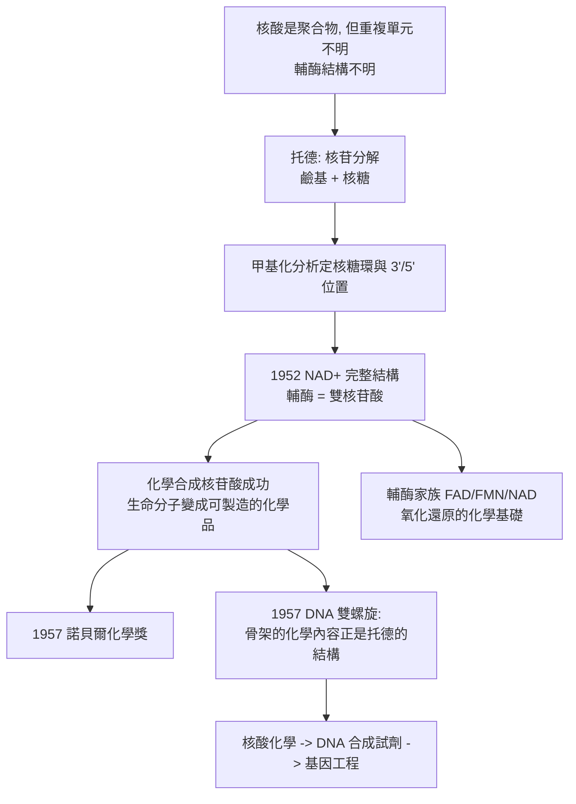

# 1957 · 托德與核苷酸的藍圖

> 1957 諾貝爾化學獎：亞歷山大·羅伯特斯·托德（Alexander Robertus Todd，Baron Todd，1907–1997，英國）——表彰「其對核苷酸與核苷輔酶之結構與合成的研究」。他畫出了生命化學中最普遍的「磚頭」的結構圖：核苷酸。

## 懸案（案情提要）

1950 年代的生化學，有一件「人人都用、沒人說得清」的事：

- **DNA 與 RNA 是聚合物**（这一点已被確立），但它們的「重複單元」是什麼？
- 1930 年代，菲爾（Fehrensen）、科恩（Kornberg）等已證明核酸的骨架含**磷酸**、**戊糖**與**含氮鹼基**三部分——但「三者怎麼接在一起」？是什麼鍵？鹼基是單一還是多種？戊糖是核糖還是去氧核糖？
- 更關鍵的一組謎題是**輔酶**：許多酵素需要「輔酶」才能工作（見 [1929-哈頓與發酵化學](1929-哈頓與發酵化學.md) 的 $\mathrm{NAD^+}$），但輔酶的結構為何？為什麼它能被酵素辨認？
- 而最迫切的實務問題是：**核酸能不能被合成？**若能合成核苷酸，就能合成 DNA 片段、可以研究基因的化學、可以做出核苷酸類藥物。

偵辦人：亞歷山大·托德。他把核苷酸「拆成零件、量尺寸、定鍵結」，並完成了**核苷酸的化學合成**——這是通往人工 DNA 與基因工程的第一塊磚。

## 前因

| 年份 | 事件 |
| --- | --- |
| 1907 | 托德生於格拉斯哥；父為法官。 |
| 1928 | 於曼徹斯特大學取得博士學位（有機化學），後赴慕尼黑（隨威蘭，見 [1927-威蘭與膽汁酸](1927-威蘭與膽汁酸.md)）、隨維爾納（見 [1913-維爾納與配位化學](1913-維爾納與配位化學.md)）學習。 |
| 1932 | 劍橋大學博士（研究抗生素 gramicidin 與 physalemin——其結構工作帶他進入胜肽與核苷酸的領域）。 |
| 1938–1944 | 研究**維生素 B$_1$（硫胺素）**、維生素 B$_2$、維生素 C 與**核苷（nucleoside）**；定出**腺苷與鳥苷**的結構（1934），並發現核苷的**呋喃（核糖）環**。 |
| 1944–1952 | 任曼徹斯特大學有機化學教授；研究**核苷酸輔酶**：1952 年定出**菸鹼醯胺腺嘌呤二核苷酸（$\mathrm{NAD^+}$）**的完整結構（含兩個核苷酸以焦磷酸相連），並示範其合成。 |
| 1953–1957 | 定出許多**核苷酸（核苷-磷酸）**的結構（$3'$、$5'$ 磷酸位置之辨），完成核苷酸的化學合成（如 $3',5'$-二磷酸腺苷、$5'$-磷酸鳥苷等）。 |
| 1957 | 獲諾貝爾化學獎；同年《Nature》發表 DNA 雙螺旋（Watson–Crick）——**托德的核苷酸結構，正是雙螺旋模型中「骨架」的化學內容**。 |
| 1971–1980 | 任皇家學會主席（1975–80）；1971 年被封為貴族（Baron Todd of Trumpington）。 |

## 調查

**偵查一：拆解核苷——三個零件的確認。**

托德以化學降解拆解核苷（adenosine 與 guanosine）：

$$\text{腺苷} \xrightarrow{\text{酸水解}} \underbrace{\text{腺嘌呤}}_{\text{鹼基}} + \underbrace{\text{核糖}}_{\text{戊糖}}$$

並以**甲基化分析**（甲基化 → 水解 → 鑑定甲基位置）確定糖上的羥基位置，從而確立**呋喃式核糖環**與糖苷鍵的 $\beta$ 構型：

$$\text{核苷} = \text{鹼基} + \beta\text{-D-核呋喃糖（}C1'\text{ 與 } N9/N1 \text{ 連接）}$$

**偵查二：磷酸酯的位置——$3'$ 與 $5'$ 的辨識。**

這是托德最精細也最重要的結構工作：**磷酸是接在核糖的 $3'$ 碳還是 $5'$ 碳？**（DNA 與 RNA 的鏈方向性完全取決於此。）

方法：以**選擇性磷酸酯酶**或**逐級甲基化＋分餾**（托德的「磷酸酯分餾法」，即以甲醇胺進行**磷酸酯的選擇性裂解**，產生可鑑定的甲基磷酸酯）：

$$\text{核苷酸} \xrightarrow{\text{甲醇胺}} \underbrace{\text{核苷-}3'\text{-磷酸酯}}_{\text{產物 A}} + \underbrace{\text{核苷-}5'\text{-磷酸酯}}_{\text{產物 B}}$$

$$\text{再甲基化 + 水解} \xrightarrow{} \text{判定 } 3' \text{ 與 } 5' \text{ 位置}$$

**結果：核苷酸的磷酸接在 $5'$ 上；然而在多核苷酸鏈中，核苷間的磷酸橋是 $3'{-}5'$ 連結**——這正是核酸骨架的關鍵特徵，也是雙螺旋模型中每條鏈的方向性來源（**兩條鏈必須反向平行**才能讓 $3'{-}5'$ 骨架互補配對）。

**偵查三：輔酶的結構——「雙核苷酸」的觀念。**

托德定出 $\mathrm{NAD^+}$ 的結構，揭示了它的組成邏輯：

$$\mathrm{NAD^+} = \underbrace{\text{菸鹼醯胺}}_{\text{氧化還原載體}} + \underbrace{\text{核糖}}_{\text{連接}} + \underbrace{\text{腺嘌呤}} + \underbrace{\text{核糖}}_{\text{連接}} + \underbrace{\text{磷酸}-\text{磷酸}}_{\text{焦磷酸橋}}$$

**「輔酶本身是核苷酸」**——這解釋了為什麼輔酶能被酵素辨認：它帶有核苷酸的部分（AMP 或 NMN  moiety），可被酵素的「核苷酸結合位」辨識，而真正做化學工作的是另一段（菸鹼醯胺的吡啶環）。

$$\mathrm{NAD^+} + \mathrm{H^+} + 2e^- \rightleftharpoons \mathrm{NADH}$$

**偵查四：化學合成——證明核苷酸可被「製造」。**

托德小組完成了多種核苷酸的化學合成（保護基策略、磷酸化試劑、磷酸酯保護基如環氧乙烷類）。合成原則：

$$\text{核苷} + \text{磷酸化試劑} \xrightarrow{\text{保護基策略}} \text{核苷-磷酸酯（}3'\text{ 或 }5'\text{）}$$

這件事的深遠意義：**核苷酸從此既是「生命分子」也是「化學品」**。後來的一切——DNA 合成試劑（phosphoramidites）、核酸藥物（siRNA、反義寡核苷酸）、NTP 供體（PCR、轉錄、測序）——都以「可合成的核苷酸」為前提。

**偵查五：維生素與核苷酸的交會。**

托德同時定出維生素 B$_1$（硫胺素）、B$_2$（核黃素）的結構，並示範核黃素是黃素（flavin）的組成——這條線在 1950–60 年代發展出**氧化還原輔酶家族**（FAD、FMN），最終在 1997 年博耶（見 [1997-博耶與ATP合成酶](1997-博耶與ATP合成酶.md)）的 ATP 合成酶工作中扮演關鍵角色。

## 理論裁決

**判決一：核苷酸的四段式結構。** 托德確立的通式至今是所有核酸化學的基礎：

$$\text{核苷酸} = \underbrace{\text{含氮鹼基}}_{\text{腺嘌呤/鳥嘌呤/胞嘧啶/尿嘧啶/胸腺嘧啶}} + \underbrace{\text{戊糖}}_{\text{核糖（RNA）或 2-去氧核糖（DNA）}} + \underbrace{\text{磷酸}}_{\text{接在 } 5' \text{ 碳}} $$

鹼基的配對（DNA 的四種鹼基以氫鍵配對，構成遺傳密碼的化學基礎）：

$$\mathrm{A{-}T}:\ 2 \text{ 個氫鍵} \qquad \mathrm{G{-}C}:\ 3 \text{ 個氫鍵}$$

**氫鍵數的差異，是 DNA 雙螺旋穩定性與突變機率（GC 較穩定）差異的物理根源**——這條從托德的結構表一路連到 DNA 雙螺旋（1957）、複製保真度與演化理論。

**判決二：$3'{-}5'$ 磷酸二酯橋——鏈的方向性。** 核苷酸之間以 $3'$ 碳與下一個的 $5'$ 碳形成磷酸二酯鍵：

$$\text{…核糖-}3'\text{-O-P(=O)(O}^{-}\text{)-O-}5'\text{-核糖…}$$

**這意味著每條核酸鏈都有化學上的「頭尾」**（$5'$ 端與 $3'$ 端），因此：

- 兩條鏈必須**反向平行**才能互補配對（這是 Watson–Crick 模型的核心幾何要求）；
- DNA 聚合酶只能沿 $5' \to 3'$ 方向合成（複製的方向性）；
- RNA 的 $5'$ 端可以是三磷酸（mRNA 的帽結構），$3'$ 端可以是聚腺苷酸尾（多聚 A 尾）。

**托德的結構工作，正是 1957 年 DNA 雙螺旋模型能「站得住腳」的化學前提**——Watson 與 Crick 之所以能推出雙螺旋，正是因為知道磷酸骨架的 $3'{-}5'$ 連結與鹼基配對的氫鍵。

**判決三：輔酶的模組化。** 托德揭示了輔酶的組成邏輯：

$$\text{輔酶} = \underbrace{\text{反應基團}}_{\text{做化學工作}} + \underbrace{\text{核苷酸 moiety}}_{\text{被酵素辨認}}$$

這解釋了**酵素如何「抓住」輔酶**，也解釋了為什麼許多輔酶彼此結構相似卻功能迥異——它們共用同一個「把手」（AMP、NMN、GDP 等），只換工作部件。

**判決四：生物分子可被合成的證明。** 托德的核苷酸合成把一個關鍵信念推入化學界：

$$\text{天然複雜分子} \;\xrightarrow{\text{可合成}}\; \text{其結構假說被驗證}$$

這與 1955 年迪維尼奧的催產素合成（見 [1955-迪維尼奧與催產素](1955-迪維尼奧與催產素.md)）、1965 年伍德沃德的維生素 B$_{12}$ 合成（見 [1965-伍德沃德與全合成](1965-伍德沃德與全合成.md)）構成同一條路線：**「合成」是結構判斷的最高法院**。

## 後果

| 領域 | 影響 |
| --- | --- |
| 核酸化學 | 核苷酸成為可設計、可合成、可改造的分子；磷醯胺（phosphoramidite）化學（1980 年代）讓寡核苷酸可長程合成，直接導向基因工程與核酸藥物。 |
| 基因工程 | 核苷三磷酸（dNTP/NTP）成為 PCR、轉錄、定序的原料；托德的結構工作為 DNA 複製的化學提供基礎。 |
| 藥物 | 抗病毒核苷類似物（acyclovir、AZT）、反義寡核苷酸、siRNA 藥物，皆以核苷酸化學為母體。 |
| 生物化學 | 輔酶結構（$\mathrm{NAD^+}$、FAD、FMN、CoA、ATP）全面釐清，確立「輔酶＝模組化配件」的觀念，直通 1997 年的 ATP 合成酶工作。 |
| 科學制度 | 托德後任皇家學會主席（1975–80），是英國科學界在「分子生物學時代」最具代表性的領袖之一。 |

## 關聯

- [1913-維爾納與配位化學](1913-維爾納與配位化學.md)：托德的師承圈（維爾納實驗室）與「金屬—配體—生物分子」的語言。
- [1927-威蘭與膽汁酸](1927-威蘭與膽汁酸.md)：托德的慕尼黑時期（威蘭實驗室）與結構化學方法論。
- [1929-哈頓與發酵化學](1929-哈頓與發酵化學.md)：輔酶 $\mathrm{NAD^+}$ 的發現（哈頓與楊），與托德的結構定案在此合流。
- [1955-迪維尼奧與催產素](1955-迪維尼奧與催產素.md)：同年代的「生物分子可合成」的證明，兩案共同鋪出分子生物學的技術地基。
- [1958-桑格與胰島素序列](1958-桑格與胰島素序列.md)：核酸的序列問題與蛋白質的序列問題在 1950–60 年代被同時解決。
- [1980-伯格與重組DNA](1980-伯格與重組DNA.md)：核苷酸化學 → 寡核苷酸合成 → 重組 DNA 的技術鏈條。
- [1997-博耶與ATP合成酶](1997-博耶與ATP合成酶.md)：ATP（核苷酸）的結構與功能，與輔酶家族的命運。
