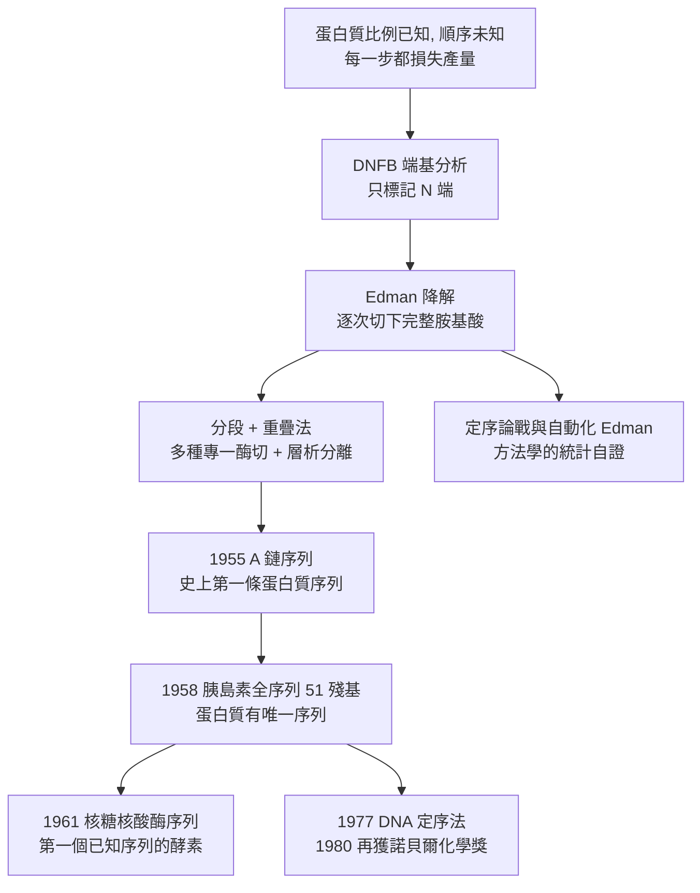

# 1958 · 桑格與胰島素的序列——中心法則的第一塊磚

> 1958 諾貝爾化學獎：弗雷德里克·桑格（Frederick Sanger，1918–2013，英國）——表彰「其對蛋白質胺基酸序列之研究，尤其是胰島素序列的測定」。他證明了蛋白質有**唯一的、確定的序列**，並因此開啟了分子生物學的中心法則。

## 懸案（案情提要）

1950 年代中期，一樁被所有人認為「不可能」的任務擺在桌上：

> **把一個蛋白質的胺基酸「順序」讀出來。**

為什麼說不可能？因為蛋白質有幾百個胺基酸殘基：

- 化學家能知道總共有哪些胺基酸、比例為何（這靠水解與層析，見 [1952-馬丁與層析法](1952-馬丁與層析法.md)）；
- 但「比例」不含順序資訊。**同一組胺基酸，可以排列成天文數字般的不同序列**；
- 而每一步的降解都損失產量、引入誤差的機會隨步數累積——讀 100 個殘基，就要有 100 次分離與鑑定。

更根本的問題是**科學哲學層面的**：蛋白質究竟是不是「一條有固定順序的鏈」？1930–40 年代，膠體學派與化學派仍爭論不休（見 [1953-施陶丁格與高分子](1953-施陶丁格與高分子.md)）。若蛋白質是「巨分子」，則它的序列問題才有意義。

偵辦人：弗雷德里克·桑格。他選了最小的、胰島素——一個只有 51 個殘基的胜肽激素（兩個多肽鏈，21 與 30 個胺基酸，由二硫鍵相連）——作為突破口。

## 前因

| 年份 | 事件 |
| --- | --- |
| 1918 | 桑格生於英國倫敦（父親是醫生）。 |
| 1939–1943 | 於劍橋，完成生物化學訓練；受阿爾弗雷德·米爾斯（Alfred Mills）與諾曼·霍里（Norman Hawry）的指導（霍里即 1937 年諾貝爾得主，見 [1937-霍沃思與維生素C](1937-霍沃思與維生素C.md)）。 |
| 1944–1946 | 戰時在倫敦醫學研究委員會從事有機化學研究；1946 年（26 歲）獲博士學位。 |
| 1948–1952 | 研究**二硫鍵的化學**（發現 $\beta$-苯甲醯基氯可裂解二硫鍵，且不破壞胜肽鏈）——這是「能切開蛋白質而留下可分析的片段」的關鍵技術。 |
| 1949–1955 | 研究自由基（$\mathrm{H}$ 原子、羥基自由基）對胺基酸的氧化降解；發展**DNFB 端基分析**（桑格試劑，與 Edman 法是當時並行的兩套 N 端鑑定法）。 |
| 1952–1955 | 完成**胰島素的二硫鍵橋與鏈分開**（用 performic 酸氧化或苯甲醯基氯裂解），並定出 A 鏈與 B 鏈的胺基酸組成。 |
| 1955 | 發表胰島素 A 鏈的完整序列（**史上第一條蛋白質序列**）。 |
| 1958 | 獲諾貝爾化學獎；同年完成 B 鏈序列，胰島素全序列（51 個殘基）完成。 |
| 1961 | 與其團隊定出**核糖核酸酶**的序列（第一個有已知序列的酵素，見 [1972-安芬森與核糖核酸酶](1972-安芬森與核糖核酸酶.md)）。 |
| 1977 | 發展**DNA 定序法**（桑格定序，以雙去氧核苷酸終止法為核心）；1980 年再獲諾貝爾化學獎（與伯格、吉爾伯特共享，見 [1980-伯格與重組DNA](1980-伯格與重組DNA.md)）。 |
| 2013 | 逝於劍橋；劍橋的分子生物學實驗室（LMB）所在的「桑格大樓」以他命名。 |

## 調查

**偵查一：N 端鑑定——先找到「鏈的頭」。**

桑格與同事（與他的博士生塔洛克（James Tuppy）合作）發明 **DNFB 法**（Sanger's reagent，1-氟-2,4-二硝基苯）：

$$\mathrm{H_2N{-}(N\text{-端殘基}){-}}\mathrm{蛋白質} + \mathrm{F_2N{-}C_6H_3{-}NO_2} \xrightarrow{\text{鹼}} \mathrm{F_2N{-}C_6H_3{-}NO_2{-}NH{-}(N\text{-端})$$

之後用酸水解，**只有 N 端的胺基酸被標記**（因為只有它的胺基是游離的）：

$$\text{酸水解} \xrightarrow{} \text{DNP-衍生的胺基酸（單一）} + \text{其餘胺基酸（游離）}$$

**如此就能一次讀出一個殘基**——這是「逐位讀序」的第一步。

**偵查二：Edman 降解——桑格的方法與另一條路。**

Edman 法（1952–53，由 Edman 提出，桑格將其發揚為可操作的序列策略）以**苯異硫氰酸酯（PITC）**與 N 端胺基酸反應，再以酸環化切下**整個 PTH-胺基酸**（**一個完整的胺基酸被逐次切除而不破壞其餘的鏈**）：

$$\mathrm{蛋白質{-}NH_2} \xrightarrow{\mathrm{PITC}} \mathrm{PTC\text{-}蛋白質} \xrightarrow{\text{酸}} \underbrace{\mathrm{PTH{-}胺基酸}_1}_{\text{被鑑定並移除}} + \underbrace{\mathrm{蛋白質}'_{-1}}_{\text{剩餘鏈}}$$

**重複此循環，即可逐一讀出序列**——這是「蛋白質有序列」最直接的證明。

**偵查三：分段與重疊——把「讀不動」變成「讀得動」。**

一條 30 個殘基的鏈無法靠一次降解讀完（產量會耗盡）。桑格的策略是**分段 + 重疊**：

1. **用幾種不同的專一性裂解方式**切出不同的片段（例如用胰蛋白酶切在 Arg/Lys 後、用胰凝乳蛋白酶切在 Phe/Tyr 後、用胰蛋白酶 + 化學裂解等）；
2. 每組片段以層析分離並定序（見 [1952-馬丁與層析法](1952-馬丁與層析法.md)）；
3. **比較不同酶切所得的片段，找出重疊區段**，用「重疊法（overlap method）」拼出全序列。

$$\text{片段 A：} \; 1\!-\!8 \quad \text{片段 B：} \; 5\!-\!14 \quad \text{片段 C：} \; 12\!-\!20 \;\Longrightarrow\; \text{拼合得到 } 1\!-\!20$$

**重疊片段的序列必須自洽**——這提供了強烈的內部檢驗，任何錯誤都會在重疊處露餡。

**偵查四：胰島素的特例——把二硫鍵橋解決掉。**

胰島素的難題在於：它是由**兩條鏈**（A 鏈 21 殘基、B 鏈 30 殘基）以**兩個二硫鍵**相連組成的。序列測定前必須先決定：

- 哪個半胱胺酸與哪個配對；
- 兩條鏈的 N 端各是什麼。

桑格用**過甲酸氧化**（把二硫鍵氧化成磺酸，鏈間即分離）與**苯甲醯基氯裂解**（選擇性切斷其中一對二硫鍵）來解決，得到 A 鏈與 B 鏈各自的序列，並確定配對方式：

$$\text{胰島素：} \; \underbrace{\text{A 鏈（21 殘基）}}_{\text{GIVEQCCTSICSLYQLENYCN}} - \underbrace{\text{B 鏈（30 殘基）}}_{\text{FVNQHLCGSHLVEALYLVCGERGFFYTPKT}} \quad (\text{兩個 } \mathrm{S{-}S} \text{ 橋})$$

**「胰島素有唯一的序列」——這是本案的核心裁決。**

**偵查五：Edman 的挑戰與裁決。**

桑格的方法面臨一個尖銳的批評（Edman 本人提出，並在 1960–70 年代引發長期的「定序論戰」）：**Edman 降解每循環一次，肽鏈就縮短一個殘基，並非每一步都 100% 成功——所以讀 30 個殘基，就必須能辨認幾十個微量的 PTH-胺基酸，是否可靠？**

桑格與其團隊（後來由布勞克斯托克（Broadstock）等人在 1960 年代以自動化的 Edman 降解器解決）用**內部標準與統計方法**建立了可信度：

$$\text{單次循環的鑑定正確率} \;\approx\; 99\% \quad \Longrightarrow\quad \text{30 循環後全序列正確率} \approx 0.99^{30} \approx 74\% \ (\text{需人工覆核與重複})$$

這場論戰最終以「自動化 Edman + 質譜鑑定（PITC-衍生物以質譜確認）」收束——**方法的可疑性被統計與自動化共同化解**，也是科學方法論的一個好教材。

## 理論裁決

**判決一：蛋白質有唯一確定的序列。** 桑格的核心裁決：

$$\text{蛋白質} = \text{固定長度、固定組成的胺基酸序列} \quad (\text{一級結構})$$

這是**中心法則的第一塊磚**：序列 → 摺疊 → 功能 → 傳遞。若蛋白質是無序的膠體（膠體派的看法），則「序列決定功能」根本無從談起。1958 年的諾貝爾獎，實質上是一場關於「生命分子是否可被化學描述」的裁決，而答案是**可以，而且精確到可以寫成一行字串**。

**判決二：重疊法的邏輯——唯一性由自洽性保證。** 重疊法之所以可靠，在於它要求**多條獨立的片段序列必須互相吻合**：

$$\text{片段} A(1\!-\!8), B(5\!-\!14), C(12\!-\!20) \;\Longrightarrow\; A \cap B = (5\!-\!8), \ B \cap C = (12\!-\!14)$$

若任一讀序有誤，重疊區的吻合即破壞。**這是一種「用交叉驗證建立可信度」的典範設計**，其邏輯與 DNA 定序中的「重疊群（overlapping reads）」完全相同——**DNA 定序（1977）正是把桑格的重疊法搬到核酸上**。

**判決三：序列分析的定量經濟學。** 桑格的工作也建立了序列分析的「物料帳」概念：讀一條 $n$ 殘基的鏈，需要的蛋白質量與時間隨 $n$ 增長，因此早期只有胰島素（51 殘基）可行；自動化（Edman 降解器、蛋白質序列儀）與更靈敏的鑑定法（質譜）把可行長度推到數百、數千殘基。

$$\text{可讀長度} \;=\; f(\text{每循環產量}, \text{單次鑑定正確率}, \text{起始樣品量})$$

**判決四：一級結構是「可攜的資訊」。** 序列一旦寫下，就成了**可攜、可比較、可搜尋的資訊**——這是生物資訊學的起點：1970 年代的人類胰島素基因序列被讀出並於 1978 年在大腸桿菌中表現（人類胰島素成為第一個由細菌生產的藥品）。

## 後果

| 領域 | 影響 |
| --- | --- |
| 分子生物學 | 「序列決定一切」的信念，是中心法則（1958）、遺傳密碼（1960–70 年代）、蛋白質生物合成機制（見 [1962-佩魯茨與血紅蛋白](1962-佩魯茨與血紅蛋白.md) 與 [1972-安芬森與核糖核酸酶](1972-安芬森與核糖核酸酶.md)）的共同前提。 |
| 蛋白質化學 | 序列測定成為蛋白質結構與功能研究的標準前置；催產素與加壓素的序列（1955）開啟了「結構—活性」的比較研究。 |
| 生物技術 | 1977 年桑格定序法與 1980 年的重組 DNA（伯格）、DNA 測序（吉爾伯特）構成基因工程的技術三支柱；人類胰島素的基因工程化生產（1978）改變了糖尿病治療。 |
| 生物資訊 | 序列作為資訊的觀念，是 1970–90 年代序列資料庫與比較生物學的源頭。 |
| 科學制度 | 桑格是唯一兩度獲化學獎者之一（1958、1980），且是少數「連續兩次在同一領域得獎」的例子；劍橋分子生物學實驗室（LMB，1962 年成立）在他的領導下成為世界重鎮。 |

## 關聯

- [1946-薩姆納與酵素結晶](1946-薩姆納與酵素結晶.md)：蛋白質能被純化與結晶，是定序的前提。
- [1952-馬丁與層析法](1952-馬丁與層析法.md)：片段分離的技術基礎——桑格定序的必備工具。
- [1954-鮑林與化學鍵](1954-鮑林與化學鍵.md)：鮑林與桑格的終身友誼；「序列決定構形」的預言（1951）在此獲得序列證據。
- [1955-迪維尼奧與催產素](1955-迪維尼奧與催產素.md)：同期完成的催產素序列與合成，構成「序列」與「合成」的雙向證明。
- [1962-佩魯茨與血紅蛋白](1962-佩魯茨與血紅蛋白.md)：序列（1958）＋三維結構（1958）＝結構生物學的完整拼圖。
- [1972-安芬森與核糖核酸酶](1972-安芬森與核糖核酸酶.md)：以核糖核酸酶重合成實驗，最終裁定「序列決定摺疊」。
- [1980-伯格與重組DNA](1980-伯格與重組DNA.md)：桑格第二次得獎的卷宗——DNA 定序與重組遺傳工程。
