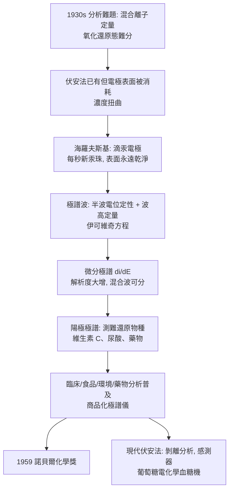

# 1959 · 海羅夫斯基與極譜——滴一滴液體，看見離子

> 1959 諾貝爾化學獎：雅羅斯拉夫·海羅夫斯基（Jaroslav Heyrovský，1890–1967，捷克斯洛伐克）——表彰「其發明極譜法」。他讓化學家能在一滴溶液裡、同時看見多種離子及其濃度——今日環境檢測與臨床檢驗的日常儀器。

## 懸案（案情提要）

1930 年代的分析化學面對的是「**混合物的定量**」問題：

- 要測溶液中某種離子的濃度，標準方法是**沉澱、重量法或滴定**——但這些方法一次只能處理一種離子，而且需要較大量樣品、費時、且難以用於微量與自動化；
- 更麻煩的是：**氧化還原態的測定**。同一元素的不同氧化態（如 $\mathrm{Fe^{2+}}$ 與 $\mathrm{Fe^{3+}}$、$\mathrm{Cr^{3+}}$ 與 $\mathrm{Cr^{6+}}$）化學性質相近，傳統方法難以分開。

而 1920 年代末的電化學界正忙著另一件事：**測量「離子的種類與濃度」**。答案是伏安法（voltammetry）——把工作電極的電位慢慢往一個方向掃，記錄電流；每一種可在電極上反應的物種會在特定電位產生特徵的電流波峰。

但伏安法的難題是：**被測物在電極表面被消耗或沉澱，濃度隨掃描改變，波形被扭曲。**

偵辦人：海羅夫斯基。他的解法是讓電極的表面「永遠是新的」——**以毛細管滴汞電極，每秒滴下新的汞珠**。

## 前因

| 年份 | 事件 |
| --- | --- |
| 1890 | 海羅夫斯基生於布拉格（奧匈帝國時期的捷克家庭，父親是布拉格大學的教授）。 |
| 1918 | 於布拉格查爾斯大學取得化學博士學位（研究電化學）。 |
| 1920s | 在布拉格查爾斯大學創立電化學研究所；研究**毛細管滴汞電極**的行為（滴汞電極在 1920 年代由海羅夫斯基引入分析應用）。 |
| 1921–1923 | 發展**電解分析法（electrolytic analysis）**：用受控電位分離混合離子（例如從鉀、鈉、鈣的混合液中分別測定鉀）。 |
| 1924 | 在**波希米亞化學會年會**上發表極譜法的首篇論文；1925 年在《Collection of Czechoslovak Chemical Communications》詳細發表。 |
| 1930s | 極譜法在歐洲迅速傳播，並由德國的儀器公司製成商品化極譜儀（Heyrovský 型），使方法走出少數實驗室；其家族下一代亦延續伏安法研究，並把極譜用於生物體的氧化還原測定（維生素 C 的極譜法為代表）。 |
| 1959 | 獲諾貝爾化學獎；同年獲哥本哈根大學的貝格獎（Berg Prize）等。 |
| 1967 | 逝於布拉格。 |

## 調查

**偵查一：滴汞電極——讓電極表面永遠是新的。**

海羅夫斯基的裝置：一根毛細管，汞在壓力下以約每秒一滴的速度滴出，形成懸掛汞珠電極。每一滴新汞珠都是**乾淨的、未被消耗的表面**：

$$\text{毛細管} \xrightarrow{\text{重力}} \text{汞珠（每秒 1 滴）} \xrightarrow{\text{電解}} \text{產物扩散離開} + \text{新的汞珠}$$

**這解決了伏安法的根本困難**：被測物在汞珠上的消耗被「滴走」，因此電流的測量反映的是**溶液中的濃度**，而非電極表面的變化。

**偵查二：伏安曲線的指紋——每種離子一個波。**

以直流電位慢慢掃描（由負往正），記錄電流：

$$\text{起始（殘餘電流）} \to \text{上升（擴散控制）} \to \text{波峰} \to \text{回落（擴散耗盡）}$$

$$\text{極譜波} : \quad \text{半波電位} \; E_{1/2} \;(\text{定性},\ \text{與濃度無關}) + \text{波高} \; i_d \;(\text{定量})$$

**伊可維奇方程**給出定量關係：

$$i_d = 607\,n\,D^{1/2}\,m^{2/3}\,t^{1/6}\,c \quad (\text{在 } 25\,^\circ\mathrm{C}\text{ 時，} i_d \text{ 以 } \mu\mathrm{A}\text{、} c \text{ 以 mM 計})$$

其中 $n$ 為電子數、$D$ 擴散係數、$m$ 毛細管流速、$t$ 滴下週期。**波高正比於濃度**，因此極譜既是定性也是定量方法。

**偵查三：測「不可還原」的物種——把電極反過來。**

這是海羅夫斯基實驗室的一項關鍵改良（1930 年代）：**把滴汞電極改為陽極（氧化型極譜），就可以測量那些不易被還原的物種**，例如：

- 維生素 C（抗壞血酸）在陽極極譜上直接被氧化，產生特徵波——**這是維生素 C 的經典定量法**；
- 尿酸、胺基酸、核苷酸、藥物代謝物皆可用此法測量。

**偵查四：微分極譜——解析混合物的技巧。**

因為極譜波可疊加，海羅夫斯基發展出**微分極譜（derivative polarography）**：記錄 $\mathrm{d}i/\mathrm{d}E$（電流的微分），波峰變成**倒 V 形**（正峰對應還原波、負峰對應氧化波），極小的波也能被辨認：

$$\frac{di}{dE} \text{ 的峰高} \propto \frac{di_d}{dE}\ \text{（峰寬約 } 50\ \mathrm{mV}\text{，故解析度極高）}$$

這使極譜能測定**低至 }10^{-6}\ \mathrm{M}\ 濃度**的物種，並能分辨共存的多種物種。

**偵查五：實務價值的爆發——醫學與工業。**

極譜在 1930–50 年代的應用極廣：

- **臨床化學**：血液與尿液中的葡萄糖（以葡萄糖氧化酶產生過氧化氫，再以極譜測 $\mathrm{H_2O_2}$）、尿素、維生素 C、鐵；
- **藥物分析**：滴定式的伏安滴定（polarographic titration）可測毫克級的藥物；
- **食品與環境**：農藥殘留、金屬（Pb、Cd、Zn、Ni）含量——**今日的環境重金屬檢測仍以 ICP-MS 或陽極溶出伏安法為基礎**；
- **生物化學**：測量氧化還原酵素的活性（以底物的消耗波或產物的生成波定量）。

## 理論裁決

**判決一：伏安波的理論解釋。** 對可還原物種 $\mathrm{Ox} + ne^- \rightleftharpoons \mathrm{Red}$，在滴汞電極上：

$$\text{擴散控制的電流} \quad i_d = nFAC\,\sqrt{\frac{D}{\pi t}} \, c$$

（$F$ 為法拉第常數、$t$ 為擴散時間 $\sim \sqrt{t_{\text{drop}}}$。）由於汞珠不斷更新，擴散層厚度固定，故：

$$i_d \propto \sqrt{D}\,c$$

**波高正比於濃度、半波電位由 $\Delta G^\circ$ 決定**：

$$\frac{\mathrm{d}\ln i_d}{\mathrm{d}E} \text{ 的形狀} \approx \text{Nernst 型的可逆波} \quad\Longrightarrow\quad E_{1/2} \approx E^\circ + \frac{RT}{nF}\ln\frac{[\mathrm{Red}]}{[\mathrm{Ox}]}$$

**這是把化學熱力學與電流直接接在一起的公式**（能斯特方程的伏安版），使極譜波可同時提供**定性（$E_{1/2}$）、定量（$i_d$）與動力學（峰形）**三重資訊。

**判決二：峰形的動力學資訊。** 對可逆的單電子反應，伏安波符合：

$$\text{波前：} \; i/i_d = \frac{1}{1 + \exp\left[\frac{nF}{RT}\left(E - E_{1/2}\right)\right]}$$

（邏輯斯蒂函數形狀。）若反應不可逆（電子轉移慢），波形會**拉長並降低**——因此**波形的形狀本身就是反應機構的診斷工具**：可逆、准可逆、不可逆（完全不可逆時波高反而與掃描速率無關）。這把極譜從「測濃度」提升為「看反應機構」。

**判決三：滴汞的物理優越性。** 為什麼是汞？四個理由：

| 性質 | 意義 |
| --- | --- |
| 液態（表面自由更新） | 避免表面被消耗或沉澱覆蓋 |
| 液相金屬（$\mathrm{Hg_2^{2+}/Hg}$ 的可逆性高） | 波形銳利、可逆 |
| 高過電位（氫的析出電位很負） | 可在負電位區測量難還原的物種（如 $\mathrm{Zn^{2+}}$、有機物） |
| 低成本、可回收 | 儀器可普及 |

**「汞的高過電位」是極譜能測定廣泛物種的關鍵**——這是材料性質決定分析方法優越性的漂亮例子。

**判決四：微分法的普适性。** 微分極譜的想法可推廣為**掃描速率的數學處理**（循環伏安法、以 $\mathrm{d}i/\mathrm{d}E$ 與 $\mathrm{d}^2i/\mathrm{d}E^2$ 分析）：

$$\frac{\mathrm{d}^2 i}{\mathrm{d} E^2} \text{ 對 } E \text{ 作圖} \;\Longrightarrow\; \text{峰位即 } E_{1/2},\ \text{峰高正比於 } c$$

這套「微分訊號」的思路今日是循環伏安法（cyclic voltammetry, CV）與電化學阻抗譜的基礎，是電化學實驗室最常用的方法之一。

## 後果

| 領域 | 影響 |
| --- | --- |
| 臨床醫學 | 極譜成為 1950–60 年代臨床化學的骨幹方法（血糖、尿糖、維生素 C、鐵）；**葡萄糖氧化酶電極**的現代血糖機（1968 年首次商業化）即是「酵素 + 電極 + 電子轉移」的後裔，其原理直接來自極譜。 |
| 環境與食品 | 重金屬（Pb、Cd、Hg）與農藥殘留的定量檢測方法；今日的陽極溶出伏安法（ASV）與感測器技術源自此。 |
| 藥理與藥物分析 | 伏安滴定可測毫克級藥物；藥物的代謝物（極譜活性基團）可被追蹤。 |
| 工業分析 | 合金與電鍍液中的金屬定量、維生素 C 含量的極譜測定（工業與食品檢驗的標準方法）。 |
| 儀器史 | 商品化極譜儀是二十世紀分析儀器商業化的代表案例；海羅夫斯基因此被稱為「現代電化學分析之父」，並創辦了極譜學派（布拉格與倫敦的 Heyrovský 家族）。 |

## 關聯

- [1920-能斯特與熱力學第三定律](1920-能斯特與熱力學第三定律.md)：能斯特方程式是伏安波的理論基礎，也是 $E_{1/2}$ 的解釋。
- [1929-哈頓與發酵化學](1929-哈頓與發酵化學.md)：輔酶 $\mathrm{NAD^+}/\mathrm{NADH}$ 的氧化還原電位，正是伏安法可測的物種；哈頓—楊的工作因此可直接用極譜追蹤。
- [1960-利比與碳-14定年](1960-利比與碳-14定年.md)：放射性的精密測量與極譜同屬「微弱訊號的偵測」技術譜系。
- [1992-馬庫斯與電子轉移理論](1992-馬庫斯與電子轉移理論.md)：外層電子轉移的馬庫斯理論，正是伏安波動力學（可逆／准可逆／不可逆）的深層解釋。
- [1983-陶布與電子轉移](1983-陶布與電子轉移.md)：內層電子轉移機制，與伏安（外層）波形的差異是本案理論的另一面。
