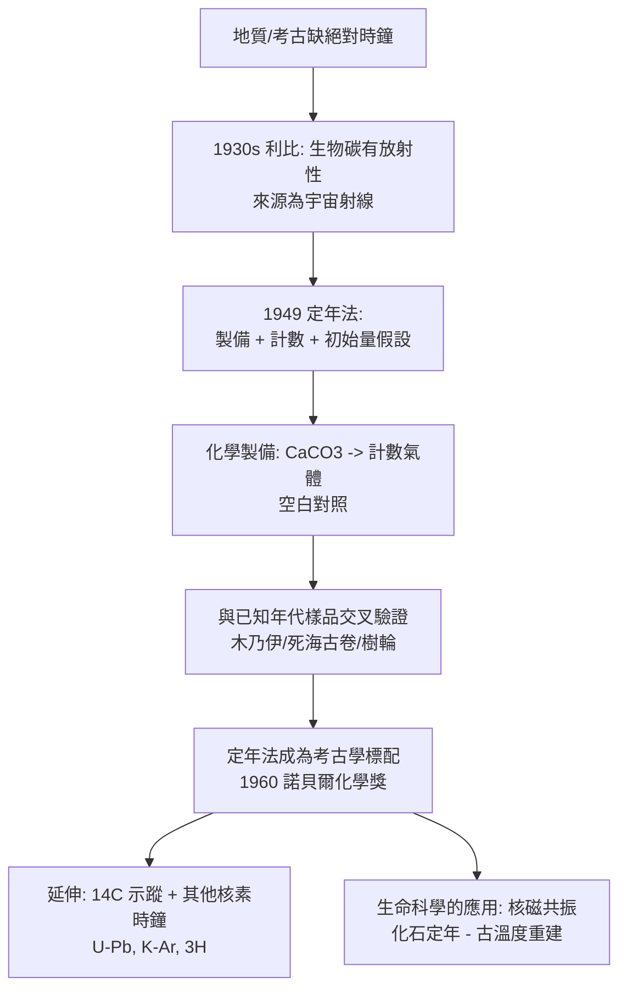

# 1960 · 利比與碳-14 定年——給地質史裝上時鐘

> 1960 諾貝爾化學獎：威爾德·法蘭西斯·利比（Willard Frank Libby，1908–1980，美國）——表彰「其對碳-14 定年法之發展的貢獻」。考古學與古生物學從此可以用同一把尺量出「幾千年前」。

## 懸案（案情提要）

地質學與考古學在 1950 年代面對一個尷尬的局面：**它們幾乎沒有絕對時間尺。**

- 地層學說（stromatolites）、冰輪（varves）、樹輪提供了**相對**年齡，但無法錨定到絕對年代；
- 埃及金字塔的年表來自紙草文與王表互證；碳-14之前的「古埃及斷代」是靠天象回推的推算，誤差以百年計；
- 人類學的年代問題更尖銳：**「智人是幾萬年前遷出非洲」這種說法，在沒有絕對定年的技術時，只是合理推測。**

而物理學這邊，手上已有一件現成的武器：**碳-14（$^{14}\mathrm{C}$）是放射性的**（由宇宙射線在大氣中產生），它的含量隨時間以可計算的速率衰減。缺的只是：**(1) 一個可測的放射性測量技術；(2) 一個能處理含碳樣品的化學製備程序；(3) 一個可信的「初始含量」假設。**

偵辦人：威爾德·利比。1949 年起，他在芝加哥大學用三年時間把這三件事拼起來——**碳-14 定年法**。

## 前因

| 年份 | 事件 |
| --- | --- |
| 1908 | 利比生於科羅拉多州格里利；父是農學教授。 |
| 1931 | 於加州大學柏克萊分校取得化學學士（1933 年博士），研究放射化學與**地球大氣中的放射性碳**——他在 1930 年代即已發現**生物體的碳具有放射性**，並論證其來源是宇宙射線在大氣中產生 $^{14}\mathrm{C}$ 後被植物吸收。 |
| 1934–1939 | 在柏克萊建立世界上第一台**計數管（Geiger counter）**並改進其靈敏度（以「靜電屏蔽」消除背景）；提出「宇宙射線在生物圈中的收支平衡」概念。 |
| 1940–1945 | 二戰期間在哥倫比亞大學「替代合金材料實驗室（SAM）」參與曼哈坦計畫，**發展鈾的氣體擴散濃縮法**（與科恩伯格的同位素分離工作相接）。 |
| 1945–1949 | 任芝加哥大學核研究所教授；發展**放射性碳的定年方法**（「芝加哥定年法」）。 |
| 1949 | 發表《放射性碳定年》（*Age of the Earth from Carbon-14*），公布首批結果（測得一件埃及木乃伊棺木的年代，落在歷史記載的合理範圍內）。 |
| 1950 | 《科學》發表首篇碳-14 定年的普及性論文；方法迅速普及到考古學與地質學界。 |
| 1954–1959 | 任美國原子能委員會（AEC）委員（1954 起，並為該委員會中唯一的科學家）；支持「氫彈」推進計畫；支持大氣核試驗。 |
| 1960 | 獲諾貝爾化學獎。 |
| 1962–1976 | 任加州大學洛杉磯分校（UCLA）地質與行星物理研究所（IGPP）所長；創立 UCLA 環境工程學系（1972），並參與加州空氣汙染标准的制定。 |
| 1980 | 逝於洛杉磯。 |

## 調查

**偵查一：同位素收支的物理——碳-14 從哪來、到哪去。**

利比的推理鏈極為清晰：

1. **來源**：宇宙射線的高能質子撞擊大氣中的氮原子，產生 $^{14}\mathrm{C}$：

$$^{14}\mathrm{N} + n \rightarrow {}^{14}\mathrm{C} + p$$

2. **循環**：$^{14}\mathrm{C}$ 隨大氣 $\mathrm{CO_2}$ 被植物吸收，經食物鏈進入動物體內；生物死亡後不再攝取，$^{14}\mathrm{C}$ 開始衰變。
3. **衰變**：$\beta^-$ 衰變回 $^{14}\mathrm{N}$，半衰期 $5730$ 年（見 [1908-盧瑟福與元素蛻變](1908-盧瑟福與元素蛻變.md) 的衰變律）：

$$N(t) = N_0\,e^{-\lambda t}, \qquad \lambda = \frac{\ln 2}{5730\ \mathrm{yr}} \approx 1.21\times10^{-4}\ \mathrm{yr^{-1}}$$

4. **關鍵假設（可檢驗的）**：**活著的生物體，其 $^{14}\mathrm{C}/{}^{12}\mathrm{C}$ 比值等於大氣的當前值**——這就是「**碳-14 初始量假設（reservoir effect / initial assumption）**」。

**偵查二：定年方程——把剩餘比例換算成年代。**

測得樣品的比放射性 $A_s$（相對於標準，Modern Carbon 標準 = 1950 年的國際標準樣品 $\mathrm{MC}$），並取活體樣品的比活性 $A_0$：

$$t = -\frac{1}{\lambda}\ln\left(\frac{A_s}{A_0}\right) = 5730 \times \log_2\left(\frac{A_0}{A_s}\right)$$

**化學製備的難題**：要測的是樣品中碳的放射性，因此必須**把碳從樣品中分離出來，並製成適合計數的樣品**。利比的方法：

1. **燃燒或酸水解**，把樣品中的碳轉為 $\mathrm{CO_2}$；
2. 用**石灰乳**吸收：$\mathrm{CO_2} + \mathrm{Ca(OH)_2} \rightarrow \mathrm{CaCO_3}\,\downarrow$；
3. 將 $\mathrm{CaCO_3}$ 與**過錳酸鋇／鈰催化劑**在高溫下反應，製成**計數氣體**（早期用還原成碳並製成薄片計數；後來改用 $\mathrm{CO_2}$ 氣體直接進入計數管）。

$$\mathrm{CaCO_3} \xrightarrow{\Delta,\ \text{催化劑}} \mathrm{CO_2}\ (\text{計數氣體}) \quad\text{或}\quad \mathrm{C}\ (\text{薄片})$$

**偵查三：偵測——把衰變率數出來。**

低放射性要求極高的偵測效率：利比使用**計數管**並以「**背景扣除**」處理：

$$\text{淨計數率} = \text{樣品計數率} - \text{背景計數率}$$

背景來源：宇宙射線、宇宙射線在樣品中產生的次級粒子、以及**樣品本身的污染**。後者尤其關鍵：**活體樣品作為「盲樣」必須與樣品一起經過完全相同的製備程序**（空白對照，見 [1923-普雷格爾與微量分析](1923-普雷格爾與微量分析.md) 的空白校正倫理）。

**偵查四：可靠性檢驗——跨文明的驗證。**

1950 年代的關鍵驗證案例（這是定年法能站穩腳跟的原因）：

| 樣品 | 已知年代 | 碳-14 定年 | 結論 |
| --- | --- | --- | --- |
| 埃及木乃伊棺木 | 歷史記載約 3000 年 | 約 3900 年 | 落在合理範圍 |
| 死海古卷（後來） | 公元 1 世紀前後 | 約公元 1 世紀 | 精確吻合 |
| 印度梵文經典（後來） | 文獻年代 | 與文獻相符 | 交叉印證 |
| 美國西南部木炭 | 未知 | 與考古學推定相符 | 方法可用於新石器遺址 |
| 樹輪序列（後來） | 連續年輪可數 | 與年輪計數逐段吻合 | 高精度驗證 |

**定年的可靠性不是靠單一方法，而是靠「已知年代的樣品」的系統校準建立的。**

**偵查五：適用範圍的邊界——利比自己畫的界線。**

利比清醒地指出方法的限制（這些限制至今仍成立）：

- **適用年代**：約 50,000 年（再舊則 $^{14}\mathrm{C}$ 太少，背景淹沒）；更舊需用 $^{87}\mathrm{K/}^{40}\mathrm{Ar}$、鈾—鉛等方法（見 [1951-麥克米倫與超鈾元素](1951-麥克米倫與超鈾元素.md) 的定年技術）；
- **死碳效應（dead carbon effect）**：石灰岩洞穴中的「死」碳（含 $^{12}\mathrm{C}$、$^{13}\mathrm{C}$ 但無 $^{14}\mathrm{C}$）會稀釋樣品，使定年偏老；
- **儲庫效應（reservoir effect）**：海洋與湖泊中的碳可能比大氣「老」；海洋碳酸鹽的定年會偏老；
- **污染與偽造**：現代碳（化石燃料）會使樣品顯得「很年輕」——這是文物鑑定的核心難題。

## 理論裁決

**判決一：定年的三要件。** 利比的方法可拆為三個可獨立檢驗的命題：

$$\boxed{\text{① 樣品製備完整（無污染、無損失）} \;+\; \text{② 初始比值可代表} \;+\; \text{③ 衰變律已知} \;\Longrightarrow\; \text{年代可求}}$$

**任何一項不成立，結果就會系統性偏移**——這三要件至今仍是古環境科學（古氣候重建）與考古鑑定的辯論焦點。

**判決二：衰變律的考古學應用。** 這是本案的理論核心，也是盧瑟福 1908 年那條指數衰變律（見 [1908-盧瑟福與元素蛻變](1908-盧瑟福與元素蛻變.md)）的第一次大規模「非物理」應用：

$$t = -\frac{1}{\lambda}\ln\left(\frac{A_s}{A_0}\right)$$

**同一條數學式，在物理實驗室裡量半衰期，在考古現場量文明年齡。**

**判決三：定年的不確定度傳播。** 測量誤差 $\sigma_A$ 傳播到年代：

$$\sigma_t = \frac{1}{\lambda}\cdot\frac{\sigma_A}{A_s} = t_{1/2}\cdot\frac{\sigma_A}{A_s\ln 2}$$

**注意：越老的樣品，誤差越大**（$A_s$ 越小，相對誤差越大）——這是定年方法的內在結構，也是「50,000 年上限」的數學原因。

**判決四：校正曲線（calibration curve）的必要性。** 1950 年代末，人們發現大氣 $^{14}\mathrm{C}$ 含量並非恆定（太陽活動、海洋交換、化石燃料燃燒都會影響），因此需要「校正曲線」：

$$t_{\text{calendar}} = f(t_{\text{radiocarbon}})$$

這條校正曲線（以樹輪、珊瑚年層、湖泊沉積物 varves 為基準）在 1970 年代被建立（CalPal、IntCal 系列），並在 2020 年因碳彈與飛機排氣而再度更新——**今日考古學界仍在使用的 IntCal20 校正曲線，就是這個開端的直系後代。**

## 後果

| 領域 | 影響 |
| --- | --- |
| 考古學 | 定年法成為考古發掘報告的標準配備（「$\mathrm{C^{14}}$ 年代」）；「前陶文化」與新石器時代的年代框架得以建立；「達特小人一萬年」之爭因碳-14 定年（最初定為約 10,000 年，後修正）而塵埃落定。 |
| 地質與古生物 | 第四紀（過去 50,000 年）的年代框架、油頁岩與第四紀沉積物的速率、洞穴沉積物序列、冰芯年層的絕對定年。 |
| 氣候科學 | 以 $^{14}\mathrm{C}$ 製作的「碳-14 定年曲線」在 1950–60 年代被嘗試用於**古溫度重建**（Suess effect），今日的全球暖化研究仍在使用相關概念。 |
| 科學政策 | 利比是原子能委員會委員與氫彈計畫的支持者，其立場與 1950–60 年代的「反核運動」（鮑林等人，見 [1954-鮑林與化學鍵](1954-鮑林與化學鍵.md)）尖銳對立；1960 年代的臭氧層爭議（見 [1995-克魯岑與臭氧層](1995-克魯岑與臭氧層.md)）中，利比主張「問題不大」，這段歷史至今仍被引用。 |
| 制度 | 利比在 UCLA 創立的環境工程學系（1972）與空氣汙染標準工作，是「科學家進入公共政策」的案例。 |

## 關聯

- [1908-盧瑟福與元素蛻變](1908-盧瑟福與元素蛻變.md)：衰變律與半衰期——定年法的物理核心。
- [1923-普雷格爾與微量分析](1923-普雷格爾與微量分析.md)：空白對照與誤差預算的倫理，是碳-14 化學製備的品質保證。
- [1943-德海韋西與同位素示蹤](1943-德海韋西與同位素示蹤.md)：放射性示蹤的姊妹技術；利比本人即同位素分離（氣體擴散）專家。
- [1951-麥克米倫與超鈾元素](1951-麥克米倫與超鈾元素.md)：同位素定年與超鈾元素的相鄰卷宗；鉀-銣定年由哈恩開創。
- [1959-海羅夫斯基與極譜](1959-海羅夫斯基與極譜.md)：微弱放射性訊號的偵測技術譜系（計數管與極譜）。
- [1961-卡爾文與光合作用](1961-卡爾文與光合作用.md)：$^{14}\mathrm{CO_2}$ 追蹤的碳固定研究——同位素方法的另一種用法。
- [1995-克魯岑與臭氧層](1995-克魯岑與臭氧層.md)：利比在臭氧問題上的爭議立場，是本案最著名的公共爭議。
