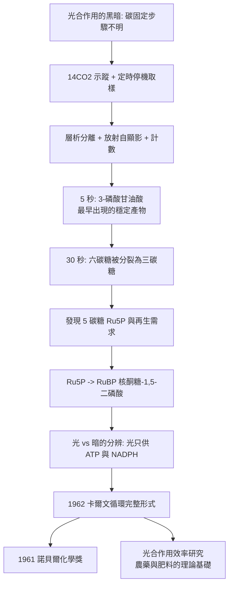

# 1961 · 卡爾文與光合作用的暗房

> 1961 諾貝爾化學獎：梅爾文·卡爾文（Melvin Calvin，1911–1997，美國）——表彰「其對光合作用中二氧化碳同化過程的研究」。他把光合作用的「黑箱」拍成一張逐步可行的反應圖，並因此得到一張「各元素的價格表」。

## 懸案（案情提要）

1950 年代的生物化學，有一樁人人皆知、卻無人能說清的龐大反應：

- **光合作用**是地球上幾乎一切生物質的來源，也是大氣氧氣的來源；
- 但它的「總反應式」早已寫在教科書上（$6\,\mathrm{CO_2} + 6\,\mathrm{H_2O} \to \mathrm{C_6H_{12}O_6} + 6\,\mathrm{O_2}$），**中間步驟卻是一片黑暗**；
- 具體的問題如刀：**碳原子在何處被「固定」？**是直接變成糖（一次反應），還是經過一系列中間物？第一次固定產物是什麼？循環是線性的還是環狀的？**光與 ATP 在哪一步介入？**
- 這些不是抽象問題：光合作用的效率決定人類文明的糧食上限（見 [1945-維爾塔寧與飼料保存](1945-維爾塔寧與飼料保存.md) 的農業化學），而其機制的理解還牽涉到 1960 年代的「世界糧食革命」。

偵辦人：梅爾文·卡爾文。他與其同事在芝加哥的放射化學實驗室裡，用**放射性二氧化碳的示蹤**，在幾分鐘之內把這條碳的旅程逐步拍下來。

## 前因

| 年份 | 事件 |
| --- | --- |
| 1911 | 卡爾文生於密蘇里州聖保羅；父為移民自以色列來的牙醫。 |
| 1931 | 於密西根州立大學取得化學學士，1935 年於芝加哥大學取得博士學位（師從摩爾（Mohr）——微量分析的領域先驅，見 [1923-普雷格爾與微量分析](1923-普雷格爾與微量分析.md)）。 |
| 1935–1937 | 芝加哥大學化學系講師；研究**鈷配位化合物（維生素 B$_{12}$ 與金屬配位化學）**，並在加州理工學院（Caltech）取得博士學位（導師 W. C. Cooper，後來成為鈷配位化學的奠基人之一）。 |
| 1937–1946 | 加州理工學院研究員；與 C. H. 格林（Green）以**同位素追蹤植物的光合作用**，首次證明碳固定路徑的某些步驟。 |
| 1946 | 加入芝加哥大學（**曼哈頓計畫的鈈計畫主持人之一**，即芝加哥大學冶金實驗室第 3 號實驗室）。 |
| 1950 | 開發**放射性紙層析（radioautography）與紙層析／放射性計數的組合**，把「追蹤 + 分離 + 計數」熔為一體。 |
| 1950–1957 | 與安格森（Andrew Angerson）、巴西（Bassham）、哈默（Hammer）合作，**以 $^{14}\mathrm{CO_2}$ 追蹤單細胞藻類（小球藻）光合作用**，逐步鑑定碳固定的中間產物。 |
| 1954 | 發表《碳在光合作用中的同化路徑》（*The Path of Carbon in Photosynthesis*）的第一篇。 |
| 1961 | 獲諾貝爾化學獎。 |
| 1962 | 與同事發表著名的**「卡爾文循環」**（Calvin–Benson cycle）的完整形式。 |
| 1960s–70s | 發展「**機器人化學家**」（robotic chemist）計畫（1960s 起的「化學家計畫」，讓儀器自動做實驗）——這是「自動化實驗室」的先驅。 |
| 1997 | 逝於加州。 |

## 調查

**偵查一：示蹤的第一招——停機取樣。**

卡爾文的策略極為簡潔：給藻類餵 **$^{14}\mathrm{CO_2}$**（放射性的二氧化碳），在**不同的時間點**（例如 5 秒、30 秒、5 分鐘）**突然停止光照與反應**，然後立刻把細胞「凍結」在當下的狀態（用沸甲醇抽取，迅速kill住酵素），再分析樣品中有哪些被標記的中間產物。

$$\text{時間越短} \Rightarrow \text{被標記的產物越「早」} \quad (\text{越接近碳固定的入口})$$

**這是「快照序列法」（chronocurrents）的經典應用**——用時間維度取代空間維度，把一條反應路徑「拍成一串電影」。

**偵查二：把分離與計數結合——紙層析 $\times$ 放射性計數。**

問題：一張層析紙上有很多斑點，如何知道哪個斑點含 $^{14}\mathrm{C}$？卡爾文的解法：

1. 層析分離產物（依 [1952-馬丁與層析法](1952-馬丁與層析法.md) 的原理）；
2. **用放射自顯影（radioautography）**：把紙片貼在 X 射線膠片上，曝露數天，顯影後**帶放射性的斑點會在膠片上留下黑點**——**標記位置一目了然**；
3. 再把對應的斑點刮下、燃燒、製成計數樣品，用計數管**測放射性強度**（定量）。

$$\text{層析分離} \to \text{自顯影定位} \to \text{刮下} \to \text{燃燒} \to \text{計數} \to \text{比活度}$$

**這套「三合一」的追蹤技術，是 20 世紀生物化學最有力的武器之一**，並被後來的同位素實驗（例如 1955–60 年代的膽固醇、脂肪酸生物合成研究）廣泛沿用。

**偵查三：逐步逼近——「最早出現的產物就是入口」。**

實測的時間序列（比活度對時間的變化）：

| 時間 | 主要標記產物 | 解讀 |
| --- | --- | --- |
| 5 秒 | **3-磷酸甘油酸（3-PGA）** | **碳固定的「第一個穩定產物」** |
| 30 秒 | 3-PGA + 丙糖磷酸 + 其他六碳糖磷酸 | 六碳糖被分裂為三碳糖 |
| 5 分鐘 | 各種三碳、四碳、五碳、六碳糖磷酸 + 蔗糖、澱粉 | 碳被分配到各種糖 |
| 更長 | 胺基酸、脂肪酸、蛋白質等 | 碳進入更廣的代謝網 |

**關鍵推論**：3-PGA 是**最早**出現的穩定產物（它出現得最快、且比活度在最初幾秒內最高）——因此它是碳固定的第一步產物；而六碳糖是**後來**由三碳糖「組裝」而成的。這顛倒了當時的直覺（當時人們以為碳先變成糖）。

**偵查四：三碳糖的命運——R5P 與 RuBP。**

繼續追蹤，卡爾文發現：

1. 5 碳糖（**核酮糖-5-磷酸，Ru5P**）的存在，提示一條**再生**路徑：必須有物質被「補回」，循環才能持續；
2. 在無光條件下（只有 ATP 與 NADPH、不給光），5 碳糖的再生仍會進行——**說明這一步不直接需要光**；
3. 用 $^{14}\mathrm{C}$ 標記並在不同時間點分析，證實 **Ru5P → RuBP（核酮糖-1,5-二磷酸）** 是再生路徑的關鍵中間物。

**偵查五：繞過碳固定的第一個障礙——光的方向。**

卡爾文用兩種方式確定「光」作用在哪一步：

1. **停止光但提供 ATP 與 NADPH**（見下）→ 碳固定仍進行；
2. **提供光但不給 ATP/NADPH**（用 DCMU 抑制光磷酸化）→ 碳固定立即停止。

**結論：光的作用是產生 ATP 與 NADPH；碳固定本身不直接需要光。**這就把光合作用拆成兩大系統：

$$\underbrace{\text{光反應（光能} \to \text{ATP + NADPH）}}_{\text{類囊體膜}} + \underbrace{\text{暗反應（卡爾文循環）}}_{\text{葉綠體基質}}$$

**「光反應／暗反應」的術語即出自此（後來被認為不夠精確，改稱光反應與碳同化反應）。**

## 理論裁決

**判決一：卡爾文循環——碳的三段旅程。**

$$\underbrace{\mathrm{CO_2} + \mathrm{RuBP}}_{\text{固定}} \xrightarrow[\mathrm{Rubisco}]{\text{羧化}} \underbrace{2\times 3\text{-PGA}}_{\text{還原}} \xrightarrow[\mathrm{ATP,NADPH}]{} \underbrace{2\times \text{G3P}}_{\text{再生}} \xrightarrow[\mathrm{ATP}]{} \underbrace{\mathrm{RuBP}}_{\text{再生，循環閉合}}$$

三個階段的化學：

1. **羧化（固定）**：核酮糖-1,5-二磷酸（RuBP，$\mathrm{C_5}$）與 $\mathrm{CO_2}$ 在 **RuBisCO** 催化下生成不穩定的六碳中間物，随即裂解為兩分子 3-磷酸甘油酸：

$$\mathrm{RuBP} + \mathrm{CO_2} + \mathrm{H_2O} \xrightarrow{\mathrm{RuBisCO}} 2\,\mathrm{3\text{-}PGA}$$

2. **還原**：3-PGA 磷酸化並被 NADPH 還原為甘油醛-3-磷酸（G3P）：

$$\mathrm{3\text{-}PGA} + \mathrm{ATP} \xrightarrow{} \mathrm{1,3\text{-}BPG} + \mathrm{ADP}; \qquad \mathrm{1,3\text{-}BPG} + \mathrm{NADPH} \xrightarrow{} \mathrm{G3P} + \mathrm{P_i} + \mathrm{NADP^+}$$

3. **再生**：G3P 的一部分被重排、磷酸化為 RuBP，循環閉合：

$$5\,\mathrm{G3P} + 3\,\mathrm{ATP} \xrightarrow{} 3\,\mathrm{RuBP} \ (\text{再生})$$

**判決二：能量與還原力的收支表。** 卡爾文循環的化學計量給出了光合作用的「帳本」：

$$\underbrace{3\,\mathrm{CO_2}}_{\text{固定}} + \underbrace{9\,\mathrm{ATP}}_{\text{再生與還原}} + \underbrace{6\,\mathrm{NADPH}}_{\text{還原力}} \xrightarrow[\text{光反應}]{\text{光能}} \underbrace{\mathrm{G3P}}_{\text{淨產物}} + 9\,\mathrm{ADP} + 6\,\mathrm{NADP^+} + 3\,\mathrm{P_i}$$

**「每固定 3 個 $\mathrm{CO_2}$ 需要 9 ATP 與 6 NADPH」**——這是光合作用效率的定量標準，也是後來比較 C3 植物（卡爾文循環）與 C4 植物、 CAM 植物的化學基礎（C4 的濃縮 $\mathrm{CO_2}$ 機制正是為了減少 RuBisCO 的光呼吸損失）。

**判決三：碳同化與光反應的分工。** 本案最深刻的結構性結論：

$$\text{光合作用} = \underbrace{\text{光反應（把光能變成 ATP 與 NADPH）}}_{\text{電子傳遞 + 光磷酸化}} + \underbrace{\text{碳同化循環（把 ATP/NADPH 變成糖）}}_{\text{卡爾文循環}}$$

**這套「能量轉換」與「碳還原」的分工，是理解所有光合細胞（植物、藻類、藍綠菌）共同架構的框架**；1988 年的諾貝爾化學獎（光合作用反應中心結構，見 [1988-光合作用反應中心](1988-光合作用反應中心.md)）正是把「光反應」那一半的結構拍下來。

**判決四：生命元素的「價格表」。** 卡爾文循環的副產品是一張驚人的原子經濟學表：**每合成一克葡萄糖，需要 6 莫耳 $\mathrm{CO_2}$、6 莫耳 $\mathrm{H_2O}$ 與 12 莫耳光子**：

$$\mathrm{6\,CO_2} + 12\,H_2O \xrightarrow{\text{光}} \mathrm{C_6H_{12}O_6} + 6\,O_2 + 6\,H_2O$$

$$\text{光子數} = 12\ (\text{每分子葡萄糖}), \qquad \text{量子效率} \approx 12\ (\text{理想值})$$

**這張「元素的價格表」說明：光合作用的瓶頸不是碳（碳來自空氣，無限），而是能量與酵素速率。**它也讓「提高光合效率」的工程努力有了明確的目標：讓更多光子打到葉片、減少光呼吸（C4/CAM）、提高 RuBisCO 的周轉率。

## 後果

| 領域 | 影響 |
| --- | --- |
| 農業 | 光合作用的化學機制成為 1960 年代「世界糧食革命」的理論背景（育種、施肥、灌溉、CO$_2$ 施肥的原理）；綠色革命的品種改良目標即在此框架下。 |
| 生化學 | 示蹤＋層析＋自顯影的組合方法成為生物化學的標準技術；卡爾文的「機器人化學家」計畫（1960s）開自動化實驗室之先河。 |
| 碳循環科學 | 卡爾文循環定量化了海洋與陸地碳吸收（全球碳循環模型的核心過程之一），是今日氣候模型的基礎。 |
| 酶學 | RuBisCO 的世界是植物中最豐富的蛋白質（含量可達葉片的 30–50%），也是蛋白質結構與功能研究的極佳模型（1990–2000 年代大量關於其催化機制與「開/閉」構象的研究）。 |
| 科學制度 | 卡爾文是「科學家—公共政策」型人物（反核、倡導環境科學），也是諾貝爾獎得主中少數以「手工式實驗方法」獲獎者——他的實驗室至今被描述為「手工的、未被電腦污染的」。 |

## 關聯

- [1923-普雷格爾與微量分析](1923-普雷格爾與微量分析.md)：卡爾文的博士導師 W. C. Cooper 是微量分析的推進者；定量的紀律一脈相承。
- [1943-德海韋西與同位素示蹤](1943-德海韋西與同位素示蹤.md)：示蹤法的建立；卡爾文把它用在了光合作用的碳流上。
- [1952-馬丁與層析法](1952-馬丁與層析法.md)：層析是卡爾文分離中間產物的工具。
- [1929-哈頓與發酵化學](1929-哈頓與發酵化學.md)：卡爾文循環的步驟與糖解途徑驚人地互為逆反應——同一套中間物（3-PGA、G3P、ATP、NADPH），方向相反。
- [1988-光合作用反應中心](1988-光合作用反應中心.md)：光反應那一半的結構被 X 射線拍下，與卡爾文循環合為完整的光合作用模型。
- [1995-克魯岑與臭氧層](1995-克魯岑與臭氧層.md)：大氣化學的另一支，同屬「全球循環」的化學。
