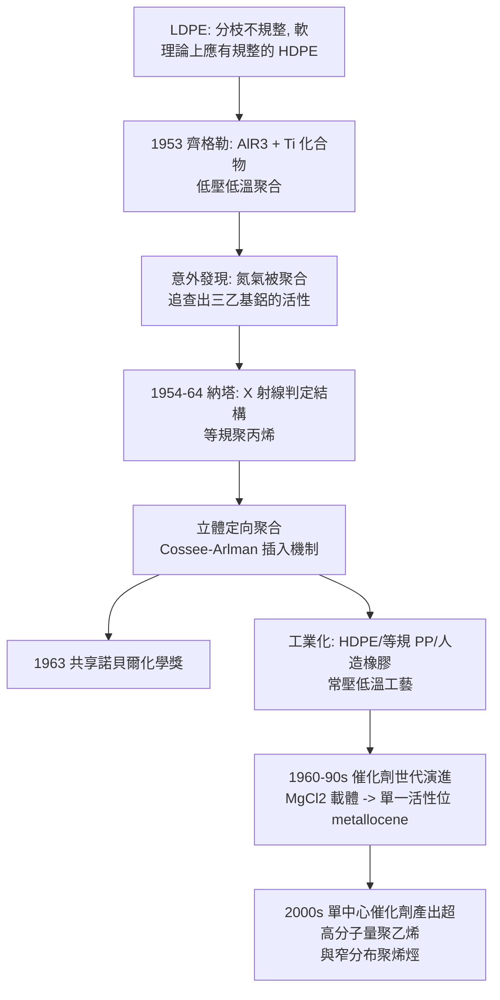

# 1963 · 齊格勒與納塔——把形狀裝進塑膠裡

> 1963 諾貝爾化學獎：卡爾·瓦爾德馬·齊格勒（Karl Waldemar Ziegler，1898–1973，德國）與朱利奧·納塔（Giulio Natta，1903–1979，義大利）——表彰「其對聚合物的發現與開發」。兩人讓「不規整」的塑膠變成可以「量身訂做」的 crystalline 材料。

## 懸案（案情提要）

1950 年代的塑膠工業有一個尷尬的現實：

- **聚乙烯（PE）**在 1930 年代由ICI 以高壓法（$1000$–$3000\ \mathrm{atm}$、$200$–$300\,^\circ\mathrm{C}$）製成，簡稱「LDPE」——它是**分枝的、不規則的**，因而柔軟、半透明、密度低；
- 但理論上，**乙烯單體若能「頭對頭」直線聚合**，會得到**完全規整的結晶型聚乙烯（HDPE）**——密度更高、更硬、更堅韌；
- 同樣的問題存在於**聚丙烯**：丙烯的單體有「左右手」（$R/S$ 構型），若能讓它們**全部朝同一邊**，就得到**等規（isotactic）聚丙烯**——強度極高、可以拉成纖維；
- 但當時的聚合方法（自由基聚合）**無法控制立體化學**——聚合物的立體結構是「隨機」的，性能因此難以提升。

懸案的本質：**能不能造一個催化劑，讓單體「排隊」按指定的方式接上去？**

偵辦人：齊格勒（德國米爾海姆，Max Planck 煤研究所）與納塔（義大利米蘭理工學院）。

## 前因

| 年份 | 事件 |
| --- | --- |
| 1898 | 齊格勒生於德國哈爾；父為聖經學者。 |
| 1920s | 於哈爾大學研究有機化學；1925 年在法爾克（Falk）的推薦下加入米爾海姆的 Max Planck 煤研究所；研究**自由基反應**（這是他後來發現催化劑的化學訓練）。 |
| 1930s | 研究**大環化合物**（環十五到環三十的環酮與環烯，著名的「環狀聚合體」研究，與魏爾納的配位化學同源）；並開始研究**金屬有機化合物**（如 $\mathrm{AlR_3}$、$\mathrm{LiR}$）——這是催化劑的化學基礎。 |
| 1940s | 戰時研究煤的液化解構與費托合成（見 [1931-博施與貝吉烏斯](1931-博施與貝吉烏斯.md)）。 |
| 1953 | **發現鈦化合物 + 鋁有機物的催化體系**：在低壓低溫下即可使乙烯聚合，且產物為**規整的高密度聚乙烯**。這是催化劑史上的轉捩點。 |
| 1954 | 與霍夫曼（Höhm）發表；專利涵蓋廣泛。 |
| 1955 | 齊格勒因發現鈦催化劑獲德國化學會的會士獎。 |
| 1954–1964 | 納塔在米蘭理工學院（與費羅（Felici）合作）系統研究**立體定向聚合**：1954 年首次製得**等規聚丙烯**（這是天然橡膠結構的完全合成版），並提出「等規」「間規」「無規」三種立體結構的分類與命名。 |
| 1963 | 兩人共享諾貝爾化學獎。 |
| 1964 | 納塔因心臟病逝於米蘭；齊格勒 1973 年逝於烏爾斯多夫。 |

## 調查

**偵查一：發現的起點——一次「意外的聚合」。**

1953 年，齊格勒在研究 $\mathrm{Al(C_2H_5)_3}$（三乙基鋁）與鈦化合物反應時，注意到：**整個反應器裡的氮氣都被聚合成了固體**。追查之下發現，是殘留的 $\mathrm{Al(C_2H_5)_3}$ 引發了乙烯的聚合。

這個「意外」揭示了關鍵：**三乙基鋁本身就能催化聚合**（這是後來齊格勒催化劑的活性組分之一）。但更重要的追問是：**產物的結構是什麼？**

**偵查二：結構的判讀——「規整」與「不規整」。**

納塔在米蘭實驗室用**X 射線繞射**研究這些新聚合物的結構：

$$\text{聚丙烯的三種立體結構：}$$

| 類型 | 說明 | 性質 |
| --- | --- | --- |
| **等規（isotactic）** | 全部 $\mathrm{-CH_3}$ 在主鏈**同一側** | **結晶性高、密度高、強度大** |
| **間規（syndiotactic）** | 甲基左右交替 | 結晶性中等 |
| **無規（atactic）** | 甲基隨機排列 | **無結晶性、軟、黏** |

**關鍵發現**：三乙基鋁 + $\mathrm{TiCl_4}$ 的催化體系產出的是**等規聚丙烯**——這是化學家第一次**控制聚合物的立體化學**。

$$\text{立體定向聚合} \equiv \text{讓單體以固定的立體面接入鏈}$$

**偵查三：催化劑的解剖——雙金屬活性位。**

齊格勒—納塔催化劑的組成為：

$$\text{金屬有機化合物（}\mathrm{AlR_3}\text{）} + \text{過渡金屬鹵化物（}\mathrm{TiCl_4}\text{、}\mathrm{TiCl_3}\text{）}$$

催化循環的骨架（**Cossee–Arlman 機構**，1960 年代提出）：

$$\begin{aligned}
\text{① 活性位生成：} &\quad \mathrm{TiCl_3} + \mathrm{AlR_3} \to \mathrm{Ti{-}R}\ (\text{或}\ \mathrm{Al{-}R}) \\
\text{② 配位與插入：} &\quad \mathrm{CH_2{=}CHR} + \mathrm{Ti{-}R} \to \mathrm{Ti{-}CH_2{-}CHR} \\
\text{③ 插入鏈增長：} &\quad \mathrm{Ti{-}(CH_2{-}CHR)_n{-}R} + \mathrm{CH_2{=}CHR} \to \mathrm{Ti{-}(CH_2{-}CHR)_{n+1}{-}R} \\
\text{④ 鏈轉移/終止：} &\quad \mathrm{H_2}\ \text{或單體}\ \text{介入}
\end{aligned}$$

**立體定向性的來源**：在插入時，單體必須以固定的「面」（si 面或 re 面）進入，因此每一步都給出同樣的立體化學——**像一條拉鍊，每一環都朝同一邊扣上**。

**偵查四：工業化——從實驗室到万吨級工廠。**

納塔的發現立刻被義大利的 Montecatini 工業化（繼而是 ICI、Shell、BASF 等），產出：

- **HDPE**（高密度聚乙烯）：剛性、強度高、做塑膠袋、桶、管材；
- **等規聚丙烯**：可拉成纖維（丙絲）、做汽車件、家電外壳；
- **立體規整的合成橡膠**：**等規聚異戊二烯＝天然橡膠的完全人造版**（此前的「合成橡膠」（如 Buna）性能遠不如天然）；
- **低壓工藝**：齊格勒—納塔法只需**常壓到數十個大氣壓、$50$–$80\,^\circ\mathrm{C}$**，而傳統高壓法需要 $1000$–$3000\ \mathrm{atm}$、$200$–$300\,^\circ\mathrm{C}$——**能耗與設備成本大降**。

**偵查五：技術的擴散——被稱為「聚烯烴革命」。**

這套方法在 1960–70 年代迅速擴展：

- $\mathrm{TiCl_3}/\mathrm{AlR_3}$ → 之後的 $\mathrm{TiCl_4}/\mathrm{MgCl_2}$（高收率催化劑）；
- 1967 年之後的**第二代、第三代催化劑**（以 $\mathrm{MgCl_2}$ 載體、$\mathrm{TiCl_4}$ 為活性中心，並加入 $\mathrm{SiO_2}$ 與第三組分 $\mathrm{Et_3Al}$ 或 $\mathrm{MAO}$）；
- 1990 年代的**單一活性位催化劑**（Dow 的 INSITE 單中心催化劑、Univation 的 metallocene）——把立體控制推到「每個活性位都一樣」的程度。

## 理論裁決

**判決一：立體定向聚合的機構。** 立體定向性的物理來源是**活性位的幾何限制**：

$$\text{單體以固定面（si/re）接近} \Rightarrow \text{每次插入的立體化學相同} \Rightarrow \text{等規鏈}$$

這意味著：**等規聚丙烯不是「運氣好」的產物，而是被催化劑的立體位所「強迫」的結果。**這是 20 世紀化學「設計催化劑」最成功的範例。

**判決二：聚合反應的雙重控制——立體 + 分子量。** 工業催化劑必須同時控制：

| 控制目標 | 手段 | 產業意義 |
| --- | --- | --- |
| 立體規整性 | 活性位的立體環境（$\mathrm{Ti}$ 的配位幾何） | 決定結晶性與強度 |
| 分子量 | 鏈轉移速率（$\mathrm{H_2}$、單體、$\mathrm{AlR_3}$） | 決定熔融指數與加工性 |
| 活性 | 活性中心數與立體環境 | 決定產率與生產成本 |

**「可設計的催化劑」這個概念在此成熟**——從齊格勒開始，催化劑設計成為化學工程的核心技術。

**判決三：材料的性能來自結構。** 等規聚丙烯的性質可由其結構直接解釋：

$$\text{等規鏈} \to \text{螺旋構象} \to \text{可堆疊成} 3_1\ \text{螺旋} \to \text{結晶} \to \text{高密度 } (0.92\ \mathrm{g/cm^3})\ \text{與高強度}$$

相較之下，無規聚丙烯無法堆疊，密度低、軟、只能做低值產品。**「立體化學＝性能」的等式，是高分子科學的核心命題之一。**

**判決四：經濟地理學的後果。** 齊格勒—納塔技術的工業化改變了全球化工版圖：義大利 Montecatini（後成為 Montedison）與德國、美國大廠在烯烴聚合上展開競賽，帶動中東（以廉價乙烷與石腦油為原料）成為新的塑膠出口中心。今日全球年產聚烯烴逾 2 億噸，是僅次於石油與鋼鐵的龐大產業。

## 後果

| 領域 | 影響 |
| --- | --- |
| 塑膠工業 | HDPE、LDPE、PP、聚丁烯、ABS 家族；包裝（塑膠袋、飲料瓶）、汽車（保險桿、汽油箱）、建材（管材）、家電的外殼——**現代生活的物質基礎**。 |
| 合成橡膠 | 等規聚異戊二烯提供了與天然橡膠性能相當（甚至更佳）的替代品，徹底改變輪胎與橡膠工業的格局。 |
| 纖維 | 丙絲（等規聚丙烯纖維）成為低成本紡織纖維。 |
| 催化劑科學 | 「可設計的催化劑」典範：之後的**烯烴複分解**（見 [2005-格拉布與烯烴複分解](2005-格拉布與烯烔複分解.md)）、**手性催化**（見 [2001-諾爾斯與手性催化](2001-諾爾斯與手性催化.md)）、**交叉偶聯**（見 [2010-赫克與鈀催化偶聯](2010-赫克與鈀催化偶聯.md)）皆沿此傳統。 |
| 科學制度 | 齊格勒（Max Planck 煤研究所）與納塔（米蘭理工）分別代表國立研究所與工業實驗室的合作模式——**「工業實驗室做基礎研究」的典範**，這也是義大利化學在 1950–60 年代的崛起契機。 |

## 關聯

- [1931-博施與貝吉烏斯](1931-博施與貝吉烏斯.md)：高壓煤化工提供烯烴原料；齊格勒的煤研究所正是同一體系。
- [1939-布特南特與魯日奇卡](1939-布特南特與魯日奇卡.md)：異戊二烯規則——等規聚異戊二烯是天然橡膠（$\mathrm{C_5}$ 單元）的完全人造版。
- [1953-施陶丁格與高分子](1953-施陶丁格與高分子.md)：大分子概念的建立，是「立體規整聚合」的前提。
- [2005-格拉布與烯烴複分解](2005-格拉布與烯烔複分解.md)：金屬碳烯催化劑——齊格勒—納塔「雙金屬活性位」思想的另一支。
- [2023-量子點](2023-巴文迪與量子點.md)：聚合反應所建立的有機合成與材料加工能力，是奈米材料時代的技術底層之一。
