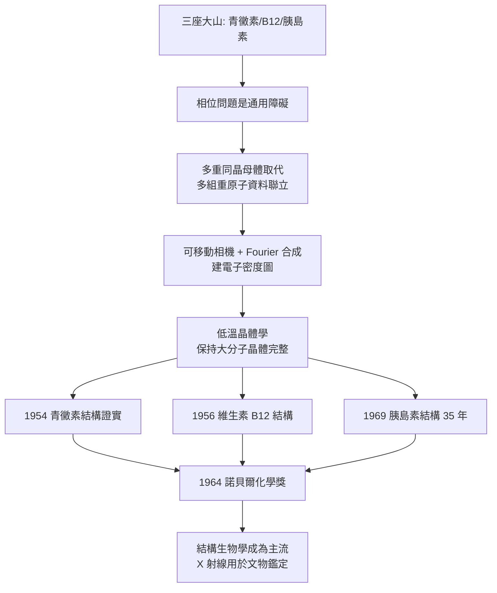

# 1964 · 霍奇金與 X 射線的三十年

> 1964 諾貝爾化學獎：多蘿西·瑪麗·克勞芙特·霍奇金（Dorothy Mary Crowfoot Hodgkin，1910–1994，英國）——表彰「其以 X 射線決定生物化學上重要物質之結構的成就」。她把青黴素、維生素 B$_{12}$、胰島素一一拍成照片，是史上首位獲諾貝爾化學獎的女性（也是第三位諾獎女性）。

## 懸案（案情提要）

1960 年代的結構生物學面對三座「大山」：

1. **青黴素（penicillin）**：1945 年由弗萊明、弗洛里（Florey）與 Chain 發現其抗菌作用，1948–54 年間 Chain 與 Abraham 提出了結構假說（並申請了專利）。**假說是否正確？**這個問題牽涉數百萬人的抗生素治療與一個值錢的專利官司。
2. **維生素 B$_{12}$**：結構極端複雜（分子式 $\mathrm{C_{63}H_{88}CoN_{14}O_{14}}$，含鈷的咕啉環），1930 年代被分離，卻無人能畫出結構。
3. **胰島素**：序列已在 1958 年由桑格讀出（見 [1958-桑格與胰島素序列](1958-桑格與胰島素序列.md)），但三維結構仍不可知。

而 X 射線結構測定本身的技術門檻極高：**相位問題**（見 [1962-佩魯茨與血紅蛋白](1962-佩魯茨與血紅蛋白.md)）尚未有通用解法；生物分子難以結晶；「重原子法」對不含重原子的天然產物無從下手。

偵辦人：多蘿西·霍奇金。她花了**三十五年**在同一個目標上（胰島素），並且發展出一套處理生物大分子的 X 射線技術。

## 前因

| 年份 | 事件 |
| --- | --- |
| 1910 | 霍奇金生於牛津（考古學家父親的女兒，家族中著名的學術環境）。 |
| 1928–1931 | 牛津大學化學系；1928 年與 J. D. 伯NAL（J. D. Bernal）合作研究**胃蛋白酶的 X 射線結構**——生物大分子的第一張 X 射線衍射照片（雖然當時無法解出結構）。 |
| 1932 | 前往劍橋，在 J. D. 伯納爾的實驗室工作；1934 年回到牛津，與 J. D. 伯納爾的生物化學實驗室建立合作。 |
| 1930s–40s | 研究**甾體、維生素 D、盤尼西林**，並把 X 射線方法推到應用極限：她發明了**可移動的相機底片技術**，讓衍射照片能以多個角度拍攝以重建三維結構。 |
| 1948–1957 | 與 E. P. Abraham（結構假說）、R. 羅賓遜（R. Robinson）、牛津的 E. F. 羅森（E. F. R. S.）等合作研究青黴素結構；1949 年發表初步結果，1954 年完成**青黴素結構的 X 射線證實**。 |
| 1950s | 發展處理**生物大分子**的技術：低溫晶体學（在低溫下保持晶體穩定）、多個同晶母體（multiple isomorphous replacement）等。 |
| 1956 | **維生素 B$_{12}$ 的結構**（與同事合作，含鈷的咕啉環結構確定）——這是化學史上結構測定最艱難的案例之一。 |
| 1964 | 獲諾貝爾化學獎（1964 年 12 月頒發）。 |
| 1969 | **胰島素結構完成**——歷時 35 年，與同事布拉德利（Guy Dodson）合作，解析度 2.8 Å。 |
| 1970s–90s | 創建牛津的「**分子生物學研究所**」，培育了包括麥克唐納（McDonald）等人；推動化學家與考古學家的合作（用 X 射線分析古畫與雕塑的顏料層）；1987 年以「Crystalkemi」一書向大眾普及 X 射線結構測定。 |

## 調查

**偵查一：相位問題的通用解法——多重同晶母體。**

在生物大分子上，佩魯茨式的「單一重原子」往往不可行（天然產物不含重原子），霍奇金發展的解法是**多重同晶母體取代（multiple isomorphous replacement）**：用**同一個晶體**，以**多種不同的重原子衍生物**（如分別以 $\mathrm{Pb^{2+}}$、$\mathrm{Ag^{+}}$、$\mathrm{Au^{3+}}$ 等處理），取得多組相位資訊，再聯立求解：

$$F_{\text{native}},\ F_{1},\ F_{2},\ F_{3} \;\Longrightarrow\; \phi(hkl)\ \text{（唯一解）}$$

**這是生物大分子結構測定能夠普及的關鍵技術**，今日結構生物學的重原子相位法（MR、SAD、MAD）皆由此演進。

**偵查二：可移動相機——把「一張照片」變成「三維資料」。**

X 射線繞射照片只給出反射斑點的位置與強度；重建三維結構需要**多個方向的衍射資料**。霍奇金的改良：**把相機底片固定在晶體的各个已知方向上逐一曝光**，再以**傅立葉合成**把各方向的資料合併：

$$\rho(x,y,z) = \frac{1}{V}\sum_h |F(h)|^2 \cos\!\left[2\pi(hx+ky+lz) - \phi(h)\right] e^{-2B(h^2+h^2+k^2+l^2)}$$

**這就是今日電子密度圖的生成原理**——霍奇金把它用在了生物大分子上。

**偵查三：低溫——保持蛋白質晶體的「活著」的狀態。**

蛋白質晶體在室溫下容易變性或脫水。霍奇金發展低溫技術：**在低溫下收集衍射資料**（液氮/液氫冷卻），使晶體保持完整：

$$\text{低溫} \to \text{減少分子運動} \to \text{減少熱運動擾動} \to \text{電子密度圖更清晰}$$

**「低溫晶體學」是今日結構生物學實驗室的標準配備**。

**偵查四：三座大山的攻頂。**

| 目標 | 年份 | 難度 |
| --- | --- | --- |
| **青黴素** | 1949 初步、1954 完成 | 首次用 X 射線直接「看到」藥物分子，並證實 Chain–Abraham 的結構假說 |
| **維生素 B$_{12}$** | 1956 | 含鈷咕啉環，結構極複雜；需多方合作 |
| **胰島素** | 1969（歷時 35 年） | 多次結晶嘗試、大量衍射資料收集、計算機能力不足時期的手工 Fourier 合成 |

**胰島素的案例最能說明「工作量」這個維度**：霍奇金在 1930 年代末就取得第一批胰島素晶體，但直到 1960 年代，**計算機的算力**才足以處理如此龐大的 Fourier 合成。三十五年的等待，一半是化學，一半是儀器。

**偵查五：把 X 射線帶出實驗室。**

霍奇金最著名的「跨界」工作，是用 X 射線分析**藝術品與考古文物**：她與美術史家與考古學家合作，以 X 射線繞射與螢光分析研究名畫的顏料層——例如辨認出某些名畫中後來被改動的痕跡、或確認某幅作品的真偽。

$$\text{颜料} \xrightarrow{\text{X 射線}} \text{晶相 + 元素組成} \xrightarrow{} \text{年代與真伪}$$

**「用物理方法讀出材料的歷史」——這正是她整個生涯的方法論。**

## 理論裁決

**判決一：電子密度圖——結構的「客觀照片」。** 霍奇金的核心貢獻不是某一個結構，而是**讓結構可以「被看見」**：

$$\rho(\mathbf{r}) \;\text{是電子分佈的三維函數} \quad\text{（Fourier 逆變換）}$$

當 $\rho$ 圖上的「棒狀密度」能與化學鍵長（$1.1$–$1.5\ \text{Å}$）與鍵角對上時，結構即被確定。**這套判讀規則至今不變**——結構生物學家讀圖的方式，與霍奇金 1950 年代的讀法在本質上相同。

**判決二：結構判定的「統計性」標準。** 霍奇金時代建立的判據：

$$\text{可接受的結構} \iff \text{與衍射資料一致} + \text{化學上合理} + \text{立體化學上可能}$$

1960–70 年代的「結構可信度分級」（well-determined / partly determined / tentative）即源於此——**這是科學上把「不確定」寫進判詞的先例**。

**判決三：X 射線的跨界威力。** 霍奇金把 X 射線從「生物化學工具」變成「通用材料鑑識法」：

$$\text{晶體} \xrightarrow{\text{繞射}} \text{結構} \quad\text{適用於：蛋白質、藥物、顏料、礦物、金属、聚合物}$$

**今日的文物保護、珠寶鑑定、藥品晶型研究（ polymorphs 影響藥物溶解度與專利）**，都是這條跨界路線的延伸。

**判決四：科學事業的組織典範。** 霍奇金的胰島素工作揭示了結構生物學的真實樣貌：**它不是靈光一現，而是一場以「年」為單位的耐力賽**——需要穩定的樣品（胰島素需從豬牛胰臟大量提取並純化）、反覆的結晶嘗試、長期的資料累積、以及（1960 年代）計算機的到位。她的案例後來成為科學資助政策的論據：基礎研究的成果需要**數十年級的持續支持**。

## 後果

| 領域 | 影響 |
| --- | --- |
| 結構生物學 | X 射線法成為蛋白質結構的主流方法；1960–80 年代的結構大爆發（肌紅蛋白、血紅蛋白、溶菌酶、胰島素、免疫球蛋白）；最終催生結構組學與 PDB。 |
| 藥物 | 青黴素結構的 X 射線證實，直接支持了 Chain 與 Abraham 的專利立場（英國藥業的產業命脈）；藥物晶型研究（X 射線粉末衍射）成為仿製藥與原研藥的法規要求。 |
| 考古與藝術史 | 以 X 射線與顯微分析研究名畫顏料層、雕塑與器物；霍奇金的合作網絡讓物理學家、化學家、考古學家共享方法。 |
| 女性科學史 | 霍奇金是史上**首位獲諾貝爾化學獎的女性**（1964），第三位諾獎女性（繼居里夫人 1903、1911 之後）；1969 年成為英國皇家學會主席級別的科學家。她的傳記《Crystalkemi》使 X 射線結構測定成為公眾可理解的科學。 |

## 關聯

- [1930-漢斯費歇爾與血紅素](1930-漢斯費歇爾與血紅素.md)：維生素 B$_{12}$ 的咕啉環屬於卟啉家族——霍奇金解出的結構，正是漢斯·費歇爾所開啟的家族。
- [1946-薩姆納與酵素結晶](1946-薩姆納與酵素結晶.md)：蛋白質結晶是 X 射線結構的前提。
- [1958-桑格與胰島素序列](1958-桑格與胰島素序列.md)：胰島素的序列（1958）與結構（1969）是同一分子的兩次解讀。
- [1962-佩魯茨與血紅蛋白](1962-佩魯茨與血紅蛋白.md)：重原子法與相位問題的開端，霍奇金的技術是它的推廣與深化。
- [1965-伍德沃德與全合成](1965-伍德沃德與全合成.md)：結構與合成在同一時期交會——霍奇金的結構成果正是伍德沃德合成設計的依據。
- [2017-杜布歇與冷凍電顯](2017-杜布歇與冷凍電顯.md)：結構生物學的第二條技術路徑，補上了 X 射線無法處理的大分子。
