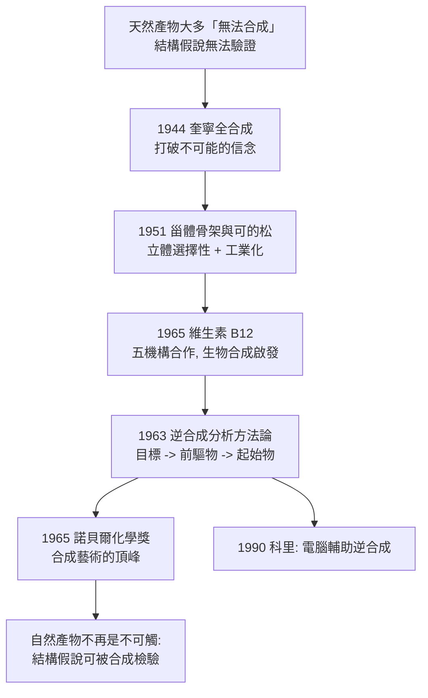

# 1965 · 伍德沃德與全合成——把自然界的難題抄了一遍

> 1965 諾貝爾化學獎：羅伯特·伯恩斯·伍德沃德（Robert Burns Woodward，1917–1979，美國）——表彰「其在有機合成藝術上的傑出成就」。他證明了合成化學不只是「做出來」，而是**「先想出來」**。

## 懸案（案情提要）

1950 年代的天然產物化學，藏著一個方法論上的隱形冠軍：**合成**。

- 人類已知數千種結構精巧的天然產物——**奎寧、嗎啡、番木鱗鹼、血紅素、維生素 B$_{12}$、葉綠素、前列腺素、甾體激素**——但其中大部分**從未被合成出來**；
- 不是不想，而是「做不到」：立體化學的控制、多官能基的相容性、環系的建構，每一步都可能失敗；
- 於是形成一個惡性循環：**不會合成，就無法用合成驗證結構；無法驗證結構，就永遠只是「猜對了」。**

懸案的具體形式：能不能挑戰最難的幾個分子——**維生素 B$_{12}$**（史上最難的自然產物之一）與**可的松**（醫藥史上最重要的合成里程碑）——並且**在結構尚未完全確定時就著手合成**？

偵辦人：羅伯特·伍德沃德。他不只做出來，他在合成前就以理論**預測**了結構與合成路徑，並且公開提出「**生物合成啟發的合成策略**」。

## 前因

| 年份 | 事件 |
| --- | --- |
| 1917 | 伍德沃德生於麻州波士頓；16 歲入 MIT（未高中畢業即入學），19 歲畢業（理學士）。 |
| 1936–1937 | 哈佛博士（導師 R. B. Woodward 在 J. H. C. 的美國）——博士論文即《環己烯酮的紫外光化學》（光化學與結構的關係），24 歲取得博士。 |
| 1937–1944 | 哈佛講師／助理教授；研究**奎寧的合成（1944）**——這是天然產物全合成的里程碑：**奎寧是歷史上第一個被全合成的藥物**（此前多數人甚至以為「合成奎寧不可能」）。 |
| 1948–1954 | 研究**甾體與萜烯的結構與合成**：完成**甾體骨架（環戊烷多氫菲）的建構**（1948–51），並合成**前列腺素**（與同事）、**皮質酮（可的松，1951 年首次合成）**。 |
| 1954 | 與其學生羅德·霍夫曼（Roald Hoffmann）開始分子軌域理論的合作研究；1955–63 年建立「保留軌域對稱性」的選擇定則。 |
| 1960–1965 | 與艾森莫瑟（Albert Eschenmoser）合作完成**維生素 B$_{12}$ 的全合成**（1965，跨五年的合作，被譽為「有機合成史上最艱巨的工作」）。 |
| 1965 | 獲諾貝爾化學獎。 |
| 1960s | 開發**反合成分析（retrosynthetic analysis）**方法論（1963 年發表），把合成設計系統化——1960 年代的「合成策略」教科書。 |
| 1979 | 逝於劍橋（時年 62）；留下《The Art of Organic Synthesis》手稿，1980 年出版。 |

## 調查

**偵查一：奎寧——打破「不可能」的信念。**

1944 年，伍德沃德與其同事完成奎寧的合成。路線的關鍵在於**選擇一條「非常規」的路線**：以**丁醛與自己合成的 3-甲基-2-丁烯醛（羰基合成）**做 Michael 加成、再以縮合（aldol）關閉 quinoline 環：

$$\text{鍵結策略} = \text{先建} \mathrm{C{-}C}\text{ 鍵、再關環（而非先造環再裝飾）}$$

**這件事的意義遠大於藥物本身**：它證明了天然產物不是「不可合成」的，並為後來的方法論（**逆合成分析**：由目標分子回推合成路徑）提供了第一個示範。

**偵查二：甾體骨架——把「四個環」拼起來的幾何學。**

1951 年伍德沃德完成**環戊烷多氫菲骨架（cyclopentanoperhydrophenanthrene）**的合成，這是全部類固醇、天然萜烯、維生素 D、膽酸的共同母核：

$$\underbrace{\text{六員環 A} + \text{六員環 B}}_{\text{由 Robinson 稠合得}} + \underbrace{\text{六員環 C} + \text{五員環 D}}_{\text{以 Diels–Alder 造，再接上}}$$

**策略的要點：用兩個已成熟的成環反應（Robinson 稠合、Diels–Alder 雙烯合成）分別造出兩塊，再接合**——見 [1950-迪爾斯與阿爾德](1950-迪爾斯與阿爾德.md) 與 [1947-羅賓遜與生物鹼的結構革命](1947-羅賓遜與生物鹼的結構革命.md)。**「把困難拆成幾個已解決的子問題」**是伍德沃德式合成思維的核心。

**偵查三：可的松——醫藥與合成互相成就的案例。**

1951 年伍德沃德完成**可的松（cortisone）的全合成**（與彼得森（Peterson）合作），此前可的松只能靠大量動物 adrenal cortex 提取，產量極低、價格高昂。

**這條路線的深遠影響**：
- 證明了類固醇骨架可用「立體選擇性」的方式建構（多步氫化、還原、消除）；
- 開啟了**甾體藥物的工業化**（今日的類固醇藥物年產量以千噸計）；
- 更重要的是——它揭示了一條「**用合成驗證生物學假說**」的路線：1950 年代「可的松能治療風濕性關節炎」的臨床發現（ Hench 的工作，1950 年諾貝爾醫學獎）激發了工業界的合成競賽，**合成與醫學在此互相推動**。

**偵查四：維生素 B$_{12}$——科學史上最艱巨的合成。**

1965 年完成的 B$_{12}$ 合成，涉及**五個研究所的數十名研究者、數千個步驟**，核心挑戰是「**A 環的位阻選擇性**」：要在鎂酞啉（corrin）環系的關鍵位置建立正確的立體中心。

**策略的關鍵是「生物合成啟發」**：伍德沃德沒有硬著頭皮硬做，而是研究維生素 B$_{12}$ 的**生物合成途徑**（此時已知其前驅物是卟啉類的氧化與甲基化），然後**用合成來模擬生物體的步驟**——特別是模仿酵素的「選擇性氧化」（用單位的氧化處理建立位阻控制的立體化學）。

$$\text{生物合成啟發的合成} \;:\; \text{先推想生物體如何做，再用化學做同一件事}$$

**這是 20 世紀合成化學最具智識性的一招**，也是他 1960 年代「逆合成分析」方法論的核心精神：**最好的合成路線，往往能在自然界找到對應物。**

**偵查五：逆合成分析——把合成變成可教、可學、可推理的方法。**

伍德沃德在 1963 年前後發展的方法論（與其同事及後人共同成型）：

$$\text{目標分子} \xrightarrow{\text{逆合成}} \text{前驅物} \xrightarrow{\text{逆合成}} \cdots \xrightarrow{\text{逆合成}} \text{可得的起始物}$$

**關鍵概念**：
- **合成子（synthon）**：在斷鍵處生成的假想碎片；
- **合成等價物（synthetic equivalent）**：實際可用的試劑；
- **官能基轉換**（FGI）、**環加成**、**重排**等逆合成「策略」；
- **「合成樹」的評估**：目標是找到**步數最少、收率最高、立體專一性最好**的路線。

這套方法在 1990 年被科里（Corey）系統化並引入**電腦輔助**（見 [1990-科里與逆合成分析](1990-科里與逆合成分析.md)），成為今日藥物合成化學的通用語言。

## 理論裁決

**判決一：合成即證據。** 伍德沃德的方法論核心是：

$$\boxed{\text{結構假說} \xrightarrow{\text{成功合成}} \text{被證實}; \quad \xrightarrow{\text{合成失敗}} \text{被推翻}}$$

這把結構化學從「事後描述」變成「事前預測 + 事後檢驗」的科學。維生素 B$_{12}$ 的合成尤其關鍵：因為**當時 B$_{12}$ 的完整結構尚未確定**，伍德沃德必須**先預測結構、再合成驗證**——這是「合成與結構研究互為裁判」的巔峰示範。

**判決二：合成策略的模組化。** 伍德沃德示範了幾個可重複使用的「策略」：

| 策略 | 內容 | 應用 |
| --- | --- | --- |
| **Robinson 稠合** | 以 Michael 加成 + aldol 關環造六員環 | 甾體 A/B 環、維生素 A |
| **Diels–Alder** | 雙烯 + 親雙烯體造六員環 | 甾體 C/D 環、前列腺素 |
| **位阻控制的立體化學** | 以大取代基「鎖定」立體中心 | 甾體的角甲基與側鏈立體化學 |
| **生物合成啟發** | 模擬生物體的步驟 | 維生素 B$_{12}$、前列腺素 |
| **官能基保護與策略性氧化** | 以單位的選擇性氧化建立立體中心 | B$_{12}$ 的 A 環 |

**「策略」這是關鍵詞**——它意味著合成不是靈感的產物，而是**可教、可學、可累積的技術庫**。

**判決三：選擇定則與合成的聯手。** 伍德沃德與霍夫曼（見 [1981-福井與前沿軌域](1981-福井與前沿軌域.md)）在 1960 年代建立的選擇定則，不僅解釋既有反應，更**預測新反應的可行性**：

$$\text{4n+2 電子的熱允許環加成（suprafacial–suprafacial）}\ \Longrightarrow\ \text{維生素 D 的光化學開環必然可行}$$

**「理論說不行，就別去試」**——這是合成化學從手藝走向科學的分水嶺。

**判決四：合成的經濟學——收率與步數。** 伍德沃德的方法論始終以「可實現」為判準：

$$\text{總產率} = \prod_{i=1}^{n} \text{步驟產率}_i$$

十步反應若每步 90%，總產率僅 $0.35$；每步 70%，總產率只剩 $0.03$。**因此「步數少」與「每步可靠」是合成設計的首要指標**——這也是逆合成分析以「最大公因子拆分（longest common sequence）」與「簡單性原則」為核心的原因。

## 後果

| 領域 | 影響 |
| --- | --- |
| 醫藥 | 甾體藥物工業（可的松、氫化可的松、避孕藥、性激素）、前列腺素、麻醉藥與抗癌藥的合成路線；「藥物設計」成為化學的主導模式。 |
| 結構化學 | 合成成為結構假說的裁判；天然產物的結構不再只能靠降解猜測。 |
| 方法論 | 逆合成分析成為有機化學的核心教學與研究工具，1990 年代由科里導入電腦輔助，2000 年代發展出「自動逆合成」與「AI 合成規劃」。 |
| 合成生物學 | 伍德沃德的「生物合成啟發」思想在 1990–2000 年代被重拾：**「以生物體的酵素取代化學步驟」**（半合成、全合成抗生素如青黴素的工業化、酶法合成）與其主張一脈相承。 |
| 科學制度 | 伍德沃德的合作網絡（哈佛—ETH—劍橋）與其「策略」式教學，培養了整個世代的有機化學家；1965 年的諾貝爾獎是「合成藝術」第一次被正式表彰為科學。 |

## 關聯

- [1947-羅賓遜與生物鹼的結構革命](1947-羅賓遜與生物鹼的結構革命.md)：羅賓遜的結構式理論與生物生成假說，是伍德沃德合成設計的理論底盤。
- [1950-迪爾斯與阿爾德](1950-迪爾斯與阿爾德.md)：雙烯合成是伍德沃德建構甾體 C/D 環的工具。
- [1954-鮑林與化學鍵](1954-鮑林與化學鍵.md)：鮑林與伍德沃德同為 1930 年代 MIT—哈佛系譜的化學家，鍵與構形的語言共通。
- [1955-迪維尼奧與催產素](1955-迪維尼奧與催產素.md)：多肽激素合成的另一座里程碑（與 B$_{12}$ 同年完成）。
- [1964-霍奇金與X射線晶體學](1964-霍奇金與X射線晶體學.md)：X 射線結構是伍德沃德合成設計的資訊來源；兩人的工作是同一枚硬幣的兩面。
- [1990-科里與逆合成分析](1990-科里與逆合成分析.md)：伍德沃德方法論的系統化與電腦化。
- [1981-福井與前沿軌域](1981-福井與前沿軌域.md)：伍德沃德與霍夫曼的選擇定則。
