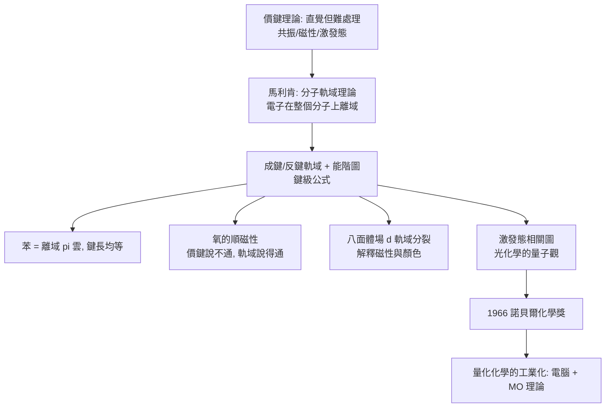

# 1966 · 馬利肯與分子軌域——用量子力學寫化學

> 1966 諾貝爾化學獎：羅伯特·桑德森·馬利肯（Robert Sanderson Mulliken，1896–1986，美國）——表彰「其對化學鍵與電子結構之分子軌域理論之開發」。他把量子力學與化學合而為一：**分子可以用數學描述與計算。**

## 懸案（案情提要）

1920–30 年代的化學理論有兩套互不相通的語言：

- **價鍵理論（VB，鮑林）**：鍵是兩個原子各自軌域的「配對重疊」——直覺、圖示化、易教，但**難以處理共振、激發態、磁性等現象**；
- 而量子力學本身（Schrödinger 方程、Hückel 方法）**算得出來**，卻缺少化學家能用的直覺與實用性。

兩者之間有一道鴻溝。而同期有幾樁懸案只能用量子語言回答：

1. **苯到底是什麼？**兩個 Kekulé 式之間跳動？還是三個共振式的混合？（鮑林說「共振」，但沒有機制）
2. **為什麼有些分子有磁性？**$\mathrm{O_2}$ 是順磁性的（$\mathrm{O_2}$ 有兩個未成對電子），$\mathrm{NO}$、苯的激發態也都是——**價鍵理論解釋不了「電子自旋」的行為**。
3. **過渡金屬配合物的磁性與顏色**為何如此多樣？電子數、氧化態、配位數之間有什麼規律？
4. **激發態、光化學、發光**：分子吸收光子後發生了什麼？電子怎麼「上去又下來」？

偵辦人：羅伯特·馬利肯。他提出了**分子軌域理論**：原子軌域不是局域在原子上的鑰匙，而是**在整個分子上離域的波函數**。

## 前因

| 年份 | 事件 |
| --- | --- |
| 1896 | 馬利肯生於麻州莫爾登堡；父為哥倫比亞大學的物理學教授。 |
| 1915 | MIT 畢業；1916 年芝加哥大學戰時「氣體毒氣」研究（他本人曾受芥子氣傷害）。 |
| 1919–1923 | 於加州大學柏克萊分校攻讀博士（師承吉布斯的學派，物理化學），1927 年博士。 |
| 1920s | **「群論與化學」的開拓**：他系統使用群論（representation theory）處理分子對稱性，把群論引入化學文獻——今日對稱性判據的基礎。 |
| 1932 | 發表「**分子軌域理論**」的核心論文：把分子軌域分成**成鍵（bonding）**與**反鍵（antibonding）**，並以能階圖描述。 |
| 1930s–40s | 發展**分子軌域法（MO method）**、電子親和能與電離能的工作（與鮑林並列提出**電負性的兩種定義**）；研究光化學與激發態（提出「激發態的相關圖」）。 |
| 1940s–60s | 溶劑效應、能量轉移、電荷轉移、光譜的量子解釋；並**大力推動電腦輔助的量子化學計算**（他本人於 1960 年代訪問歐洲，培訓了歐洲的量化學家）。 |
| 1966 | 獲諾貝爾化學獎。 |
| 1969 | 出版《化學鍵：分子軌域理論及其應用》（*Chemical Bond: Molecular Orbital Theory and Its Application*）。 |
| 1986 | 逝於西安大略。 |

## 調查

**偵查一：軌域的重新定義——從「鑰匙」到「波」。**

價鍵理論的想法：每個原子保有自己的軌域，鍵是兩個軌域的重疊。馬利肯的翻轉是：

$$\text{價鍵：} \quad \psi_{\text{鍵}} = \psi_A(1) + \psi_B(2) \quad (\text{電子被限制在 A 或 B})$$
$$\text{分子軌域：} \quad \psi = \sum_i c_i \phi_i \quad (\text{電子在整個分子上離域})$$

**原子軌域 $\phi_i$ 只是「基組」，真正的物理對象是它們的線性組合**。這是量子化學的通用語言——今天所有的量化計算（HF、DFT、從頭計算）都是這個形式。

**偵查二：能階圖——鍵的真相。**

以 $\mathrm{H_2}$ 為例：

$$\psi_{\sigma_g} = \frac{1}{\sqrt{2}}\left(\phi_1 + \phi_2\right) \ (\text{成鍵}), \qquad \psi_{\sigma_u^*} = \frac{1}{\sqrt{2}}\left(\phi_1 - \phi_2\right) \ (\text{反鍵})$$

$$\text{鍵級} = \frac{n_{\text{成鍵}} - n_{\text{反鍵}}}{2}, \qquad E_{\text{分子}} = 2E_{\text{原子}} + \Delta E$$

**成鍵軌域降低能量、反鍵軌域升高能量**——這解釋了為何 $\mathrm{He_2}$（$\sigma_g^2\sigma_u^{*2}$，鍵級 0）不存在，而 $\mathrm{N_2}$（鍵級 3）極穩定。

**偵查三：苯的解答——六個 $\pi$ 軌域。**

苯的六個碳原子的 $p$ 軌域組合出**六個 $\pi$ 分子軌域**（三個成鍵、三個反鍵），其中三個成鍵軌域被 6 個電子填滿，形成**離域的 $\pi$ 電子雲**：

$$\text{鍵級} = \frac{6 - 0}{2} = 3 \ \text{（所有 } \mathrm{C{-}C} \text{ 鍵皆為 } 1.5 \text{ 級，等長）}$$

**苯的兩個 Kekulé 式不是「在跳動」，而是同一個離域波函數的兩種人類語言描述**——這在價鍵理論裡只能勉強以「共振」解釋，在軌域理論裡是自然的結果。

**偵查四：自旋與磁性——開魯和奧本海默的解釋。**

馬利肯與開魯（Kramers）、奧本海默（Oppenheimer）於 1928 年指出：**$\mathrm{O_2}$ 的兩個電子分別佔據兩個 degenerate（簡併）的 $\pi^*$ 反鍵軌域，依洪德規則平行自旋**，因此 $\mathrm{O_2}$ 呈順磁性：

$$\mathrm{O_2}:\ (\sigma_{2s})^2(\sigma^*_{2s})^2(\sigma_{2p})^2(\pi_{2p})^4(\pi^*_{2p})^2 \Rightarrow \text{兩個未成對電子}$$

**價鍵理論無法解釋氧的磁性；分子軌域理論是自然的。**這是軌域理論的第一個重大勝利，也是「化學鍵有了機制」的證明。

**偵查五：過渡金屬與配合物——$d$ 軌域的分裂。**

對八面體場中的 $d$ 電子：

$$\text{八面體場分裂} \to \underbrace{t_{2g}}_{\text{三個較低}} + \underbrace{e_g}_{\text{兩個較高}}, \qquad \Delta_o = 10\,Dq$$

$$\text{高自旋 vs 低自旋} \Rightarrow \text{磁性、顏色、穩定性的差異}$$

這套「晶體場理論」在 1930 年代由貝特（Bethe）與海涅克（Van Vleck）推展，1950 年代由奧格（Orgel）與塔拉哈（Tanabe–Sugano）量化，成為解釋過渡金屬配合物性質（磁性、顏色、催化活性）的標準框架。

**偵查六：激發態與光化學——「光化學的量子觀」。**

馬利肯提出**激發態的相關圖（correlation diagram）**，用於解釋：吸收光子後電子由成鍵軌域躍遷到反鍵軌域（或更高能態），為何會引起斷鍵、重排或異構化：

$$\text{吸收} \Rightarrow \pi \to \pi^*\ (\text{或}\ n \to \pi^*) \Rightarrow \text{鍵級下降} \Rightarrow \text{斷鍵/重排}$$

**這套語言直通 1999 年諾貝爾化學獎（飛秒化學，見 [1999-茲韋勒與飛秒化學](1999-茲韋勒與飛秒化學.md)）**——飛秒雷射把分子從基態「打」到激發態後的演化，就是用這套能階圖描述的。

## 理論裁決

**判決一：軌域的數學語言。** 分子軌域理論的正式表述：

$$\hat{H}\psi = E\psi, \qquad \psi = \sum_i c_i\phi_i \ (\text{RHF 或 UHF}) \;\Longrightarrow\; \mathbf{F}\mathbf{c} = E\mathbf{S}\mathbf{c}$$

（Roothaan 方程，1951 年由 C. C. J. Roothaan 寫成；它是所有量化化學程式的骨架。）

**判決二：電子結構與化學性質的對應。** 軌域理論把所有化學性質都變成可計算的量：

| 性質 | 軌域層次的來源 |
| --- | --- |
| 鍵數與鍵級 | 成鍵/反鍵軌域的佔據數 |
| 鍵角與幾何 | 軌域的對稱性與混成 |
| 磁性 | 未成對電子數（洪德規則） |
| 顏色（可見吸收） | $\pi \to \pi^*$ 或 $d \to d$ 躍遷的能量（$\lambda = hc/\Delta E$） |
| 反應性 | 前線軌域（HOMO/LUMO）的對稱性與能量 |
| 酸鹼性 | 最高佔據軌域的能量 |

**這張表是 1960 年代以後化學理論的核心遺產**——今日「結構—性質—反應性」的整套語言都由此而來。

**判決三：Fukui 的接棒。** 馬利肯的理論在 1950 年代被日本化學家福井謙一（見 [1981-福井與前沿軌域](1981-福井與前沿軌域.md)）用於解釋**反應性**：以最高佔據分子軌域（HOMO）與最低空軌域（LUMO）的對稱性預測反應在哪裡發生。

$$\text{親電子反應} \Rightarrow \text{進攻者的 HOMO 與受體的 LUMO 對稱性匹配}$$

**1965–66 年福井與霍夫曼在京都的「對稱性保留」研討會**，正是在馬利肯的能階圖上畫出軌域相關圖，並導致選擇定則的建立（1981 年諾貝爾獎）。

**判決四：理論—實驗的迴圈加速。** 1960 年代是量化化學的「起飞期」：電子計算機使 $ab\ initio$ 計算從「玩具」變成可行；DFT（科恩、帕爾、馬利肯等人，見 [1998-科恩與量子化學](1998-科恩與量子化學.md)）與經驗參數的結合，使中等大小分子的定量預測成為常態。

$$\text{1960s-70s} \to \text{1990s} \to \text{2000s} \to \text{2010s} \to \text{2020s:}\ \text{「預測化學」的能力每十年提升一個數量級}$$

## 後果

| 領域 | 影響 |
| --- | --- |
| 理論化學 | 分子軌域理論成為化學的通用語言；量化化學從 1970 年代的「計算clusters」走到 2020 年代的化學家日常工具。 |
| 藥物設計 | 配體與受體的相互作用可以用軌域理論與量化計算預測，是現代結構化學藥物設計（structure-based drug design）的一部分。 |
| 材料與催化 | 過渡金屬催化劑的活性（電子結構、氧化態循環）、有機半導體的能階設計、鈣鈦礦與 OLED 材料，皆以軌域語言描述與設計。 |
| 光化學 | 激發態能階圖是光化學與光生物學（視覺、photosynthesis）的標準語言，直通 1999 年飛秒化學獎。 |
| 科學史註記 | 馬利肯與鮑林在「電負性」與「鍵理論」上的優先權之爭延續數十年（1980–90 年代鮑林與馬利肯的支持者還在為此爭辯），是科學史上著名的「誰對誰錯其實各有所長」的案例。 |

## 關聯

- [1901-凡特荷夫與物理化學](1901-凡特荷夫與物理化學.md)：物理化學的量化傳統；軌域理論是它的量子化升級。
- [1902-費歇爾與醣類偵探學](1902-費歇爾與醣類偵探學.md)：費歇爾的立體異構與鎖鑰學說，正是軌域理論要解釋的現象。
- [1954-鮑林與化學鍵](1954-鮑林與化學鍵.md)：價鍵理論與電負性——軌域理論的對手與互補者；兩人的優先權之爭是科學史課本。
- [1981-福井與前沿軌域](1981-福井與前沿軌域.md)：軌域理論用於解釋反應性，並導出選擇定則。
- [1998-科恩與量子化學](1998-科恩與量子化學.md)：馬利肯—波普爾（Mulliken–Pople）方法的成熟與工業化。
- [1999-茲韋勒與飛秒化學](1999-茲韋勒與飛秒化學.md)：激發態能階圖的實驗實現。
