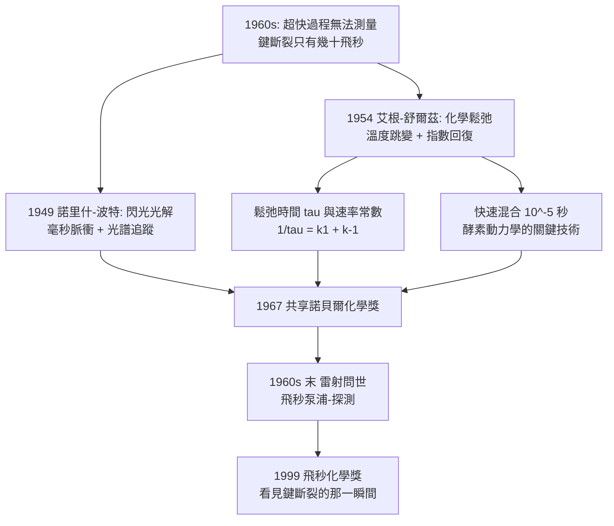

# 1967 · 艾根、諾里什與波特——追上反應的幾微秒

> 1967 諾貝爾化學獎：曼弗雷德·艾根（Manfred Eigen，1927–2019，德國）、羅納德·諾里什（Ronald George Wreyford Norrish，1897–1978，英國）與喬治·波特（George Porter，1920–2002，英國）——表彰「其對極快反應之研究」。化學第一次能「拍到」化學鍵斷裂的那一瞬間。

## 懸案（案情提要）

1960 年代的化學動力學，有一個令人尷尬的時間尺度的鴻溝：

- **典型化學反應**：$10^{-3}$–$10^{0}$ 秒——可以用秒錶量。
- **快速反應**（如中和、蛋白質構形變化、酵素結合）：$10^{-6}$–$10^{-3}$ 秒——需要示波器。
- **超快過程**（如光解後的鍵斷裂、自由基生成）：$10^{-12}$–$10^{-9}$ 秒——**當時沒有任何儀器能看見**。

因此在 1960 年代之前，**化學家只能研究「慢反應」，或者用「穩態近似／過渡狀態理論」從間接數據推論快的步驟**。而化學鍵斷裂、激发態弛豫、光致異構化這些過程，真實發生時只有幾十飛秒——比當時最快的儀器還快三個數量級。

懸案的追問：**能不能造出儀器，進入飛秒的世界？**

偵辦人：三位化學家分頭作戰——**諾里什與波特**在英國用「閃光光解（flash photolysis）」追蹤短壽命中間物；**艾根**在德國用「**化學鬆弛法**」與後來的**溫度跳變（temperature jump）**技術，測量極快的分子重排。

## 前因

| 年份 | 事件 |
| --- | --- |
| 1897 / 1920 | 諾里什生於英國；波特生於英國蘭開斯特。 |
| 1930s–50s | 諾里什在曼徹斯特（隨鮑曼（Bowman）與諾里什的研究）研究**光化學**；1930s 起研究光致異構化（光致互變）與短壽中間物。 |
| 1949 | 諾里什（與 Porter 合作）在**牛津**建立「**閃光光解**」裝置：用一道高強度閃光（放電管）照射反應物，使中間物在毫秒內累積到可測濃度；再用光谱测量其濃度隨時間的衰變。 |
| 1950s | 波特在牛津研究**短壽基團（short-lived species）**的光譜：首次以光譜直接「看見」自由基與激發三重態；並以「光漂白（photobleaching）」等方法追蹤超快過程。 |
| 1950s–60s | 艾根在德國哥廷根（Max Planck 物理化學研究所，與歐廷根（Eigen）與舒爾茲（Schulz）合作）發展**化學鬆弛法（temperature jump）**：以**脈衝式加熱**（如高壓放電）在微秒內讓體系溫度瞬間改變，再以光譜（UV/可見吸收）追蹤反應的鬆弛過程。 |
| 1954 | 艾根與舒爾茲發表「**化學鬆弛**」的經典論文，把鬆弛時間與反應速率常數聯繫起來。 |
| 1960s | 艾根繼續發展**快速混合（rapid mixing）**與**溫度跳變／壓力跳變**技術，把時間解析度推進到 $10^{-6}$ 秒以下。 |
| 1967 | 三人共享諾貝爾化學獎。 |
| 1980s | 波特與諾里什進入**飛秒雷射時代**（雷射由 IBM 的 H. – M. 莫爾（1960s 後半）發明），1980s 的皮秒／飛秒光譜學把極快過程的研究推向常規。 |

## 調查

**偵查一：閃光光解——用時間差製造中間物。**

原理極為直覺：**如果中間物壽命是 $10^{-4}$ 秒，那麼用一道極短的閃光把它「打」出來，讓它累積，再以另一道光去測它。**

$$\underbrace{\text{持續光（產生中間物）}}_{\text{持續}} \xrightarrow{\text{閃光（毫秒級）}} \underbrace{\text{中間物濃度躍升}}_{\text{可測}} \xrightarrow{\text{光譜追蹤}} \underbrace{A(t) = A_0 e^{-k_{\text{obs}}t}}_{\text{衰減曲線}}$$

諾里什與波特以「**閃光光解 + 連續監測吸收光譜**」的組合，首次實現了對微秒級中間物的直接觀測，例如羰基化合物光解後生成的**乙酰自由基（$\mathrm{CH_3CO^\bullet}$）**。

**偵查二：溫度跳變——鬆弛法。**

艾根的策略是「擾動—觀察—回復」：

$$\text{平衡} + \text{瞬間擾動} \xrightarrow{} \text{偏離平衡} \xrightarrow{\text{指數回復}} \text{新平衡}$$

以溫度跳變為例：體系原本在 $T_1$ 達平衡；一道脈衝把溫度瞬間拉高 $\Delta T$（微秒級），平衡常數立刻改變（$\partial \ln K / \partial T = \Delta H^\circ/RT^2$，見 [1901-凡特荷夫與物理化學](1901-凡特荷夫與物理化學.md)），體系因此偏離新平衡；之後以指數方式回復：

$$A(t) = A_{\infty} + \left(A_0 - A_{\infty}\right) e^{-t/\tau}$$

**由鬆弛時間 $\tau$ 可求出正反應速率常數之和**：

$$\frac{1}{\tau} = k_1 + k_{-1}$$

**這是第一個能「量時間」的通用方法**——只要系統有一個能被光譜觀察的變數（吸收、螢光、折射率），就能用它測速率常數。艾根以此測得**離子結合反應**（如 $\mathrm{H^+} + \mathrm{OH^-} \to \mathrm{H_2O}$ 在水中的速率常數，約 $10^{10}\ \mathrm{M^{-1}s^{-1}}$——**接近分子碰撞的極限**）。

**偵查三：快速混合——把兩種溶液瞬間混在一起。**

艾根與其同事發展**快速混合裝置**（如「**連續流動混合器**」）：兩股溶液在毛細管中相遇並立刻流入觀察池，混合時間可壓到 $10^{-5}$ 秒。

$$\text{混合時間} \sim \frac{\text{流速}}{\text{毛細管直徑}^2} \ \Rightarrow\ \text{需要極快的流速與極細的管}$$

**這是 1960 年代生物化學的關鍵技術**——因為**酵素結合與反應的時間尺度恰好在此區間**（$10^{-3}$–$10^{-5}$ 秒）。

**偵查四：弛豫時間的「標尺」——化學的時鐘。**

艾根最重要的概念性貢獻是：**用鬆弛時間的分布來描述一個反應網絡**，並證明即使反應極快，也可以透過鬆弛方法測得：

$$\text{弛豫譜} = \{\tau_1, \tau_2, \dots\} \quad \text{對應}\quad \text{速率常數的組合}$$

**這是把「過渡狀態理論」的抽象過渡態，換成可實測的鬆弛時間**——化學有了自己的「地震儀」。

**偵查五：飛秒時代的接棒。**

1960 年代末雷射問世後，這套「擾動—觀察」的方法論被推到飛秒尺度：**飛秒雷射泵浦—探測（pump-probe）**用兩道脈衝：前一道把分子打到激發態，後一道（延遲 $10^{-15}$–$10^{-12}$ 秒）探測其演化：

$$\Delta A(\tau) \ \text{隨延遲時間}\ \tau \text{的變化} \;\Longrightarrow\; \text{激發態弛豫動力學}$$

1999 年茲韋勒的飛秒化學（見 [1999-茲韋勒與飛秒化學](1999-茲韋勒與飛秒化學.md)）正是這條線的頂點。

## 理論裁決

**判決一：鬆弛動力學——把「平衡」變成可測的時間常數。** 鬆弛法的完整表述：

$$\frac{d\,\Delta c}{dt} = -\frac{1}{\tau}\,\Delta c, \qquad \tau = \frac{1}{k_1 + k_{-1}}$$

對多步反應網絡，鬆弛時間由速率常數矩陣的特徵值決定：

$$\det\left|\left(k_{ij}\right) - \frac{1}{\tau}\delta_{ij}\right| = 0$$

**這是第一套能用「幾個時間常數」完整描述反應網絡的數學工具**——今日的「全反應動力學分析（global analysis）」仍用它。

**判決二：擴散控制與反應控制——擴散係數可量。**

鬆弛實驗讓人第一次能把「分子相遇」與「化學反應」分開：

$$k_{\text{obs}} = \frac{k_d\,k_r\,[\mathrm{B}]}{k_d + k_r[\mathrm{B}]}$$

其中 $k_d$ 為擴散速率常數、$k_r$ 為反應速率常數。**當 $k_r[\mathrm{B}] \gg k_d$ 時，觀察到的是擴散控制**——這解釋了為什麼離子結合的速率常數會「 saturate 」（撞上了物理極限）：

$$k_{\text{obs}}^{\max} \approx k_d \approx 10^{10}\ \mathrm{M^{-1}s^{-1}}\ (\text{水中的擴散極限})$$

**「撞上擴散極限」是 1960 年代物理化學最漂亮的發現之一**——它證明當時的速率理論已抵達物理的天花板。

**判決三：化學鬆弛的溫度效應——活化参数的直接量測。**

因為擾動的幅度（$\Delta T$）已知且可變，鬆弛實驗可反覆量測同一反應在不同溫度下的 $\tau$：

$$\frac{1}{\tau(T)} = k_1(T) + k_{-1}(T) \xrightarrow{\text{Arrhenius}} \text{兩個活化能}$$

**這是阿瑞尼斯方程（見 [1903-阿瑞尼斯與離子解離疑案](1903-阿瑞尼斯與離子解離疑案.md)）在極快反應上的第一次嚴格檢驗**，並與過渡狀態理論對接（見 [1967-艾根與極快反應](1967-極快反應.md)）。

**判決四：短壽命中間物的直接觀測。** 閃光光解首次讓化學家「看見」反應中間物，並且**用光譜判斷其結構**：

$$\text{中間物的吸收特徵} \xrightarrow{} \text{鍵級判斷} \xrightarrow{} \text{結構假說}$$

這是把「中間物」從紙面上的箭頭變成可觀測物體的第一步——今日的短暫中間體研究（自由基、卡賓、瞬子）由此發軔。

## 後果

| 領域 | 影響 |
| --- | --- |
| 生物化學 | 快速混合與鬆弛技術使**酵素動力學**（結合常數、反應速率）成為定量學科；血紅蛋白的協同結合（Hill 方程的動力學解釋）、酵素的快速平衡研究皆由此建立。 |
| 物理化學 | 「極快反應」成為物理化學的正式分支；1960–70 年代的化學鬆弛、超快光譜、脈衝技術合流。 |
| 光化學 | 閃光光解成為研究光解、光致異構化、光致二聚化的標準方法。 |
| 技術史 | 雷射的引入（1960 年 Maiman 的紅寶石雷射）使極快光譜成為可能——**化學儀器的重大升級往往來自物理學的發明**，這是本案最深刻的後果之一。 |
| 科學傳記 | 三位得主的路徑各異：諾里什（光化學）、波特（光譜與快反應，後成為皇家學會會長與 BBC 「化學世界」節目主持人——科普的典範）、艾根（生物物理化學，後推動「演化生物技術」與馬克斯・普朗克學院的跨學科計畫）。 |

## 關聯

- [1903-阿瑞尼斯與離子解離疑案](1903-阿瑞尼斯與離子解離疑案.md)：活化能與阿瑞尼斯方程式，是鬆弛實驗量測的對象。
- [1956-鏈反應與爆炸](1956-鏈反應與爆炸.md)：鏈反應的短壽命載體（自由基）正是閃光光解要偵測的目標。
- [1999-茲韋勒與飛秒化學](1999-茲韋勒與飛秒化學.md)：飛秒尺度把「極快反應」推進到鍵斷裂的瞬間。
- [2013-卡普拉斯與多尺度模擬](2013-卡普拉斯與多尺度模擬.md)：計算化學的另一條路徑——用模擬跨越無法實測的尺度。
- [1968-翁薩格與不可逆熱力學](1968-翁薩格與不可逆熱力學.md)：同屬 1960 年代物理化學的理論擴張。
