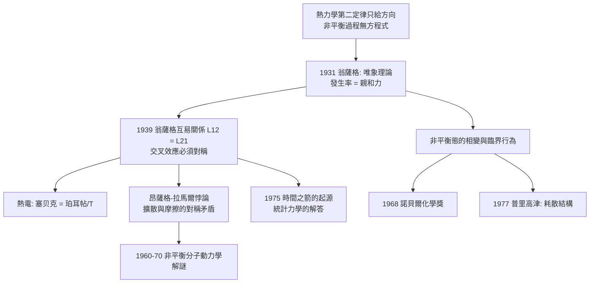

# 1968 · 翁薩格與不可逆熱力學——時間的箭頭

> 1968 諾貝爾化學獎：拉斯·翁薩格（Lars Onsager，1903–1976，挪威／美國）——表彰「其對不可逆過程熱力學之發現」。他給非平衡態寫了方程式，並把「時間之箭」放進了物理學。

## 懸案（案情提要）

熱力學第二定律寫著：孤立系統的熵只增不減（$\Delta S \ge 0$）。但這是一條**單向**的陳述——它解釋了「為什麼時間有方向」，卻留下幾個更尖銳的問題：

1. **近平衡時會怎樣？**經典熱力學只處理平衡態。但真實系統幾乎從不處於平衡——化學反應進行中、熱流流動中、生物體代謝中。**接近平衡的系統服從什麼定律？**
2. **遠離平衡時會怎樣？**例如貝洛烏索夫—札鮑廷斯基化學振盪（1950 年代發現）、貝氏對流花紋（Rayleigh–Bénard convection）、雷射的自發脈衝、火焰的震動。**「非平衡」是否意味著「無秩序」？**
3. **一個更根本的問題**：既然微觀運動是「可逆的」（把時間倒轉，方程仍成立），**那麼不可逆性究竟從哪裡來？**是統計的偶然？還是結構的必然？
4. 還有一個實際問題：**如何預測不可逆過程的速率？**若只有平衡常數，則只知道「往哪走」，不知道「走多快」。

偵辦人：拉斯·翁薩格——挪威出生、耶魯的理論化學教授。他提出了**不可逆過程的唯象方程（phenomenological equations）**與著名的**翁薩格互易關係（reciprocity relations）**。

## 前因

| 年份 | 事件 |
| --- | --- |
| 1903 | 翁薩格生於挪威克里斯蒂安桑（Christiania，即今奧斯陸）。 |
| 1925–1928 | 於挪威理工學院與德國慕尼黑求學；1928 年在蘇黎世 ETH 取得博士學位（導師 Peter Debye，見 [1936-德拜與偶極矩](1936-德拜與偶極矩.md)）。 |
| 1928–1935 | 返挪威，於奧斯陸大學任教，創建理論化學的教學體系。 |
| 1931 | 發展**不可逆過程的唯象理論**：引入「**發生率（rate of production）」與「親和力（affinity）」的概念，把化學反應、電荷傳導、熱傳導統一在同一套框架下。 |
| 1935 | 移居美國（應普林斯頓邀請，取代他的導師 Debye）。 |
| 1939 | **翁薩格互易關係**：證明在線性近平衡 regime 中，各種「交叉效應」之間存在對稱性——這是線性響應理論的第一個重大結果。 |
| 1940s–50s | 研究**統計力學**（液體的介電性質、混合熱力學、不可逆過程的隨機理論）、**過渡狀態理論**（Eyring 與 Evans 共同發展，翁薩格提出「粘性與擴散有同樣的活化能」）。 |
| 1950s | 與其合作者研究**非平衡態的相變**（非平衡態的「相變」與臨界現象）。 |
| 1968 | 獲諾貝爾化學獎。 |
| 1975 | 出版《Non-Equilibrium Thermodynamics》？其回顧論文〈時間之箭的起源〉（*Origin of the arrow of time*, 1975）成為科學哲學的重要文獻。 |

## 調查

**偵查一：把「不可逆」變成可寫的方程式。**

翁薩格的核心策略是「線性近平衡理論」：在接近平衡時，各種不可逆過程的**發生率**與驅動力（他稱為「親和力」）成正比：

$$\text{發生率} \times \text{力} = \text{力} \times \text{發生率} \quad (\text{互易關係})$$

具體地，考慮兩個同時進行的過程（例如熱傳導與化學反應、兩個耦合的化學反應）：

$$\begin{aligned}
\text{過程 1 的速率：} &\quad J_1 = L_{11}X_1 + L_{12}X_2 \\
\text{過程 2 的速率：} &\quad J_2 = L_{21}X_1 + L_{22}X_2
\end{aligned}$$

其中 $J_i$ 是過程 $i$ 的發生率、$X_i$ 是驅動力（affinity）、$L_{ij}$ 是「唯象係數」。翁薩格的重大定理是：

$$\boxed{\;L_{12} = L_{21}\;}$$

**物理意義**：若「熱流的強度」能驅動「化學反應」，那麼「化學反應的強度」必定以**同樣的效率**驅動熱流——**交叉效應必須對稱**。

**偵查二：熱量與功的關聯——Onsager 與 Berg 的「熱電效應」對稱。**

最直觀的實例是熱電現象：電流的流動會帶走熱量（珀耳帖效應），而熱流的流動會產生電流（塞贝克效應）。翁薩格互易關係預言：

$$\text{珀耳帖係數} \; \frac{\Pi}{T} = \text{塞贝克係數} \; S$$

**同一對材料，兩種效應的強度必須相等**（對稱性）。這是物理學中「對稱性如何限制現象」的最漂亮例子之一。

**偵查三：統計力學的補充——昂薩格—拉馬爾悖論。**

1930 年代翁薩格發現了一個尖銳的矛盾（由拉馬爾於 1931 年獨立提出）：在近平衡的線性理論中，**擴散係數**與**摩擦係數**之間有對稱性，但分子動力學算出來的數值卻互相矛盾（這是「昂薩格—拉馬爾悖論」）。其解決要等到 1960–70 年代的非平衡分子動力學與正確的統計處理——這條線最終通向 1986 年諾貝爾化學獎（見 [1986-李遠哲與分子束](1986-李遠哲與分子束.md)）。

**偵查四：非平衡態的「相變」與耗散結構。**

1950–60 年代，翁薩格研究了一個深刻的問題：**非平衡系統在偏離平衡越遠時，是否會出現類似相變的臨界行為？**他的答案是肯定的，並提出「非平衡相」的觀念——這為普里高津（見 [1977-普里高津與耗散結構](1977-普里高津與耗散結構.md)）的耗散結構理論鋪平了道路。

**偵查五：時間之箭的追問。**

1975 年，翁薩格寫了〈時間之箭的起源〉一文，這是一篇科學哲學的經典：它問「既然基本動力學是時間反演對稱的，為什麼宏觀世界有方向？」並以**統計力學的粗粒化（coarse-graining）**作答——**宏觀描述不是微觀描述的鏡像**：

$$\text{微觀（可逆）} \xrightarrow{\text{粗粒化}} \text{宏觀（不可逆）}$$

以及他對「分子混沌（molecular chaos）」的處理（玻爾茲曼方程的隨機性引入），說明不可逆性其實是**「統計的無知」**的產物。

## 理論裁決

**判決一：不可逆過程的唯象方程。** 翁薩格把「近平衡」的不可逆現象寫成線性方程組：

$$\mathbf{J} = \mathbf{L}\mathbf{X}$$

- $\mathbf{J}$：各過程的發生率（熱流率、反應速率、粒子流率、電流……）；
- $\mathbf{X}$：相應的驅動力（溫度梯度、化學親和力、濃度梯度、電動勢……）；
- $\mathbf{L}$：**唯象係數矩陣**（含對角項與交叉項）。

**這套框架的重要性**：它證明**不同領域的不可逆現象（熱、電、化學、擴散）並非互不相干，而是同一個線性代數結構的不同投影。**這是「跨領域統一」的典範。

**判決二：互易關係——對稱性對現象的約束。** 翁薩格定理：

$$\mathbf{L}_{ij} = \mathbf{L}_{ji} \quad (\text{在線性近平衡、且無磁場等破壞時間反演對稱的場合})$$

**注意其適用條件**：如果有磁場、旋轉、或者系統離平衡太遠，互易性會被修正（翁薩格—卡西爾德定理給出更一般的形式，含時間反演的偶奇性）。**「對稱性受限」的思想，是 20 世紀物理學的核心風格。**

**判決三：熵產生——不可逆性的定量指標。** 不可逆熱力學的中心量是**熵產生率**：

$$\frac{dS_i}{dt} = \sum_i J_i X_i \ \ge 0$$

（由互易性與「二次型非負」可得 $J\cdot X \ge 0$，即第二定律在近平衡線性理論中的表達。）

**這把「不可逆」從形容詞變成可測的量**——今日的熱力學工程、燃燒模擬、生物能量學都在用它。

**判決四：非平衡態的秩序問題——為普里高津鋪路。** 翁薩格的非平衡「相」觀念指出：**遠離平衡時，系統可能出現有序結構**（這在平衡熱力學中不可能），且存在「臨界點」與「耗散結構」的可能性。普里高津（見 [1977-普里高津與耗散結構](1977-普里高津與耗散結構.md)）把這一思想發展為完整的耗散結構理論，並引入**非平衡自由能（Lyapunov 函數）**：

$$\frac{d\mathcal{F}}{dt} \le - \dot{S} + \text{驅動項} \quad (\text{在特定條件下，} \mathcal{F} \text{ 單調下降})$$

**這是化學與物理學的分水嶺：秩序不是「耗散」的，而是「耗散」的產物。**

## 後果

| 領域 | 影響 |
| --- | --- |
| 化學工程 | 傳質、傳熱、反應器設計的現代理論基礎；「過程的耦合」設計（如反應—分離耦合）今日仍是化學工程的核心課題。 |
| 電化學 | 唯象方程統一了電荷傳導與化學反應；**能斯特方程與歐姆定律都是它的特例**，膜生物學的電流—電位關係（見 [2012-萊夫科維茨與GPCR](2012-萊夫科維茨與GPCR.md) 的受體信號傳遞）亦源於此。 |
| 生命科學 | 翁薩格—拉馬爾悖論的解決（1950–70 年代）成為非平衡統計力學的里程碑；生物體作為「開放系統」的能量與物質流描述由此奠基。 |
| 科學哲學 | 〈時間之箭的起源〉是「物理定律為何不決定宇宙歷史」的經典回答，影響了 1970–90 年代的科學哲學討論。 |
| 制度 | 翁薩格於 1970 年獲諾貝爾化學獎，是**諾貝爾獎史上第一位以理論物理化學得獎的美國籍學者之一**；他長期在耶魯建立理論化學的學派，並於 1960 年代推動科學家的社會責任討論（他早年的科學保護同盟工作，1930 年代的「哈伯事件」中他即為哈伯辯護者之一）。 |

## 關聯

- [1901-凡特荷夫與物理化學](1901-凡特荷夫與物理化學.md)：$\Delta G$、親和力與平衡的語言，是翁薩格把「力」概念推廣到非平衡的基礎。
- [1936-德拜與偶極矩](1936-德拜與偶極矩.md)：翁薩格的博士導師；線性響應與介電性質的傳統。
- [1956-鏈反應與爆炸](1956-鏈反應與爆炸.md)：鏈反應正是典型的不可逆過程；其分支因子語言可與翁薩格的親和力—發生率框架對話。
- [1968-翁薩格與不可逆熱力學](1968-翁薩格與不可逆熱力學.md)：即本卷。
- [1977-普里高津與耗散結構](1977-普里高津與耗散結構.md)：翁薩格的非平衡相思想的最大延伸與戲劇性展開。
- [2012-萊夫科維茨與克比爾卡](2012-萊夫科維茨與GPCR.md)：受體的激活與去活化，本質是非平衡過程的相變。
