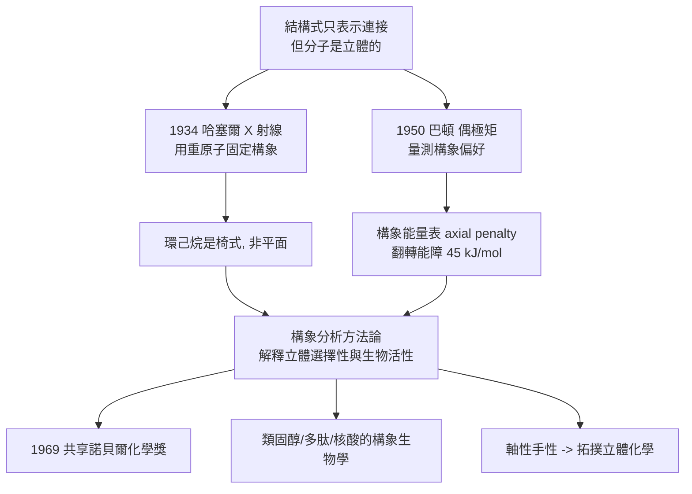

# 1969 · 巴頓與哈塞爾——分子的第三個維度

> 1969 諾貝爾化學獎：德雷克·哈羅爾德·理查德·巴頓爵士（Sir Derek Harold Richard Barton，1918–1998，英國）與奧德·哈塞爾（Odd Hassel，1897–1981，挪威）——表彰「其對構象概念的開發及其在化學中的应用」。他把「立體化學」從平面結構式解放出來：**分子會轉身。**

## 懸案（案情提要）

1960 年代的化學，有一個被普遍忽略卻又無處不在的問題：

> **結構式畫出來了，但分子實際上長什麼樣？**

- 平面結構式（凱庫勒式）表示的是**連接關係**，不是**空間形狀**。可是：
  - **環己烷**的六個碳，是**平面的**還是有立體的？若平面，碳的鍵角就要是 $120^\circ$，遠離碳的天然鍵角 $109.5^\circ$，張力極大——**那它一定不是平面**。
  - 那它是什麼？有幾種可能形狀？
  - **環己烷的兩個椅式構象**可以互相翻轉（chair–chair interconversion），翻轉時能量經過一個「半椅式」的過渡態——**這意味著取代基的位置會互換**！
  - 若是如此，**則「順式／反式」的立體化學會變得複雜**：因為分子是「活的」，會不斷翻轉。
- 另一個相關的難題：**「軸性手性」與「構象手性」**——有些分子因為單鍵旋轉受限而呈現可分離的光學異構體（例如聯苯、螺環化合物），這在平面結構式裡完全看不出來。

偵辦人：巴頓（結構與能量）與哈塞爾（X 射線測量）。

## 前因

| 年份 | 事件 |
| --- | --- |
| 1897 | 哈塞爾生於挪威奧斯陸；1920s–30s 就讀於奧斯陸大學（隨西蒙斯（Simonsen））並兩度赴德（慕尼黑、柏林）。 |
| 1918 | 巴頓生於英國格雷夫沙姆；1939–1946 年於英國進行戰時研究（為國防部研究爆炸物的結構），並在蘇格蘭（蘇格蘭麵粉廠的實驗室）自修化學。 |
| 1934 | 哈塞爾以 X 射線研究**環己烷及其衍生物**（如二氯環己烷的 cis/trans 異構體），首次在 X 射線照片中看出**椅式構象**。 |
| 1946–1950 | 巴頓以**偶極矩測量**研究環己烷的構象；1950 年起發表一系列環己烷構象的論文，提出**環己烷椅式與翻轉障壁**的定量圖像。 |
| 1951 | 哈塞爾與同事用**分子內位移（molecular displacement）法**——把重原子取代基以固定構象（例如用碘原子「錨定」某一構象），使 X 射線能分辨兩個椅式——**第一次在實驗上確認環己烷是椅式而非平面**。 |
| 1953 | 巴頓提出**構象分析（conformational analysis）**的系統方法：以「構象能量」來解釋化學性質（反應性、熱力學穩定性）。 |
| 1954–1960s | 巴頓發表一系列「構象分析」論文，應用於**萜烯、甾體、生物鹼**的立體化學與反應性；並於 1969 年的諾貝爾演講中完整表述構象分析。 |
| 1960s–70s | 巴頓與哈塞爾在加州理工學院長期合作（巴頓負責合成與構形分析、哈塞爾負責 X 射線量測），共同建立「構象分析」的實證基礎。 |
| 1969 | 兩人共享諾貝爾化學獎。 |
| 1970s | 哈塞爾回到奧斯陸，主持化學系並建立研究機構（1980 年建立哈塞爾化學研究所）；1981 年逝於奧斯陸。 |

## 調查

**偵查一：X 射線看見椅式——哈塞爾的分子內位移法。**

問題在於：環己烷是液體，晶體中的分子因堆疊而「鎖定」在某個構象，但普通 X 射線無法分辨**兩個幾乎相同的椅式**。哈塞爾的解法：

1. **在分子上「打釘子」**：把幾個氫換成重原子（如碘、溴），使某一個構象被「固定」；
2. 由於重原子的電子數多，其散射會在衍射圖上產生**可辨識的峰**；
3. 藉此判定：**分子確實是椅式**（而非平面或船式），且**兩個椅式互為鏡像（interchange by ring flip）**。

$$\text{反-1,2-二氯環己烷} = \text{兩個「diequatorial」（雙平伏）構象} \quad\Longleftrightarrow\quad \text{兩個「diaxial」（雙直立）構象}$$

**偵查二：偶極矩測量——巴頓的定量手段。**

偶極矩（見 [1936-德拜與偶極矩](1936-德拜與偶極矩.md)）是量測構象最靈敏的探針：**不同構象的偶極矩不同**。以 1,2-二氯環己烷為例：

| 構象 | 偶極矩 |
| --- | --- |
| 雙平伏（diequatorial） | 接近 0（兩個 C–Cl 鍵反向） |
| 雙直立（diaxial） | 較大（兩個 C–Cl 鍵同向） |

實測值接近「雙平伏」，證明**穩定構象是雙平伏**——這第一次用物理量直接「看見」構象的偏好。

**偵查三：構象能量——翻轉的代價。**

巴頓建立了一張「構象能量表」，把常見基團的立體效應（axial penalty）量化：

$$\text{axial penalty}\ (\mathrm{kJ/mol}): \quad \mathrm{H} \approx 0, \ \mathrm{CH_3} \approx 7.3, \ \mathrm{OH} \approx 3.8, \ \mathrm{Cl} \approx 2.2, \ \mathrm{CO_2Et} \approx 6.5$$

$$\text{翻轉能障}\ (\text{環己烷}) \approx 45\ \mathrm{kJ/mol} \quad(\text{約 } 10\ \mathrm{kcal/mol})$$

**這張表立刻成為立體化學的工程圖**：預測產物比例、預測反應的立體選擇性、預測天然產物的構象。

**偵查四：構象分析在生物化學中的應用——立體化學即功能。**

巴頓與哈塞爾把構象概念推到生物分子：

- **類固醇的立體化學**：四個環的稠合方式（$5\alpha$ 或 $5\beta$）、取代基的平伏／直立偏好，決定了激素的活性——**這解釋了為何「構型相同」的兩種類固醇生物活性天差地別**（例如睪固酮與其異構物、雌二醇的兩個羥基的取向）；
- **蛋白質與多肽**：多肽鏈的構象（螺旋、伸展、摺疊）與側鏈的立體排布；
- **核酸**：糖的 $2'$ 位有無羥基（RNA vs DNA）決定構象（A 型 vs B 型雙螺旋），這是「構象決定生物功能」最著名的例子之一。

**偵查五：軸性手性與「拓撲立體化學」的開端。**

巴頓還指出：**某些分子因單鍵旋轉受阻而具有穩定的立體異構體**（軸性手性），例如：

$$\text{2,2'}\text{-二取代聯苯} \xrightarrow{\text{軸向旋轉受阻}} \text{可分離的對映體（軸性手性）}$$

這開啟了「**拓撲立體化學**」（topological stereochemistry）的概念，並在 1980 年代由 **Bredt's rule（不飽和橋頭）與螺旋手性（helicity）** 等概念延伸，直通 1981 年的福井—霍夫曼前沿軌域理論（見 [1981-福井與前沿軌域](1981-福井與前沿軌域.md)）。

## 理論裁決

**判決一：構象分析的原理。** 巴頓的判準可總結為：

$$\text{分子性質} = f(\text{構象分布}), \qquad P_i \propto e^{-G_i/RT}$$

**只要能算出各種構象的自由能差，就能算出性質的加權平均**：

$$\text{環己烷的性質} = \sum_i x_i\,(\text{構象 } i \text{ 的性質})$$

這是一個非常強的框架：**立體化學從「畫圖」變成「計算」**。

**判決二：立體選擇性的熱力學解釋。** 以 Diels–Alder 與 SN2 反應為例，立體選擇性可由構象能量解釋：

$$\frac{k_{\text{anti}}}{k_{\text{syn}}} \sim e^{-\Delta\Delta G^\ddagger/RT}$$

$$K = \frac{[\text{反式產物}]}{[\text{順式產物}]} = e^{-\Delta G^\circ/RT}$$

**巴頓的貢獻是提供「算出 $\Delta G^\circ$ 的零件表」**（axial penalty、偶極與位阻的加和），使化學家可以在合成前預測立體化學結果。

**判決三：生物分子的構象功能學。** 巴頓–哈塞爾的工作給生物化學一個新問題意識：**功能不只由化學組成決定，也由三維構形決定。**

$$\text{相同化學式} + \text{不同構象} \;\Longrightarrow\; \text{不同生物效應}$$

這在 1960 年代被三個領域同時證實：類固醇（構型差異 → 活性差異）、蛋白質（構象變化 → 酵素活性）、核酸（$A/B$ 型雙螺旋 → 配對與複製）。

**判決四：拓撲立體化學。** 巴頓提出：**有些立體化學的差異來自「拓撲」（連接方式），不是來自構象的微小扭轉**：

$$\text{拓撲異構} \ne \text{構象異構};\qquad \text{橋環大小、螺旋性、軸性手性} \in \text{拓撲層面}$$

這套概念在 1980 年代與選擇定則結合，解釋了反應的「幾何要求」（例如 Diels–Alder 的六員環必須是 $s$-cis 構型才能反應）。

## 後果

| 領域 | 影響 |
| --- | --- |
| 有機合成 | 立體化學預測成為合成設計的常規步驟；「立體選擇性」的語言（axial penalty、Felkin–Anh 模型等）建立。 |
| 藥物化學 | 構象與活性的關係成為藥物設計的核心；構象限制（conformational constraint）成為藥物設計策略（如同阿片類的嗎啡骨架，其立體化學即活性）。 |
| 生物化學 | 類固醇藥物（性激素、維生素 D、皮質類固醇）的活性差異獲得結構解釋；核酸的構象（A/B/Z 型）研究開啟。 |
| 化學教育 | 牛頓式構象模型（Newman projection）與「構象分析」寫入教科書，取代了單一的平面結構式思維。 |
| 科學史地位 | 1969 年的化學獎被視為「立體化學時代」的正式開端——從凡特荷夫（1901）的立體異構、費歇爾（1902）的構型，到巴頓（1969）的構象，化學的三個維度用了七十年才補齊。 |

## 關聯

- [1901-凡特荷夫與物理化學](1901-凡特荷夫與物理化學.md)：立體異構與對稱碳的起點；構象分析是其三維延伸。
- [1902-費歇爾與醣類偵探學](1902-費歇爾與醣類偵探學.md)：費歇爾的環狀糖模型（吡喃型、呋喃型）正是構象概念的早期應用。
- [1927-威蘭與膽汁酸](1927-威蘭與膽汁酸.md)：類固醇骨架的建立者——巴頓的構象分析正是用來「讀懂」威蘭定出的立體化學。
- [1936-德拜與偶極矩](1936-德拜與偶極矩.md)：偶極矩是巴頓量測構象的工具。
- [1950-迪爾斯與阿爾德](1950-迪爾斯與阿爾德.md)：內向規則等立體化學問題，正是構象分析解答的對象。
- [1969-巴頓與構象分析](1969-巴頓與構象分析.md)：即本卷。
- [1981-福井與前沿軌域](1981-福井與前沿軌域.md)：拓撲立體化學與選擇定則的匯流。
