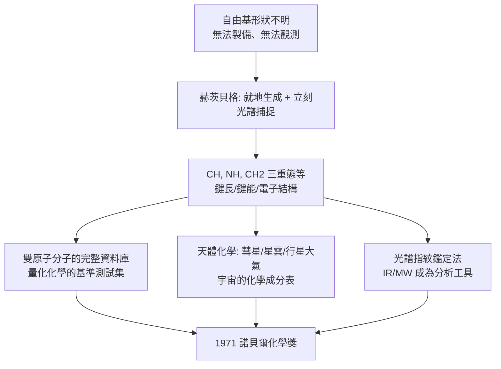

# 1971 · 赫茨貝格與分子光譜——用光讀出分子的肖像

> 1971 諾貝爾化學獎：格哈德·赫茨貝格（Gerhard Herzberg，1904–1999，德國／加拿大）——表彰「其對分子之電子結構與幾何，特別是自由基之知識的貢獻」。他把分子變成了「可以拍照片」的對象，並讀出了宇宙的成分。

## 懸案（案情提要）

1950 年代的化學理論已經很發達（分子軌域理論、鍵理論），但有一個巨大的實證缺口：

- **自由基是什麼樣子？**它們是化學反應的中間物（見 [1956-鏈反應與爆炸](1956-鏈反應與爆炸.md)），卻極短命、極活潑，傳統方法難以製備、難以研究；
- **分子的幾何與電子結構怎麼「直接看見」？**X 射線只能看晶體裡的分子（見 [1964-霍奇金與X射線晶體學](1964-霍奇金與X射線晶體學.md)），對氣相分子、對短壽命中間物無能為力；
- **天文學的問題**：太陽與星雲的光譜裡有些譜線從來沒有人在實驗室對上號——它們屬於什麼分子？**宇宙的化學成分，我們知道多少？**

偵辦人：格哈德·赫茨貝格——德國出生、二戰期間流亡加拿大（因他是猶太人且拒絕加入納粹的「科學家宣言」），在國防研究部門工作時把雷達與光譜學結合起來的物理化學家。

## 前因

| 年份 | 事件 |
| --- | --- |
| 1904 | 赫茨貝格生於德國漢堡；父為學者。 |
| 1920s | 於德國達姆施塔特大學讀物理（受量子力學影響），1928 年於哥廷根取得博士學位（隨弗朗茨（B. Franck）——他曾以弗兰克—康登實驗驗證玻爾的氫原子理論）。 |
| 1930s | 於哥廷根研究火焰光譜與分子光譜；1935 年遷居英國（劍橋），研究 $\mathrm{CH}$、$\mathrm{NH}$ 等自由基的光譜。 |
| 1938–1945 | 二戰期間移居加拿大（因為拒絕在「支持希特勒」的宣言上簽名）；在**國防研究委員會（DRC）**工作，參與雷達與爆炸性氣體的研究，並在**加納利光譜學實驗室**建立高解析度分子光譜的技術。 |
| 1945–1950s | 在**國家研究委員會（NRC）**的分子光譜實驗室進行系統研究：建立光譜的「指紋」辨識方法，定出許多自由基與激發態分子的結構。 |
| 1948–1950s | 開始**天體化學研究**：分析星雲與彗星的光譜，辨認出宇宙空間的化學成分（CH、CN、OH、NH$_2$ 等自由基，以及 $\mathrm{C_2}$、$\mathrm{C_3}$ 等）；並研究極光、彗星與行星大氣。 |
| 1950s–60s | 出版《分子光譜與電子結構》（*Spectra of Diatomic Molecules*, 1950; *Molecular Spectra and Electronic Structure*, 1966）。 |
| 1966 | 獲柏克萊的「加里$\cdot$泰勒獎章」等。 |
| 1971 | 獲諾貝爾化學獎；同年獲皇家學會的戴維獎章（Davy Medal）。 |
| 1973–1980 | 任渥太華卡爾頓大學（Carleton University）校監。 |
| 1999 | 逝於渥太華。 |

## 調查

**偵查一：光譜作為分子的「指紋」。**

分子的光譜不是連續的，而是**一條條分立的線**，每一條對應一個量子能階的躍遷：

$$\Delta E = h\nu = \frac{hc}{\tilde{\nu}} \quad\Longrightarrow\quad \tilde{\nu} = \frac{\Delta E}{hc}$$

每條線的位置（波數 $\tilde{\nu}$）、強度、與精細結構，共同編碼了分子的：
- 鍵長（振動光譜的位向決定鍵的力常數 $k$ 與折合質量 $\mu$）：

$$\tilde{\nu}_{\text{振動}} = \frac{1}{2\pi c}\sqrt{\frac{k}{\mu}}$$

- 電子結構（電子光譜與價鍵理論的比較）；
- 對稱性（選擇定則決定哪些躍遷被允許）。

**赫茨貝格的工作，就是把這些譜線「翻譯」成分子的幾何與電子結構。**

**偵查二：自由基的製備與研究——化學與光譜的聯手。**

自由基（如 $\mathrm{CH}$、$\mathrm{NH}$、$\mathrm{CH_2}$ 三重態）如何製造？答案是**在火焰、電弧或放電中「就地」生成，然後立刻用光譜抓住**：

$$\text{前驅物} \xrightarrow{\text{放電/火焰}} \text{自由基} \xrightarrow{\text{光譜}} \text{結構}$$

**這是一種「永遠抓不住但一直在拍」的策略**——今日的短暫中間體研究（自由基、卡賓）用的仍是這套原理。

**偵查三：雙原子分子的「永久記錄本」。**

對雙原子分子，赫茨貝格建立了極其完整的資料庫：鍵長、鍵能、振動頻率、力常數、電子激發態——**這些數據後來成為量化化學的基準測試集（benchmark）**，用以檢驗計算方法的準確度。

**偵查四：天文學的化學——宇宙的成分表。**

赫茨貝格是「**天體化學（astrochemistry）**」的奠基者之一。他的團隊分析：

- **彗星的尾部與彗髮**：確認 $\mathrm{CN}$、$\mathrm{OH}$、$\mathrm{NH_2}$、$\mathrm{C_2}$ 等自由基的存在；
- **星雲與星雲體**：辨認恆星光譜中的分子帶（CH、CH$^+$、C$_3$、CN 等）；
- **行星大氣**：早期研究火星的 $\mathrm{CO_2}$ 與水冰。

**「宇宙是由化學組成的」——這句話在 1960 年代被赫茨貝格的數據表變成了可查證的清單。**

**偵查五：光譜的「指紋鑑定法」——分析的革命。**

1950–70 年代，**紅外與微波光譜被用於化學分析**：以分子光譜的獨特指紋鑑定未知物、測量混合物組成、追蹤反應中間物、以及**測量分子在環境中的濃度**（空氣污染监测的第一代工具）。

$$\text{觀測吸收} \xrightarrow{} \text{濃度} \quad(\text{Beer–Lambert}: A = \varepsilon c l)$$

## 理論裁決

**判決一：振動光譜是「鍵的顯微鏡」。** 分子振動的頻率直接反映鍵的力常數：

$$\tilde{\nu} = \frac{1}{2\pi c}\sqrt{\frac{k}{\mu}}, \qquad \mu = \frac{m_1 m_2}{m_1 + m_2}$$

**這條式子把「紅外光譜的峰位」翻譯成「鍵的強度與原子質量」**——因此：

- $\mathrm{C{-}H}$ 鍵（$\mu$ 小）在約 $2900\ \mathrm{cm^{-1}}$；
- $\mathrm{C{=}C}$（$k$ 大，約 2 倍）在約 $1650\ \mathrm{cm^{-1}}$；
- 氫鍵使 O–H 拉伸頻率**紅移**並變寬——**紅外光譜因此成為「氫鍵的探針」**，是蛋白質二級結構判定的經典方法（ amide I、amide III 帶）。

**判決二：選擇定則與對稱性——光譜是對稱性的證人。**

只有滿足對稱性條件的躍遷才會出現於光譜中：

$$\text{拉曼活性} \iff \left(\frac{\partial \mu}{\partial Q}\right) \neq 0, \qquad \text{紅外活性} \iff \left(\frac{\partial \mu}{\partial Q}\right) \neq 0$$

**「光譜裡有什麼、沒有什麼」本身就是分子的對稱性資訊**——這是赫茨貝格建立雙原子分子結構的核心方法（用同位素取代改變對稱性，觀察譜線變化來推結構）。

**判決三：分子能量階層的完整圖譜。** 赫茨貝格的工作確立了分子的電子—振動—轉動能階結構：

$$E = E_{\text{電子}} + E_{\text{振動}} + E_{\text{轉動}}$$

$$\text{譜線複雜度的來源} = \text{電子結構} \times \text{振動耦合} \times \text{轉動結構}$$

**這套層級是 1960–70 年代光化學（激發態弛豫）與 1990 年代雷射光譜（超精細光譜）共同的框架。**

**判決四：天體化學的定量方法。** 赫茨貝格示範了如何用「已知分子的已知光譜」去辨認「未知天體中的未知譜線」：

$$\text{觀測譜線} \xrightarrow{\text{與實驗室譜庫比對}} \text{分子身分} \xrightarrow{} \text{豐度（由線強度推）}$$

**這是「天文學變成化學」的技術路徑**，並在 1970 年代被用於發現**星际分子**（星际空間的分子數量從 1960 年代的十幾種增加到今日的數百種）。

## 後果

| 領域 | 影響 |
| --- | --- |
| 分子光譜 | 紅外、微波、紫外光譜成為化學的標準工具；**現代的分子指紋鑑定（GC-MS、FTIR）直接源於此**。 |
| 物理化學 | 鍵長、鍵能、力常數的資料庫，是量化化學的第一個大型基準（今日的 G2/反應基準集仍以赫茨貝格數據為參考）。 |
| 天體化學 | 開啟以化學探測宇宙的時代；今日已知的數百種 interstellar 分子，源頭在此。 |
| 科學史註記 | 赫茨貝格因拒絕納粹的「科學家宣言」而流亡加拿大，其科學生涯因此在戰後獲得長足的資源（國防研究委員會、NRC）；他的案例常被引為科學與政治衝突的教科書例子。 |
| 制度 | 他在卡爾頓大學建立** Herzberg 加拿大天文與光譜研究中心**（後併入 NRC 的 Herzberg 天體物理研究所），是加拿大科學的一次重大制度佈局。 |

## 關聯

- [1903-阿瑞尼斯與離子解離疑案](1903-阿瑞尼斯與離子解離疑案.md)：阿瑞尼斯在萊比錫的同事之一；物理化學的光譜傳統。
- [1936-德拜與偶極矩](1936-德拜與偶極矩.md)：偶極矩與分子光譜的共同語言。
- [1956-鏈反應與爆炸](1956-鏈反應與爆炸.md)：自由基是鏈反應的載體，而赫茨貝格正是把自由基「看清楚」的人。
- [1971-赫茨貝格與分子光譜](1971-赫茨貝格與分子光譜.md)：即本卷。
- [1986-李遠哲與分子束](1986-李遠哲與分子束.md)：分子束與交叉束，讓化學反應在分子層級被「看見」——赫茨貝格的光譜精神的延伸。
- [1999-茲韋勒與飛秒化學](1999-茲韋勒與飛秒化學.md)：以超快雷射直接追蹤能階間的躍遷。
