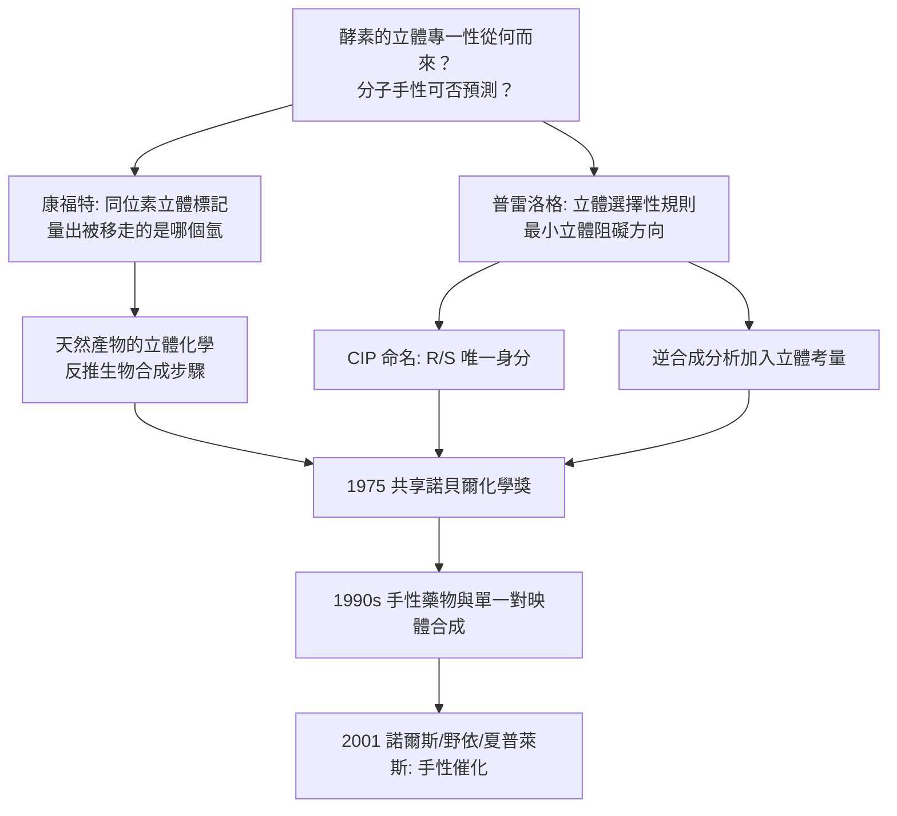

# 1975 · 康福思與普雷洛格——酵素與分子的手性

> 1975 諾貝爾化學獎：約翰·沃卡普·康福特爵士（Sir John Warcup Cornforth，1917–2013，澳大利亞／英國）與弗拉基米爾·普雷洛格（Vladimir Prelog，1906–1998，克羅埃西亞／瑞士）——表彰「其對酵素催化的反應之立體化學，以及對有機分子與反應之立體化學的研究」。一人用酵素量出立體化學，另一人用立體化學解讀分子。

## 懸案（案情提要）

1970 年代的化學有兩樁互為表裡的懸案：

1. **酵素的立體專一性從何而來？**酵素催化反應時，只從立體上的一個面進攻受質（例如：留體激素的 A 環被酵素「只從上面」羥化）。**為什麼一個蛋白質能分辨「分子的左右」？**這在 1950 年代是個謎——因為酵素是「立體專一」的，卻沒有任何立體的「鑰匙」給它。
2. **分子本身的手性與反應的手性，可不可以被預測？**E 型與 Z 型烯烴、D 型與 L 型糖、$R$ 與 $S$ 構型——當一個分子有兩個以上的手性中心時，**可能的立體異構體有幾個？哪一個會形成？**

偵辦人：康福特與普雷洛格。他們一個用**同位素標記＋酵素**量出「哪一個氫被移走」，另一人用**立體化學的系統規則**預測「會發生什麼反應」——**於是酵素與立體化學這兩條線在 1975 年接上了。**

## 前因

| 年份 | 事件 |
| --- | --- |
| 1906 | 普雷洛格生於薩拉熱窩（今波斯尼亞）；1919 年後遷居布拉格（當時屬捷克斯洛伐克），於查爾斯大學學習；1930–35 年在布拉格工作（研究烏頭鹼等生物鹼），並赴德國（先在柏林化學研究所，後於慕尼黑隨威蘭與赫茨貝格，見 [1927-威蘭與膽汁酸](1927-威蘭與膽汁酸.md)、[1971-赫茨貝格與分子光譜](1971-赫茨貝格與分子光譜.md)）。 |
| 1935–1941 | 普雷洛格在蘇黎世 ETH 隨**流體力學（Kármán）與化學工程**背景研究**微生物的立體化學選擇性**（各類細菌對外消旋體的攝取差異）——這是「生物能辨認立體」的早期證據。 |
| 1941–1950 | 普雷洛格在蘇黎世**化學工業公司（CIBA）**任研究主管；研究**甾體與胜肽的立體化學**、研究 **UDP-葡萄糖**（糖核苷酸，見 [1970-勒盧瓦爾與糖核苷酸](1970-勒盧瓦爾與糖核苷酸.md)）。 |
| 1950s | 普雷洛格提出**普雷洛格規則**：在對映體（enantiomer）的 CIP 命名中，以 $R/S$ 取代舊的 D/L 與 $\alpha/\beta$ 的混亂。 |
| 1955 | **Ciba 首次分離出純的**對映體（純的光學活性胺類）。 |
| 1950s–70s | 普雷洛格與其合作者建立**立體化學的系統規則**（**普雷洛格規則**：立體選擇性反應中，進攻基團會沿最小立體阻礙的方向接近，產生「像 Sn2 那樣」的立體結果；以及「**CIP 規則**」的體系化）。 |
| 1917 | 康福特生於澳大利亞新南威爾斯；1935 年後赴英國（劍橋，與羅賓遜，見 [1947-羅賓遜與生物鹼的結構革命](1947-羅賓遜與生物鹼的結構革命.md)）。 |
| 1946–1953 | 康福特與羅賓遜完成**膽固醇的完整結構**（含立體化學），並建立「**立體化學的實驗方法**」：**以同位素標記（${}^{14}\mathrm{C}$、$\mathrm{T}$）追蹤酵素反應中被移走的是「哪一個氫」**。 |
| 1950s–60s | 康福特研究**酵素催化的立體專一性**：以 **$2\,[^{14}\mathrm{C}]$ 乙醯輔酶 A** 與**標記的乙酸酯**研究「**類固醇的脫羧（decarboxylation）**」與「**膽固醇的合成**」；1957 年以 **$'^{14}\mathrm{C}$ 標記 + 立體專一性酵素**證明：天然產物在酵素作用下有**立體選擇性**的氫被取代——例如「$\mathrm{C}$ 上的兩個氫，只有立體上特定位置的那個被酵素移走」。 |
| 1969 | 康福特因車禍重傷（導致失明與行走障礙），研究轉由其妻**羅迪·康福特（Lady Constance H. R. Cornforth，Roddy）**主導，直到她於 2002 年去世。 |
| 1975 | 兩人共享諾貝爾化學獎（康福特獲頒時因車禍重傷，由其妻陪同出席）。 |

## 調查

**偵查一：同位素標記＋酵素——量出「被移走的是哪個氫」。**

康福特的核心實驗設計極為精巧。問題：**在酵素催化的脫羧或羥化反應中，酵素究竟把立體上「哪一個」氫拿走了？**

方法：以**立體專一標記**（stereospecifically labeled）的受質做實驗——例如在分子的特定立體位置放上 ${}^{3}\mathrm{H}$（氚）或 ${}^{14}\mathrm{C}$，再比較反應產物中標記的去向：

$$\text{若酵素移走「朝向特定面」的氫} \Rightarrow \text{產物中氚的位置可預測}$$

$$\text{觀測：} \quad \text{產物的立體化學} \xrightarrow{\text{放射性標記位置}} \text{「酵素的進攻面」}$$

**這套方法產生了「**酵素把氫立體專一地移走**」的定量證據**，並成為酵素機制研究的經典工具。**1969 年的諾貝爾演講中，康福特以膽固醇的生物合成為例，展示從「哪個氫被移走」到「生物合成路徑」的完整推導。

**偵查二：生物合成的立體化學——「天然產物是立體選擇性合成的產物」。**

康福特與羅賓遜確立了一條原則：

$$\text{天然產物的立體化學} \Rightarrow \text{可反推其生物合成的步驟與酵素的立體專一性}$$

**判例**：在類固醇的生物合成中，若某一步的酵素把 C-9 上的**特定**氫（$\alpha$ 或 $\beta$）移走，則產物的立體化學必須是唯一的；實測證實了這條鏈。此方法後來被用於推斷維生素 D$_2$（溫道斯案，見 [1928-溫道斯與維生素D](1928-溫道斯與維生素D.md)）、前列腺素與許多天然產物的合成路徑。

**偵查三：普雷洛格規則——「最小立體阻礙」的方向。**

普雷洛格的核心規則（1960s–70s 建立）：

$$\text{當一個四面體碳上有兩個相同的基團（一個易離去的、一個不易離去的），} \quad \text{親核試劑從「離去基团較少阻礙」的方向進攻}$$

其立體化學結果是：

$$\text{進攻產生的新鍵，與被取代基團呈「反式」排列（相對於進攻方向）}$$

**這條規則統一了 SN2 型取代反應的立體結果**，並被普雷洛格用於**逆合成分析**：若目標分子有特定立體化學，可推斷反應必須走什麼立體路徑。

**偵查四：CIP 命名系統——把「手性」變成可命名的東西。**

普雷洛格與 CIP（化學家龍）建立的**優先順序規則（Cahn–Ingold–Prelog rules）**：

$$\text{以 CIP 優先序排列} \Rightarrow \text{順時針為 } R,\ \text{逆時針為 } S$$

$$R = \text{rectus（順）}, \qquad S = \text{sinister（逆）}$$

**這套規則的意義**：它把「D/L」（相對構型，與甘油醛比較）與「$(+)/(-)$」（旋光方向）之間長久混亂的局面徹底整頓——**分子有了唯一、與光譜符號無關的立體身分**。今日的 IUPAC 立體命名、藥物的立體化學名稱、序列資料庫中的立體標記，皆源於此。

**偵查五：生物的立體辨識——微生物的「手性偏好」。**

普雷洛格在 1930 年代的發現是全案的起點：**某些細菌會優先攝取 D-型或 L-型的對映體**——這說明**生物能辨認立體**，而化學試劑不能。

$$\text{微生物} \xrightarrow{} \text{立體選擇性運輸/代謝} \quad \text{（生物界的手性純度）}$$

這解釋了一個醫藥上的重要事實：**藥物的單一對映體與外消旋體，可能有不同的療效與毒性**（「thalidomide 悲劇」是 1960 年代的著名警鐘）——並推動了 1990 年代的「**手性藥物**」浪潮與 2001 年的手性催化諾貝爾獎（見 [2001-諾爾斯與手性催化](2001-諾爾斯與手性催化.md)）。

## 理論裁決

**判決一：立體化學的可預測性。** 普雷洛格的工作把立體化學從「描述」提升為「預測」：

$$\text{已知立體化學的受質} + \text{已知立體的試劑} \xrightarrow{\text{規則}} \text{預測的立體產物}$$

**三條基本規則**：
1. **CIP 優先序**（命名用的先後順序）；
2. **立體化學保持原則**（反應中心的立體在取代反應中反轉，SN2）；
3. **普雷洛格規則**（親核進攻沿最小立體阻礙方向 → 產物的立體結果可預測）。

**判決二：酵素立體專一性的「立體經濟學」。** 康福特以同位素實驗確立：

$$\text{酵素} \xrightarrow{} \text{只辨認受質的「一隻手」};\quad \text{因此}\ \text{受質的 } R \text{ 或 } S \text{ 異構體反應速率可能相差數百倍}$$

**這解釋了**：天然產物為何幾乎是「手性純」的；也解釋了**外消旋體拆分**的原理（酵素只作用於其中一隻手）。

**判決三：立體資訊的「不可替代性」。** 一個反應的立體結果有時能「鎖定」中間體或過渡態的形狀：

$$\text{立體化學結果} \xrightarrow{\text{反推}} \text{過渡態的幾何} \xrightarrow{} \text{機構}$$

這是普雷洛格規則在機構研究中的用法——**立體化學成為「過渡態的照相機」**。

**判決四：命名系統的必要性——科學的「身分證制度」。** CIP 規則的深層意義在於：

$$\text{一個立體異構體的身分} = \text{其結構} + \text{其 CIP 描述}$$

**而不是**依賴「D 型、L 型、$(+)$、$(-)$」這類依賴參考物或實驗符號的混亂系統。這套制度是今日**化學資訊學**（結構資料庫、化學反應預測）能夠運作的基礎——**沒有唯一的命名，就沒有可計算的化學。**

## 後果

| 領域 | 影響 |
| --- | --- |
| 藥物化學 | 立體專一性的理解推動手性藥物市場（1990 年代起佔主流藥品的比例持續上升）；**普雷洛格規則成為藥物立體選擇性合成的標準工具**。 |
| 天然產物化學 | 立體化學的「可預測性」大幅加速結構判定：合成候選物的立體結構可先算再驗。 |
| 生物化學 | 酵素立體專一性的分子基礎，連到受體與藥物的作用（受體立體選擇性結合）；也提供「外消旋拆分」的原理。 |
| 化學資訊 | CIP 規則與 R/S 命名是今日化學資料庫（如 PDB 的立體標記、反應資料庫）能互通的前提。 |
| 科學史註記 | 康福特 1969 年車禍重傷後仍與妻子共同研究，並由其夫人陪同出席 1975 年的頒獎典禮——**這是諾貝爾獎史上動人的一筆**；羅迪·康福特後來獲得了化學界的最高榮譽之一。 |

## 關聯

- [1902-費歇爾與醣類偵探學](1902-費歇爾與醣類偵探學.md)：D/L 命名系統的源頭；普雷洛格的 R/S 系統是它的整頓。
- [1927-威蘭與膽汁酸](1927-威蘭與膽汁酸.md)：普雷洛格的慕尼黑時期（威蘭實驗室）與立體化學傳統。
- [1947-羅賓遜與生物鹼的結構革命](1947-羅賓遜與生物鹼的結構革命.md)：康福特與羅賓遜的合作——膽固醇結構與立體化學方法。
- [1957-托德與核苷酸](1957-托德與核苷酸.md)：UDP-葡萄糖（普雷洛格在 CIBA 期間研究的糖核苷酸）。
- [1970-勒盧瓦爾與糖核苷酸](1970-勒盧瓦爾與糖核苷酸.md)：糖核苷酸與立體選擇性——普雷洛格把酵素的立體性與核苷酸的轉移化學接起來。
- [2001-諾爾斯與手性催化](2001-諾爾斯與手性催化.md)：普雷洛格規則的工業化——不對稱催化。
