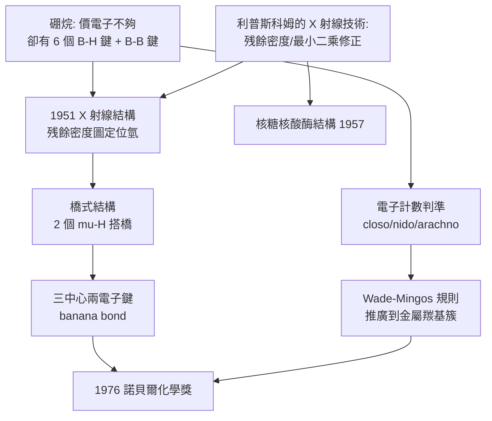

# 1976 · 利普斯科姆與硼烷——三中心兩電子鍵的例外之美

> 1976 諾貝爾化學獎：威廉·納恩·利普斯科姆（William Nunn Lipscomb，1919–2011，美國）——表彰「其對硼烷結構之研究」。他證明了一件違反直覺的事：**有些化學鍵只有兩個電子，卻把三個原子牢牢綁在一起。**

## 懸案（案情提要）

1930–50 年代的硼化學是元素週期表上的「幽靈區」：

- **硼的電子結構很怪**：$\mathrm{B}$ 的電子組態是 $1s^2 2s^2 2p^1$，只有三個價電子，但它偏好在**四配位**（如 $\mathrm{BF_4^-}$、$\mathrm{BH_4^-}$）——這在價鍵理論下很難解釋（因為價鍵理論要求電子成對）；
- **硼烷（borane）家族的行為更怪**：$\mathrm{B_2H_6}$（乙硼烷）只有 12 個價電子，但有 6 個 B–H 鍵——**電子數不夠**；$\mathrm{B_4H_{10}}$、$\mathrm{B_5H_9}$、$\mathrm{B_5H_{11}}$、$\mathrm{B_6H_{10}}$、$\mathrm{B_{10}H_{14}}$……一系列分子，其鍵結無法用「兩中心兩電子鍵」描述；
- 這些化合物在工業上卻極其有用（**硼烷燃料**是火箭推進劑；硼是半導體、玻璃、核反應堆吸收棒、陶瓷的材料），但**沒有人知道它們的結構**。

偵辦人：威廉·利普斯科姆。他用 X 射線結晶學（他本人是 X 射線晶體學的大師，曾為多達五十餘種分子結構測定做出貢獻）逐一把這些「幽靈分子」的形狀畫出來，並且**提出了一個違反教科書的鍵結模型**。

## 前因

| 年份 | 事件 |
| --- | --- |
| 1919 | 利普斯科姆生於美國俄亥俄州克利夫蘭；出身於科學家庭（母親 Julia 與叔父 Sidney Lipscomb 亦為科學家）。 |
| 1941–1946 | 於加州理工學院取得博士學位（導師 Linus Pauling，見 [1954-鮑林與化學鍵](1954-鮑林與化學鍵.md)）；戰時參與 MIT 的炸藥研究（** Explosives Project**，即炸藥結構研究）。 |
| 1946–1950s | 回到哈佛；研究**硼烷的結構**，並發展 X 射線結構分析的方法（尤其「電子密度圖的分析技巧」與「最小二乘法修正」的應用）。 |
| 1951 | 發表《硼烷的結構》（*The Structure of Boranes*）——**首次提出「三中心兩電子鍵」（3-center-2-electron bond）**。 |
| 1950s–60s | 研究範圍擴大：核糖核酸酶的結構（與哈佛的 X 射線團隊合作，1957）、過渡金屬配合物的結構、羰基簇合物。 |
| 1962–1970s | 研究**硼烷的電子結構理論**（與他的學生與合作者，如 Ronald Hoffmann（見 [1981-福井與前沿軌域](1981-福井與前沿軌域.md)）曾是他的博士學生之一——霍夫曼 1963 年在利普斯科姆指導下完成博士學位！）。 |
| 1971–1976 | 利普斯科姆在哈佛的教學聲譽（本科生的「利普斯科姆化學」課程被譽為美國最出色的普通化學課之一，學生稱其為「3A 化學」）。 |
| 1976 | 獲諾貝爾化學獎。 |
| 2011 | 逝於劍橋（麻州）。 |

## 調查

**偵查一：電子數的短缺——記帳上的矛盾。**

以乙硼烷 $\mathrm{B_2H_6}$ 為例做「價電子帳」：

$$\text{價電子總數} = 2\times 3 + 6\times 1 = 12$$

若用標準的**兩中心兩電子鍵**模型：6 個 B–H 鍵需要 12 個電子，剛好——但 **B–B 鍵沒有電子可用**，而實驗卻顯示兩個硼之間確有鍵（乙硼烷有順反異構：順式與反式的 B–H 橋結構不同）。**帳算不平。**

**偵查二：結構的偵測——X 射線與電子密度。**

利普斯科姆的做法：

1. 製備單晶，以 X 射線繞射收集資料；
2. 求電子密度圖；
3. **直接「讀」出氫的位置**——這需要處理「H 幾乎不散射 X 射線」的難題（電子密度圖上 H 是「山丘」而非「山峰」），他發展出**差分 Fourier 技術**與最小二乘修正，使 H 的位置可被可靠地定位：

$$\Delta \rho(\mathbf{r}) = \rho_{\text{觀測}}(\mathbf{r}) - \sum_i f_i\, \rho_i^{\text{理論}}(\mathbf{r})$$

**殘餘電子密度圖上出現的「山丘」就是氫的位置**——這是 X 射線結構測定中的一項關鍵技術，至今仍是處理輕元素（尤其是 H）的標準做法。

4. 結果：**乙硼烷的結構是「橋式」**——兩個硼之間由兩個「橋氫」（$\mu$-H）各搭一座橋：

$$\begin{array}{c}
\text{橋式：}\quad \mathrm{H_2B(\mu-H)_2BH_2} \\
\text{即：} \quad 4\ \text{個末端 B–H} + 2\ \text{個橋式 B–H–B}
\end{array}$$

**偵查三：三中心兩電子鍵——鍵結理論的第二次革命。**

面對電子短缺，利普斯科姆提出了大膽的模型：**一個「三中心」鍵只由「兩個電子」構成**：

$$\underbrace{\mathrm{B}\ \cdots\ \mathrm{H}\ \cdots\ \mathrm{B}}_{\text{三中心}}\ \longleftarrow\ \underbrace{2\ e^-}_{\text{兩個電子}}$$

**這是一個「彎曲的（banana）鍵」**——電子密度集中在三個原子的共同區域，而非任一對原子之間。

**偵查四：韋伯（Weber）規則的誕生。**

利普斯科姆後來以拓撲方式總結硼烷家族的結構規則：

$$\text{每一個 BH 單元} \ \text{提供} \ 2\ \text{個價電子（BH 對）} + \ 2\ \text{個電子（B–H 端基）} = \ \text{「styx」規則}$$

更常用的形式是**電子計數的「閉殼層＋缺電子」判準**：

$$\text{電子數} = 2n(\text{端基 H}) + 2m(\text{橋 H}) + \text{金屬} $$

而**韋伯規則**：一個 $n$ 頂點的閉多面體（closo）硼烷骨架需要 $2n+2$ 個骨架電子；$n+1$ 頂點（nido）需要 $2n+4$；$n+2$ 頂點（arachno）需要 $2n+6$。

$$\mathrm{B_5H_9}\ (\text{nido}): \quad 2(5) + 4 = 14 = 2n + 4\ (\text{正確！})$$

**這套「closo–nido–arachno」分類法是硼烷化學的通用語言**，並在 1960–70 年代由惠特利（Whitley）與多納（Doane）的理論計算獲得電子結構的理論支持（並在 1971 年由惠特利的「群論」與利普斯科姆的實驗合作完成）。

**偵查五：超越硼烷——簇合物理論的開端。**

利普斯科姆把同一套「三中心」與「多中心」的想法推廣到**金屬羰基簇合物**（如 $\mathrm{Co_4(CO)_{12}}$、$\mathrm{Fe_3(CO)_{12}}$），並在 1970 年代發展了**「 Wade–Mingos 規則」**（Wade 1970 年、Mingos 1972 年）：

$$\text{骨架電子對數}\ (SEP) = \text{金屬的} d\ \text{電子} + \text{每個 CO 提供 2} + \text{橋的貢獻}$$

**這個「多中心鍵」的概念，後來成為理解金屬簇、固體超導體、以及酵素金屬中心的通用語言。**

## 理論裁決

**判決一：鍵的第三種形態。** 化學鍵的三種典範：

| 類型 | 電子數 | 描述 | 例子 |
| --- | --- | --- | --- |
| 兩中心兩電子 | 2 | 局域於一對原子之間 | C–H、O–H |
| 三中心兩電子 | 2 | 局域於三個原子之間 | B–H–B 橋 |
| 多中心（簇） | $2n$ 於 $n$ 中心 | 離域於整個骨架 | 金屬簇、$\mathrm{H_3^+}$ |

**「三中心兩電子鍵」把「鍵＝兩原子間的共享」這一定義擴展了。**它並不是例外，而是**缺電子系統的必然**：當可用的價電子不足以填滿所有「兩中心鍵」的軌域時，電子自然聚集成多中心鍵。

**判決二：電子計數的規則化（styx 與 Wade–Mingos）。**

$$\mathrm{B}_n\mathrm{H}_m: \quad \text{骨架電子對數}\ SEP = \frac{\text{總價電子數} - 2\times(\text{端基 B–H 鍵})}{2}$$

$$SEP = n + 1\ (\text{closo}),\quad n + 2\ (\text{nido}),\quad n + 3\ (\text{arachno})$$

**這套規則把「形狀」變成「可算的」**：知道 $n$ 與 $SEP$，就能預測骨架是閉多面體、開殼還是更開放的形式。今日任何一個 borane 簇的結構判定，都先做這一步。

**判決三：X 射線的極限能力——「看見氫」。**

利普斯科姆的技術貢獻可總結為：

$$\text{電子密度} = \rho_{\text{電子}} + \sum_{\text{原子}} \rho_{\text{原子}};\qquad \text{觀測到的} \rho \ \text{含} \ \text{誤差} \Rightarrow \text{用殘餘密度「摳」出 H}$$

**這是「把不夠亮的訊號分離出來」的典範**——與今日的核磁共振成像同樣的哲學。

**判決四：理論與實驗的互動——霍夫曼的訓練。**

利普斯科姆實驗室是 1960 年代**理論化學革命**的溫床之一：他的學生**羅德·霍夫曼**（1963 年博士，導師利普斯科姆）在此學習了「用分子軌域與電子結構思考問題」的風格，並在加州理工與伍德沃德合作建立選擇定則（見 [1981-福井與前沿軌域](1981-福井與前沿軌域.md)）。

**「利普斯科姆—伍德沃德—霍夫曼」這條譜系，把硼烷的多中心鍵經驗與選擇定則的理論接在了一起**——這是 20 世紀化學最典型的傳承之一。

## 後果

| 領域 | 影響 |
| --- | --- |
| 硼化學 | 硼烷結構的解決，使**硼烷燃料**（如乙硼烷、癸硼烷）得以安全使用（航空與航天推進劑）；也使**碳硼烷**（carborane）成為一整類穩定芳香化合物（可作催化劑、藥物骨架、中子捕獲劑）。 |
| _cluster化學 | Wade–Mingos 規則成為金屬簇化學（clusters）的通用規則；金屬羰基簇合物、奈米粒子、團簇物理的結構語言都源於此。 |
| 理論化學 | 多中心鍵的概念直達分子軌域理論的深水區；利普斯科姆實驗室的「理論—實驗」傳統培養出霍夫曼等一代。 |
| 技術與教學 | 利普斯科姆的普通化學課程（Lipscomb Course，Harvard Chem 17）成為美國本科化學教育的標竿；他以「把化學教得有趣且嚴謹」聞名，出版《化學與能量》（*Chemistry and Energy*）。 |
| 科學史 | 硼烷結構是「**X 射線結構學＋理論化學**」協作的早期巔峰案例，也是「化學鍵的教科書需要被改寫」的著名事例。 |

## 關聯

- [1954-鮑林與化學鍵](1954-鮑林與化學鍵.md)：利普斯科姆的博士導師；價鍵理論的極限，正是本案要突破的對象。
- [1973-菲舍爾與二茂鐵](1973-菲舍爾與二茂鐵.md)：金屬有機化學與多中心鍵——夾心化合物也可視為「多中心」鍵結的另一例。
- [1976-利普斯科姆與硼烷](1976-利普斯科姆與硼烷.md)：即本卷。
- [1981-福井與前沿軌域](1981-福井與前沿軌域.md)：霍夫曼在利普斯科姆實驗室的博士訓練，是選擇定則背後的學術血脈。
- [1985-豪普特曼與直接法](1985-豪普特曼與直接法.md)：X 射線晶體學的相位問題——利普斯科姆所屬領域的下一個大突破。
