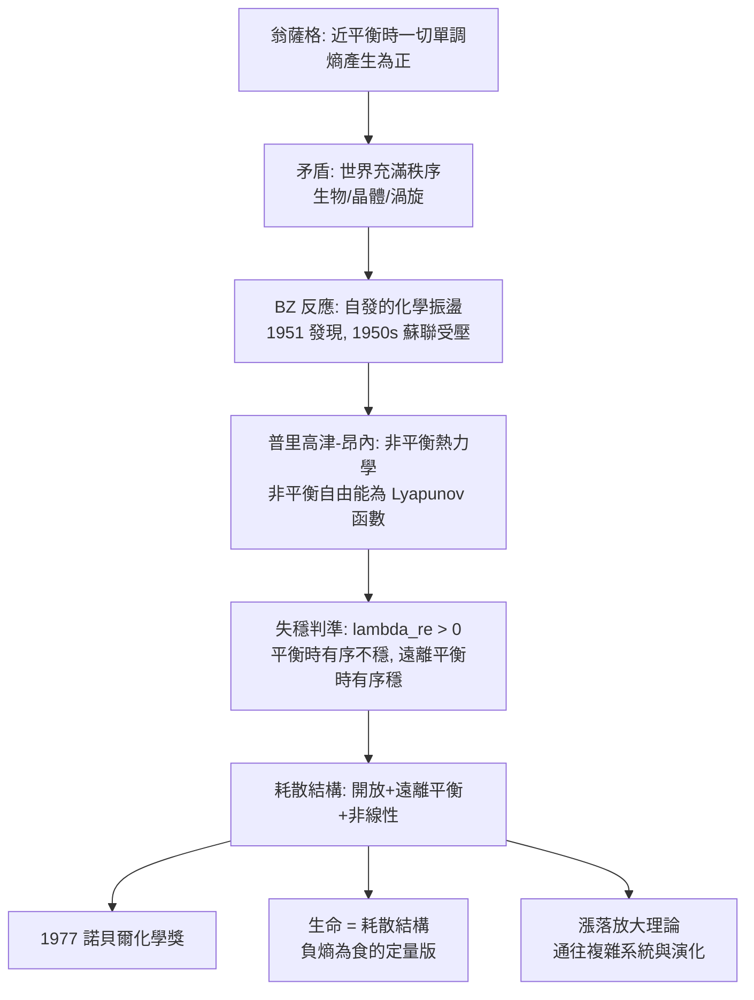

# 1977 · 普里高津與耗散結構——秩序來自耗散

> 1977 諾貝爾化學獎：伊利亞·普里高津（Ilya Prigogine，1917–2003，比利時，俄裔）——表彰「其對非平衡熱力學的貢獻，特別是耗散結構理論」。他解釋了為什麼宇宙中會有規律、有生命——**因為它們在不斷耗散。**

## 懸案（案情提要）

1970 年代的物理化學有一樁深刻的矛盾：

- **翁薩格（見 [1968-翁薩格與不可逆熱力學](1968-翁薩格與不可逆熱力學.md)）證明**：在**接近平衡**時，不可逆過程服從線性方程，且**熵產生為正**——一切順流而下，無例外；
- 但世界充滿了**秩序**：晶體、渦旋、生物體、星系——它們是「有序」的，卻又持續在進行不可逆的代謝與演化。**熱力學豈不是說秩序會被熱力學第二定律抹平嗎？**

更尖銳的實驗性懸案是**貝洛烏索夫—札鮑廷斯基反應（BZ 反應）**：

- 這是一個化學振盪：同一個反應容器裡，**液體會自發地呈現藍色、紅色、藍色、紅色……的週期性變化**，週期可長達數分鐘；
- 它是「化學的鐘」——**用反應速率的可見週期來計時**（這在 1950 年代是驚世駭俗的，因為當時認為化學反應一旦點火就只會單調進行）；
- 貝洛烏索夫（Belousov）在 1951 年就發現了它，但**不敢發表**（蘇聯期刊拒登：這違反化學定律）；札鮑廷斯基（Zhabotinsky）於 1950 年代在列寧格勒做系統研究，並被囚禁於監獄（史達林時代的「反猶太主義」迫害）。

**懸案的問題：在一個注定走向最大熵的宇宙裡，週期性的秩序從哪裡來？**

偵辦人：伊利亞·普里高津。他給出的答案是：**秩序是「耗散」的產物——遠離平衡的開放系統，會自己「躍」到有序態。**

## 前因

| 年份 | 事件 |
| --- | --- |
| 1917 | 普里高津生於莫斯科（帝俄末期），1920 年隨家庭移居比利時。 |
| 1930s | 布魯塞爾自由大學學習；1939 年獲博士學位，導師 **Paul de Donder**（布魯塞爾的熱力學學派，與翁薩格同源）。 |
| 1947–1954 | 研究**等溫反應的熱力學**（de Donder 的「親和力」理論的延伸）；1955 年獲弗朗基獎章（Francqui Prize）。 |
| 1950s | 研究**非平衡態的統計力學**；提出「**局域平衡假設（local equilibrium assumption）**」：即使總體遠離平衡，系統的每個小區域仍可視為接近平衡——這是非平衡熱力學可處理的前提。 |
| 1954 | **「耗散結構」概念首次出現**（在布魯塞爾的一次會議上）。 |
| 1955–1960s | 與共同合作者**彼得·格蘭斯多夫（Peter Glansdorff）**合作建立「**布魯塞爾學派**」，發展非平衡熱力學的**唯象方程**，並證明：**在非平衡態，存在「非平衡自由能」（Lyapunov 函數），在特定條件下單調變化。** |
| 1967 | 出版《非平衡熱力學》（*Non-equilibrium Thermodynamics*）與《穩定、平衡與不可逆過程》（*Order through Fluctuation*, 1971）。 |
| 1971 | 與同事提出**「耗散結構」的判準**：在遠離平衡時，**「有序」反而是穩定的**（而平衡態的「無序」是穩定的）。 |
| 1977 | 獲諾貝爾化學獎。 |
| 1980s–90s | 與其後繼者（如 **I. Prigogine & P. Glansdorff**；**Stuart Kauffman** 的「自組臨界複雜性」、**Brian Goodwin**）合作，把耗散結構的思想推廣到生物學、演化與複雜系統；1986 年創立**布魯塞爾自由大學的複雜系統研究中心**；1990 年代推動「**十字路口計畫（Interschool Project）**」。 |
| 2003 | 逝於布魯塞爾。 |

## 調查

**偵查一：非平衡的數學骨架——熱力學分支。**

普里高津與昂內（Glansdorff）的框架建立在兩條線上：

1. **布魯塞爾學派的自由能泛函（非平衡自由能）**：在非平衡態，仍可構造一個類 Lyapunov 函數 $\mathcal{F}$，使得：

$$\frac{d\mathcal{F}}{dt} \le -\dot{S} + \text{(驅動項)} \quad\text{或}\quad \frac{d\mathcal{F}}{dt} \le -\dot{S}\ (\text{在特定條件下})$$

**當 $\dot{S} > 0$（不可逆）時，$\mathcal{F}$ 單調下降——系統「自發地朝有序態走」。**

2. **演化方程**：由「總親和力」的平衡（總熵產生為零）與「局部平衡」導出：

$$\frac{dX_i}{dt} = \sum_j \Omega_{ij} X_j \quad (\text{線性區})$$

$$\text{在遠離平衡時，} \ \Omega_{ij} \text{ 的對稱性被破壞} \Rightarrow \text{出現不穩定性}$$

**這是全案的數學核心：接近平衡時，$\Omega$ 近似反對稱（Lyapunov 定理保證穩定）；遠離平衡時，反對稱性被破壞，系統可以失穩並躍入新態。**

**偵查二：失穩的判準——分支的數學。**

普里高津的分析給出耗散結構出現的三個條件：

$$\text{① 開放系統（有物質與能量流）}; \quad \text{② 遠離平衡}; \quad \text{③ 存在「負回饋」型的非线性穩定機制}$$

$$\text{線性失穩：} \quad \lambda_{\text{re}} > 0 \ \text{（某模態的實部為正）}\ \Longrightarrow\ \text{微小擾動被放大}$$

**「平衡時無序穩定，遠離平衡時有序穩定」——這是全案最著名的反直覺結論。**

**偵查三：BZ 反應——化學鐘的解釋。**

BZ 反應（如 $\mathrm{Ce^{4+}}$／$\mathrm{Fe^{3+}}$／$\mathrm{BrO_3^-}$ 在丙酮中的氧化還原循環）呈現週期性振盪。普里高津與其同事（Volterra 的數學生態學傳統、以及「**極限環**」的概念）的解釋是：

$$\dot{x} = f(x, \mu), \qquad \mu = \text{（受控參數，如進料率）}$$

當 $\mu$ 越過某個**分岔點（bifurcation）**，系統失穩並躍入**極限環**（limit cycle）——一個穩定的週期軌道：

$$\text{線性分析在此失效} \Rightarrow \text{必須用非線性數學描述}$$

**這解釋了 BZ 反應「會自己回到週期軌道」的頑固性，也解釋了為何生物體的代謝與心跳是週期性的。**

**偵查四：生物體作為耗散結構。**

普里高津把上述框架用於生命：

$$\text{生物} = \text{開放系統} + \text{遠離平衡} + \text{負回饋} \xrightarrow{} \text{維持有序}$$

**「生命靠消耗秩序（自由能）來維持秩序」**——這正是薛定諤 1944 年《生命是什麼》裡的「以負熵為食」的定量版本。普里高津的貢獻是把「負熵」寫成**可計算的條件**（失穩判準、分岔、極限環）。

**偵查五：漲落的放大——通往複雜性。**

普里高津對「秩序從何而來」的最終回答是**漲落理論**：

$$\text{在遠離平衡的系統中，} \quad \delta x \sim \sqrt{\frac{k_B T}{K}} \ \text{的漲落} \xrightarrow{\text{被放大}} \text{新的宏觀結構}$$

$$\text{「秩序是漲落被放大的結果」} \quad\Longrightarrow\quad \text{微觀的偶然} \xrightarrow{\text{非平衡} + \text{放大}} \text{宏觀的必然}$$

**這是 20 世紀物理學對「偶然與必然」這個古老問題最精緻的回答之一**，並直接影響了 1990 年代的複雜系統研究（Kauffman 的自組臨界、協同意識與超導等）。**

## 理論裁決

**判決一：非平衡有序的判準。** 普里高津的耗散結構理論可以總結為三個條件加一個判準：

$$\boxed{\text{耗散結構} \iff (\text{開放系統}) \land (\text{遠離平衡}) \land (\text{非線性反應}) \land (\text{失穩後落入新的穩定態})}$$

**這與「平衡態是最大熵態、有序態是脆弱的」这一直覺完全相反**——普里高津的洞見在於：**「脆弱性」與「穩定性」的關係會隨系統距平衡的距離而反轉。**

**判決二：Lyapunov 函數的存在——非平衡也能有「勢能」。**

$$\frac{d\mathcal{F}}{dt} \le 0 \quad (\text{在吸引區內})$$

這保證了**非平衡態的局部穩定性可以被數學證明**（不是靠直覺）。普里高津-昂內的「布魯塞爾方案」（Brussels School）是 1960–70 年代非平衡熱力學的兩大流派之一（另一是莫斯科的 Sinai 學派）。

**判決三：分岔與極限環——週期性的數學語言。**

$$\text{分岔點} \xrightarrow{} \text{新結構};\qquad \text{極限環} \Rightarrow \text{穩定的週期};\qquad \text{混沌} \Rightarrow \text{不規則但確定的吸引集}$$

**這套語言把 BZ 反應、心跳、神經放電、Belousov–Zhabotinsky 振盪、以及化學振盪器（self-oscillating chemical reactor）統一在一個框架裡。**

**判決四：時間之箭與「起源」問題。** 普里高津在《從存在到生成》（*From Being to Becoming*, 1980）中的追問：

$$\text{為什麼宇宙的基本方程是時間反演對稱的，} \quad \text{但世界的歷史卻有方向？}$$

他的回答：**不可逆性來自「粗粒化」與「局域平衡」的假設失效**，以及**系統與環境的耦合**：

$$\text{基本動力學（可逆）} + \text{統計（大數）} + \text{耦合（開放）} \xrightarrow{} \text{時間之箭}$$

## 後果

| 領域 | 影響 |
| --- | --- |
| 化學 | **化學振盪**成為一門現象學（Belousov–Zhabotinsky 反應、化學鐘、自振盪反應器、化學_compute）；催化劑設計中「振荡型反應」的研究。 |
| 生物學 | 生命作為耗散結構的框架；**形態發生（morphogenesis）**的物理化學詮釋（如 Turing 的反應—擴散模式）；演化與適應性的非平衡表述。 |
| 複雜系統 | 直接影響 1980–90 年代的複雜性科學（Santa Fe Institute）、Kauffman 的自組臨界、協同意識與超導、生命起源的「不可約約化複雜性」論戰（1996 年倫敦「Complexity Science」會議的著名爭論）。 |
| 物理 | 對稱性破缺與失穩的語言，貫穿宇宙學（早期宇宙的相變）、統計物理（臨界現象）與生物物理。 |
| 科學史地位 | 1977 年的化學獎是**第一次頒給「非平衡」這一概念**；普里高津也是少數在科學與哲學（複雜性、文明）之間廣泛寫作的諾獎得主；他在 1990 年代倡導「跨學科研究計畫」，是今日「跨領域研究」的先驅之一。 |

## 關聯

- [1968-翁薩格與不可逆熱力學](1968-翁薩格與不可逆熱力學.md)：非平衡熱力學的框架，本案是其戲劇性的展開。
- [1977-普里高津與耗散結構](1977-普里高津與耗散結構.md)：即本卷。
- [1956-鏈反應與爆炸](1956-鏈反應與爆炸.md)：鏈反應的自催化與振盪，是非線性行為的化學前奏。
- [1983-陶布與電子轉移](1983-陶布與電子轉移.md)：非平衡與耗散的化學證據之一。
- [2017-杜布歇與冷凍電顯](2017-杜布歇與冷凍電顯.md)：生命起源的分子證據——普里高津的問題在 2010 年代被直接觀察。
- [2024-貝克與蛋白質設計](2024-貝克與蛋白質設計.md)：以設計的蛋白質檢驗生命起源的各種假說，是普里高津問題的現代形式。
