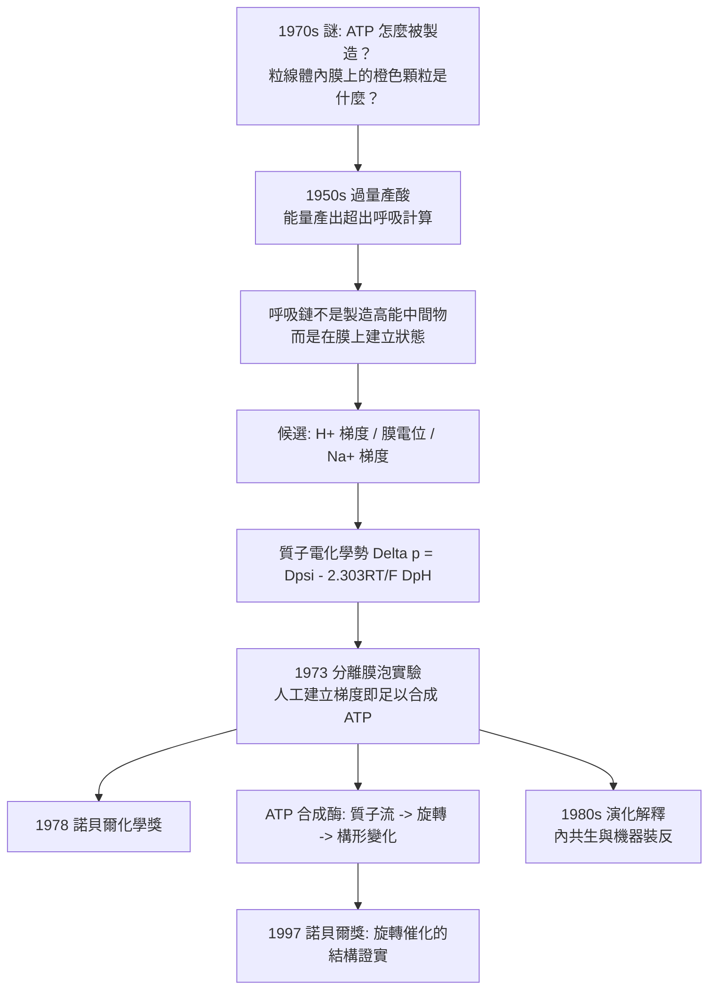

# 1978 · 米切爾與化學滲透——生命引擎的齒輪

> 1978 諾貝爾化學獎：彼得·丹尼斯·米切爾（Peter Dennis Mitchell，1920–1992，英國）——表彰「其對化學滲透機制之生物能量學轉換的理論貢獻」。他解開了一個困擾科學家四十年的謎：**ATP 是怎麼被製造出來的？**

## 懸案（案情提要）

1970 年代的生物化學，有一樁人人皆知卻無人能答的謎：

> **細胞如何製造 ATP？**

已有的知識很多，但拼不起來：

- 細胞內有一種小分子（**ATP**），它是所有代謝的「通用貨幣」——水解時釋放約 $30\ \mathrm{kJ/mol}$ 的自由能，驅動幾乎所有需能反應；
- 呼吸作用（醣解、檸檬酸循環、電子傳遞鏈）在**粒線體內膜**上進行，顯然能量在此被「收集」並「轉換」；
- 但**機制完全不明**。1970 年前的教科書上，粒線體內膜上有一排「**奇特的橙色顆粒（orange granules）**」與「**合成肌球蛋白的原型（myosin-like particles）**」——這些是當年電子顯微鏡下的模糊觀察，長期被認為是「呼吸的機器」，但沒有人知道它怎麼運轉。

同時還有幾個更基本的困惑：
- 呼吸鏈中的**電子傳遞**如何與**ATP 的合成**耦合？化學鍵能如何變成化學鍵（$\mathrm{ADP} + \mathrm{P_i} \to \mathrm{ATP}$）？
- 為什麼質子（$\mathrm{H^+}$）的移動如此關鍵？
- 這套機制在細菌的**細胞膜**上與真核細胞的**粒線體內膜**上都存在——**為什麼演化出兩套同樣的系統？**（米切爾自己曾懷疑這是演化上的巧合，直到他發現細菌有「反向轉運酶」能利用同一機制反向製造 ATP。）

偵辦人：彼得·米切爾。他給出的答案是**化學滲透**：**能量不是直接用來合成 ATP，而是先用來把質子「泵」過膜，建立一個電化學梯度；再讓質子「流回來」，由一台分子機器把它轉成 ATP。**

## 前因

| 年份 | 事件 |
| --- | --- |
| 1920 | 米切爾生於英國牛津。 |
| 1940s–50s | 於劍橋（隨霍蘭（F. R. Hope）研究細胞色素、當時稱「細胞色素 $\mathrm{f}$」）；並赴德國研究光合作用。 |
| 1950s | 轉攻**生物能量學**：研究微生物的「產酸作用（acid production）」與「產氣作用（gas production）」——**這是他的關鍵實驗室**：他發現某些細菌的產酸量**遠超**其呼吸所應有的能量產出；同時，**氧氣可以逆轉這種「過量產酸」**。 |
| 1958–1961 | 米切爾在《Nature》發表一系列短文，提出「**化學滲透假說**」：呼吸作用建立質子梯度；梯度驅動 ATP 合成；他並指出**細菌必須有「反向」的機制**才能利用已有的梯度合成 ATP——**這解釋了演化上的兩套系統問題**。 |
| 1960s–70s | 化學滲透假說長期不被接受（多數生化學家認為 ATP 合成需要某種「高能中間物」）；米切爾轉而研究**化學滲透在細菌中的普遍性**，並發展**以完整細菌膜體（vesicles）為材料**的實驗系統（1960 年代末的「分級運輸」實驗）。 |
| 1973 | 米切爾發表以「**完整膜囊泡（proteoplasts / 細菌內膜體）**」為材料的一系列實驗，**直接證明**：單靠建立 pH 梯度與膜電位（而無電子傳遞鏈、無 ATP 合成酶），即可驅動 ATP 合成。 |
| 1978 | 獲諾貝爾化學獎。 |
| 1980s | 米切爾在《New Phytologist》發表「**化學滲透與演化（chemiosmotic hypothesis and evolution）**」一文——**解釋了為何細菌與真核細胞各有自己的版本**（他的答案是：最早的祖先用化學滲透製 ATP；後來真核細胞獲得內共生細菌，細菌改為反向運作）。 |
| 1992 | 逝於米尼爾沃德（Cornwall）。 |

## 調查

**偵查一：過量產酸的謎團——能量從哪裡來？**

米切爾在 1950 年代的實驗觀察到：某些細菌在有氧時產生的酸，**比其呼吸所能提供的能量還多**（酸度上升的「當量」超出計算值）。

$$\text{若產酸是「高能中間物」的後果，} \quad \text{就不該有過量}; \qquad \text{若產酸本身驅動了什麼，} \quad \text{就會有過量}$$

**這個「過量」是整個案的破口**——它說明呼吸鏈的作用**不是**直接製造某種高能中間物，而是**在膜上建立某種狀態**。

**偵查二：質子梯度的搜尋——三個候選梯度。**

米切爾列出膜兩側可能存在的三種「電化學不對稱」：

| 梯度 | 定義 | 測試 |
| --- | --- | --- |
| **$\mathrm{H^+}$ 梯度**（化學梯度） | $\Delta \mathrm{pH}$：膜內外 pH 不同 | 用弱酸/鹼緩衝液調變外液 pH，看 ATP 合成速率 |
| **膜電位** | $\Delta \psi$：膜內外電荷差 | 用離子（$\mathrm{K^+}$、$\mathrm{valinomycin}$）跨膜移動來固定電位 |
| **$\mathrm{Na^+}$ 梯度** | $\Delta \mathrm{Na}$ | 在 $\mathrm{Na^+}$ 存在與否的條件下比較 |

**結論：$\mathrm{H^+}$ 梯度與膜電位都有效，且兩者可以合併為一個量——質子電化學勢（proton motive force, pmf）：**

$$\boxed{\;\Delta p = \Delta\psi - \frac{2.303\,RT}{F}\,\Delta\mathrm{pH}\;}$$

**（$2.303\,RT/F \approx 59\ \mathrm{mV}$／pH 單位，在 25 °C。）**

**偵查三：分離膜泡實驗——證明「梯度本身就夠了」。**

1973 年，米切爾（與其同事）取得細菌的「**內膜體（chromoplasts/vesicles）**」，在其中**人為地建立 pH 梯度與膜電位**（加入酸/鹼、加入離子載體），然後觀察：

$$\text{若加入 ADP + P}_i \xrightarrow{\text{有梯度}} \mathrm{ATP} + \mathrm{H_2O} \qquad \text{（無電子傳遞鏈、無氧）}$$

**結果：ATP 被合成。**這是化學滲透假說的決定性實驗——**它證明「梯度」是充分的條件，不需要任何「高能中間物」**。

**偵查四：ATP 合成酶的機制——旋轉催化。**

ATP 合成酶（$\mathrm{F_1F_0}$ ATPase）的結構與機制：

$$\mathrm{F_0}\ (\text{膜內、} a\text{ 旋轉子}) + \mathrm{F_1}\ (\text{膜外、} \alpha_3\beta_3\gamma\delta\varepsilon)$$

$$\mathrm{H^+} \xrightarrow{\text{經 } c\text{ 環}} \text{驅動 } \gamma \text{ 軸旋轉} \xrightarrow{} \mathrm{F_1}\ \text{內部構形循環} \xrightarrow{} \mathrm{ADP} + \mathrm{P_i} \to \mathrm{ATP}$$

**質子流 → 旋轉 → 構形變化 → 化學鍵形成**：一條把「電化學能」轉成「化學能」的機械鏈。1997 年的諾貝爾化學獎（博耶、沃克爾、斯科，見 [1997-博耶與ATP合成酶](1997-博耶與ATP合成酶.md)）正是這一機制的結構與動力學確認。

**偵查五：演化問題的解答——兩套系統的由來。**

米切爾 1980 年的解釋（他称之为「**祖先的遺產**」）：

$$\text{最早的產能細胞} \xrightarrow{} \text{用化學滲透「向外」泵 } \mathrm{H^+} \text{ 製造 ATP} \xrightarrow{\text{內共生}} \text{細菌被吞入} \xrightarrow{} \text{真核細胞獲得粒線體}$$

$$\text{於是：細菌改為「反向」（用糖解產生的梯度製造 ATP），真核用粒線體的「向外泵」版本}$$

**這解釋了為何細菌與粒線體的 ATP 合成酶在結構上高度相似，卻運作方向相反**——它們是同一台機器，裝反了。

## 理論裁決

**判決一：化學滲透機制的完整表述。**

$$\text{呼吸/光合作用} \xrightarrow{\text{電子傳遞}} \text{質子跨膜轉移} \xrightarrow{} \Delta p \xrightarrow{\text{ATP 合成酶}} \mathrm{ADP} + \mathrm{P_i} \to \mathrm{ATP}$$

**這是 20 世紀生物能量學的基本範式**，並在 1990 年代與 2000 年代被「化學滲透 + 旋轉催化」完全鞏固：

- **化學滲透**解釋「能量如何跨膜傳遞」；
- **旋轉催化**解釋「化學能如何被製造」。

**判決二：質子電化學勢——一個可算的驅動力。**

$$\Delta p = \Delta\psi - \frac{2.303\,RT}{F}\,\Delta\mathrm{pH}$$

在 25 °C、$\Delta\mathrm{pH} = 1$、$\Delta\psi = 0.14\ \mathrm{V}$ 時，$\Delta p \approx 0.14\ \mathrm{V}$，對應的自由能：

$$\Delta G = -F\,\Delta p \approx -96{,}800 \times 0.14 \approx -13.5\ \mathrm{kJ/mol\ (H^+)}$$

**把「質子梯度」翻譯成「每莫耳 ATP 可得幾個 $\mathrm{H^+}$」**，即可核算能量收支（通常約 3–4 個 $\mathrm{H^+}$ 對應 1 個 ATP）。

**判決三：「高能中間物」的必要性被否定。** 米切爾的實驗否定了 1950–60 年代的主流假說（ATP 合成需要某種共價的高能中間物，如「驅動的乙醯磷酸中間物」）：

$$\text{若需要高能中間物} \Rightarrow \text{人工梯度應無法合成 ATP};\qquad \text{實測：可以}$$

**這是科學史上典型的「理論被實驗推翻並取代」案例**——1960 年代末到 1970 年代初，米切爾的主張被視為異說，1973 年之後成為主流。

**判決四：氧氣為何「過量產酸」——還原當量的處理。** 米切爾對過量產酸的解釋最終落實在**還原型當量的平衡**（細胞必須維持還原力平衡，否則 NADH 過剩會抑制呼吸）：

$$\text{氧化} \to \text{電子傳遞鏈} \to \mathrm{H^+} \text{ 泵出} \quad\text{與}\quad \text{還原型當量消耗} \to \text{產酸}$$

**這解釋了為何呼吸速率會與還原型當量的消耗速率「掛鉤」**——這是 1960 年代後半生物能學的重要謎題。

## 後果

| 領域 | 影響 |
| --- | --- |
| 生物能量學 | 成為現代生物化學的骨幹概念；**化學滲透 + 旋轉催化**是 ATP 生成的標準答案（1997 年諾貝爾獎即為其最終確認）。 |
| 醫藥 | 線粒體ATP 合成酶是**數種抗生素的標靶**（如床蟲黴菌的 atpenin A 類），也與心臟衰竭的治療策略相關；癌症代謝（Warburg 效應）的現代解讀亦以此為框架。 |
| 植物生理 | 葉綠體的光合磷酸化是化學滲透的另一版本（光反應泵 $\mathrm{H^+}$，見 [1961-卡爾文與光合作用](1961-卡爾文與光合作用.md) 的分工模型）。 |
| 演化生物學 | 內共生學說獲得能量學說的支持；米切爾的演化論述成為「化學滲透演化論」的代表性文獻。 |
| 科學史 | 米切爾是「**孤立但堅持**」的典範：1960 年代他的假說不被接受，他繼續研究微生物（在他人研究哺乳動物的時代），**最後以微生物的實驗征服了整個領域**。他也因此獲得諾貝爾獎——這在科學史上是著名的「耐心回報」案例。 |

## 關聯

- [1901-凡特荷夫與物理化學](1901-凡特荷夫與物理化學.md)：滲透壓與化學勢的語言是化學滲透的物理底層。
- [1920-能斯特與熱力學第三定律](1920-能斯特與熱力學第三定律.md)：能斯特方程式是膜電位的理論基礎。
- [1961-卡爾文與光合作用](1961-卡爾文與光合作用.md)：光反應與暗反應的分工，本案補上「光反應如何驅動暗反應」的機制（光合磷酸化）。
- [1968-翁薩格與不可逆熱力學](1968-翁薩格與不可逆熱力學.md)：膜內的質子流是典型的不可逆過程。
- [1978-米切爾與化學滲透](1978-米切爾與化學滲透.md)：即本卷。
- [1997-博耶與ATP合成酶](1997-博耶與ATP合成酶.md)：旋轉催化的結構與機制——本案的最終結案陳詞。
