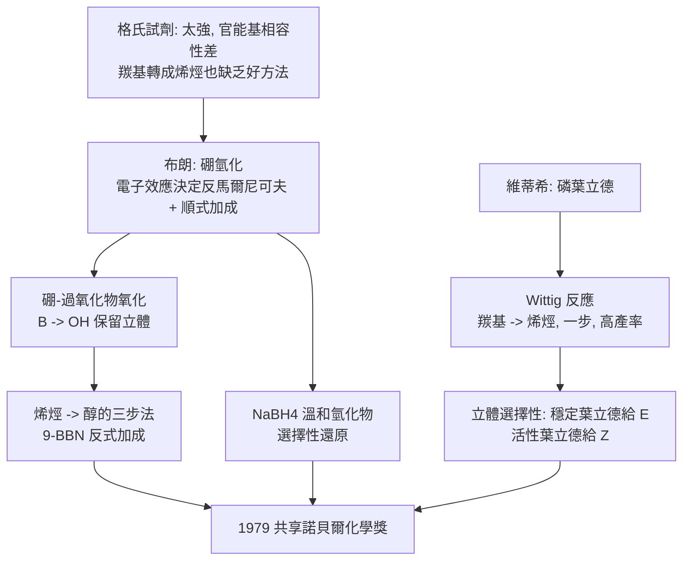

# 1979 · 布朗與維蒂希——有機合成的兩把新鑰匙

> 1979 諾貝爾化學獎：赫伯特·查爾斯·布朗（Herbert Charles Brown，1912–2004，美國）與格奧爾格·維蒂希（Georg Wittig，1897–1987，德國）——表彰「其對有機硼化合物之發展」（布朗）與「其對磷葉立德之發展」（維蒂希）。**同年兩把讓碳—碳鍵與碳＝氧鍵可以「精準接駁」的鑰匙。**

## 懸案（案情提要）

1970 年代的有機合成有兩個「老工具」的諸多不便：

1. **格氏試劑（1912 年諾獎，見 [1912-格林納與薩巴捷](1912-格林納與薩巴捷.md)）**：能接碳—碳鍵，但**反應性太強、官能基相容性太差**——羧基、羥基、醛基、酮基、硝基幾乎都會先把試劑摧毀。要用它，必須先「保護」掉所有不相容的官能基。
2. **羰基的轉化**：把 $\mathrm{C{=}O}$ 變成 $\mathrm{C{=}C}$（烯烴）是合成中最常用的操作之一，但當時的方法（Wittig 之前）步驟多、產率低、或立體選擇性差。

兩位得主各自給出一把更「溫和」或更「精準」的鑰匙：**硼氫化**（布朗）與**Wittig 反應**（維蒂希）。

## 前因

| 年份 | 事件 |
| --- | --- |
| 1912 / 1897 | 布朗生於賓夕法尼亞州斯里波特；維蒂希生於德國卡爾斯魯厄。 |
| 1930s–40s | 布朗在芝加哥大學（隨 H. I. Schlesinger 研究**硼烷與硼氫化物**——正是 [1976-利普斯科姆與硼烷](1976-利普斯科姆與硼烷.md) 的硼烷化學）；1933 年發現**硼氫化反應**（$\mathrm{B_2H_6}$ 加成烯烴生成三烷基硼烷），但當時人們認為它「太複雜、難以利用」。 |
| 1940s | 維蒂希於海德堡任教授，研究**活性甲基烯醇醚（enol ether）**、**環氧化合物（epoxide）**與**Wittig 重排**；1938 年首次以**磷葉立德（phosphonium ylide）**製備烯烴，但產率極低，方法未被接受。 |
| 1950s | 布朗轉向**硼酸（boric acid）與硼氫化物的反應性**，發展**氫硼化鈉（$\mathrm{NaBH_4}$）**與**二硼烷的還原能力**；1956 年報告 $\mathrm{NaBH_4}$ 能把羧酸、酯、腈、醯胺還原為醇——**「溫和的氫化物」**誕生。 |
| 1957 | **維蒂希反應（Wittig reaction）**正式發表：以磷葉立德與羰基化合物反應生成烯烴——**在常溫下、於醚中、以高產率進行**。 |
| 1960s | 布朗發展**9-BBN（9-硼雙環[3.3.1]壬烷）**、**二環己基硼烷（$\mathrm{dicyclohexylborane}$）**等選擇性試劑，以及**烯烴的「反馬克尼可夫」加成（反式加成）**的立體化學解釋。 |
| 1979 | 兩人共享諾貝爾化學獎。 |

## 調查

**偵查一：硼氫化——「反馬爾尼可夫」的加氫。**

普通催化加氫（見 [1912-格林納與薩巴捷](1912-格林納與薩巴捷.md) 的薩巴捷法）給出「馬爾尼可夫」產物（硼/氫加到取代較多的碳上），且無法控制立體化學。而硼氫化：

$$\mathrm{R{-}CH{=}CH_2} + \mathrm{BH_3} \xrightarrow{} \mathrm{R{-}CH_2{-}CH_2{-}BH_2}$$

**硼加到「取代較少」的碳上，氫加到「取代較多」的碳上**——**反馬爾尼可夫**，而且是**順式加成（syn addition，硼與氫從同側加入）**。

**為什麼？** 因為硼是**電子 deficient**（缺電子），而烯烴的 $\pi$ 電子流向硼——**電子效應決定了極性方向**：

$$\text{烯的 }\pi\text{ 電子} \to \mathrm{B}\ (\text{缺電子}) \Rightarrow \text{負電子加到}\ \beta\text{ 碳（取代多者）}\ \Rightarrow\ \text{反馬爾尼可夫}$$

**偵查二：三烷基硼烷的價鍵革命——硼可以被「氧化」並取代。**

布朗的關鍵發現是：**三烷基硼烷的碳—硼鍵可以被過氧化物「氧化」並以羥基取代**：

$$\mathrm{R_3B} \xrightarrow{\mathrm{H_2O_2}/\mathrm{OH^-}} 3\,\mathrm{ROH} \quad(\text{保留立體化學：}\ \text{硼} \to \text{羥基}\ \text{是}\ \text{retention})$$

$$\mathrm{R_3B} + 3\,\mathrm{H_2O_2} + 3\,\mathrm{OH^-} \xrightarrow{} 3\,\mathrm{B(OH)_4^-} + 3\,\mathrm{ROH}$$

**這一步的意義**：硼原本只是「加氫用完就丟」的載體，現在它成了**「把雙鍵變成醇」的載體**——一個比格氏試劑溫和得多的三步法：

$$\text{烯烴} \xrightarrow{\mathrm{BH_3}} \text{三烷基硼烷} \xrightarrow{\mathrm{H_2O_2/OH^-}} \text{醇}$$

**且整個過程不動原子的位置**（立體化學保持），因此可用於合成**立體定義的**醇與激素。

**偵查三：9-BBN——立體化學的主導者。**

布朗發展的**9-BBN** 是「反式加成、產率極高、幾乎不與羰基反應」的試劑：

$$\mathrm{9\text{-}BBN}\ \text{的立體化學} \xrightarrow{} \text{雙羥基化產物}\ (\text{反式})\ \xrightarrow{\mathrm{H_2O_2}} \text{反式二醇}$$

**這使「立體專一性」的合成控制成為可設計的**——今日的類固醇全合成（如吳德沃德的可的松合成，見 [1965-伍德沃德與全合成](1965-伍德沃德與全合成.md)）大量使用硼氫化的產物。

**偵查四：硼氫化鈉——「溫和的氫化物」。**

$$\mathrm{RCOOH} \xrightarrow{\mathrm{NaBH_4}} \mathrm{RCH_2OH}, \qquad \mathrm{RCOOR'} \xrightarrow{\mathrm{NaBH_4}} \mathrm{RCH_2OH}$$

**與格氏試劑的對比**：

| 試劑 | 官能基相容性 | 選擇性 |
| --- | --- | --- |
| $\mathrm{LiAlH_4}$（1950s 布朗等） | 幾乎無相容性 | 全部還原 |
| $\mathrm{NaBH_4}$（1956 布朗） | 與鹼性官能基相容 | 醛、酮、醯氯可還原；酸、酯、腈、醯胺通常不動 |
| $\mathrm{DIBAL}$（布朗） | 可調 | 酯 → 醛 |
| $\mathrm{9\text{-}BBN}$ | 高度選擇性 | 僅加氫烯烴 |

**「可以選擇性地只還原某一個官能基」——這正是布朗體系的設計哲學**，並在藥物合成中成為標準工具。

**偵查五：Wittig 反應——羰基直接變烯烴。**

維蒂希的反應機制：

$$\mathrm{R_3P^+{-}CH_2^-} + \mathrm{R'_2C{=}O} \rightarrow \mathrm{R'_2C{=}CH_2} + \mathrm{R_3P{=}O}$$

**羰基的 $\mathrm{C{=}O}$ 被替換為 $\mathrm{C{=}CH_2}$**——一步反應，且不受「羰基本身已有什麼官能基」的限制（羰基碳的兩個取代基被保留）。

**立體化學是維蒂希反應最精采的部分**：

| 葉立德類型 | 反應性 | 產物立體化學 |
| --- | --- | --- |
| **穩定葉立德**（$\mathrm{Ph_3P{=}CHCO_2Et}$，共軛於電子吸基） | 慢，需要加熱 | **E-烯烴（反式）** |
| **半穩定**（苄基取代） | 中 | E 為主 |
| **活性葉立德**（$\mathrm{Ph_3P{=}CHR}$，非共軛） | 快，$-78\,^\circ\mathrm{C}$ | **Z-烯烴（順式）** |

**這提供了「立體選擇性合成烯烴」的直接工具**——此前只能靠「加氫再脫氫」之類的迂迴法。

**偵查六：葉立德的來源——「鹼的強度」與「共振穩定化」。**

$$\mathrm{R_3P^+{-}CHR} \xleftarrow{\ \text{鹼};\ H^+ \text{ 去質子化} } \mathrm{R_3P^+{-}CH_2R}$$

**去質子化的容易程度決定葉立德的活性**：若 $\alpha$ 碳上沒有電子吸基，負電荷「無處安放」，葉立德極活潑（給 Z 產物）；若有電子吸基共振穩定，活性下降（給 E 產物）。

**這是「反應性與立體化學」的統一解釋**，並在 1990 年代被「Still–Gennari 修飾的葉立德」等改進（提高 Z 選擇性）所延伸。

## 理論裁決

**判決一：硼的電子性質與「反馬爾尼可夫」的解釋。**

$$\mathrm{BH_3}\ \text{有 6 個價電子、只有 4 個鍵} \Rightarrow \underbrace{\text{缺電子（Lewis 酸）}}_{\text{接受烯的 } \pi \text{ 電子}}$$

$$\text{電子流向} \Rightarrow \beta\text{ 碳得電子（成 } \mathrm{C{-}H}\text{）} \Rightarrow \boxed{\text{反馬爾尼可夫加成}}$$

**這是「反應性由電子的流向決定」的教科書案例**——類比於 [1903-阿瑞尼斯與離子解離疑案](1903-阿瑞尼斯與離子解離疑案.md) 的解離觀念。

**判決二：硼的「可被取代」——一個新的合成邏輯。**

$$\mathrm{C{-}B} \xrightarrow{\mathrm{H_2O_2}} \mathrm{C{-}O} \quad(\text{立體化學保持：retention})$$

**「先加上去、以後再換掉」**——這是一種新的合成策略：**以硼為「暫存鍵」**。它的價值在於立體化學的可控性與官能基相容性。

**判決三：立體化學的完全控制。** 硼氫化的**順式加成**與其後的**保留（retention）**給出了：

$$\text{烯烴} \xrightarrow{\text{硼氫化（順式）}} \text{硼烷} \xrightarrow{\text{氧化（保留）}} \text{醇}\quad\Longrightarrow\quad \text{反馬爾尼可夫 + 順式的二醇前驅物}$$

$$\text{配合反式選擇性的 } 9\text{-BBN}:\quad \text{烯} \to \text{反式二醇}$$

**這套「硼的路線」是 1970–90 年代類固醇與前列腺素全合成的核心技術**。

**判決四：Wittig 反應的立體化學理論。**

$$\text{產物立體化學} \approx f(\text{葉立德的立體穩定性})\quad\begin{cases}\text{活性葉立德（快、 $-78\,^\circ\mathrm{C}$）} &\Rightarrow Z\\ \text{穩定葉立德（慢、需加熱）} &\Rightarrow E\end{cases}$$

**機構**：早期（反應速率控制）經由**環氧鏈中間體**（betaine／oxaphosphetane），立體結果由**動力學控制**決定；晚期（可逆）則經由**環中間體平衡**，由**熱力學控制**決定（E 更穩定）。

**判決五：兩個反應的共通點——「把難做的鍵做出來」。**

$$\text{布朗}：\ \mathrm{C=C} \to \mathrm{C{-}C(O)};\qquad \text{維蒂希}：\ \mathrm{C{=}O} \to \mathrm{C{=}C}$$

兩者都以「新的、選擇性的鍵結反應」取代了舊的多步法，**並各自帶來一種新的立體化學控制**（順式加成 vs E/Z 選擇性）。**這是 1970 年代有機合成風格轉變的兩個標誌。**

## 後果

| 領域 | 影響 |
| --- | --- |
| 藥物合成 | 硼氫化／氧化是類固醇、前列腺素、維生素、藥物中間體的標準步驟；$\mathrm{NaBH_4}$ 是全世界實驗室最常用的還原劑之一。 |
| 天然產物全合成 | 1970–80 年代的合成高峰（吳德沃德的維生素 B$_{12}$、前列腺素、毒毛旋花苷）大量使用硼化學。 |
| 材料化學 | 硼烷與硼酸酯在**碳纖維複合材料、陶瓷、玻璃、阻燃劑、硼砂**中的角色；**硼摻雜的半導體**（p 型摻雜）。 |
| 聚合材料 | 氫硼化聚合（把硼單元引入聚合物，可後續氧化成羥基）——「單體共聚」之外的新途徑。 |
| 天然產物結構 | 硼氫化／氧化（烯烴 → 二醇）成為判定雙鍵立體化學的標準「探針」反應之一。 |
| 歷史註記 | 維蒂希的反應在 1938 年就發表過，但**當時無人重視**（他自己在 1953 年的檢討中提到此事），直到 1957 年才被接受——**「早熟的正確」是化學史的常見悲劇**。 |

## 關聯

- [1912-格林納與薩巴捷](1912-格林納與薩巴捷.md)：格氏試劑與接觸催化——本案正是這兩把「舊鑰匙」的溫和替代品。
- [1965-伍德沃德與全合成](1965-伍德沃德與全合成.md)：硼氫化是伍德沃德類固醇全合成的關鍵技術之一。
- [1976-利普斯科姆與硼烷](1976-利普斯科姆與硼烷.md)：硼烷的結構化學是布朗硼氫化試劑的理論前提。
- [1979-布朗與維蒂希](1979-布朗與維蒂希.md)：即本卷。
- [1984-梅里菲爾德與固相合成](1984-梅里菲爾德與固相合成.md)：胜肽合成中的硼保護基（如 $\mathrm{Boc}$、$\mathrm{Fmoc}$）與硼化學同源。
- [2010-赫克與鈀催化偶聯](2010-赫克與鈀催化偶聯.md)：碳—碳鍵接合的現代主力工具。
