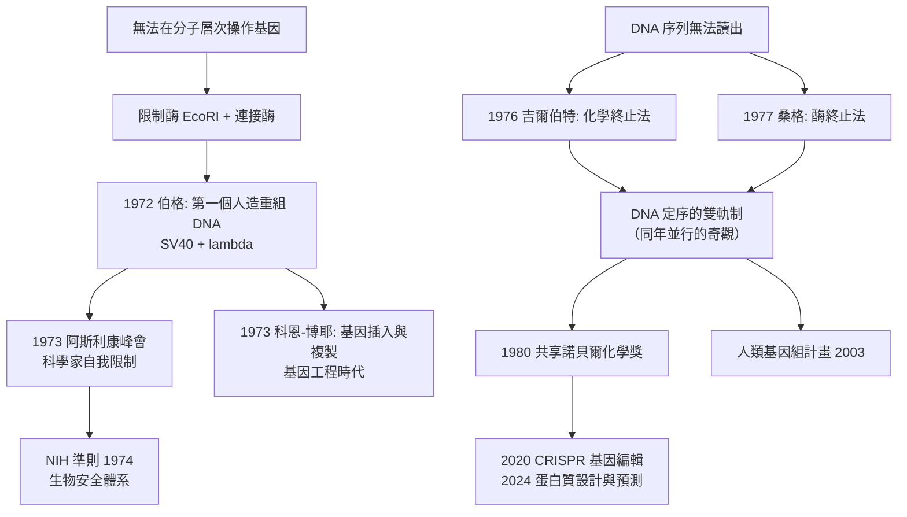

# 1980 · 伯格、吉爾伯特與桑格——把基因變成可以「剪接」的東西

> 1980 諾貝爾化學獎（共享）：保羅·伯格（Paul Berg，1926–2023，美國）、沃爾特·吉爾伯特（Walter Gilbert，1932– ）與弗雷德里克·桑格（Frederick Sanger，1918–2013，英國）——表彰「其對核酸生化學，特別是有關重組 DNA 的根本研究」。第一個**人造重組 DNA 分子**、第一個**DNA 定序法**，與生命科學的操作化工具在此同時誕生。

## 懸案（案情提要）

1970 年代的生物學，有一個「技術上的不可能」：

- **所有生命科學都受限於「無法把基因拿出來看、也無法把基因放回去」。**研究者只能觀察整個生物體的表現，卻無法在分子層次上做實驗；
- 需要的工具是明確的：**能在體外把兩個不同來源的 DNA 片段接起來的分子**（重組 DNA），以及**能讀出 DNA 序列的方法**；
- 而更根本的問題是**資訊**：DNA 的序列如何被「讀出來」並「寫進去」？化學家此前擅長的是「做小分子」，而 DNA 的長度（人類基因組約 30 億鹼基對）與結構（四面纏繞的雙螺旋）讓「化學操作」難以想象。

偵辦人：伯格（做出重組 DNA）、吉爾伯特（做出 DNA 定序）、桑格（早已做出蛋白質定序，第二次獲獎）。

## 前因

| 年份 | 事件 |
| --- | --- |
| 1926 / 1932 | 伯格生於賓夕法尼亞；吉爾伯特生於波士頓；桑格生於倫敦（見 [1958-桑格與胰島素序列](1958-桑格與胰島素序列.md)）。 |
| 1940s–60s | 伯格在華盛頓大學（研究 $\mathrm{T4}$ 噬菌體的遺傳學，與 Hershey–Chase 的 DNA 實驗同期）；1960 年轉至史丹福。 |
| 1967–1972 | **伯格的重組 DNA 實驗**：以**限制酶（restriction enzyme）**切割兩種來源的 DNA（例如 SV40 病毒 DNA 與噬菌體 DNA），用**DNA 連接酶（ligase）**接成一個環狀分子——**第一個人造重組 DNA**。1972 年 6 月發表（PNAS 與 1973 年的 Nature 專刊）。 |
| 1972 | **「阿斯利康峰會」（Asilomar Conference）**——**生物學家歷史上最重要的一次會議**：科學家們自行宣布暫停重組 DNA 實驗，直到安全規範與準則建立。**這是人類科學家第一次為自己的研究設定停戰日。** |
| 1973 | 伯格的研究獲准恢復；同年，**科恩（Stanley Cohen）**與博耶（Herbert Boyer）完成**用限制酶與連接酶切出並接入基因的操作**（見 [1973-菲舍爾與二茂鐵](1973-菲舍爾與二茂鐵.md) 同年的 DNA 操作技術），標誌基因工程時代。 |
| 1976 | **吉爾伯特的 DNA 定序法**：以 **化學法終止**（用雙去氧核苷酸鏈終止）讀出 DNA 序列；與桑格的**酶法**（1977）並行——**兩種方法同年出現，DNA 定序從此可行**。 |
| 1980 | 三人共享諾貝爾化學獎。 |
| 1990s–2010s | 從重組 DNA → 基因定序（人類基因組計畫，2003 完成）→ 基因編輯（2020 年諾貝爾獎，見 [2020-卡彭蒂耶與CRISPR](2020-卡彭蒂耶與CRISPR.md)）→ 蛋白質設計與預測（2024 年諾貝爾獎）。 |

## 調查

**偵查一：限制酶與連接酶——「剪接」工具的發現。**

重組 DNA 的可行性完全依賴兩類酵素：

$$\text{限制酶（restriction endonuclease）}：\ \text{辨認特定序列並切割，如 } \mathrm{EcoRI}\text{ 辨認 GAATTC}$$

$$\mathrm{GAATTC} \xrightarrow{\mathrm{EcoRI}} \mathrm{G}\ |\ \mathrm{AATTC} \quad(\text{黏性端，}5'\text{ 突出})$$

$$\text{DNA 連接酶}：\ \text{把相同黏性端的片段接回} \quad\Longrightarrow\quad \text{重組 DNA}$$

**「限制—連接」這兩步，就是把 DNA 變成「可以剪接的帶子」的關鍵**，也是基因工程的「剪刀與膠水」。

**偵查二：重組 DNA 的第一個實驗。**

伯格的實驗（1972–73）：

1. 以限制酶切開 **SV40 病毒 DNA**（環狀）與**$\lambda$ 噬菌體 DNA**；
2. 把兩者的片段用 DNA 連接酶接成**一個嵌合的環狀分子**；
3. 以**感染性試驗**（轉形）檢測：把重組分子引入細菌，若能複製並產生子代噬菌體，就證明**重組 DNA 具備生物活性**。

$$\text{這是第一個人造的、能在細胞內複製的「外來基因」分子}$$

**它的意義**：遺傳學從此不只是觀察，而是**操作**。

**偵查三：阿斯利康峰會——科學的自我治理。**

1973 年，美國國家科學院與醫學院在加州阿斯利康召開會議，邀集全球相關科學家。結論：

$$\text{暫停「重組 DNA」的實驗工作},\quad \text{直到生物安全指引與準則建立}$$

**這是科學史上罕見的、由科學家集體主動提出的「自我限制」**——比任何法律都早。這一決定最終催生了 1974 年的《美國 NIH 準則》與今日的全球生物安全規則體系。

**偵查四：DNA 定序的兩條路線。**

**（一）桑格法（酶法，1977）**：利用 DNA 聚合酶在**缺乏某種 dNTP** 時停下：

$$\text{模板} + \text{聚合酶} + \mathrm{dNTP}(\text{缺一種}) \Rightarrow \text{在該鹼基處終止的片段}$$

$$\text{四組反應} \xrightarrow{\text{電泳分離}} \text{四條「階梯」} \xrightarrow{\text{讀序}} \text{序列}$$

**（二）吉爾伯特法（化學法，1976）**：以**鹼基特異性的化學試劑**（如二甲硫酸鹽處理 $\mathrm{G}$、肼鹼處理 $\mathrm{A+C}$、高鹽酸處理 $\mathrm{G+T$ 等）**切斷**帶放射性標記的 DNA，在特定鹼基處產生無標記的短片段。

$$\text{四組化學處理} \xrightarrow{\text{電泳}} \text{階梯} \xrightarrow{} \text{序列}$$

**兩條完全不同的路線，同年得到同一個結果：DNA 可以被讀出。**這在科學史上極為罕見（通常一條路線要統治二十年）。

**偵查五：從讀序列到「合成序列」——基因合成的難題。**

DNA 定序之後，緊接著的挑戰是**寫入序列**：合成一段已知的寡核苷酸。1970 年代的「化學合成法」（保護基、磷醯胺化學）是必要的技術鋪墊：

$$\text{第一代的 DNA 合成} \xrightarrow{} \text{只能做十幾個鹼基} \xrightarrow{\text{磷醯胺試劑}} \text{數百個} \xrightarrow{\text{自動化}} \text{數千個}$$

**今日的 DNA 合成（基因合成公司的一小時交付數 kb 的能力）即是這條線的成熟形態。**

## 理論裁決

**判決一：重組 DNA 的可複製性——「人造基因」的合法性。**

$$\text{限制酶切割} + \text{連接酶接合} + \text{宿主複製} \xrightarrow{} \text{可自我複製的嵌合分子}$$

**這條等式的成立，意味著「遺傳物質可以被工程化」**——它是所有基因工程的技術前提，也是生物安全的技術前提（因為「可複製的嵌合分子」正是需要被管制的那個東西）。

**判決二：DNA 定序的資訊理論意義。** 兩條定序法共同的深層意義是：

$$\text{序列} = \text{可被複製、可被比較、可被搜尋的資訊}$$

**「基因組」這個概念本身，就是定序技術帶來的。**此前「基因」是一個功能單位（孟德爾的因子）；此後它是**一段可讀的字母序列**——從此可以在電腦上比較、搜尋、預測。

**判決三：讀與寫的對偶。** 定序（read）與合成（write）是一對互補操作：

$$\text{讀} \xrightarrow{\text{定序}} \text{序列} \xrightarrow{\text{合成}} \text{想要的序列} \xrightarrow{\text{重組}} \text{放在基因組裡}$$

**這個閉環是人類從「讀基因組」走到「改寫基因組」的技術結構**，也正是今日基因編輯（CRISPR）的邏輯位置。

**判決四：科學的自我治理。** 阿斯利康峰會的意義超出分子生物學：

$$\text{科學家的集體判斷} > \text{外部管制} \quad\text{（至少在最初）}$$

**這是一個可被援引的先例**：當一項技術的能力（把不同來源的遺傳物質接合並在活細胞中複製）超出了當時的評估能力時，**由研究者群體自己設定暫停與指引**，而非等待事故發生後再由法律收拾。

## 後果

| 領域 | 影響 |
| --- | --- |
| 基因工程 | 胰島素（1982 上市）、生長激素、凝血因子 VIII、疫苗（重組乙肝疫苗）、干擾素——**生物製藥產業**（今日市值數千億美元）自此起步。 |
| 農業 | **基改作物**（Bt 玉米、抗除草劑大豆、金黃色玉米胚乳的維生素 A 富集）；作物基因組定序（水稻、小麥）。 |
| 基因體學 | 人類基因組計畫（2003）、的模式生物（酵母、線蟲、果蠅、小鼠）定序；**生物資訊學**成為學科。 |
| 生物安全體系 | 阿斯利康峰會 → NIH 準則 → 全球生物安全與基因Editing 治理（今日的《生物安全公約》討論）——**科學治理的原型案例**。 |
| 醫學 | 遺傳病的分子診斷（今日的基因定序報告）、**基因治療**（1990 年代的 ADA-SCID 治療）、CAR-T 細胞療法（以病毒載體導入基因）。 |
| 科學制度 | 伯格是《原子科學家公報》的顧問委員會成員（他亦主張反核政策），是科學家介入公共政策又一例。 |

## 關聯

- [1957-托德與核苷酸](1957-托德與核苷酸.md)：核苷酸的結構是重組 DNA 與定序的化學前提。
- [1958-桑格與胰島素序列](1958-桑格與胰島素序列.md)：序列概念的源頭；桑格把「定序」從蛋白質帶到 DNA。
- [1973-菲舍爾與二茂鐵](1973-菲舍爾與二茂鐵.md)：同年的諾貝爾獎涵蓋金屬有機化學——正是限制酶／連接酶的化學血脈（重組 DNA 的工具箱裡也包含金屬依賴的酵素）。
- [1980-伯格與重組DNA](1980-伯格與重組DNA.md)：即本卷。
- [1984-梅里菲爾德與固相合成](1984-梅里菲爾德與固相合成.md)：胜肽合成的自動化——DNA 合成日後也走過相同的自動化道路。
- [2020-卡彭蒂耶與CRISPR](2020-卡彭蒂耶與CRISPR.md)：重組 DNA 技術的終極延伸——從「剪接」到「定點編輯」。
- [2024-貝克與蛋白質設計](2024-貝克與蛋白質設計.md)：基因組與蛋白質組的資料，成為 AI 設計的燃料。
