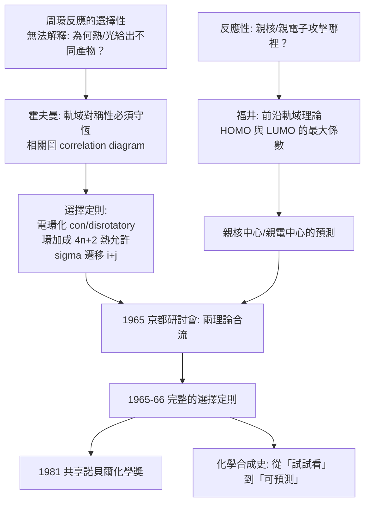

# 1981 · 福井與霍夫曼——反應為何只能走這條路

> 1981 諾貝爾化學獎（共享）：福井謙一（Kenichi Fukui，1915–1998，日本）與羅德·霍夫曼（Roald Hoffmann，1937– ，波蘭／美國）——表彰「其各自獨立發展的、關於化學反應歷程的理論」。化學反應從此有了「通行證」：**對稱性不允許的反應，不會發生。**

## 懸案（案情提要）

1960 年代的理論化學，有一個巨大的「說不通」：

- ** Woodward–Hoffman 規則之前的化學反應理論，幾乎全是「事後描述」。**化學家算出過渡態、算出活化能，卻無法回答最實際的問題：**「這個反應到底能不能發生？」**
- 一系列「反常」現象長期沒有解釋：
  - 為什麼 $\mathrm{)}$ 環加成（**4+2**）可以在常溫下進行，而 **2+2** 環加成（烯二烯的光二聚）卻需要紫外線？
  - 為什麼有些**周環反應**在加熱下走得通、有些在光照下才走得通？
  - 為什麼**電環化**在 4 個 $\pi$ 電子時，熱與光給出相反的產物（順式或反式）？
  - 為什麼有些分子（如**環丁烯**）在加熱下開環成反式雙烯，而另一些（如**環己二烯**）給出順式？
- 這些不是罕見的邊角案例，而是**有機合成家每天都在用的核心反應**（Diels–Alder、環加成、$(2+2)$ 加成、烯的順反異構化）。**它們的「為什麼」卻沒有答案。**

偵辦人：福井謙一（用分子軌域解釋反應性）與羅德·霍夫曼（用軌域對稱性推導選擇定則）。兩人於 1965 年在京都的「對稱性保留研討會」上相遇，開啟了一場延續到今天的革命。

## 前因

| 年份 | 事件 |
| --- | --- |
| 1915 | 福井生於京都；1928 年畢業於京都帝國大學工學院（工業化學），後留校任助教，研究**脂肪族硝基化合物的反應性**。 |
| 1940s–50s | 福井以**分子軌域理論**研究反應性：1952 年提出「**前沿軌域理論**（frontier orbital theory）」——以 **HOMO（最高佔據分子軌域）** 與 **LUMO（最低空軌域）** 來解釋親電子與親核反應的選擇性。 |
| 1950s–60s | 福井與其合作者以軌域理論研究**鏈反應、環加成反應的選擇性**；1965 年發表〈化學反應軌域對稱性保留規則〉（京都大學的「對稱性保留研討會」上）。 |
| 1937 | 霍夫曼生於波蘭；1939 年隨家人逃往美國並隱姓埋名。1949 年赴哈佛攻讀物理化學，1953 年取得博士學位，隨後加入 **R. B. 伍德沃德**（見 [1965-伍德沃德與全合成](1965-伍德沃德與全合成.md)）的研究團隊。 |
| 1959–1965 | 霍夫曼與伍德沃德發展**「保留軌域對稱性原理」**：用軌域的對稱性分類（symmetry correlation diagrams）推導周環反應的選擇定則。 |
| 1965-12 | **京都「對稱性保留研討會」**：霍夫曼受邀赴日，與福井及其研究群共同發展選擇定則；霍夫曼返回美國後整理出完整的** Woodward–Hoffmann 選擇定則**（1965 年底至 1966 年發表）。 |
| 1981 | 兩人共享諾貝爾化學獎。 |
| 1980s–90s | 霍夫曼以「化學家兼作家」的身分推廣科學與藝術的對話（《化學與文學》、《道路與彎道》）；他與 Woodward 的「 Woodward–Hoffmann 對話錄」成為科學寫作的經典。 |

## 案件結構的特殊性

本案是諾貝爾獎史上少見的「**兩位互不相識的人獨立提出互補的理論**」：

- **福井**（日本，量子化學家）：解釋「**反應性**」——哪些位點會反應、哪一條路徑能量低；
- **霍夫曼**（美國，理論化學家）：解釋「**對稱性**」——哪些反應在熱或光下「被允許」。

兩者合起來，才構成完整的化學反應理論。

## 調查

**偵查一：前沿軌域理論——「誰的電子跑到誰那裡」。**

福井的問題：**親電子試劑會攻擊分子的哪裡？**他的答案：

$$\text{親電子試劑（} e^-\text{ 接受者）攻擊 } \mathbf{HOMO}_{\text{受質}}\ \text{最大的係數位置}$$

$$\text{親核試劑（} e^-\text{ 供應者）攻擊 } \mathbf{LUMO}_{\text{受質}}\ \text{最大的係數位置}$$

$$\text{最大係數} \approx \text{電荷密度} + \text{軌域反應性} \xrightarrow{} \text{「親核/親電中心的預測」}$$

**例**：$\mathrm{CH_3CHO}$（乙醛）的 LUMO 在**碳**上係數較大，故親核試劑（$\mathrm{CN^-}$） attacks 碳而非氧——**這解釋了亲核加成為何走碳。**

**偵查二：軌域對稱性——過渡態的「點群」不能變。**

霍夫曼的推理極為深刻：**反應過程中，軌域的對稱性必須守恆。**因此：

$$\text{反應前態的對稱性} \xrightarrow{} \text{過渡態的對稱性} \xrightarrow{} \text{反應後態的對稱性}$$

$$\text{若前後態的軌域「對不上號」，} \Rightarrow \text{反應被禁止（symmetry-forbidden）}$$

**「被禁止」不等於「不會發生」，而是指：它有一條極高的能量障（通常超過 $100\ \mathrm{kJ/mol}$），在熱力學上不可能。**

**偵查三：選擇定則的推導。**

**（一）電環化（electrocyclic reaction）**：開鏈共軛多烯 ↔ 環烯。

| 共軛 $\pi$ 電子數 | 熱（$4n$） | 熱（$4n+2$） |
| --- | --- | --- |
| $4n$（如丁二烯，4 電子） | **conrotatory**（順轉） | — |
| $4n+2$（如己三烯，6 電子） | — | **disrotatory**（對轉） |

$$\text{光化學時，兩者對調}$$

**例**：$\mathrm{4n}$ 系的環丁烯開環（熱，conrotatory）給出 **$(E)$-雙烯**；而 $4n+2$ 系的環己二烯開環（熱，disrotatory）給出 **$(Z)$-雙烯**——**這正是巴頓（1969）用偶極矩實驗量到的結果**（見 [1969-巴頓與構象分析](1969-巴頓與構象分析.md)）。

**（二）環加成（cycloaddition）**：

$$\text{熱允許：} \ (4_q + 2_s) \ \text{與}\ (2_q + 4_s) \quad(\text{電子數總和} \equiv 0 \bmod 4)$$

$$\text{奇數對：} \ (4_q + 4_s) \text{熱禁止，但光化學允許}$$

因此：**$(2+2)$ 環加成熱禁止（需光）、$(4+2)$ 熱允許**——這解釋了烯二烯為何只在光照下二聚。

**（三）σ-遷移（sigmatropic rearrangement）**：

$$\text{熱允許：} \ [i,j]\ \text{遷移} \text{，} \ i+j = 4n+2 \text{（suprafacial）};\quad i+j=4n \text{（antarafacial）}$$

**偵查四：維生素 D——理論的實戰考場。**

福井與霍夫曼的規則立刻解釋了溫道斯的實驗（見 [1928-溫道斯與維生素D](1928-溫道斯與維生素D.md)）：麥角固醇的光化學開環是 **$6\pi$ 電環化（$4n+2$ 類）**，因此在光下必須是 **disrotatory**——這預測了維生素 D 的立體化學，並被實驗證實（普雷洛格 1937 的構型測定）。

**偵查五：與天然產物生物合成的交會。**

霍夫曼在 1960 年代另一項重要工作是用選擇定則檢驗**天然產物的立體化學**：

$$\text{生物合成的每一步} \xrightarrow{\text{選擇定則}} \text{立體化學必須是「允許」的}$$

**這是一個極其強力的「結構合理性檢查」**——若某天然產物的立體化學違反選擇定則，則其生物合成假說必有問題。霍夫曼用此方法檢查了許多天然產物，也因此發現某些天然產物的「異常立體化學」需要特殊的酵素機制來解釋。

## 理論裁決

**判決一：選擇定則的完整表述（熱允許表）。**

| 反應類型 | 電子數 | 熱允許 | 光允許 |
| --- | --- | --- | --- |
| **電環化** | $4n$ | conrotatory | disrotatory |
| **電環化** | $4n+2$ | disrotatory | conrotatory |
| **環加成** | $4q+2s$（總 $4n+2$） | suprafacial–suprafacial | antarafacial–antarafacial |
| **環加成** | $4q+4s$（總 $4n$） | suprafacial–antarafacial | suprafacial–suprafacial |
| **σ 遷移** | $i+j = 4n+2$ | suprafacial | antarafacial |
| **σ 遷移** | $i+j = 4n$ | antarafacial | suprafacial |

**（適用條件：體系為單一態的反應物、且反應涉及 $(4q+2)$ 或 $4q$ 電子的循環。）**

**判決二：反應性的預測——HOMO/LUMO 的「握手」。**

$$\text{親核試劑} \ (\text{HOMO}_A) + \text{親電子受體} \ (\text{LUMO}_B) \xrightarrow{} \text{成鍵}$$

$$\text{最有利的路徑} = \text{最大重疊（係數乘積最大）} \xrightarrow{} \text{「最大重疊原理」}$$

**這是化學家第一次能在「動手之前」預測反應會發生在哪裡、會產生什麼立體化學。**

**判決三：反應速率的定性預測。** 福井的理論還提供：

$$\text{反應性} \sim \left|\mathrm{HOMO}_A - \mathrm{LUMO}_B\right| \quad (\text{能量差越小越快})$$

**「HOMO–LUMO 能量差」成為定量比較反應性的指標**（今日的 FMO 理論計算、Fukui 函數用於預測反應位點）。

**判決四：從解釋到設計。** 選擇定則把化學合成從「試試看」變成「可預測」：

$$\text{想得到某個立體化學的產物} \xrightarrow{\text{選擇定則}} \text{選熱允許的路徑} \xrightarrow{} \text{設計反應}$$

**這是 20 後半有機合成風格的根本轉變**——化學家開始「先算再做」。1980–90 年代的合成設計軟體（以及 2020 年代的 AI 合成規劃），其思想根源就在此。

## 後果

| 領域 | 影響 |
| --- | --- |
| 有機合成 | 立體選擇性反應的預測能力；**合成策略的「逆向思考」**（從目標結構倒推可行的周環路徑）。 |
| 天然產物化學 | 用選擇定則檢驗生物合成假說，篩掉不可能的立體化學；霍夫曼的「立體化學與生物合成」系列論文成為經典。 |
| 藥物合成 | 立體專一性步驟的設計（例如 Diels–Alder 在藥物骨架建構中的應用）。 |
| 光化學 | 光化學選擇定則是理解光化學反應、光驅動的分子機器（見 [2016-索瓦熱與分子機器](2016-索瓦熱與分子機器.md)）、光動態治療的理論基礎。 |
| 科學文化 | 霍夫曼以「化學家兼詩人」身分（《道路與彎道》、《化學與文學》）推廣科學與人文的對話；他與福井的獲獎被視為**科學的國際性與和平性**的雙重象徵（冷戰末期的美日科學握手）。 |
| 物理化學 | 前沿軌域理論成為化學教育與研究的通用語言；DFT 計算的「反應性描述符」（如 $\mathrm{HOMO}$、$\mathrm{LUMO}$、Fukui 函數）成為計算化學的標準輸出。 |

## 關聯

- [1928-溫道斯與維生素D](1928-溫道斯與維生素D.md)：維生素 D 的光化學開環，是選擇定則最著名的實驗考場。
- [1947-羅賓遜與生物鹼的結構革命](1947-羅賓遜與生物鹼的結構革命.md)：羅賓遜的「生物生成原理」需要選擇定則來檢驗立體化學是否可能。
- [1950-迪爾斯與阿爾德](1950-迪爾斯與阿爾德.md)：雙烯合成的機構由選擇定則正式解釋。
- [1954-鮑林與化學鍵](1954-鮑林與化學鍵.md)：價鍵理論與軌域理論——霍夫曼是鮑林的學生，軌域理論的來源可上溯至鮑林與利普斯科姆。
- [1966-馬利肯與分子軌域](1966-馬利肯與分子軌域.md)：軌域理論的建立，是福井與霍夫曼工作的直接前提。
- [2016-索瓦熱與分子機器](2016-索瓦熱與分子機器.md)：以光驅動的分子機器，正是光化學選擇定則的應用。
