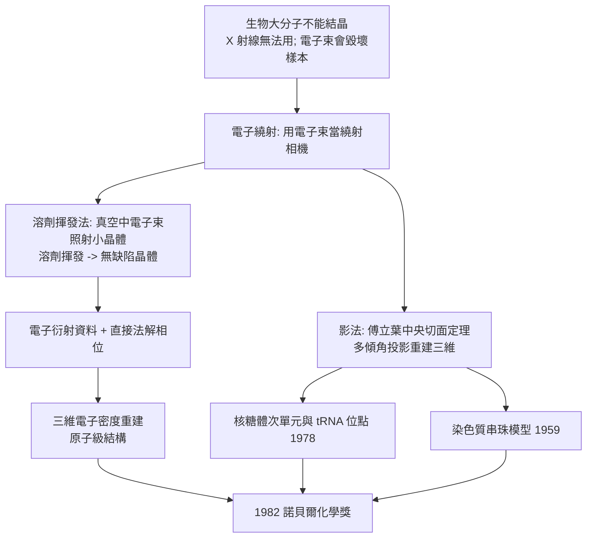

# 1982 · 克盧格與晶體學電子顯微鏡

> 1982 諾貝爾化學獎：阿龍·克盧格爵士（Sir Aaron Klug，1926–2018，英國）——表彰「其對晶體學電子顯微鏡之開發，以及其對生物學上重要之核酸—蛋白質複合體之結構詮釋」。他讓「看不見的大分子」有了「看得見的形狀」。

## 懸案（案情提要）

1980 年代的結構生物學，撞上了一堵牆：

- **X 射線晶体學**需要**單晶**——而許多生物學上最重要的分子**根本長不出晶體**：染色質（DNA 與蛋白質的複合體）、核糖體（巨大的核蛋白複合體）、病毒衣殼、膜蛋白；
- 更麻煩的是**X 射線無法分辨同一位置的不同原子**（例如 Fe 與 Mn 的散射能力相近），而生物複合體常常含有**金屬離子**（血紅蛋白的 Fe、碳酸酐酶的 Zn）；
- 而**電子顯微鏡**（1931 年 Ruska 發明）雖能看清生物樣品的形貌，卻**看不到分子層級的結構**——電子波的波長雖短，但樣品的**輻射損傷**極快（電子束打壞樣本只需數秒），且影像襯度取決於相位問題（**同一個「相位問題」困擾了 X 射線幾十年**）。

偵辦人：阿龍·克盧格。他的解法是**把兩者的優點結合**：**以電子顯微鏡產生電子繞射，再用電腦把繞射資料重建成三維結構**——並且**用電子束照射小晶體、讓它們在真空中揮發掉溶劑**，得到「近乎完美」的單晶。

## 前因

| 年份 | 事件 |
| --- | --- |
| 1926 | 克盧格生於立陶宛（當時屬波蘭）；1931 年隨家人移居英國。 |
| 1939–1943 | 劍橋（隨麥克斯·佩魯茨與 J. D. 伯納爾），研究病毒（烟草花葉病毒）的 X 射線繞射；1943 年完成博士學位。 |
| 1940s–50s | 於倫敦的 Birkbeck 學院與 U Hall（University College London）研究核酸的結構；1953 年後在劍橋的 MRC 分子生物學實驗室工作，與 Francis Crick（見 [1962-佩魯茨與血紅蛋白](1962-佩魯茨與血紅蛋白.md) 的 LMB 圈子）長期合作。 |
| 1950s | 研究染色質（chromatin）的結構；1959 年提出染色質的**「串珠模型」（beads-on-a-string）**——**DNA 纏繞在組蛋白核心上**。 |
| 1960s | 研究**核糖體**（ribosome）——當時最大的生物分子；1960 年提出以 X 射線繞射研究大分子的「**同晶置換法**」擴展方案。 |
| 1970s | 與 Jacques Dubochet（見 [2017-杜布歇與冷凍電顯](2017-杜布歇與冷凍電顯.md)）等人合作，發展**晶體學電子顯微鏡（crystallographic electron microscopy）**：以電子束照射**小晶體**，在真空中使溶劑揮發，得到近乎完美的晶體，再以電子繞射收集資料。 |
| 1978 | 發表電子顯微鏡下的**核糖體結構**：首次看到核糖體有兩個不對稱的次單元，並辨認出 tRNA 的結合位。 |
| 1982 | 獲諾貝爾化學獎。 |
| 1980s–90s | 應用「影法（image processing）」方法於生物樣品的電子顯微影像重建；與 Dubochet、Frank 共同發展**低溫固定技術**（1984 年液態乙烷冷卻玻璃化）——**這三人在 2017 年共享諾貝爾化學獎**。 |

## 調查

**偵查一：電子繞射——把「相位問題」交給電腦。**

電子與 X 射線一樣在晶格上產生繞射；差别在于：**電子的波長極短（100 kV 時約 $0.0037\ \mathrm{nm}$），因此單一方向的資料就帶有高解析度的資訊**。但電子束對樣品的傷害巨大：

$$\text{電子輻射損傷} \Rightarrow \text{生物樣本在數秒內被破壞}$$

**解法：把電子顯微鏡當成「繞射相機」而非「照相機」。**

1. **電子繞射**：以平行電子束照射晶體，記錄繞射斑點的位置與強度（可在極低劑量下進行）；
2. **相位解決**：用**直接法（direct methods）**或** Patterson 法**處理相位問題——**這正是豪普特曼與卡爾 1985 年獲獎的工作**（見 [1985-豪普特曼與直接法](1985-豪普特曼與直接法.md)）；
3. **重建**：由結構因子做 Fourier 合成，得到電子密度圖。

$$\rho(\mathbf{r}) = \frac{1}{V}\sum_{hkl}|F(hkl)|e^{-2\pi i(hx+ky+lz)}\ e^{i\phi(hkl)}$$

**「相位問題」的解決，使電子繞射能重建原子級結構**——這是 X 射線做不到的（因 X 射線的相位問題至今仍需重原子法等輔助）。

**偵查二：溶劑揮發法——「不會壞的晶體」。**

生物大分子的單晶問題在 1970 年代被一個簡單的物理小把戲解決：

$$\text{生物晶體（含水與溶劑）} \xrightarrow{\text{電子束照射，真空環境}} \text{溶劑揮發、蛋白質凝固} \xrightarrow{} \text{「近乎完美」的晶體}$$

**因為電子束在真空中照射小晶體，溶劑會迅速揮發，使蛋白質在原位凍結成固體——得到的晶體幾乎沒有缺陷。**這個技術使得**病毒衣殼**與**核糖體**的結構研究成為可能。

**偵查三：影法（Image Processing）——把「不完美的資料」變成「好結構」。**

生物樣品的電子顯微影像不像晶體那樣完美。克盧格發展的**影法**系列方法，把「模糊的影像」轉為可用於三維重建的資料：

$$\text{影像} \xrightarrow{\text{傅立葉轉換}} \text{功率譜} \xrightarrow{\text{過濾}} \text{分離各方向的資訊} \xrightarrow{\text{逆轉換}} \text{「投影」}$$

**關鍵概念**：生物樣品的二維投影之傅立葉變換，等於三維結構的**中央切面**（central slice）——因此把多個不同傾角的投影的傅立葉資訊「拼起來」，即可重建三維。

$$\text{中央切面定理（Central Slice Theorem）}$$

**偵查四：染色質的串珠模型——生物學上重要的複合體。**

1959–70 年代，克盧格以電子顯微鏡與 X 射線散射研究染色質，得出：

$$\text{DNA 纏繞在組蛋白八聚體上，形成「串珠」};\qquad \text{再進一步捲曲成螺線管（solenoid）}$$

**這個模型在 1970 年代被「核小體（nucleosome）」的生化研究證實**（其結構由倫敦的另外兩位科學家於 1980 年代解析——見 [1988-光合作用反應中心](1988-光合作用反應中心.md) 同期的結構戰爭），並成為今日**表觀遺傳學**的核心概念。

**偵查五：核糖體——「巨大的分子」的結構。**

核糖體是 RNA 與蛋白質的龐大複合體（細菌型約 2.5 MDa），其結構研究歷經三十年，最終在 2009 年獲得諾貝爾化學獎（見 [2009-約納特與核糖體](2009-約納特與核糖體.md)）。**克盧格在 1970 年代開創的電子顯微鏡方法，是這條路的起點**——他早在 1978 年就描述了核糖體的兩個次單元與 tRNA 結合位。

## 理論裁決

**判決一：電子衍射的相位問題——「直接法」的必要性。**

相位的取得需要「已知結構的對照」；電子衍射的樣品是生物大分子，幾乎不可能有重原子對照。**豪普特曼與卡爾的直接法（direct methods）**提供了出路：

$$\text{直接法}：\ \text{從強度資料 {|}F(h)|^2 \text{ 直接推得相位（在适当对称性与可解性条件下）}$$

$$\text{機制}：\text{「概率同余（probability congruence）」} \;\Longrightarrow\; \text{以隨機相位為起點，反覆「修正」使結構因子更符合}$$

**這是純數學家在沒有化學直覺的情況下，解出一個困擾物理化學家三十年的問題**——豪普特曼因此獲得諾貝爾化學獎（見 [1985-豪普特曼與直接法](1985-豪普特曼與直接法.md)）。

**判決二：中央切面定理——影像重建的數學。**

$$\text{三維物體的投影的傅立葉變換} = \text{三維傅立葉變換的一個「切片」}$$

**這意味著：只要從足夠多的角度取得投影，就能在傅立葉空間把它們「拼」成完整的立體資訊。**克盧格的影法正是這一原理在生物樣品上的實現，也是今日**電子斷層成像（cryo-ET）**的理論基礎。

**判決三：真空中的「玻璃化」——物理小把戲解決生物學大問題。**

$$\text{電子束} \xrightarrow{\text{真空}} \text{溶劑揮發} \xrightarrow{} \text{生物大分子在原位固化}$$

**「沒有完美的晶體，就讓它變成完美的」**——這是一種極具物理化學智慧的解法，也是 1980 年代結構生物學能突破「巨大複合體」障礙的關鍵。

**判決四：電子顯微鏡與 X 射線的分工——「各有所長」。**

| | X 射線 | 電子顯微鏡 |
| --- | --- | --- |
| 樣品需求 | 完美單晶 | 小晶體或薄樣品 |
| 輻射損傷 | 幾乎無 | 嚴重（需低劑量、冷卻） |
| 相位問題 | 需重原子法輔助 | 可用直接法 |
| 解析度 | 可達 $0.7$–$1$ Å | 優於 $1$ Å |
| 適用對象 | 可結晶的小分子與蛋白質 | 巨大複合體、病毒、水合樣品 |

**兩者互補，共同構成今日結構生物學的完整工具箱。**

## 後果

| 領域 | 影響 |
| --- | --- |
| 結構生物學 | 病毒衣殼、纖毛、核糖體、染色質的結構研究成為可能；電子斷層成像（cryo-ET）今日是結構生物學的常規方法。 |
| 技術傳承 | 克盧格與 Dubochet、Frank 合作發展的**低溫固定（玻璃化）技術**（1984），是 2017 年諾貝爾化學獎的核心（見 [2017-杜布歇與冷凍電顯](2017-杜布歇與冷凍電顯.md)）——**同一條研究線的三十年後收穫**。 |
| 生物物理 | 「影法」系列方法（傅立葉濾波、相關分析、隨機對稱化）成為生物影像分析的標準工具箱。 |
| 科學制度 | 克盧格出身立陶宛的猶太家庭、在英國完成學業，是二戰後歐洲科學人才流的一例；他亦長期在 LMB 與 Crick 共事，是「一個實驗室孕育大科學」的又一例證。 |

## 關聯

- [1962-佩魯茨與血紅蛋白](1962-佩魯茨與血紅蛋白.md)：X 射線結構生物學的開端——克盧格即出自這個圈子。
- [1973-菲舍爾與二茂鐵](1973-菲舍爾與二茂鐵.md)：同年的諾貝爾獎涵蓋金屬有機化學；克盧格的核糖體工作同樣涉及金屬中心（$\mathrm{Mg^{2+}}$）。
- [1982-克盧格與電子顯微鏡](1982-克盧格與電子顯微鏡.md)：即本卷。
- [1985-豪普特曼與直接法](1985-豪普特曼與直接法.md)：解相位問題的數學工具，是電子衍射結構重建的關鍵。
- [2009-約納特與核糖體](2009-約納特與核糖體.md)：克盧格在 1978 年描繪的核糖體，終於在 2009 年被完整解析。
- [2017-杜布歇與冷凍電顯](2017-杜布歇與冷凍電顯.md)：低溫固定的技術譜系。
