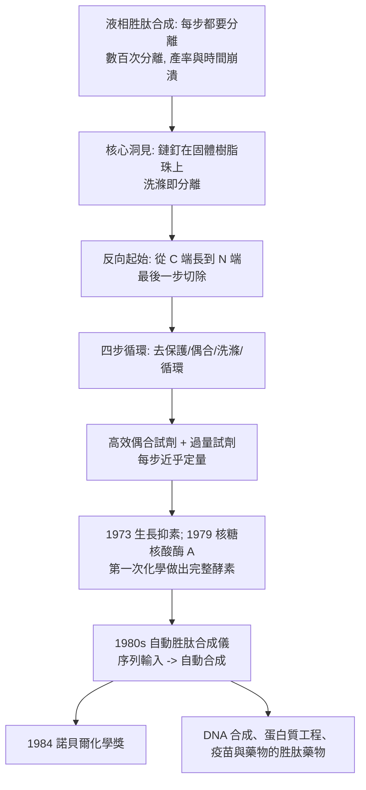

# 1984 · 梅里菲爾德與固相合成——把胜肽合成裝上機器

> 1984 諾貝爾化學獎：羅伯特·布魯斯·梅里菲爾德（Robert Bruce Merrifield，1921–2006，美國）——表彰「其固相胜肽合成法之發明」。他讓「逐條接上去的胜肽合成」從手工藝變成**可程式化的化學操作**。

## 懸案（案情提要）

1980 年代的生化學，有一個「合成」與「結構」之間的缺口：

- **蛋白質合成太難**。即使有了正確的序列（見 [1958-桑格與胰島素序列](1958-桑格與胰島素序列.md)），要「做出」一段胜肽來研究它，也是一場折磨：液相合成的每一步都需要分離、純化、再保護、再偶合；
- **一個 20 個胺基酸的胜肽，液相法可能需要數百次分離**，每次都損失產量、浪費時間；
- 而更實際的問題：**能不能像「自動分析儀」那樣，把合成也「自動化」？**

偵辦人：梅里菲爾德。他的答案是**固相合成**：把正在生長的胜肽鏈**固定在一顆固體樹脂珠上**，讓溶劑洗掉多餘的試劑、卻把鏈留在原地——**於是「分離」這一步消失了**。

## 前因

| 年份 | 事件 |
| --- | --- |
| 1921 | 梅里菲爾德生於美國加州。 |
| 1949 | 哥倫比亞大學博士（化學）；隨其兄（研究者）進入洛克斐勒研究所；**1950s 研究蛋白質的化學合成**（他先後合成了幾種胜肽，包括一種緩激肽）。 |
| 1950s–60s | 液相胜肽合成的「保護基策略」成熟（費歇爾的貢獻，見 [1902-費歇爾與醣類偵探學](1902-費歇爾與醣類偵探學.md)）；但流程冗長。 |
| 1963 | **首度固相合成實驗**：在聚苯乙烯（後改為交聯的聚苯乙烯—二乙烯苯）樹脂珠上，以 Boc 基保护的胺基酸逐步接上胜肽鏈。 |
| 1964 | 在《Journal of the American Chemical Society》發表《固相合成法：一種胺基酸序列的組裝方法》（*A General Method for the Synthesis of Peptide Chains from Amino Acids*）。 |
| 1960s–70s | 以此法合成**牛胰島素 A 鏈（1966–67）**、**生長抑素（somatostatin，1973）**、**核糖核酸酶 A（1979）**——**第一次以化學方法做出具有完整生物活性的酵素**。 |
| 1984 | 獲諾貝爾化學獎。 |
| 1980s–90s | 固相合成成為**自動胜肽合成儀**的基礎（1980s 後期由多家公司商業化）；「多肽合成儀」成為生物化學實驗室的標準裝備。 |

## 調查

**偵查一：核心洞見——「把鏈釘在原地」。**

液相合成的困境在於：每一步之後都要**分離**出想要的產物（未反應的試劑、產生的鹽、副產物都混在一起）。若把生長中的鏈**接在一顆不溶於溶劑的固體支持體上**，則：

$$\text{溶液中的物種} \xrightarrow{\text{洗滌}} \text{全部被沖走};\qquad \text{固體上的胜肽} \xrightarrow{} \text{原封不動}$$

**「液相—固相」兩相操作的分離問題，被一顆樹脂珠一次解決。**

**偵查二：固相合成的循環。**

每個循環四步（以 Fmoc 策略為例）：

$$\begin{aligned}
\text{① 去保護：} &\quad \text{树脂}{-}\mathrm{NH}{-}\text{Fmoc} \xrightarrow{20\%\,\text{piperidine/DMF}} \text{树脂}{-}\mathrm{NH_2} \\
\text{② 偶合：} &\quad \text{树脂}{-}\mathrm{NH_2} + \mathrm{Fmoc{-}AA{-}OH} \xrightarrow{\text{HATU/DIPEA}} \text{树脂}{-}\mathrm{NH{-}Fmoc{-}AA{-}OH} \\
\text{③ 洗滌：} &\quad \text{洗去過量試劑} \\
\text{④ 循環：} &\quad \text{直到鏈長完成}
\end{aligned}$$

**最後**：以**酸性或鹼性條件切斷**鏈與樹脂（例如 Fmoc 的酸敏或 TFA），並以**副作用反應**（side-reaction）保護精確組裝。

**偵查三：第一步的關鍵設計——「反向起始」。**

梅里菲爾德的方法與常規合成方向**相反**：

$$\text{常規（液相）：}\ \text{從 N 端開始接}\ \text{（每步保護 N 端）}$$

$$\text{固相：}\ \text{從 C 端開始，鏈「長」在固體上};\quad \text{N 端最後才接上}$$

**為什麼必須反向？**因為鏈要長在固體上，最後必須能一次切下；若從 N 端開始，最後殘留的保護基在切斷時會污染產物。**反向策略是固相法能成功的先決條件**——這是「限制驅動設計」的漂亮例子。

**偵查四：產率的數學——為什麼必須用過量試劑。**

每一步偶合的產率 $p$ 若為 $0.99$，20 步後總產率為：

$$P = 0.99^{20} \approx 0.82;\qquad \text{若 } p = 0.95:\ P = 0.95^{20} \approx 0.36$$

**因此固相法的關鍵是「偶合必須近乎定量」**——這推動了：

- **高效偶合試劑**（DCC、HATU、HBTU、COMU——把羧基活化到親核試劑能快速反應）；
- **過量試劑策略**（用 2–10 倍當量的胺基酸，補償不完全反應；未反應者被洗掉）；
- **加速偶合的添加劑**（HOBt、DMAP）。

**「用過量、靠洗滌去雜」——這是固相法的化學哲學**，並被後來的 DNA 合成完全沿用（見 [1980-伯格與重組DNA](1980-伯格與重組DNA.md)）。

**偵查五：可程式化——自動化的到來。**

$$\text{重複的循環} \xrightarrow{\text{程式控制}} \text{自動合成儀}$$

1980 年代中期，第一台商用**多肽合成儀**（如 Applied Biosystems 的 Model 430A）上市：**輸入序列，儀器自動完成數百個循環。**

**這是化學儀器史上的一個里程碑**：**「化學實驗」第一次被程式化**。今日的自動胜肽合成、DNA 合成、乃至蛋白質的「自動固相合成」皆為此脈統。

## 理論裁決

**判決一：固相合成的數學優越性。**

$$\text{液相法}：\ \text{每步需要 } \sim 3\text{–}5 \text{ 次操作（保護、偶合、分離、洗滌、純化）} \Rightarrow \text{總操作數} \sim n \times 4$$

$$\text{固相法}：\ \text{每步需要 } 2\text{ 次操作（偶合、洗滌）} \Rightarrow \text{總操作數} \sim n \times 2$$

**且液相法的分離會損失產率，固相法的洗滌不損失鏈。**這是固相法勝出的量化理由。

**判決二：保護基策略的現代化（Fmoc）。**

$$\text{Fmoc（9-芴甲氧羰基）}：\ \text{鹼敏感（piperidine 去除）、}\ \text{與酸不敏感}（因此可與酸敏的側鏈保護並存）}$$

$$\text{與} \ \mathrm{Boc}\ \text{（酸敏感）相比，Fmoc 允許} \ \text{TFA 等酸敏側鏈保護基同時使用}$$

**「正交保護（orthogonal protection）」**——不同官能基用互不干擾的條件去除——成為多肽合成的標準設計語言，今日的蛋白質半合成與蛋白化學（protein chemistry）皆沿用。

**判決三：化學的可程式化。** 梅里菲爾德方法最深遠的影響不是「做出胜肽」，而是：

$$\boxed{\text{「重複的化學循環」可以被寫成程式、被機器執行}}$$

這是**「自動化實驗室」時代的化學版預言**——今日的自動化合成機器人、DNA 合成儀、以及 2020 年代的 AI 驅動合成優化，都是這條線。

**判決四：合成與生物學的匯流。** 1979 年梅里菲爾德以固相法合成的**核糖核酸酶 A**，是第一次以**純化學方法**做出具有完整催化活性的酵素（並於 1986 年由另一些實驗室用更完善的化學法獨立重現）。

$$\text{「蛋白質是化學品」的最終證明} \quad\Longrightarrow\quad \text{「可以按需設計並製造蛋白質」}$$

**這條線在 1984 年之後的延伸**：重組 DNA（做蛋白質，見 [1980-伯格與重組DNA](1980-伯格與重組DNA.md)）、胜肽疫苗、胜肽藥物、以及蛋白質的化學全合成。

## 後果

| 領域 | 影響 |
| --- | --- |
| 生化學 | 多肽合成儀成為標準裝備；「化學合成的胜肽」用於研究蛋白質的構形—活性關係、抗體的Fab 片段、胜肽激素類似物。 |
| 醫藥 | 胜肽藥物（GLP-1 類降糖藥、胜肽抗生素、胜肽疫苗）；免疫原性胜肽疫苗（以胜肽為抗原）。 |
| 蛋白質生物化學 | **蛋白質化學（protein chemistry）**：定點突變（以合成胜肽片段接回蛋白質）、半合成、位點特定交聯。 |
| DNA 技術 | 固相合成的原理被 DNA 合成完全沿用（磷醯胺化學＋柱層析洗滌＋過量試劑）——**DNA 合成儀即固相胜肽合成儀的同構兄弟**。 |
| 科學制度 | 梅里菲爾德是「**個人研究者的長期堅持**」典範：他在 1960 年代提出的想法，在 1970 年代被同領域的人視為「不實際」，最終在 1980 年代初被承認（他的諾貝爾演講中特別提到同行的質疑）。 |

## 關聯

- [1902-費歇爾與醣類偵探學](1902-費歇爾與醣類偵探學.md)：費歇爾在 1900 年代已合成上百條胜肽，但無法實用化——本案是他的技術終局。
- [1955-迪維尼奧與催產素](1955-迪維尼奧與催產素.md)：液相合成時代的最高峰（九胜肽激素），與固相法的自動化形成前後兩期。
- [1958-桑格與胰島素序列](1958-桑格與胰島素序列.md)：序列的定出，使「按序合成」成為可能的目標。
- [1972-安芬森與核糖核酸酶](1972-安芬森與核糖核酸酶.md)：1979 年梅里菲爾德以化學法做出核糖核酸酶 A——序列與構形的課業在本案得到化學式的答卷。
- [1980-伯格與重組DNA](1980-伯格與重組DNA.md)：固相化學與重組 DNA 是「做蛋白質」的兩條平行的替代途徑（化學合成 vs 生物表現）。
- [1984-梅里菲爾德與固相合成](1984-梅里菲爾德與固相合成.md)：即本卷。
- [2022-貝爾托西與點擊化學](2022-貝爾托西與點擊化學.md)：生物正交化學的興起，正是「化學與生物系統如何共處」的問題，與胜肽合成的工程經驗相輔相成。
