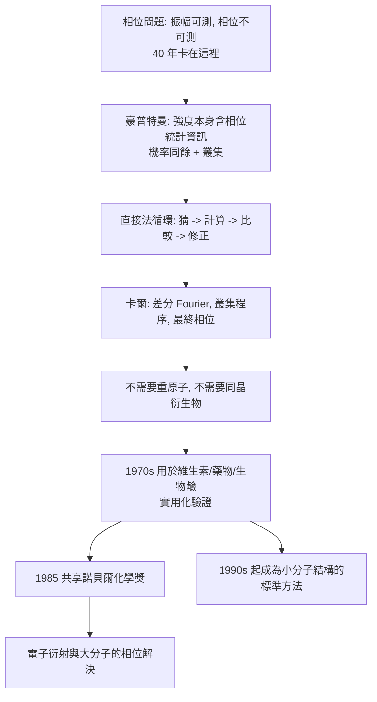

# 1985 · 豪普特曼與卡爾——用數學破解相位問題

> 1985 諾貝爾化學獎：赫伯特·奧古斯特·豪普特曼（Herbert Aaron Hauptman，1917–2011，美國）與傑羅姆·卡爾（Jerome Karle，1918–2013，美國）——表彰「其對晶體結構之直接分析法的發展」。**一位純數學家，一位物理化學家，把 X 射線結構測定最難的一關，用統計與機率的方法推開了。**

## 懸案（案情提要）

X 射線晶體學的核心障礙，四十年沒人真正解決：

- 繞射實驗量到的是**結構因子的振幅** $|F(hkl)|$，但計算電子密度需要**相位角** $\phi(hkl)$：

$$\rho(x,y,z) = \frac{1}{V}\sum_{hkl}|F(hkl)|\,e^{-2\pi i(hx+ky+lz)}\,e^{i\phi(hkl)}$$

- 振幅可測、相位不可測——這就是「**相位問題**」。沒有相位，就沒有電子密度圖，就沒有結構；
- 傳統解法是**重原子法**（見 [1962-佩魯茨與血紅蛋白](1962-佩魯茨與血紅蛋白.md)）：找一個重原子（如 Hg、Au）作「相位標籤」。但這要求：
  - 分子含有或能引入重原子；
  - 要製備多個同晶衍生物；
  - **對天然產物、對生物大分子幾乎不可行**；
- 另一條路是 **Patterson 法**（1934 年由 M. C. Patterson 提出的向量法），但只能給出「對角線」資訊，且難以直接轉成結構。

**1985 年的答案是：不必有重原子，不必有同晶衍生物——直接從強度資料本身，把相位「猜」出來，而且用統計保證猜對。**

## 前因

| 年份 | 事件 |
| --- | --- |
| 1917 / 1918 | 豪普特曼生於美國紐約（美國籍、猶太家庭）；卡爾生於美國紐約。 |
| 1940s | 豪普特曼在哥倫比亞大學取得數學學位，後於**美國海軍**服役，於 1940–50 年代任職於**美國海軍研究實驗室（Naval Research Laboratory）**，從事 X 射線繞射與機率分析的研究。 |
| 1950s | 豪普特曼在海軍實驗室接觸到**相位問題**與「直接法」的構想：與其同事 **David Sayre** 討論（Sayre 1952 年提出「Triplet」估計的雛形），並發展**「機率同餘（probability congruence）」**的概念。 |
| 1960s | 豪普特曼持續發展直接法的數學；**卡爾**（在美國海軍研究實驗室與海軍物理學家 W. K. 近藤（William K. Kondo）合作）則以**「差分 Fourier 法」與「半高法（half-height method）」**改善結構精修，並在 1960 年代提出**「概率分布法」**的實作。 |
| 1970s | 豪普特曼與卡爾合作，把直接法用於解決**小分子與中藥分子結構**（維生素、藥物、生物鹼）——**證明直接法「真的能用」**；兩人並整理出實用的叢集程序（*clustering*）與**「最終相位（final phase）」**的求法。 |
| 1985 | 兩人共享諾貝爾化學獎（同年物理獎由瑞士的 Klaus von Klitzing 與美國的 Horst Störmer 分享）。 |
| 1990s | 直接法成為小分子結構解定的**標準工具**（今日幾乎所有小分子 X 射線結構都用它）；並擴展到大分子（尤其以直接法解決相位的高分子數目持續增加）。 |
| 2011 / 2013 | 豪普特曼逝於貝卡拉（賓州）；卡爾逝於馬里蘭。 |

## 調查

**偵查一：問題的重新表述——「我們不需要知道相位，只需要知道相位的統計」。**

直接法的洞見：

$$\text{若 } \phi \text{ 未知，} \quad \text{則 } |F(hkl)|^2 \text{ 本身含有「相位關係」的統計資訊}$$

$$\text{因此：}\quad \text{從 } |F|^2 \text{ 出發，用「隨機相位」為起點，反覆修正使所有 } |F| \text{ 同時吻合}$$

**這是一個統計的「自我一致性」問題**——用一個候選相位集合去「解釋」所有觀測強度，並不斷改善它。

**偵查二：機率同餘——「弱反射」的統計武器。**

豪普特曼的技術核心是**機率同餘**：

$$\text{在强度分布中，} \quad \text{「弱」反射（} |F| \text{ 小）之間的相位關係，} \quad \text{比强反射的關係更「同餘」（congruent）}$$

**直覺**：由於 Friedel 定律 $|F(hkl)| = |F(\bar{h}\bar{k}\bar{l})|$，每一對對稱反射只有一個獨立相位可猜；因此有 $N$ 個獨立相位、$N$ 個方程、$N$ 個未知數的「超定方程系統」——**機率上，若猜對的相位愈多，就愈容易發現不一致並修正**。

$$\text{直接法的循環}：\ \text{猜相位} \to \text{計算 } |F|_{\text{模型}} \to \text{比較} \to \text{修正最壞的相位} \to \text{重複}$$

**偵查三：卡爾的實作工具——差分 Fourier 與叢集。**

卡爾的貢獻是把直接法變成可操作的流程：

- **差分 Fourier 法（difference Fourier）**：在已知結構的基礎上，只計算「實測密度 − 理論密度」的差，用以尋找錯置的原子與缺失的原子；
- **叢集（clustering）與叢集—叢集關係**：把強度相近的反射分組，由叢集內的關係推相位；
- **最終相位（final phase）**：用最可靠的叢集關係鎖定一個絕對基準，其餘相位由**同餘（congruence）鏈**逐步傳遞確定。

$$\text{叢集内關係} \xrightarrow{\text{機率同餘}} \text{第一組相位} \xrightarrow{\text{傳遞}} \text{全部相位}$$

**偵查四：叢集程序（clustering）——「從強度找同餘」。**

$$\text{叢集程序}：\ \text{把强度相似的 } n \text{ 個反射看作一個「叢集」，其相位被視為相同}$$

$$\text{理由}：\ \text{强反射的相位具有集中的機率分布（最可能值），弱反射則分散}$$

**這個「用統計壓制不確定性」的技巧，是豪普特曼方法的精華。**

**偵查五：驗證——「解出來的結構會自我證明」。**

直接法解出的結構必須通過嚴格檢驗：

$$\text{檢驗}：\ \text{計算模型的 } |F|_{\text{計算}} \ \text{與觀測值比較};\qquad R = \frac{\sum ||F_{\text{obs}}|-|F_{\text{calc}}||}{\sum |F_{\text{obs}}|}$$

**若 $R$ 值合理（對小分子常 $< 0.05$）且化學上合理，則結構可信。**這是「自證」式的判準——**相位問題的解答不必依賴外部假設，而由資料自身的內部一致性保證。**

## 理論裁決

**判決一：統計替代化學——本案的方法論。** 傳統結構測定倚賴**化學直覺**（引入重原子、製備衍生物）；直接法倚賴**統計直覺**：

$$\text{在相位未知時，} \quad \text{先假設它「隨機」，再讓資料把它「修正」到正確}$$

**這是把一個代數問題（求 $\phi$）轉化為一個優化問題（求使模型吻合觀測的 $\phi$）**，並以迭代法逼近。

**判決二：機率同餘的內容。** 豪普特曼的核心命題（以「歸一化強度分布」的語言表述）：

$$\text{在强度分布的「歸一化隨機變數」模型下，} \quad \text{某些反射對之間的相位差具有尖銳的機率分布}$$

$$\text{因此：}\ \text{把相位「猜成」最可能的值（差 0 或 } \pi\text{），成功率顯著高於隨機猜測}$$

**這解釋了為何直接法在實務上「準得驚人」**：$2^{N}$ 的可能相位空間中，統計把它壓縮到極小的有效集合。

**判決三：叢集與傳遞——把不確定性局部化。**

$$\text{叢集（cluster）}：\ \{h_1, h_2, \dots, h_n\},\ \text{其相位被視為等於 }\ \phi_c \quad (\text{叢集相位})$$

$$\text{機率同餘關係}：\ \phi_c \approx \phi_{c'} \ \text{或}\ \phi_c \approx \phi_{c'} + \pi$$

$$\text{傳遞}：\ \text{由叢集間的同餘關係，逐一確定所有絕對相位}$$

**這是把一個巨大的非線性問題（$N$ 個未知數）化約成一系列小問題（叢集間的關係）的策略**——今日的機器學習cryo-EM 相位求解，本質上也在做類似的事（用「關係」推導）。

**判決四：驗證的雙重要求。**

$$\text{直接法解出的結構必須同時滿足}：\quad \underbrace{|F_{\text{模型}}| \approx |F_{\text{obs}}|}_{\text{統計檢驗}} \quad \text{且} \quad \underbrace{\text{化學上合理}}_{\text{結構檢驗}}$$

**「雙重驗證」是所有結構測定程序的通用原則**——X 射線（振幅 + 相位）、NMR（化學位移 + 耦合常數 + NOE）、冷凍電顯（密度擬合 + 化學合理性）、質譜（精確質量 + 碎裂模式）。

## 後果

| 領域 | 影響 |
| --- | --- |
| 結構化學 | 直接法成為**小分子結構解定的標準方法**（今日的《國際晶體學表》與各類結構資料庫收錄的結構，絕大多數用直接法解出）；使「無重原子的天然產物」與「藥物多晶型」研究成為常規。 |
| 藥物研發 | 藥物的多晶型（polymorph）結構解析——**晶型影響藥物的溶解度、溶解速率與專利**；直接法降低了結構解析的成本。 |
| 生物化學 | 電子衍射與大分子相位求解（如病毒衣殼、糖的複合體）大量使用直接法；**2017 年的冷凍電顯（見 [2017-杜布歇與冷凍電顯](2017-杜布歇與冷凍電顯.md)）則把直接法帶入大分子時代**。 |
| 數學與物理 | 「機率同餘」把數學家引入 crystallography 核心；豪普特曼自述是「數學家誤闖化學」的結果——**諾貝爾獎史上純數學背景得主的代表**。 |
| 科學文化 | 卡爾與豪普特曼都長期在**美國海軍研究實驗室**任職（軍方的科學傳統是美國晶體學的重要支柱）；豪普特曼亦長期服務於通用電氣研究實驗室（與 [1932-朗繆爾與表面化學](1932-朗繆爾與表面化學.md) 的 GE 傳統同一脈）。 |

## 關聯

- [1962-佩魯茨與血紅蛋白](1962-佩魯茨與血紅蛋白.md)：重原子法與相位問題的開端——本案是它的普遍化與簡化。
- [1964-霍奇金與X射線晶體學](1964-霍奇金與X射線晶體學.md)：生物大分子的 X 射線結構測定，多重同晶母體的相位解法——與直接法互補。
- [1982-克盧格與電子顯微鏡](1982-克盧格與電子顯微鏡.md)：電子衍射的相位問題，正是靠直接法與豪普特曼—卡爾的叢集程序解決。
- [1985-豪普特曼與直接法](1985-豪普特曼與直接法.md)：即本卷。
- [2017-杜布歇與冷凍電顯](2017-杜布歇與冷凍電顯.md)：相位問題的「機器學習解」，是直接法精神的現代延伸。
- [2024-貝克與蛋白質設計](2024-貝克與蛋白質設計.md)：結構預測的可行性，部分建立在結構資料庫的品質上，而其品質正由直接法所決定。
