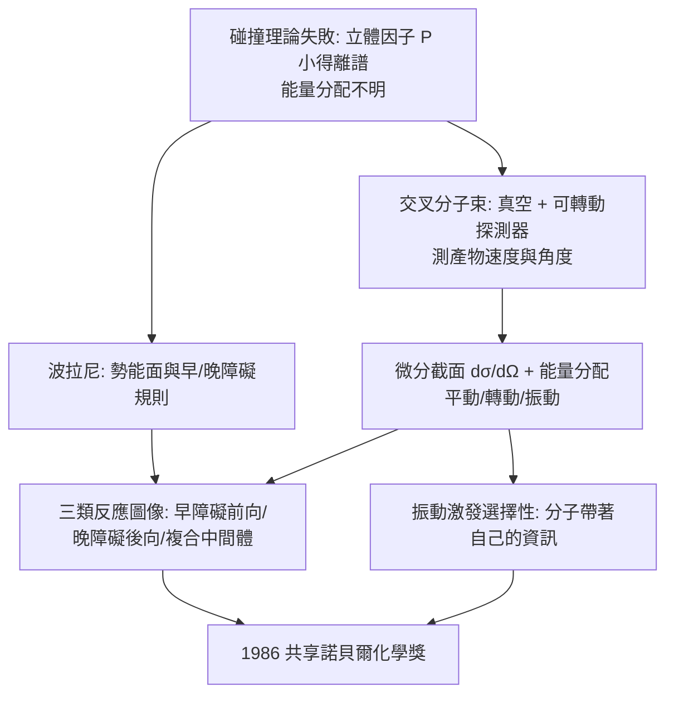

# 1986 · 赫施巴赫、李遠哲與波拉尼——看清反應的碰撞

> 1986 諾貝爾化學獎（共享）：杜德利·羅伯特·赫施巴赫（Dudley R. Herschbach，1932– ，美國）、李遠哲（Yuan Tseh Lee，1936– ，台灣／美國）與約翰·卡羅爾·波拉尼（John Charles Polanyi，1929– ，匈牙利／加拿大）——表彰「其對化學基本過程動力學的貢獻」。**化學反應第一次被拍成了一部三維的電影。**

## 懸案（案情提要）

1970 年代的化學動力學，能描述「**多少**反應會發生」，卻幾乎不知道「**它們怎麼發生**」：

- **碰撞理論的失敗**：依碰撞理論，速率應為

$$k = P\,\sigma\,\sqrt{\frac{8k_BT}{\pi\mu}}\,e^{-E_a/RT}$$

其中 $P$ 為**立體因子（steric factor）**。但實測的 $P$ 值常小得離譜（$10^{-1}$ 到 $10^{-6}$）——**「分子是否恰好以正確的姿勢相撞」這個問題，碰撞理論答不出來**；
- **能量的去向**：反應物釋放（或吸收）的能量，在產物之間**如何分配**？變成平動？轉動？振動？多少能量變成了化學鍵？——**「能量分配問題」是化學動力學的最大空白**；
- **方向性**：產物是往前散射（forward scattering）還是往後（backward scattering）？是「共線碰撞」還是「斜著撞」？
- 而這些不是抽象問題：**燃燒、大氣化學（臭氧層）、爆炸、催化表面反應**，都取決於這些細節。

偵辦人：三人分工。**波拉尼**做理論（勢能面的圖像），**赫施巴赫與李遠哲**造儀器（**交叉分子束**），把反應的「碰撞瞬間」拍成照片。

## 前因

| 年份 | 事件 |
| --- | --- |
| 1929 | 波拉尼生於柏林（匈牙利裔家庭），1933 年隨家人移居英國；1952 年於曼徹斯特大學取得博士學位，先後於加拿大國家研究委員會與普林斯頓從事博士後研究；1956 年起任多倫多大學教授，後為大學教授（emeritus）。 |
| 1932 | 赫施巴赫生於美國加利福尼亞州；哈佛大學（博士），後任哈佛教授。 |
| 1936 | 李遠哲生於台灣新竹（新竹州）；在台灣完成大學教育後赴美，1959 年於加州大學柏克萊分校取得博士學位，隨後留在柏克萊的勞倫斯放射實驗室，與 **Dudley R. 赫施巴赫** 合作開展分子束實驗。 |
| 1954 | **李遠哲進入柏克萊的勞倫斯放射實驗室**（他此前在密西根大學攻讀博士），在**赫施巴赫**（當時在柏克萊訪問）指導下開始做**交叉分子束**實驗——1954–55 年的鉀與鹵化鹽反應實驗是這條路的開端。 |
| 1955–1959 | 赫施巴赫與李遠哲在柏克萊完成一系列**交叉分子束反應**實驗（$\mathrm{K + NaBr}$、$\mathrm{Rb + CH_3I}$ 等），確立了**產物速度與角度分布**的量測方法。 |
| 1950s–60s | 波拉尼發展**反應動力學的理論**：**勢能面（potential energy surface）**的圖像、「早障礙／晚障礙」與能量分配的**波拉尼規則**。 |
| 1960s–70s | 赫施巴赫回哈佛，發展**分子束與超射頻（microwave）技術**；李遠哲持續擴展分子束實驗（鹽類反應、二聚反應、振動激發的反應）；三人共同建立「**態到態化學（state-to-state chemistry）**」。 |
| 1986 | 三人共享諾貝爾化學獎。 |
| 1994–2006 | 李遠哲任中央研究院院長；2011 年當選國際科學理事會主席。 |

## 調查

**偵查一：交叉分子束——把「碰撞」變成可控的幾何。**

兩束分子在真空中**以精確角度交叉**，只有極少數分子真正「命中」：

$$\text{反應}：\ \mathrm{A} + \mathrm{B} \xrightarrow{} \mathrm{C} + \mathrm{D}$$

$$\text{產物被四極質譜儀按質量分析，再由可轉動的探測器測其}\textbf{角度與速度分布}$$

**關鍵設計**：
- **真空**：消除殘餘氣體造成的「碰撞雜訊」；
- **速度選擇（速度分析器或超射頻 chopper）**：篩選特定速度的入射分子；
- **可轉動探測器**：掃描 $0$–$180\,^\circ$ 的角度，得到**微分截面**：

$$\frac{d\sigma}{d\Omega}(\theta) \ \text{——產物飛向哪裡}$$

**產物速度分布還給出能量分配**：由產物的速度可算出平動能，再由紅外光譜與微波譜算振動與轉動能，三者相加應等於反應熱：

$$E_{\text{trans}} + E_{\text{rot}} + E_{\text{vib}} = \Delta H + E_{\text{反應物碰撞}}$$

**偵查二：碰撞的「命運地圖」——三類典範。**

分子束實驗立刻顯示，不同反應的散射圖像分為幾類：

| 類型 | 能量釋放時機 | 散射特徵 | 代表反應 |
| --- | --- | --- | --- |
| **「早障礙」反應**（放熱） | 電子重疊早 | **前向散射**、**振動激发** | $\mathrm{H + H_2}$、鹵素 + 鹵素 |
| **「晚障礙」反應**（吸熱） | 電子重疊晚 | **後向散射**、**平動激發** | $\mathrm{F + H_2}$、$\mathrm{K + NaBr}$ |
| **「複合中間體」反應** | 有長壽命中間物 | 各向同性散射 | $\mathrm{Na + NaBr}$（有 $\mathrm{Na_2Br}$ 中間物） |

**「早障礙／晚障礙」即波拉尼規則**，它把勢能面的形狀與散射行為直接對應：

$$\text{早障礙}（\text{吸引性勢能面}）\Rightarrow \text{反應物「抓住」後彈回} \Rightarrow \text{振動激發}$$

$$\text{晚障礙}（\text{排斥性勢能面}）\Rightarrow \text{必須拉長鍵才能過渡} \Rightarrow \text{共線碰撞} \Rightarrow \text{後向散射}$$

**偵查三：波拉尼的勢能面圖像——「化學反應的地形圖」。**

波拉尼把反應描繪成二維（多維）勢能面上的軌跡：

$$\text{反應坐標} = \text{反應物核間距離等}; \qquad \text{軌跡} \sim \text{最小能量路徑（MEP）}$$

$$\underbrace{\text{反應物谷}}_{\text{入口}} \xrightarrow{\text{鞍點}} \underbrace{\text{產物谷}}_{\text{出口}}$$

**這幅「地圖」解釋了反應的立體因子（$P$）：若勢能面的「谷」很窄，則只有少數特定構型的碰撞能通過——$P$ 天然很小。**

**偵查四：振動激發的選擇——「分子會記得」。**

李遠哲與赫施巴赫的實驗發現：**若反應物的某個振動模式被激發，反應速率會顯著增加**（振動模式選擇性）：

$$\mathrm{H_2}\ (\text{振動量子數}\ v=1) + \mathrm{Cl_2}\ (\text{激發態}) \;\Rightarrow\; \text{反應速率大幅上升}$$

**這是「化學的記憶」——反應物不是「無差別的碰撞者」，它帶著自身的振動資訊。**這條觀念是**態到態化學**的核心，並直通 1990 年代的**飛秒雷射選擇性激發**（見 [1999-茲韋勒與飛秒化學](1999-茲韋勒與飛秒化學.md)）與「**-mode-specific chemistry**」。

## 理論裁決

**判決一：過渡狀態理論的定位。** 波拉尼與過渡狀態理論的關係是互補的：

$$\text{過渡狀態理論（統計）}：\ k = \frac{k_BT}{h}e^{-\Delta G^\ddagger/RT}$$

$$\text{分子束實驗（微觀）}：\ \text{給出「走向過渡態的那條路」的細節}$$

**過渡狀態理論給出速率的「平均值」，分子束給出速率的「分布與圖像」——兩者是同一物理的兩種視角。**

**判決二：能量分配律（波拉尼規則）。**

$$\boxed{\text{早障礙（放熱）}：\ \text{能量主要成為產物的振動能（}E_{\text{vib}} \text{大），散射偏向前方}}$$

$$\boxed{\text{晚障礙（吸熱）}：\ \text{能量主要成為平動能（}E_{\text{trans}} \text{大），散射偏向後方（近共線）}}$$

**這條規則有巨大的工業意義**：它指出**若要讓反應「有效」，應把能量「灌」在正確的模式下**——今日的雷射選擇性激發化學、激發態反應通道控制，全部建立在這條規則上。

**判決三：反應的「立體因子」被解釋。**

$$\text{立體因子 } P \text{ 的物理來源} = \text{勢能面谷的幾何「窄度」} \times \text{碰撞的幾何因子}$$

**這把碰撞理論中那個神秘的 $P$ 從「經驗係數」還原成了幾何事實。**

**判決四：化學反應的「散射語言」。** 分子束實驗建立的語言：

$$\frac{d\sigma}{d\Omega}(\theta),\qquad f(v'),\qquad E_{\text{trans}}/E_{\text{vib}}/E_{\text{rot}}$$

**這套語言後來成為化學動力學研究（尤其是表面反應、燃燒、大氣化學）的通用語言**——例如「臭氧層破壞中 $\mathrm{Cl + O_3 \to ClO + O_2}$ 的後向散射」直接決定了臭氧的壽命（見 [1995-克魯岑與臭氧層](1995-克魯岑與臭氧層.md)）。

## 後果

| 領域 | 影響 |
| --- | --- |
| 大氣化學 | 分子束實驗提供了 $\mathrm{O}$、$\mathrm{Cl}$、$\mathrm{OH}$ 等基元反應的速率常數與能量分配；**臭氧層的存亡因此可以用量測數據計算**（見 [1995-克魯岑與臭氧層](1995-克魯岑與臭氧層.md)）。 |
| 燃燒與爆炸 | 燃燒化學的基元反應動力學（$\mathrm{H + O_2}$、$\mathrm{OH + CO}$ 等）建立在分子束與激發態實驗上。 |
| 表面科學 | 分子束撞擊表面（**分子束表面反應**）可測吸附能、反應性與能量耗散——這是「分子束技術」在材料科學的應用（李遠哲的另一貢獻領域）。 |
| 雷射化學 | 振動激發的選擇性 → 1990 年代的飛秒雷射「波形控制化學」（見 [1999-茲韋勒與飛秒化學](1999-茲韋勒與飛秒化學.md)）。 |
| 醫學與藥學 | 分子動力學模擬（MD）計算蛋白質配體結合自由能，正是「分子碰撞與能量分配」的巨量計算版本。 |
| 科學制度 | 李遠哲是**首位獲諾貝爾獎的台灣人**，也是中央研究院院長（1994–2006）、國際科學理事會主席（2011）；他的科學生涯橫跨台灣、美國，並把諾貝爾獎的視野帶回亞洲。 |

## 關聯

- [1903-阿瑞尼斯與離子解離疑案](1903-阿瑞尼斯與離子解離疑案.md)：活化能與速率常數的語言，是本案的起點。
- [1956-鏈反應與爆炸](1956-鏈反應與爆炸.md)：鏈載體（自由基）的動力學，本案把它們的基本反應拍成電影。
- [1967-極快反應](1967-極快反應.md)：超快過程的時間解析度，本案提供「空間解析度」（角度與速度分布）。
- [1986-李遠哲與分子束](1986-李遠哲與分子束.md)：即本卷。
- [1995-克魯岑與臭氧層](1995-克魯岑與臭氧層.md)：本案量測的基元反應，直接決定臭氧層的命運。
- [1999-茲韋勒與飛秒化學](1999-茲韋勒與飛秒化學.md)：波拉尼規則在雷射時代的實現。
