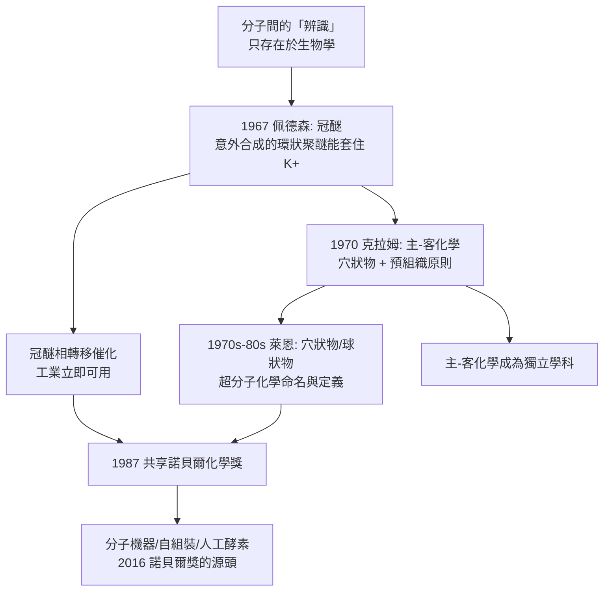

# 1987 · 克拉姆、萊恩與佩德森——主與客的化學

> 1987 諾貝爾化學獎：唐纳德·詹姆斯·克拉姆（Donald J. Cram，1919–2001，美國）、讓-馬里·萊恩（Jean-Marie Lehn，1939– ，法國）與查爾斯·約翰·佩德森（Charles J. Pedersen，1904–1989，美國）——表彰「其對具有高度選擇性的結構特異相互作用之分子之開發與應用」。**超分子化學**從此建國。

## 懸案（案情提要）

1970 年代的化學，有一個「生物學的謎」擺在化學家面前：

- **酵素與受體如何「認出」自己的對象？**一個酵素的活性部位只結合特定的受質；一個抗體只結合特定的抗原；細胞膜上的受體只辨認特定的訊號分子。**分子之間有「辨識」的能力**；
- 但在化學的語言裡，分子間的作用只有「共價鍵」（強、有方向性、有位置專一性）與「非共價作用」（弱、無方向性、難以控制）；
- **於是有一個尖銳的問題**：**能不能設計出人工的分子，使它們之間的「弱作用」也變得專一、有方向、有位置選擇性？**如果能，人工分子就能做酵素與藥物能做的事；
- 而更誘人的是：**如果人工分子能做到，人工的「機器」與「裝置」是否也可能？**

偵辦人：佩德森（冠醚）、克拉姆（主—客化學）、萊恩（穴狀物與超分子化學）。

## 前因

| 年份 | 事件 |
| --- | --- |
| 1904 | 佩德森生於韓國（當時為日本統治下的朝鮮）；他的父親是挪威裔、母親是朝鮮人；少年時期在釜山讀書。 |
| 1920s–30s | 佩德森在美國就學（麻省理工學院），1927 年取得學士、1930 年取得博士；隨即進入**杜邦實驗室**（Experimental Station）任職——**此後 42 年都在杜邦**。 |
| 1940s–60s | 杜邦的研究方向：含鉛汽油添加物（四乙基鉛的改進）、氯丁橡膠（neoprene）的開發、金屬去活化劑。 |
| 1967 | **冠醚（crown ether）的發現**：在合成含兩個羥基的雙酚（catechol）與二鹵代物時，意外得到環狀的聚醚產物——**冠醚**。他試了各種尺寸的冠醚，發現它們能像「冠子」一樣把金屬陽離子套在中央。 |
| 1972–1977 | 佩德森發表冠醚系列論文；**1970 年，克拉姆把這種現象命名為「主—客化學（host–guest chemistry）」**並系統化「結構特異相互作用」的概念。 |
| 1968–1973 | **克拉姆**（加州理工學院）合成**穴狀物（cryptand）**——三維的「籠子」，選擇性更高；並提出「**冠（crown）／穴（cryptand）／球（spherand）**」的分類概念與「**預組織（preorganization）**」原則。 |
| 1970s–80s | **萊恩**（斯特拉斯堡大學）發展**球狀物（spherand）**、**穴狀物**與**纖維狀聚合體（線型、環狀的聚醚鏈，如 polyoxomacrocycles）**；建立「**超分子化學（supramolecular chemistry）**」這一學科名稱與定義。 |
| 1987 | 三人共享諾貝爾化學獎。 |

## 調查

**偵查一：冠醚——「冠子」的發現與其立即的工業用途。**

冠醚的結構：以 $-\mathrm{CH_2CH_2O}-$ 為單元組成的大環醚。

$$\text{18-冠-6（18-crown-6）}：\ \text{6 個 } -\mathrm{O}-\ \text{與 6 個 } -\mathrm{CH_2CH_2}-\ \text{組成 18 員環}$$

$$\text{冠醚的氧原子} \xrightarrow{} \text{以孤對電子} \xrightarrow{} \text{配位金屬陽離子}$$

$$\mathrm{K^+} + \text{18-冠-6} \rightleftharpoons \text{配合物},\qquad K \sim 10^6\ \mathrm{M^{-1}}$$

**最著名的選擇性**：**18-冠-6 對 $\mathrm{K^+}$ 的親和力遠高於對 $\mathrm{Na^+}$**——因為 $\mathrm{K^+}$ 較大，與冠醚的空腔大小更匹配（**尺寸匹配原則**）。

$$\text{尺寸匹配}：\ \text{空腔直徑} \approx \text{離子直徑} \Rightarrow \text{最佳結合}$$

**立即的工業應用（佩德森在杜邦的實務）：**冠醚是極佳的**相轉移催化劑**：

$$\mathrm{K^+}\ (\text{固相}) + \text{冠醚} \rightarrow \text{可溶於有機相的} \left[\mathrm{K(冠醚)}\right]^+$$

$$\text{原本不能反應的} \ \text{固相鹽} + \text{有機底物} \xrightarrow{\text{冠醚}} \text{可以反應}$$

**冠醚相轉移催化今日是工業合成（如相轉移烷基化、Grignard 反應改進、SN2 反應）的標準工具。**

**偵查二：穴狀物——把冠醚「扣上蓋子」。**

克拉姆的創新：把冠醚的兩個氧原子用 $-\mathrm{CH_2CH_2CH_2}-$ 橋接起來，形成三維的「籠子」：

$$\text{穴狀物（cryptand）}：\ \text{2 個氮的孤對電子從三維空腔中抓住金屬}$$

$$\text{結果}：\ \text{選擇性再提升數個數量級};\quad \text{且} \ \text{金屬可被「鎖住」不易逃逸}$$

**這是「由二維冠到三維穴」的關鍵一步**，也是後來所有分子籠與分子容器的起點。

**偵查三：預組織原則——「設計得對，就不用再花力氣」。**

克拉姆的核心概念：

$$\text{非共價作用的强度} \sim \text{（作用點的匹配程度）} \times \text{（作用的数目）}$$

$$\text{「預組織」}：\ \text{在結合之前就把受體設計成「準備好」的形狀，使結合時幾乎不需要重排}$$

$$\Delta G_{\text{bind}} = \Delta H_{\text{bind}} - T\Delta S_{\text{bind}}$$

**預組織讓 $\Delta S_{\text{bind}}$ 不至於太負**（結合時不需要擾動溶劑），因此親和力更高。**這正是自然界酵素的策略**（酵素的活性部位預先排列好）。

**偵查四：主—客化學的系統化（克拉姆）。**

克拉姆 1983 年的著作《主—客化學》（*Host-Guest Chemistry*）建立了框架：

$$\underbrace{\text{主（host）}}_{\text{大分子、凹面}} + \underbrace{\text{客（guest）}}_{\text{小分子、凸面}} \rightleftharpoons \underbrace{\text{主—客錯合物}}_{\text{選擇性包含物}}$$

$$\text{三種作用力}：\ \underbrace{\text{離子—偶極}}_{\text{金屬與醚氧}} \quad \underbrace{\text{氫鍵}}_{\text{客的OH/NH 與主的O/N}} \quad \underbrace{\text{π-π 堆疊}}_{\text{芳香客}}$$

**「冠」（二維環）與「穴」（三維籠）與「球」（spherand）的選擇性梯隊**，成為超分子化學的標準詞彙。

**偵查五：超分子化學的定義（萊恩）。**

萊恩在 1987 年諾貝爾演講中給出定義：

$$\text{超分子化學} \equiv \text{研究「分子之間的組裝」（而非分子本身的化學）的學問}$$

**其分類學（今日的標準）**：

| 類別 | 例子 |
| --- | --- |
| **分子識別（molecular recognition）** | 主—客化學、冠醚、穴狀物、旋轉子（rotaxane） |
| **分子催化** | 冠醚的相轉移催化；穴狀物包裹的酵素模擬 |
| **分子自組裝（self-assembly）** | 纖維狀聚醚、液晶、囊泡 |
| **分子裝置（molecular devices）** | 分子馬達、分子開關（2016 年諾貝爾獎，見 [2016-索瓦熱與分子機器](2016-索瓦熱與分子機器.md)） |
| **分子機器（molecular machines）** | 「分子肌肉」、分子轎車、光驅動馬達 |
| **模仿生命** | 人工酵素、人工膜、產能的分子系統 |

## 理論裁決

**判決一：非共價作用的可設計性。** 超分子化學的核心命題：

$$\text{只要把「弱作用」的幾何排列設計好，} \quad \text{就能獲得專一性}$$

$$\text{非共價作用的加總} \approx \underbrace{10\text{–}30\ \mathrm{kJ/mol}}_{\text{單一氫鍵}} \times n + \underbrace{\text{離子—偶極}}_{\text{可達 } 100\ \mathrm{kJ/mol}}$$

**單靠弱作用無法達到共價鍵的強度，但可以達到「足夠結合 + 高度選擇性」**——這正是酵素、受體與藥物所需。

**判決二：預組織原則。**

$$\Delta G_{\text{bind}} = \Delta H_{\text{bind}} - T\Delta S_{\text{bind}}$$

$$\text{預組織} \Rightarrow \Delta S_{\text{bind}} \text{ 的損失最小} \Rightarrow \Delta G_{\text{bind}} \text{ 更負（更強）}$$

**「把受體設計成『不需要再整理自己』的形狀」**——這是克拉克的洞見，也是理解酵素效率的鑰匙（酵素的「誘導契合」說在此得到補充：預組織 + 誘導變化）。

**判決三：尺寸匹配與選擇性。**

$$\text{選擇性} \sim \text{「空腔尺寸」與「客體尺寸」的匹配程度}$$

$$\text{18-冠-6}：\ K^+ > \mathrm{Na^+};\qquad \text{穴狀物 [2.2.2]}：\ \mathrm{Ba^{2+}} > \mathrm{K^+} > \mathrm{Na^+}$$

**「冠／穴／球」形成了一條從低到高的選擇性梯隊**——這是超分子化學的第一課。

**判決四：超分子化學的系統論。** 萊恩的分類把「分子之間的化學」分成幾個層次，並指出最終目標：

$$\text{分子識別} \to \text{分子催化} \to \text{分子自組裝} \to \text{分子裝置} \to \text{分子機器}$$

**「分子機器」的定義尤其激進**：分子的行為與結構由化學決定，不依賴外部控制。**這條線在 2016 年由索瓦熱、斯托達特、費寧加獲得諾貝爾獎時達成頂點**（見 [2016-索瓦熱與分子機器](2016-索瓦熱與分子機器.md)）。

## 後果

| 領域 | 影響 |
| --- | --- |
| 工業 | 冠醚相轉移催化是工業合成的常規工具；冠醚與穴狀物用於**離子選擇性電極**（$\mathrm{K^+}$、$\mathrm{Na^+}$、$\mathrm{Li^+}$ 的檢測，臨床與實驗室皆用）。 |
| 醫藥 | 主—客化學成為藥物設計的語言；**環孢素（cyclosporine）**這類天然環狀胜肽正是天然的主—客分子；冠醚衍生物用於藥物遞送。 |
| 生命起源 | 萊恩與其同事提出**「微反應器（microreactor）」**概念：把反應物封裝在囊泡或纖維中，模擬原始地球的「容器」——生命起源化學的重要假說（見 [2017-杜布歇與冷凍電顯](2017-杜布歇與冷凍電顯.md) 的原始地球實驗）。 |
| 材料與自組裝 | 冠醚、穴狀物、環糊精（cyclodextrin）自組裝成纖維、囊泡、凝膠；**超分子聚合物**；今日的刺激響應性材料與自修復材料皆源於此。 |
| 分子機器 | 旋轉子（rotaxane）、滑動環（slider）、分子馬達、光開關——2016 年諾貝爾獎的領域。 |
| 科學史 | 佩德森在杜邦的 42 年工業生涯中做出諾獎級的工作，且**其發現來自「副產品」**——合成雙酚時意外得到的產物，被他追問「這是什麼」，然後追了四十年。**「注意你的副產品」是化學史上最美的教訓之一**。 |

## 關聯

- [1902-費歇爾與醣類偵探學](1902-費歇爾與醣類偵探學.md)：費歇爾的**鎖與鑰學說**是超分子化學的祖先；其「分子之間有幾何互補」的洞見，在本案被工程化。
- [1912-格林納與薩巴捷](1912-格林納與薩巴捷.md)：冠醚相轉移催化是格氏反應在工業上的重要改良工具。
- [1957-托德與核苷酸](1957-托德與核苷酸.md)：核苷酸作為生物的「受體」；托德的結構工作使主—客的化學語言能用在核酸上。
- [1966-馬利肯與分子軌域](1966-馬利肯與分子軌域.md)：非共價作用（氫鍵、離子—偶極）的量子描述。
- [1972-安芬森與核糖核酸酶](1972-安芬森與核糖核酸酶.md)：蛋白質摺疊與「形狀即功能」——超分子化學的仿生目標。
- [1987-克拉姆與超分子化學](1987-克拉姆與超分子化學.md)：即本卷。
- [2016-索瓦熱與分子機器](2016-索瓦熱與分子機器.md)：超分子化學的終極目標。
