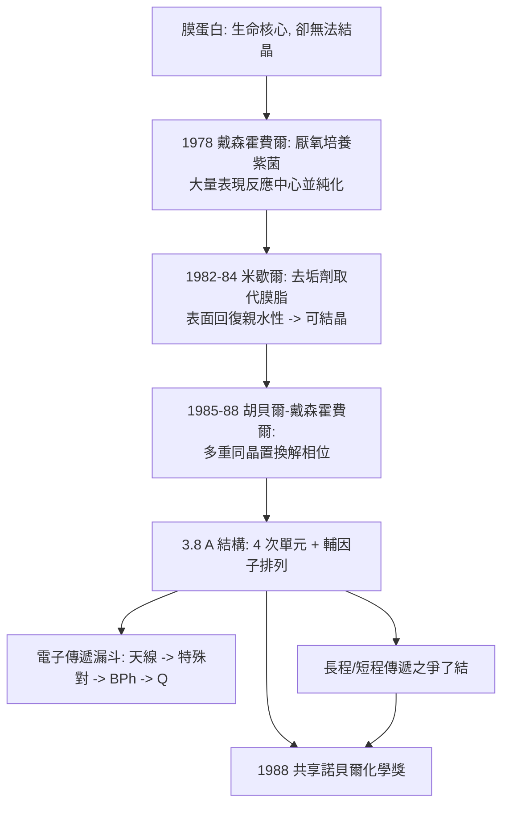

# 1988 · 戴森霍費爾、胡貝爾與米歇爾——看見光合作用的天線

> 1988 諾貝爾化學獎：約翰·戴森霍費爾（Johann Deisenhofer，1943– ，德國）、羅伯特·胡貝爾（Robert Huber，1937– ，德國）與哈特穆特·米歇爾（Hartmut Michel，1948– ，德國）——表彰「其決定第一個積分膜蛋白之晶體結構——一個對光合作用至關重要的蛋白質與輔因子的膜結合複合體」。**人類第一次看見了膜蛋白的原子結構。**

## 懸案（案情提要）

1970 年代末，結構生物學撞上了最堅硬的牆：**膜蛋白**。

- 光合作用、氧化磷酸化、訊息傳遞、藥物耐受——這些生命中最核心的過程，都在**膜上**進行；
- 而膜蛋白**幾乎不能被 X 射線晶體學研究**：
  - 它是**兩親性（amphipathic）**的（有親水區與疏水區），一拿出來就溶在去垢劑的 micelle 裡，**親水部分外露、疏水部分被埋**，表面不均勻，難以結晶；
  - 即使結晶成功，也難以解出結構（微晶、取向混亂）；
- 而光合作用的**反應中心（reaction center）**是其中最關鍵的一個：它是**膜蛋白中的「天線」**，吸收光能並把電子「推」到特殊配對（$\mathrm{BChl}$）上。

**懸案：能不能把一個膜蛋白複合體的原子結構拍下來？**

偵辦人：三位德國化學家，故事要從一個「卡在塑膠盒裡的蛋白質」說起。

## 前因

| 年份 | 事件 |
| --- | --- |
| 1937 / 1943 / 1948 | 胡貝爾生於慕尼黑；戴森霍費爾生於德國辛斯海姆（巴伐利亞）；米歇爾生於 Ludwigshafen。 |
| 1970s | 胡貝爾在慕尼黑建立蛋白質結晶的傳統（他此前已完成 **胰蛋白酶抑制劑（trypsin inhibitor）** 的結構，1970 年代）；戴森霍費爾加入慕尼黑的「蛋白質結構實驗室」。 |
| 1978 | **戴森霍費爾**與同事在慕尼黑成功從**紫色菌（紫硫菌，*Rhodopseudomonas viridis*）**中分離出**反應中心蛋白**，並證明它可在**去垢劑存在下保持活性**。 |
| 1982–1984 | **米歇爾**（在杜塞爾多夫的 Max Planck 實驗室）發展**「以去垢劑取代膜脂」的結晶策略**：用去垢劑包住疏水區，使蛋白質可溶且表面親水，同時讓它**在結晶時維持天然構形**。 |
| 1984 | 米歇爾成功取得**紫菌反應中心**的晶體（德國報告），結構測定的技術難關被突破。 |
| 1985–1988 | **胡貝爾與戴森霍費爾**接手，用 X 射線（叠加法等技術）解出結構：**1988 年發表**（$3.8\ \text{Å}$ 分辨率），確認四個蛋白質次單元（$\mathrm{L}$、$\mathrm{M}$、$\mathrm{H}$、$\mathrm{Cy}$）與輔因子（4 個 bacteriochlorophyll $b$、2 個 bacteriopheophytin、2 個 quinone、1 個 $\mathrm{Fe^{2+}}$、1 個 $\mathrm{Mg^{2+}}$）的排列。 |
| 1988 | 三人共享諾貝爾化學獎。 |
| 1990s–2010s | 反應中心結構成為**光合作用電子傳遞理論的結構基礎**（1988 年後，「長程電子傳遞」與「短程電子傳遞」之爭因結構而了結）；胡貝爾後任 Max Planck 生化研究所所長。 |

## 調查

**偵查一：純化——把一個「膜上的天線」取出來。**

反應中心是膜蛋白複合體（$\mathrm{L}$、$\mathrm{M}$、$\mathrm{H}$ 三個次單元 + 細胞色素 $\mathrm{Cy}$），需先把它從膜上「剪下來」：

$$\text{膜} \xrightarrow{\text{去垢劑溶解}} \text{去垢劑中的蛋白質複合體} \xrightarrow{\text{硫酸銨分級}} \text{純化反應中心}$$

**關鍵的生物化學前提**：紫菌在有氧時會**關閉**其光合作用基因並改走呼吸代謝——因此在**厭氧條件下培養**的細菌，其反應中心才會大量表現。戴森霍費爾正是用這一招，解決了「蛋白質產量太低」的問題。

**偵查二：去垢劑取代膜脂——「把疏水尾巴包起來」。**

米歇爾的關鍵洞見：

$$\text{天然膜}：\ \text{蛋白質的疏水區} \leftarrow \text{膜脂} \qquad \text{結晶時}：\ \text{蛋白質的疏水區} \leftarrow \text{去垢劑 micelle}$$

$$\text{以去垢劑的「碳氫尾巴」代替「膜脂的尾巴」，} \quad \text{蛋白質表面恢復親水性} \Rightarrow \text{可結晶}$$

**這是「用化學工具替換生物結構」的漂亮想法**——今日幾乎所有膜蛋白的結構研究都建立在同一策略上（去垢劑、脂質體、nanodisc 脂質盤）。

**偵查三：結構的難點——相位問題的再戰。**

由於去垢劑 micelle 包著蛋白質，晶體的**母液含量高且分散**，故必須用**同晶置換**（見 [1962-佩魯茨與血紅蛋白](1962-佩魯茨與血紅蛋白.md)）：

$$\text{原生衍生物} \xrightarrow{+\ \mathrm{Hg},\ \mathrm{Pb},\ \mathrm{Au}\ \text{等重原子}} \text{多重同晶衍生物} \xrightarrow{\text{相位求解}} \phi(hkl)$$

**戴森霍費爾與胡貝爾在 1984–88 年間完成了數十個衍生物的製備與量測**——這是本案最耗費人力的部分。

**偵查四：電子傳遞路徑的揭示——「天線」的構造。**

結構揭示的反應中心組成：

$$\underbrace{\mathrm{L}\ (\text{外側天線})}_{4\ \text{個 BChl}} + \underbrace{\mathrm{M}\ (\text{內側天線})}_{2\ \text{個 BChl} + 2\ \text{個 BPh} + \mathrm{Fe^{2+}}} + \underbrace{\mathrm{H}\ (\text{天線蛋白)}}_{1\ \text{個 BChl}} + \underbrace{\mathrm{Cy}\ (\text{細胞色素)}}_{1\ \text{個 BChl}}$$

**電子傳遞的「漏斗」由此可見**：

$$\text{天線 BChl 吸收光} \to \text{能量傳遞} \to \text{特殊對 BChl}_P \to \text{電荷分離} \to \text{BPh} \to \mathrm{Q_A} \to \mathrm{Q_B} \to \text{細胞色素}$$

**關鍵發現：兩個特殊對 BChl$_P$ 被蛋白質「扭轉」而錯開約 $145^\circ$**（正是費歇爾的鎖鑰與鮑林的立體化學預期），這使得電荷分離效率極高。

**偵查五：兩個電子傳遞機制的區分——「長程」與「短程」。**

結構解釋了當時爭論不休的問題：

$$\text{長程電子傳遞}：\ \text{電子在} \ \text{連續的輔因子間「跳躍」}（電子供體鏈）$$

$$\text{短程電子傳遞}：\ \text{電子沿} \ \text{蛋白質骨架的共軛路徑「隧穿」}$$

**結構顯示兩條路徑並存**：從 BChl$_P$ 到 BPh 是短程（$3.5\ \text{Å}$ 的緊密堆積），從 BPh 到 $Q_A$ 則是長程（$10.7\ \text{Å}$ 的跳躍）。

## 理論裁決

**判決一：膜蛋白結構的可行性——「用化學替換生物」。**

$$\text{天然膜} \rightarrow \text{去垢劑替代} \rightarrow \text{可溶、可結晶、可測量}$$

**這條「替換策略」是結構生物學最重要的技術突破之一**：它把「膜蛋白結構」從不可能變成常規，今日數千個膜蛋白結構（$\mathrm{GPCR}$、通道、轉運體——見 [2012-萊夫科維茨與GPCR](2012-萊夫科維茨與GPCR.md)）皆由此而來。

**判決二：光合作用的結構機制。** 反應中心的結構第一次把光合作用的功能步驟與原子排列對應起來：

$$\underbrace{\text{特殊對 BChl}_P}_{\text{電荷分離中心}} \xrightarrow[\text{短程}]{3.5\ \text{Å}} \underbrace{\mathrm{BPh}}_{\text{第二電子載體}} \xrightarrow[\text{長程}]{10.7\ \text{Å}} \underbrace{Q_A \to Q_B}_{\text{質體載體}} \xrightarrow{} \underbrace{\mathrm{Cy}}_{\text{細胞色素}}$$

$$\text{光} \to \text{激發} \to \text{電荷分離} \to \text{穩定電荷} \to \text{還原 NADP}^+ \to \text{合成 ATP}$$

**「光 → 化學能」的轉換，第一次有了原子級的圖解。**

**判決三：蛋白質骨架作為電子傳遞的介質。** 結構顯示，在 BChl$_P$ 與 BPh 之間存在一條**共軛的蛋白質路徑**（蛋白質的 $\mathrm{C{=}O}$ 與醯胺的 $\pi$ 系統形成「電子隧穿」的橋）：

$$\text{蛋白質的肽骨架} \xrightarrow{\text{共振耦合}} \text{電子隧穿} \xrightarrow{} \text{BPh}$$

**這解釋了「為什麼電子傳遞能跨越 $3.5\ \text{Å}$ 的空隙」——蛋白質不只是支架，還是導線。**

**判決四：人工光合作用的藍圖。** 反應中心結構立即成為**人工光合作用**設計的模板（模仿其天線—特殊對—載體的排列），並啟動了 1990 年代的「人工葉片」研究與 2010 年代的「鈷氧化物催化劑製氫」。

## 後果

| 領域 | 影響 |
| --- | --- |
| 結構生物學 | 膜蛋白結構研究的全面開啟；「去垢劑／脂質盤」成為膜蛋白研究的標準方法。 |
| 光合作用 | 光合作用的電子傳遞機構在原子層次被確立；「特殊對 BChl」的能量轉移效率（接近 100%）有了結構解釋。 |
| 人工光合作用 | 人工天線（分子自組裝的有機色素）、人工催化劑（鈷氧化物、分子催化劑）的研究，起於此結構提供的藍圖。 |
| 醫學 | 膜蛋白結構的可行性，直接促成 **$\mathrm{GPCR}$ 結構**（見 [2012-萊夫科維茨與克比爾卡](2012-萊夫科維茨與GPCR.md)）與今日一半藥物的靶點結構。 |
| 科學制度 | 這是**德國科學在戰後重新站上世界舞台**的象徵之一：三位得主都在 Max Planck 體系，並在 1990 年代成為德國科學界的領航者（胡貝爾任 Max Planck 生化所所長）。 |

## 關聯

- [1962-佩魯茨與血紅蛋白](1962-佩魯茨與血紅蛋白.md)：同晶置換與相位問題——本案技術上的直系前身。
- [1964-霍奇金與X射線晶體學](1964-霍奇金與X射線晶體學.md)：生物大分子 X 射線結構的方法論。
- [1969-巴頓與構象分析](1969-巴頓與構象分析.md)：特殊對 BChl 的立體錯開，正是立體化學原則的又一例證。
- [1971-赫茨貝格與分子光譜](1971-赫茨貝格與分子光譜.md)：光譜與結構互證；反應中心的吸收特徵與結構的對應。
- [1988-光合作用反應中心](1988-光合作用反應中心.md)：即本卷。
- [1995-克魯岑與臭氧層](1995-克魯岑與臭氧層.md)：大氣光化學的另一條線；光合作用與臭氧同屬「太陽能的化學」。

