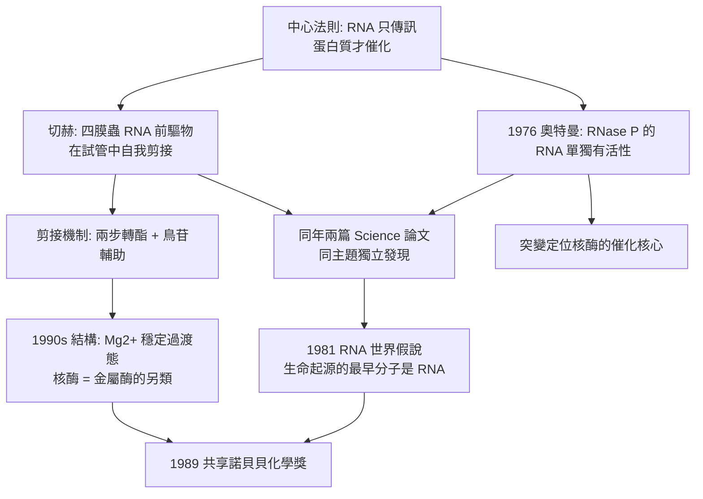

# 1989 · 奧特曼與切赫——RNA 也是酵素

> 1989 諾貝爾化學獎：席德尼·奧特曼（Sidney Altman，1939–2022，加拿大／美國）與托馬斯·切赫（Thomas R. Cech，1947– ，美國）——表彰「其發現 RNA 之催化性質」。**分子生物學的中心法則被徹底改寫。**

## 懸案（案情提要）

1980 年代的分子生物學，有一個「不該存在」的現象：

- 中心法則說：DNA → RNA → 蛋白質。**RNA 只是「傳訊」的角色**；
- 但 1970 年代中期，切赫在研究**四膜蟲（*Tetrahymena*）的 RNA 前驅物**時發現了一個驚人的事實：RNA 分子**能自己剪接自己**——把序列中間的一段切掉，並把兩端接起來。
- 而切赫的實驗更驚人：他在**沒有任何蛋白質酵素的情況下**，讓 RNA 在試管裡完成了自我剪接。
- 這意味著：**RNA 本身有催化能力。**

同一時期，奧特曼在耶魯研究 **RNase P**（一種把 tRNA 前驅物加工成成熟 tRNA 的核酸酵素）：

- 他發現 RNase P 的催化活性**不需要蛋白質**——把其中的 RNA 單獨分離出來，它仍有活性；
- 而把 RNA 的特定位點突變，活性即喪失——**說明活性中心在 RNA 上**。

**懸案的意義**：中心法則說 DNA 是資訊、蛋白質是催化者、RNA 只是中間人。若 **RNA 既能儲存資訊又能催化**，那麼在生命演化上最早的分子是什麼？**「RNA 世界」（RNA world）」假說由此誕生。**

## 前因

| 年份 | 事件 |
| --- | --- |
| 1939 | 奧特曼生於加拿大蒙特婁；1960 年在哥倫比亞大學取得博士學位（研究 RNA 與病毒的相互作用），後轉任耶魯大學並長期任教，專攻 RNA 的加工與酵素機制。 |
| 1971–1976 | 奧特曼在耶魯（與 **David S. (D.)** 合作）研究 **RNase P**，發現其 RNA 部分（**$\mathrm{P_4}$ RNA**）即為催化核心。 |
| 1976 | 奧特曼與**切赫**在《Science》同時發表「RNA 具有催化活性」的發現（同年、同一主題、兩條路徑——**科學史上著名的「同時獨立發現」**）。 |
| 1970s–1980s | **切赫**（科羅拉多大學）研究四膜蟲的 RNA 剪接：發現 **L-19 IVS**（一種自我剪接的 RNA），並在試管中實現無蛋白質的自剪接。 |
| 1981 | 切赫提出 **「RNA 催化假說」與生命起源的 RNA 世界觀點**（在《Nature》的專論中）。 |
| 1983 | **切赫發現核酶的**「活性中心」可由**鳥苷（G）**等小分子輔助（他提出「鳥苷輔助的自剪接」機制）。 |
| 1982–1983 | 切赫與**約翰遜（Thomas Johnson）** 發現**端粒酶（telomerase）**——一個含 RNA 的酵素，其 RNA 模板被用來延長端粒；切赫實驗室發現其 RNA 基因組成分的突變會導致端粒縮短（如酵母的 est1 突變）。 |
| 1989 | 兩人共享諾貝爾化學獎。 |
| 1990s | 席夫（Schiff）與其他人發現**錘頭型核酶（hammerhead ribozyme）**與「自我剪接內含子」家族的催化機制；核酶的化學（1989–1990s 的結構研究）揭示了**鎂離子催化的過渡態**。 |
| 2000–2008 | 切赫任**霍華德·休斯醫學研究所**所長（推動科學教育）。 |

## 調查

**偵查一：奧特曼的切除實驗——把酵素「拆成兩半」。**

RNase P 在細菌中是一個**核蛋白**（RNA + 蛋白質）。奧特曼的做法是**用化學方法把 RNA 與蛋白質分開**（例如以酚／氯仿抽提 RNA，或以密度梯度離心分離），然後分別測活性：

$$\text{RNase P（完整）} \xrightarrow{} \begin{cases}\text{RNA 部分}：\ \text{仍有活性（但需要 } \mathrm{Mg^{2+}}\text{）}\\ \text{蛋白質部分}：\ \text{無活性}\end{cases}$$

**結論：催化中心在 RNA 上。**（後來知道：細菌的 RNase P RNA 本身即為酵素；真核細胞的 RNase P 則是核蛋白，RNA 只提供催化核心。）

**偵查二：突變定位——「活性中心的座標」。**

奧特曼以**定點突變**（把 RNA 的特定鹼基改變）逐步破壞活性：

$$\text{RNA 的關鍵區域突變} \Rightarrow \text{活性劇降};\qquad \text{突變的區域即「催化核心」}$$

**「用突變畫出催化中心」——這是後來核酶結構研究的方法論**。

**偵查三：切赫的四膜蟲 RNA——「自己剪自己」。**

四膜蟲的 rRNA 前驅物含有**插入序列（IVS，內含子）**，必須被切除並連接：

$$\text{pre-rRNA} \xrightarrow{\text{自剪接}} \text{mature rRNA} + \text{IVS (ligation)}$$

切赫的關鍵實驗（1981–84）：

$$\text{把 IVS RNA 單獨取出，放進試管（加 } \mathrm{Mg^{2+}}\text{、ATP、鳥苷等）} \xrightarrow{} \text{自己完成剪接}$$

**這是在試管中重現了生命演化史上一個關鍵事件：沒有蛋白質，RNA 也能自我加工。**

**偵查四：剪接的化學機制——「兩步反應」與鳥苷的作用。**

$$\text{第一步（轉酯）}：\ \text{G 的 3'-OH 親核進攻 5' 剪接位點} \xrightarrow{} \text{G 與 5' 片段成酯鍵} + \text{環狀中間物}$$

$$\text{第二步（轉酯）}：\ \text{環狀中間物的 3'-OH 進攻另一個剪接位點} \xrightarrow{} \text{連接後的 RNA} + \text{G 離開}$$

**鳥苷（G）是「可逆的共價輔因子」**：它先成為產物的一部分，再離開——這在酵素學中極為罕見（**「G 輔助的自剪接」**）。

**偵查五：核酶的結構與金屬離子催化。**

1990 年代的結構研究（席夫等人的錘頭型核酶結構）揭示：

$$\text{核酶的催化} \sim \text{（底物的幾何扭曲）} + \text{（} \mathrm{Mg^{2+}}\ \text{穩定帶負電的過渡態）}$$

$$\mathrm{Mg^{2+}} \ \text{與 RNA 的磷酸基配位} \xrightarrow{} \text{中和負電荷} \xrightarrow{} \text{降低活化能}$$

**「核酶的催化機制，本質上與金屬酶（metalloenzyme）相同」——這是一個極其深刻的統一。**

## 理論裁決

**判決一：中心法則的擴充——「RNA 世界」。**

$$\text{原始中心法則}：\ \text{DNA} \to \text{RNA} \to \text{蛋白質} \quad(\text{RNA 只傳訊})$$

$$\text{擴充後}：\ \text{DNA} \to \text{RNA} \xrightarrow{\text{可催化}} \text{蛋白質}\quad(\text{RNA 兼具資訊與催化})$$

**「RNA 世界」假說的邏輯**：

$$\text{若 RNA 能同時儲存資訊與催化，} \quad \text{則早期演化只需一種分子} \xrightarrow{} \text{後來 DNA 专职儲存、蛋白質專職催化}$$

**這是演化生物學中影響最深遠的假說之一**，並在 2009 年（核糖體的結構證明核糖體是由 RNA 構成的核酶——**肽轉移酶活性中心是 rRNA**）獲得關鍵支持：**今日所有蛋白質的合成，都由 RNA 催化**——演化史的最後一塊拼圖由核糖體結構補上（見 [2009-約納特與核糖體](2009-約納特與核糖體.md)）。

**判決二：催化不必依賴蛋白質。** 核酶揭示了催化劑的「充分條件」：

$$\text{催化劑} = \text{能結合底物} + \text{能穩定過渡態} + \text{具有適當的幾何}$$

$$\text{蛋白質不是必要的}，\text{因為 RNA 的 2'-OH 與磷酸骨架也能提供這些功能}$$

**這打破了一個「生物學直覺」：只有蛋白質才能做酵素。**

**判決三：核酶的催化機制——「幾何扭曲 + 金屬穩定」。**

$$\underbrace{\text{內部 }(2'\text{-OH}) \text{親核進攻}}_{\text{扭轉底物幾何}} + \underbrace{\mathrm{Mg^{2+}} \text{中和負電荷}}_{\text{穩定過渡態}} \Rightarrow \Delta G^\ddagger \downarrow$$

**這把核酶與金屬酶統一在同一物理之下**：兩者都用金屬離子中和過渡態的負電荷，只是核酶用 RNA 的骨架來做。

**判決四：剪接機制中「鳥苷」的意義——可逆共價輔因子的先例。**

$$\text{核酶輔因子的兩類}：\begin{cases}\text{金屬離子（} \mathrm{Mg^{2+}}\text{）：非共價} \\ \text{鳥苷（} \mathrm{G}\text{）：可逆共價（轉酯）}\end{cases}$$

**「酵素可逆地參與共價催化」**是核酶帶來的新概念，之後在**核酶催化的小分子合成**（用核酶做酵素，製造 RNA 藥物）與**人工核酶設計**中被廣泛利用。

## 後果

| 領域 | 影響 |
| --- | --- |
| 演化生物學 | RNA 世界假說成為主流框架；**生命起源研究**因此獲得具體的化學模型（今日的核酶實驗、原始地球的 RNA 合成實驗，如 [2017-杜布歇與冷凍電顯](2017-杜布歇與冷凍電顯.md) 的原始地球實驗，皆源於此）。 |
| 醫藥 | **以 RNA 為藥的治療**：RNA 干擾（siRNA）、反義寡核苷酸、mRNA 疫苗（COVID-19 的 mRNA 疫苗即是此邏輯的工業化）；核酶亦可用於治療性切割。 |
| 生物技術 | 核酶用於 RNA 剪接與改造、SELEX 式的核酸篩選、以及**「RNA 干擾」與 CRISPR 的 RNA 化**（Cas13）。 |
| 端粒與老化 | 切赫的端粒酶工作（1984–89）揭示端粒維持機制，與老化、癌症（端粒酶在腫瘤中活化）直接相關。 |
| 結構生物學 | 核酶結構（1990s）確立了「金屬離子穩定過渡態」的催化範式，並成為 2009 年核糖體結構研究的先聲。 |

## 關聯

- [1958-桑格與胰島素序列](1958-桑格與胰島素序列.md)：序列技術的源頭；核酶研究大量使用定點突變。
- [1962-佩魯茨與血紅蛋白](1962-佩魯茨與血紅蛋白.md)：蛋白質結構方法；核酶的結構研究用的正是同一套技術。
- [1989-奧特曼與RNA催化](1989-奧特曼與RNA催化.md)：即本卷。
- [2009-約納特與核糖體](2009-約納特與核糖體.md)：核糖體是最大的核酶——RNA 世界假說的最後一塊拼圖。
- [2020-卡彭蒂耶與CRISPR](2020-卡彭蒂耶與CRISPR.md)：以 RNA 為核心的基因編輯，是「RNA 有功能」的又一證明。
- [2021-利斯特與不對稱有機催化](2021-利斯特與不對稱有機催化.md)：**酵素催化的立體化學**——核酶證明 RNA 也能做立體選擇性催化，正是克拉克「立體專一性」原理的延伸。
