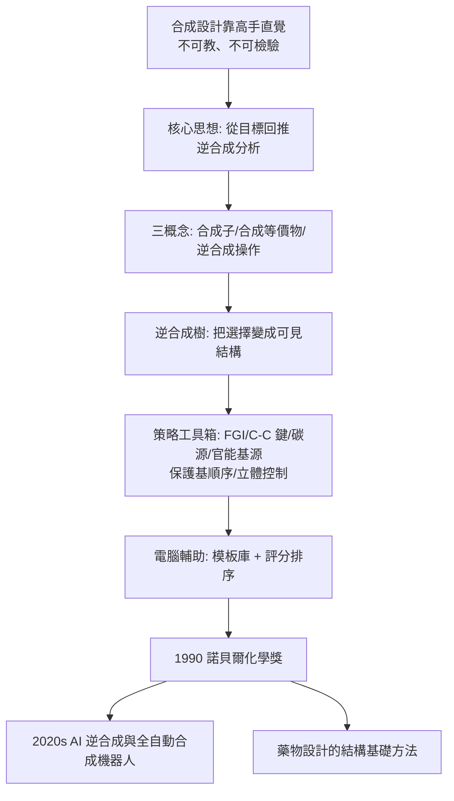

# 1990 · 科里與逆合成分析——把合成變成一道可解的題

> 1990 諾貝爾化學獎：伊萊亞斯·詹姆斯·科里（Elias James Corey，1928– ，美國）——表彰「其對有機合成理論與方法學的發展，尤其是逆合成分析」。化學合成從「藝術」變成「有解題步驟的學問」。

## 懸案（案情提要）

1990 年以前的合成化學，有一個方法論上的尷尬：

- 化學家**確實**在「設計」合成路線——但這個設計是**在腦子裡**完成的，過程難以教、難以傳承、難以檢驗；
- 同一個目標分子，不同的化學家會給出不同的路線，**誰比較好？為什麼？**判準散落在經驗、品味與「高手的直覺」裡；
- 藥物開發需要的，正是「**快速、可靠地給出一條好路線**」——而當時一個藥物的合成開發動輒以「年」計，其中大量時間花在「試錯」而非「設計」；
- 更根本的：**「逆合成」這件事——從目標分子回推到起始物——從來沒有被形式化。**

偵辦人：伊萊亞斯·科里。他做了一件在科學史上罕見的事：**把化學家腦中的直覺，寫成了一套可以教、可以學、可以執行、可以檢驗的演算法。**

## 前因

| 年份 | 事件 |
| --- | --- |
| 1928 | 科里生於美國麻州梅里登（Lebanon, 黎巴嫩的希爾頓美國大學附屬中學畢業後移居美國）。 |
| 1950–1951 | 麻省理工學院理學士、碩士；1953 年取得博士學位（導師 **John C. Sheehan**），後留校任教。 |
| 1950s–70s | 科里的實驗工作橫跨天然產物全合成與方法學：**前列腺素**（1960s 與吳德沃德合作）、**醛固酮與可的松等類固醇、萜烯、維生素、嗎啡類似物**；並開發了許多**新型保護基與試劑**（如 **DCC 偶合試劑**、**LDA（鋰二異丙胺）**、**N-甲基嗎啉-N-氧化物** 等）。 |
| 1960s–70s | 科里在教學中反覆問一個問題：**「這個分子要怎麼做出來？第一步該是什麼？」**並嘗試把「合成設計」的邏輯寫出來。 |
| 1980s | 科里與 **Alan P. (A.)** 等人發展並在業界推廣**電腦輔助的逆合成分析**（1980 年代末已有商業軟體）；並提出**「合成子（synthon）」**與**「合成等價物（synthetic equivalent）」**兩個核心概念。 |
| 1990 | 獲諾貝爾化學獎。 |
| 1990s–2000s | 科里的「合成策略」叢書（《Classics in Total Synthesis》《Strategic Applications of Named Reactions in Organic Synthesis》等）成為合成化學的教科書體系；退休後於 2006 年創立科里研究機構（位於波士頓），推廣「合成策略教育」。 |

## 調查

**偵查一：核心概念——把目標分子「拆解」。**

逆合成的邏輯：

$$\text{目標分子} \xrightarrow{\text{逆合成}} \text{前驅物} \xrightarrow{\text{逆合成}} \cdots \xrightarrow{\text{逆合成}} \text{起始物}$$

**關鍵的三個概念**：

1. **合成子（synthon）**：在斷鍵處「假想」生成的碎片（如把羰基 $\mathrm{C{=}O}$ 拆成 $\mathrm{C^+} + \mathrm{O^-}$）。
2. **合成等價物（synthetic equivalent）**：實際可用的試劑（如把羰基合成子換成 $\mathrm{Grignard}$ 試劑或 $\mathrm{LiR}$）。
3. **逆合成操作（retrosynthetic transform）**：把分子「變回」更簡單的分子。

$$\boxed{\text{逆合成分析} = \text{「我能做什麼反應？」} \times \text{「把它反過來做」}}$$

**偵查二：逆合成樹——把選擇變成可見的結構。**

$$\text{目標} \xrightarrow{\text{步驟 A}} \text{中間物}_1 \xrightarrow{\text{步驟 B}} \text{中間物}_2 \cdots$$

**逆合成樹把「一個答案」變成「一個空間」**：每個節點是一個可能的拆卸方向，樹的大小與深度即「搜索空間」的規模。

$$\text{評估一棵樹}：\ \text{最長路徑長度（步數）}、\ \text{分支數（選擇空間）}、\ \text{收斂度（是否都匯到可得起始物）}$$

**偵查三：核心策略與工具箱。**

科里整理出的策略（今日教科書的標準章節）：

| 策略 | 內容 |
| --- | --- |
| **官能基轉換（FGI）** | 把目標上的官能基「翻譯」成更容易合成的形式（如把醛翻成烯醇、或翻成縮醛保護） |
| **碳—碳鍵形成** | 格林納（見 [1912-格林納與薩巴捷](1912-格林納與薩巴捷.md)）、Wittig（見 [1979-布朗與維蒂希](1979-布朗與維蒂希.md)）、Suzuki 偶聯、Diels–Alder（見 [1950-迪爾斯與阿爾德](1950-迪爾斯與阿爾德.md)） |
| **碳的來源** | 羧酸、醇、烯烴、酮 |
| **官能基的來源** | 格林納、醛的合成、胺的合成 |
| **保護基策略** | 決定「先裝哪個、後裝哪個」 |
| **立體化學控制** | 巴頓的構象分析（見 [1969-巴頓與構象分析](1969-巴頓與構象分析.md)）與 CIP 規則（見 [1975-康福思與普雷洛格](1975-康福思與普雷洛格.md)） |

**「先裝哪個官能基」的順序問題，被科里總結為一條經驗規則**：

$$\text{「碳—碳雙鍵的合成應安排在官能基轉換之前（越早越好）」}$$

**因為不飽和鍵是「萬用的把手」**——它可以在後續被轉成醇、酮、環氧、胺等幾乎任何官能基。**這是逆合成分析最具洞察力的一條規則。**

**偵查四：電腦輔助——把直覺外包給機器。**

1980 年代末起，電腦化學家開始把逆合成「執行」：

$$\text{目標分子} \xrightarrow{\text{模板庫（reaction templates）}} \text{候選逆合成步驟} \xrightarrow{\text{評分}} \text{排序} \xrightarrow{} \text{給化學家「建議」}$$

**2020 年代的「AI 逆合成」（如基於機器學習的合成規劃）正是這條線的成熟形態**——但其思想源頭正是 1990 年科里的這套框架。

**偵查五：與電腦時代的另一條線——「藥物設計」的反向工程。**

逆合成的另一個應用是**「從目標性質反推結構」**：

$$\text{我要一個能結合蛋白質 X 的分子} \xrightarrow{\text{逆合成 + 結構設計}} \text{藥物骨架}$$

**這是「藥物設計」與「合成設計」的合流**，並在 1990 年代的「結構基礎藥物設計」中成為主流。

## 理論裁決

**判決一：合成的可計算性。** 科里的方法論把「合成」表述為一個**搜索問題**：

$$\text{目標} \xrightarrow{\text{逆合成規則}} \text{候選前驅物的集合} \xrightarrow{\text{再逆合成}} \cdots$$

$$\text{因此合成的難度} = \text{搜索空間的大小} \times \text{評估函數的品質}$$

**這使得「合成設計」第一次與演算法、人工智慧、文獻資訊學接軌**（今日的逆合成軟體如 ASKCOS、ASKCOS 與機器學習模型，皆以此為框架）。

**判決二：策略優於戰術。** 科里的洞見：

$$\text{一個好的「策略」（例如「先建雙鍵、晚期再轉官能基」）} \quad \text{勝過} \quad \text{一百個「戰術」的優劣之爭}$$

**「策略」是可教的知識**——這是科里對化學教育的最大貢獻：合成化學從「師徒制」變成「課程」。

**判決三：合成子與合成等價物的分離。** 這兩個概念的區分極為深刻：

$$\text{合成子} = \text{「我需要什麼樣的電子（或官能基）？};\qquad \text{合成等價物} = \text{「實際用哪個試劑取得它？」}$$

**它把「電子層面的需求」與「試劑層面的選擇」分開**——因此同一個合成子可以有多種等價物，而逆合成樹可以在「合成子層級」上統一比較不同路線。**這是逆合成分析能夠被電腦化的技術前提。**

**判決四：把「合成」變成可評估的科學。** 科里的方法讓合成路線可以被定量評估：

$$\text{步數}、\text{總產率} \approx \prod_i p_i、\text{立體選擇性}、\text{官能基相容性}、\text{起始物的可得性}$$

**這使「合成規劃」第一次有了優劣的客觀判準**——並成為藥物開發中「合成可及性（synthetic accessibility, SA score）」評分（2013 年由 Ertl 等人提出）的先聲。

## 後果

| 領域 | 影響 |
| --- | --- |
| 藥物研發 | 合成路線的設計效率大幅提升；「逆合成分析」成為藥化學家的基本技能；今日的合成線性度（synthetic linearity）指標即承此思想。 |
| 化學教育 | 合成化學有了教科書體系（科里的「策略」叢書）；「先做什麼」的問題有了答案。 |
| 計算化學 | 逆合成軟體與 AI 合成規劃（2010 年代的 Reaxys、ASKCOS、分子生成模型）都以此為基礎；2020 年代的「AI 設計分子—合成—驗證」閉環。 |
| 天然產物全合成 | 科里本人與吳德沃德等人以逆合成策略重新設計諸多合成路線（前列腺素、萜烯、生物鹼），示範了「規劃大於試錯」。 |
| 科學制度 | 科里在 1990 年得獎後，設立研究機構推廣「合成策略教育」；他與吳德沃德共同獲得諾貝爾獎，使「合成藝術」在科學中得到最高級的制度性承認。 |

## 關聯

- [1947-羅賓遜與生物鹼的結構革命](1947-羅賓遜與生物鹼的結構革命.md)：羅賓遜的生物生成原理是逆合成「策略」的思想前身。
- [1950-迪爾斯與阿爾德](1950-迪爾斯與阿爾德.md)：雙烯合成是逆合成工具箱的關鍵反應之一。
- [1912-格林納與薩巴捷](1912-格林納與薩巴捷.md)：格林納反應是「碳—碳鍵形成」策略的原型。
- [1965-伍德沃德與全合成](1965-伍德沃德與全合成.md)：伍德沃德的「生物合成啟發」是逆合成策略的哲學先驅；兩人同獲諾貝爾獎。
- [1975-康福思與普雷洛格](1975-康福思與普雷洛格.md)：立體化學規則是逆合成分析中「立體控制策略」的部分。
- [1990-科里與逆合成分析](1990-科里與逆合成分析.md)：即本卷。
- [2022-貝爾托西與點擊化學](2022-貝爾托西與點擊化學.md)：現代合成設計的另一個支柱——「正交性」策略（見 2021 年的不對稱催化）。
