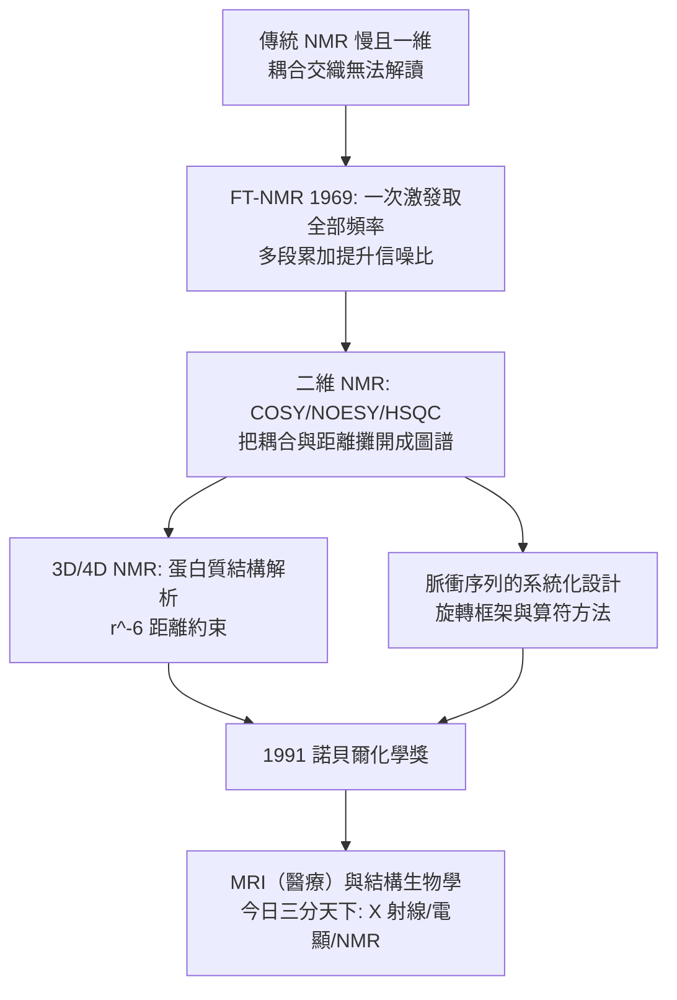

# 1991 · 恩斯特與傅立葉轉換核磁共振——化學的「指紋雷達」

> 1991 諾貝爾化學獎：理查·羅伯特·恩斯特（Richard Robert Ernst，1933–2021，瑞士）——表彰「其對傅立葉轉換核磁共振光譜學之貢獻」。他自稱是「**造工具的人（tool-maker）**」——但他造的這個工具，改寫了化學、醫學與生物學。

## 懸案（案情提要）

1990 年代的化學分析，有一個「信息太多」的困境：

- NMR 是化學家最重要的結構工具，但**傳統的 NMR 是「一次一個頻率」的掃描**：要決定一個分子的結構，得在數百 ppm 的範圍上逐一施加射頻頻率、等待、記錄——**緩慢而笨重**；
- 1960–70 年代，**傅立葉轉換**已被引入 NMR（這是天文與其他領域的技術移植），使掃描速度提高百倍——但**多維 NMR 仍然極其困難**；
- 難在哪裡？**耦合（coupling）**：一個核的訊號不只被自己的化學位移影響，還被鄰近核的核自旋耦合影響。在多核系統中，這些耦合交織成極複雜的**二維／多維圖譜**，而**如何取得多維譜**是當時的技術瓶頸；
- 而更根本的問題：**化學位移、耦合常數、NOE（核磁偶極 Overhauser 效應）這些參數，究竟給了多少結構資訊？能否系統性地用它們「自動」解出結構？**

偵辦人：理查·恩斯特。他用**多維傅立葉轉換 NMR** 解決了速度與維度的問題，並以「二维」為核心，發展出一整套**多核、多維、乃至三維**的 NMR 方法論。

## 前因

| 年份 | 事件 |
| --- | --- |
| 1933 | 恩斯特生於瑞士蘇黎世；1952 年於蘇黎世 ETH 取得物理化學博士學位；後赴美國於加州大學柏克萊分校的勞倫斯柏克萊實驗室工作，後回歐洲。 |
| 1960s | 於蘇黎世 ETH（**Richard R. Ernst** 在 ETH 從 1966 年起任教，後任教授）推動 NMR 的**多維方法**；1966 年發表第一篇多維 NMR 論文。 |
| 1969 | 恩斯特發明 **FT-NMR 商業儀器**（與 Varian Associates 合作——他在 1969–70 年間於 Varian 從事應用研究），並以「一種新的方法測量核磁共振（高分辨度 FT-NMR）」獲得了 1991 年諾貝爾獎的核心成果。 |
| 1970s | 發展**二維 NMR**（如 COSY、NOESY、HSQC、TOCSY），確立「多維譜學」的方法論。 |
| 1980s | 發展**三維與四維 NMR**（用於蛋白質：TOCSY + NOESY 的 3D 組合），並確立「**接力（relay）**」與「**梯度選擇（gradient-selected）**」等技術。 |
| 1980s–90s | 恩斯特在蘇黎世建立 NMR 的理論與方法學傳統；與其同事 **G. Bodenhausen**、**R. R. Ernst** 等發展多維脉冲序列的系統化設計。 |
| 1991 | 獲諾貝爾化學獎（同年物理獎頒給皮爾·路易·拉珀、與赫爾曼等；醫學獎頒給埃德蒙·菲舍爾與伊萬·維爾紐斯）。 |
| 1991–2000s | 恩斯特自稱「造工具的人」；他在**ETH 的 NMR 中心**培養了整個歐洲的 NMR 學派；並推動 **NMR 在醫學中的應用**（MRI 即源於 NMR 原理）。 |
| 2021 | 逝於蘇黎世。 |

## 調查

**偵查一：傅立葉轉換——從「掃描」到「一次全部聽見」。**

傳統（掃描式）NMR：逐點施加頻率、逐點記錄訊號，$\sim 10^6$ 點需數小時。

$$\text{掃描式}：\ \text{逐頻率取樣} \quad \xrightarrow{\text{時間 domain}} \text{傅立葉轉換} \quad \Longrightarrow\quad \text{頻譜}$$

$$\text{FT 的貢獻}：\ \text{一次激發獲得全部頻率資訊} \Rightarrow \text{時間節省數百倍} + \text{靈敏度提升（多段累加）}$$

**「多段累加」是靈敏度的來源**：重複 $N$ 次並相加，訊號增強 $N$ 倍（噪聲只增強 $\sqrt{N}$ 倍）：

$$\frac{S}{N}\ \text{（信噪比）} \propto \sqrt{N_{\text{累加}}}$$

**偵查二：二維 NMR——把耦合「攤開」。**

核心想法：**在第二個維度施加「選擇性脈衝」，把原本混疊在一維上的耦合資訊分開。**

$$\text{一維}：\ \delta\text{（化學位移）} \quad \text{二維}：\ \delta_1 \text{ vs}\ \delta_2$$

以 **COSY**（${}^{1}\mathrm{H}$-${}^{1}\mathrm{H}$ 關聯譜）為例：對角線上是各質子的化學位移，**非對角線的「交叉峰」就直接指出「哪兩個質子彼此耦合」**——**這是一張「耦合網路圖」**。

**偵查三：NOESY——「空間上靠近」的量測。**

核磁偶極 Overhauser 效應（NOE）利用**交叉弛豫**：距離越近的質子，交叉峰越強：

$$\frac{I_{\text{cross}}}{I_{\text{diagonal}}} \propto r^{-6}$$

**這個 $r^{-6}$ 的極陡峭依賴，是「距離判定」最靈敏的探針**——這正是核磁共振在生物學中的殺手級應用：**二維 NOESY 譜加上 $r^{-6}$ 距離約束，就能推算蛋白質的三維結構**。

$$\text{距離約束集} \xrightarrow{\text{三角測量 + 退火}} \text{三維結構}$$

**偵查四：三維與四維——從小分子到蛋白質。**

$$\text{3D NMR}：\ \text{以化學位移為第一維、耦合/NOE 為第二維、再以耦合/NOE 為第三維}$$

$$\text{4D NMR}：\ \text{加入「同位素選擇」維度}\ \xrightarrow{}\ \text{可解出「大型」蛋白質（>30\ \mathrm{kDa）}$$

**1990 年代，NMR 成為小蛋白質（< 30\ \mathrm{kDa}）結構解析的標準方法**（今日仍與 X 射線、冷凍電顯三分天下）。

**偵查五：脈衝序列的系統化——「把物理學家的工具箱交給化學家」。**

恩斯特的貢獻不只是「多維」，而是**把脈衝序列設計變成一門可推導的學問**：

$$\text{脈衝序列} = \text{（以角度算符演算法描述的旋轉操作）} \xrightarrow{\text{合成}} \text{任何想要的二維/多維相關譜}$$

$$\text{旋轉框架的「90°脈衝 - 演化時間 } t_1\text{ - 檢測 } t_2\text{ - 90°脈衝」}$$

**這套框架使化學家能「設計」自己的實驗**，而不是只能使用供應商提供的固定序列——這是方法論的民主化。

## 理論裁決

**判決一：NMR 參數的結構意義——三個參數定結構。**

$$\underbrace{\delta}_{\text{化學位移}} \Rightarrow \text{化學環境（官能基、電子密度）}$$

$$\underbrace{J}_{\text{耦合常數}} \Rightarrow \text{鍵的連接關係（通過幾個鍵）}$$

$$\underbrace{r_{\text{NOE}}}_{\text{距離}} \Rightarrow \text{三維空間接近性}$$

$$\text{三者} \xrightarrow{} \text{唯一的立體化學結構}$$

**「NMR 結構」的嚴謹性在於它是「過定義」的**：由化學位移、耦合常數與 NOE 距離共同決定——這是 X 射線（電子密度）之外的**第二種獨立的結構判據**。

**判決二：NOE 的 $r^{-6}$ 與「距離的信息論」。**

$$\text{NOE 強度} \propto r^{-6}$$

**為什麼是六次方？**因為這是兩個偶極之間的耦合能量與距離的六次方成反比（偶極—偶極相互作用 $\propto r^{-3}$，平方後 $\propto r^{-6}$）。**結果是：距離的微小變化會造成強烈的訊號變化——這使 NMR 成為極精準的「空間尺」。**

$$\text{誤差傳播}：\ \frac{\Delta I}{I} \approx -6\frac{\Delta r}{r} \quad\Rightarrow\quad \text{距離誤差可控制在 } \sim 0.1\text{–}0.3\ \text{Å}$$

**判決三：二維譜的「交叉峰」＝耦合網路。** 這是一個極重要的教學與思考工具：

$$\text{COSY 的交叉峰} \Rightarrow \text{「這兩個質子互相耦合」} \Rightarrow \text{推出骨架的連接順序}$$

$$\text{不對稱的交叉峰強度} \Rightarrow \text{可判斷順反異構（ROESY 中的「指紋」）}$$

**今日的化學家正是靠這張「耦合網路圖」在十分鐘內判斷一個未知天然產物的骨架。**

**判決四：MRI——NMR 的醫學應用。** 恩斯特的工具直接導向：

$$\text{核磁共振成像（MRI）}：\ \text{以磁場梯度編碼空間位置，以射頻讀取質子弛豫}$$

$$\text{弛豫時間} T_1 \text{（纵向）與}\ T_2 \text{（横向）}\text{ 決定影像對比}$$

**同一套物理原理，在化學實驗室量「分子」，在醫院量「病人」**——這是 1991 年諾貝爾獎最被低估的社會後果。

## 後果

| 領域 | 影響 |
| --- | --- |
| 化學 | NMR 成為結構鑑定的標準工具；「二維譜」成為化學家的日常語言；天然產物結構的鑑定時間由數週縮至數日。 |
| 生物學 | 蛋白質 NMR（2D/3D/4D）成為與 X 射線並列的結構方法；**動力學（蛋白質在溶液中的運動）**成為 NMR 的獨占領域（X 射線看不到運動）。 |
| 醫學 | MRI 從研究儀器成為臨床標準；今日的 fMRI（功能性磁共振）甚至能用來讀腦。 |
| 代謝體學 | NMR 是代謝組學的核心平台；今日的「 metabolomics」大量使用 NMR 與質譜。 |
| 科學制度 | 恩斯特「造工具的人」的自述，確立了「方法學本身就是諾獎級貢獻」的典範；ETH 的 NMR 中心成為全球 NMR 人才中心。 |

## 關聯

- [1959-海羅夫斯基與極譜](1959-海羅夫斯基與極譜.md)：另一種「用物理量測化學」的技術路徑；兩者都以「把不可見的量變成可分析的訊號」為宗旨。
- [1962-佩魯茨與血紅蛋白](1962-佩魯茨與血紅蛋白.md)：X 射線結構與 NMR 結構是兩條獨立的結構判斷路徑。
- [1984-梅里菲爾德與固相合成](1984-梅里菲爾德與固相合成.md)：固相合成出來的胜肽，正是 NMR 結構研究最好的材料之一。
- [1989-奧特曼與RNA催化](1989-奧特曼與RNA催化.md)：核酶的結構研究依賴 NMR。
- [1991-恩斯特與NMR](1991-恩斯特與NMR.md)：即本卷。
- [2017-杜布歇與冷凍電顯](2017-杜布歇與冷凍電顯.md)：蛋白質結構方法的三分之一；NMR 與 X 射線、電顯構成分子結構的三大支柱。
