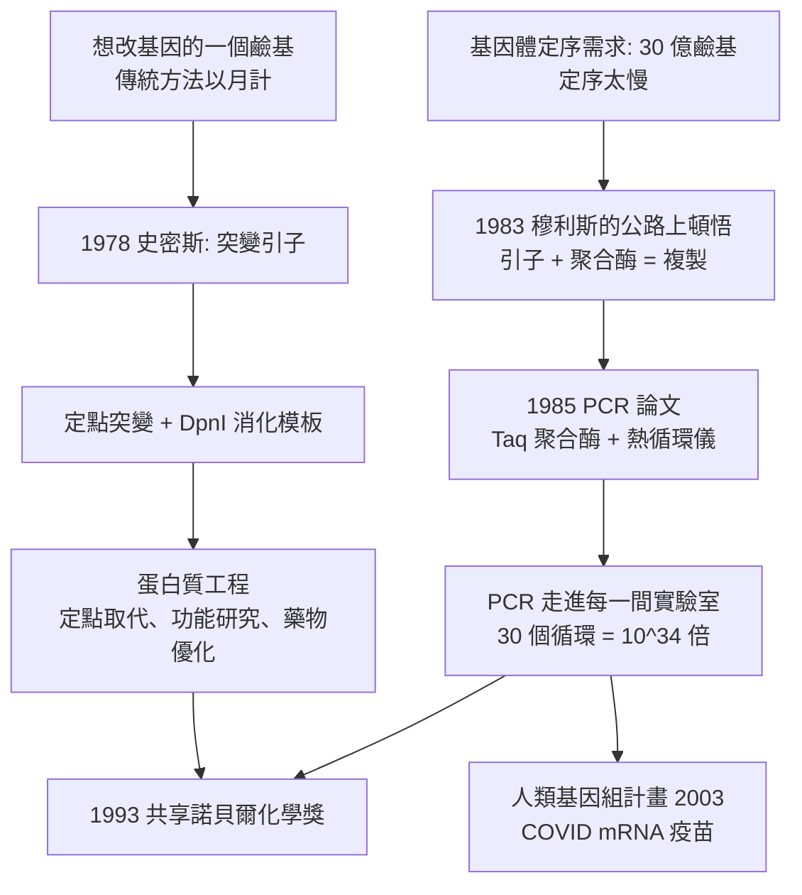

# 1993 · 穆利斯與史密斯——DNA 的複印機與改寫筆

> 1993 諾貝爾化學獎（共享）：卡里·班克斯·穆利斯（Kary Banks Mullis，1944–2019，美國）與麥可·史密斯（Michael Smith，1932–2000，英國／加拿大）——表彰「其對聚合酶連鎖反應（PCR）的發明，以及對定點突變的發展」。**生物學從此可以用一根試管、一台機器，在幾小時內複印與改寫基因。**

## 懸案（案情提要）

1980 年代的分子生物學，有一個「想都不敢想」的實務需求：

- **定序太慢。**1980 年的 DNA 定序（見 [1980-伯格與重組DNA](1980-伯格與重組DNA.md)）一次只能讀幾百個鹼基，手工費時；而生物學家需要的量級是**整個基因組**（人類約 30 億鹼基對）；
- **克隆太慢。**想研究一個基因的「突變版」，傳統做法是：建立文庫、篩選、製備、重複序列——以月計；
- **PCR 的構想**其實在 1970 年代就有人提出過（**K. B. Mullis** 的前同事 **H. Gobind Khorana** 曾於 1972 年提出「以兩個寡核苷酸引子複製 DNA」的構想，甚至申請了專利）——**但沒有人把它做成可用的方法**；
- 而**定點突變**的問題同樣存在：化學家早就能合成寡核苷酸，但**要把它放回基因裡、並且只改一個鹼基**，在 1980 年代仍極困難。

偵辦人：穆利斯（PCR）與史密斯（定點突變）。**兩項技術的共同點是：它們把「生物學的問題」轉化成「可在試管裡自動進行」的化學程序。**

## 前因

| 年份 | 事件 |
| --- | --- |
| 1944 | 穆利斯生於美國北卡羅來納州；曾在哥倫比亞大學與柏克萊取得學位（博士為加州大學柏克萊分校，物理化學）；隨後轉入生化學。 |
| 1967–1979 | 穆利斯在 Cetus 公司（**K. B. Mullis** 曾在 Cetus 擔任科學家）從事寡核苷酸合成；**關鍵的頓悟在 1983 年的一个晚上**：他駕車經過聖塔莫尼卡公路時，想到「兩個引子 + DNA 聚合酶 = 無限複製」的想法。 |
| 1983–1985 | 穆利斯在 Cetus 開發並申請 **PCR** 專利；1985 年公開發表〈經 DNA 聚合酶催化的 DNA 序列擴增〉（*Enzymatic amplification of specific DNA sequences*）。 |
| 1987–1990 | **PCR 商業化**（Cetus 的 Taq 聚合酶由 **Kary Mullis** 推動應用；Taq 聚合酶本身來自水生棲熱菌（*Thermus aquaticus*），其耐熱性使 PCR 得以全自動進行）。 |
| 1932 | 史密斯生於英國；1956 年於曼徹斯特大學取得博士學位，後於加拿大英屬哥倫比亞大學（UBC）隨 **H. Gobind Khorana**（諾獎得主）作博士後研究（1960–63）。 |
| 1970s | 史密斯在 UBC 研究 RNA 合成（以化學法合成寡核苷酸與 tRNA 的基因），並發展**寡核苷酸合成與基因（基因合成）**的能力。 |
| 1978 | 史密斯與同事發表**定點突變（site-directed mutagenesis）**：以合成好的寡核苷酸引子（含想要改變的鹼基）在質體上進行「引導合成」，把突變精確地植入基因。 |
| 1980s–90s | 史密斯推動 UBC 的生物技術與基因體研究；1996 年獲加拿大「彼得·沃爾紀念教授」；1999 年成立**麥可·史密斯基因科學中心**。 |
| 1993 | 兩人共享諾貝爾化學獎。 |

## 調查

**偵查一：PCR——「用兩個引子做書籤」。**

PCR 的原理簡單得令人驚訝：

$$\text{模板 DNA} + \underbrace{\text{兩個引子}}_{\text{分別結合兩條鏈的兩端}} + \mathrm{dNTP} + \text{DNA 聚合酶} \xrightarrow{\text{熱循環}} \text{大量目標片段}$$

**每一個循環（三步）**：

$$\begin{aligned}
\text{① 變性（}95\,^\circ\mathrm{C}\text{）} &\quad \text{雙鏈分離} \\
\text{② 退火（}50\text{–}65\,^\circ\mathrm{C}\text{）} &\quad \text{引子結合模板} \\
\text{③ 延伸（}72\,^\circ\mathrm{C}\text{）} &\quad \text{聚合酶合成新鏈}
\end{aligned}$$

**指數放大**是關鍵：每個產物又成為下一輪的模板，因此：

$$N = N_0\left(1 + \eta\right)^n \quad (\eta = \text{效率},\ n = \text{循環數})$$

$$\text{以 } \eta = 0.98,\ n = 35 \text{ 計}：\quad N \approx 10^{0.98\times35} \approx 10^{34}\ \text{倍}$$

**「幾小時、幾微克的起始物、變成幾微克的產物」**——這就是 PCR 的威力。

**偵查二：Taq 聚合酶——「從溫泉來的耐熱工廠」。**

$$\text{PCR 需要聚合酶耐受 } 95\,^\circ\mathrm{C}\ \text{的變性步驟}$$

**Taq 聚合酶**（來自 *Thermus aquaticus*，生長於黃石公園的溫泉）耐 $95$–$97\,^\circ\mathrm{C}$，且延伸效率高。**有了它，PCR 不必每輪加酶**——這是 PCR 得以自動化（熱循環儀）的關鍵。

**偵查三：PCR 的「條件優化」——化學家介入生物學。**

PCR 一開始並不好用：引子設計、溫度、$\mathrm{Mg^{2+}}$ 濃度、退火時間……**這些都是物理化學問題**。穆利斯本人是物理化學出身，他的強項正是把生物學程序「工程化」。

$$\text{PCR 的優化} = \text{化學（引子 Tm、濃度）} + \text{物理（溫度梯度）} + \text{生物學（模板品質）}$$

**偵查四：定點突變——「用一根帶錯字的引子改寫基因」。**

史密斯的策略：以**含有想要突變的鹼基的寡核苷酸**作為引子，在體外進行 DNA 複製，將突變帶入產物：

$$\text{質體（含目標基因）} + \text{突變引子} + \text{聚合酶} + \mathrm{dNTP} \xrightarrow{} \text{突變後的質體}$$

$$\text{再以 } \mathrm{DpnI}\ \text{消化模板（甲基化）}\ \xrightarrow{}\ \text{只留下新生（突變）的質體}$$

**「以化學合成的寡核苷酸為引子」——這正是費歇爾、托德、桑格一路鋪路的技術譜系在基因工程中的延伸。**

**偵查五：定點突變的深遠後果。**

$$\text{定點突變} \xrightarrow{} \text{蛋白質的「定點取代」} \xrightarrow{} \text{功能研究（哪個殘基重要）}$$

$$\text{再往前一步} \xrightarrow{} \text{「蛋白質工程」} \xrightarrow{} \text{改造酵素的性質（穩定性、專一性、產率）}$$

**這是「從基因到藥物」的現代研發路線的起點**：今日無數的生物藥物（抗體、酵素、胜肽）的性質優化，都是從定點突變開始的。

## 理論裁決

**判決一：PCR 的數學——指數放大的條件。**

$$N_n = N_0(1+\eta)^n \quad\Longrightarrow\quad \log N_n = \log N_0 + n\log(1+\eta)$$

$$\text{因此「多循環幾次」的邊際效益是} \sim \log(1+\eta) \approx \eta \ \text{（每輪約 1–2 倍）}$$

**實務教訓**：當產物已過量時，多做 5 個循環只增加幾倍，但會增加**非特異擴增**（引子二聚、錯誤配對）——**因此「少而準」優於「多而髒」**，這是所有 PCR 使用者的共同體感。

**判決二：定點突變的「化學引子」原理。**

$$\text{引子的 } 3'\text{ 端必須與模板完全配對；}\quad \text{突變鹼基置於引子中部（錯配）}$$

$$\text{在體外複製時，錯配被「忠實地」複製成新鏈} \xrightarrow{} \text{突變被固定}$$

**這把「化學合成的精確性」與「生物複製的效率」結合**——是化學與生物學交會的典範。

**判決三：PCR 作為「體外複製」概念的建立。**

$$\text{傳統}：\ \text{DNA 複製必須在活細胞內進行（受制於生理）}$$

$$\text{PCR}：\ \text{複製脫離細胞，在試管中進行；模板可單股、可化學合成、可從任何來源取得}$$

**「把複製從細胞裡拿出來」**——這是分子生物學方法論的關鍵轉移，也是基因工程、診斷（PCR 診斷 COVID、HIV）、法醫鑑定與古代 DNA 分析的共同基礎。

**判決四：診斷革命的數學基礎。** PCR 的選擇性來自**引子的專一性**：

$$\text{引子} + \text{模板} \xrightarrow{\text{退火}} \text{只有特定序列被擴增}$$

$$\text{檢測極限} \approx \text{起始模板數} \times (1+\eta)^n$$

**這使得「一滴血、一個拭子」即可判斷感染**——今日全球的 PCR 檢測量級（每日數十億次測試）正是這條方程的工業化。

## 後果

| 領域 | 影響 |
| --- | --- |
| 基因體學 | **人類基因組計畫**（1990–2003）的主要技術支柱；今日的「$10 美元一人類基因組」定序產業。 |
| 醫學診斷 | PCR 診斷（結核、HIV、HPV、COVID-19）、新生兒篩檢（遺傳疾病）、腫瘤的液體活檢（以 PCR 檢測循環腫瘤 DNA）。 |
| 法醫與演化 | 微量 DNA 的親子鑑定、刑事案件、物種與古 DNA 的分析。 |
| 生物技術 | 定點突變 → 蛋白質工程 → 定向演化（見 [2018-阿諾德與定向演化](2018-阿諾德與定向演化.md)）；**基因編輯（CRISPR）的先決條件之一，就是能快速、大量地做突變並篩選**。 |
| 工業生物技術 | 選擇性標定菌株的製造（以 PCR 篩選大量突變體）、合成生物學的「設計—建構—測試」循環。 |
| 科學史註記 | 穆利斯在諾獎演講與後續訪談中強調 PCR 來自「一個公路上的頓悟」，並長期主張 PCR 概念的優先權應歸於 Khorana——**科學史上少見的、得獎者主動為他人請功的案例**。他晚年關於氣候與疫苗的許多反科學言論，也使他成為「諾獎得主的科學倫理」討論中的常被引用案例。 |

## 關聯

- [1958-桑格與胰島素序列](1958-桑格與胰島素序列.md)：DNA 定序的源頭（桑格法）；PCR 讓定序與擴增結合。
- [1975-康福思與普雷洛格](1975-康福思與普雷洛格.md)：定點突變以立體化學與化學合成為基礎。
- [1980-伯格與重組DNA](1980-伯格與重組DNA.md)：重組 DNA 與定序是 PCR 的直接前輩。
- [1984-梅里菲爾德與固相合成](1984-梅里菲爾德與固相合成.md)：化學合成寡核苷酸（PCR 的引子）的能力，來自固相合成的成熟。
- [1993-穆利斯與PCR](1993-穆利斯與PCR.md)：即本卷。
- [2020-卡彭蒂耶與CRISPR](2020-卡彭蒂耶與CRISPR.md)：PCR 與定點突變是基因編輯技術鏈的前段。
- [2023-量子點](2023-巴文迪與量子點.md)：生物標記與奈米探針結合的檢測平台，延續了「以核酸偵測」的思路。
