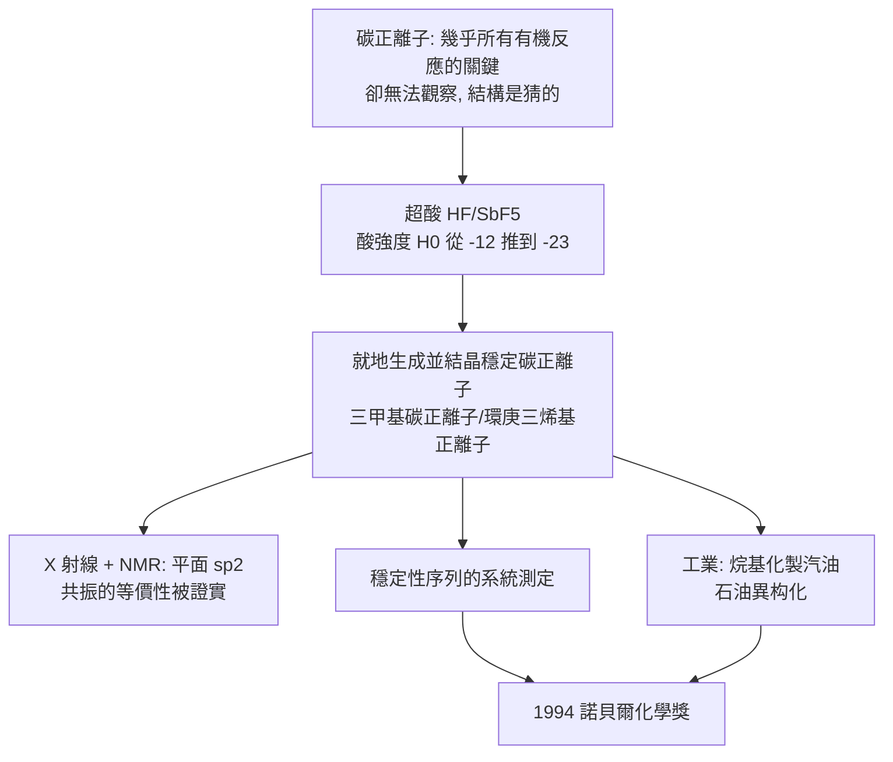

# 1994 · 奧拉與碳正離子——捕捉短命的反應中間物

> 1994 諾貝爾化學獎：喬治·安德烈·奧拉（George Andrew Olah，1927–2017，匈牙利／美國）——表彰「其對碳正離子化學的貢獻」。他把化學中最兇惡、最短命、最難捉摸的反應中間物，變成了可以拿在手上研究的東西。

## 懸案（案情提要）

有機化學有一個「看不見的兇手」：

- **碳正離子（carbocation，$\mathrm{R_3C^+}$）**是幾乎所有有機反應的關鍵中間物——加成、消除、取代都有它；
- 但它**極其活潑**：一旦生成，通常在奈秒（$10^{-9}$ 秒）內就反應掉，**無法直接觀察**；
- 更糟的是，化學家對它的「樣貌」眾說紛紜：**它是平面的？三角形的？碳有正電荷嗎？電荷分佈在三個碳上還是一個？穩定中間物長什麼樣？**
- 教科書上寫著碳正離子是「二級碳正離子比三級穩定」、「烯丙基型因共振而穩定」——**但這些都只是紙上的推論，從未被直接看見**；
- 而且更根本的問題：**既然它這麼活潑，為什麼某些反應卻「選擇」形成某種碳正離子而不是另一種？**中間物的能量高低決定了反應的選擇性，但從沒有人量過它。

偵辦人：喬治·奧拉。他的答案是：**製造比硫酸還強的「超酸」，讓碳正離子活下來。**

## 前因

| 年份 | 事件 |
| --- | --- |
| 1927 | 奧拉生於匈牙利布達佩斯（其父為匈牙利陸軍將軍）。 |
| 1949 | 布達佩斯工業大學博士；後赴匈牙利科學院（中央研究化學研究所）研究**Freud（佛羅伊德）反應**的碳正離子中間物——他在 1949–50 年代已提出「碳正離子中間物」的概念模型。 |
| 1956 | 匈牙利革命；奧拉流亡，先後在英國（與 **Patrick** 的碳正離子研究，1957 年發表「碳正離子的生成與穩定」）、加拿大、美國。 |
| 1960s | 奧拉在**洛杉磯的休斯化學研究所**發展**超酸（superacid）**系統（**氟化氫／氟化硼酸 $\mathrm{HF{-}SbF_5}$**，即「魔酸（magic acid）」，其酸強度遠超過 $100\%\ \mathrm{H_2SO_4}$）。 |
| 1968–1970s | 以超酸**直接觀測穩定的碳正離子**：如**三甲基碳正離子（$\mathrm{(CH_3)_3C^+}$）**、**環庚三烯基正離子（tropylium ion，$\mathrm{C_7H_7^+}$）**、**三芳基甲基正離子**。1969 年發表《碳正離子》（*Carbonium Ions*）。 |
| 1970s–80s | 將超酸用於**石油的異构化與裂解**（工業超酸催化，UOP 的烷基化製汽油），並發展**低碳烷烴的異構化**技術；推動「**異构烷烴（isooctane）**」與高辛烷值汽油。 |
| 1994 | 獲諾貝爾化學獎。 |
| 1990s–2010s | 奧拉以「**我沒有原子的專利**」的幽默著稱；並以諾獎金設立**奧拉化學獎與匈牙利的研究資助計畫**；2017 年逝於聖巴巴拉。 |

## 調查

**偵查一：超酸——「把酸強度推上物理極限」。**

酸的強度（Brønsted 定義）以 $\mathrm{H_0}$ 值表示：

$$H_0 = -\log_{10}\left(\frac{[\mathrm{H^+}]}{1\ \mathrm{M}}\right)$$

$$\mathrm{H_2SO_4}:\ H_0 \approx -12;\qquad \mathrm{HF{-}SbF_5}\ (\text{魔酸}):\ H_0 \approx -23 \ \text{（甚至更低）}$$

$$\mathrm{HF} + \mathrm{SbF_5} \rightleftharpoons \mathrm{H_2F^+} + \mathrm{SbF_6^-}$$

**「魔酸」的成分比例可微調**（$\mathrm{SbF_5}$ 越多越強），可把酸強度連續地調到任意值——**這就像給化學家一個可連續調節的「酸強度旋鈕」**。

**偵查二：穩定碳正離子的捕獲。**

在超酸中，碳正離子的生成可以「就地」進行，且產物可被結晶分離：

$$\text{異丁烷} \xrightarrow{\mathrm{HF/SbF_5}} \underbrace{(\mathrm{CH_3})_3\mathrm{C^+}}_{\text{三甲基碳正離子}} + \mathrm{H_2}$$

$$\underbrace{\text{環庚三烯}}_{\text{cycloheptatriene}} \xrightarrow{\mathrm{HF/SbF_5}} \underbrace{\mathrm{C_7H_7^+}}_{\text{環庚三烯基正離子（tropylium）}} + \mathrm{H^-}$$

**這是「第一次真正抓住」碳正離子**——不再是瞬息即逝的中間物，而是可以稱重、可以結晶、可以做 X 射線結構、可以量 NMR 的分子。

**偵查三：結構的直接測定——「平面？三鍵？共振？」**

結構研究回答了長久的爭議：

| 碳正離子 | 結構事實 |
| --- | --- |
| 三甲基碳正離子 $\mathrm{(CH_3)_3C^+}$ | 中心碳**平面 $sp^2$**，三個甲基呈 $120^\circ$ |
| 環庚三烯基正離子 $\mathrm{C_7H_7^+}$ | **完全對稱的環**，七個碳等價（${}^{1}\mathrm{H}$ NMR 只有一個峰）——**證實了「共振」的圖像** |
| 三芳基甲基正離子 | 芳環扭轉以減少立體排斥，電荷主要位於中心碳 |

**「共振」不再是書上的記號，而是可以量到等價性的結構事實。**

**偵查四：穩定性的定量序列。**

超酸讓「碳正離子穩定性」第一次可以被系統比較：

$$\text{三級（tertiary）} > \text{二級} > \text{一級} > \text{甲基（最不穩定）}$$

$$\text{共振穩定} > \text{超共軛穩定} > \text{誘導效應} > \text{三級（超取代）} > \text{二級} > \text{一級}$$

**這套序列在 2010 年代被重新檢視**：現代理論計算發現，**溶劑效應與「親電性／立體效應」會顯著改變序列**——這是奧拉晚年關注的議題。

**偵查五：超酸的工業應用——石油的分子重排。**

$$\text{原油的直鏈烷烴} \xrightarrow{\text{超酸}} \text{異构烷烴（高辛烷值）}$$

**這就是「烷基化製汽油」的化學基礎**：把直鏈的烴分子「剪接重排」成支鏈的異构烷烴，使汽油的抗爆性大幅提升——**1950–60 年代的美國「汽油黃金時代」，有超酸的一份功勞。**

## 理論裁決

**判決一：碳正離子的結構定義。**

$$\mathrm{R_3C^+}：\ \text{中心碳為} \ sp^2\ \text{平面三配位，} \angle 120^\circ,\qquad \text{空軌域（} p\ \text{軌域）垂直於平面}$$

$$\text{電荷分佈}：\ \text{部分正電荷} \xrightarrow{\text{誘導效應}} \text{向基團傳遞};\quad \text{共振} \xrightarrow{} \text{離域到相鄰} \pi\text{ 系統}$$

**「平面 + 空 p 軌域」這兩點解釋了碳正離子為何反應那麼快**（空的 p 軌域使親核試劑易於接近），也解釋了它的立體化學偏好。

**判決二：共振的實證——「等價性就是共振的證據」。**

$$\text{環庚三烯基正離子：} \quad 7 \text{ 個碳等價} \;\Longrightarrow\; {}^{1}\mathrm{H}\ \text{NMR 只有一個峰} \;\Longrightarrow\; \text{電荷完全離域}$$

**「若七個碳不等價，就會有七組不同的 NMR 訊號」**——實測只有一組，這是共振理論最乾淨的實驗證明之一（與 1902 年費歇爾的立體異構推理同屬「用對稱性讀結構」的傳統）。

**判決三：超酸開啟的「酸強度連續變數」。**

$$\mathrm{H_0} \text{ 作為可連續調節的參數} \;\Longrightarrow\; \text{「反應的立體化學與選擇性」可以用酸強度來「掃描」}$$

$$\text{超酸使「純碳正離子」成為可研究的物種} \xrightarrow{} \text{碳正離子化學成為獨立學科}$$

**這是一個「工具改變問題」的典型：有了足夠強的酸，很多化學問題從「猜測」變成「測量」。**

**判決四：對「穩定性序列」的現代修正。** 奧拉本人的研究與後來的理論計算顯示：

$$\text{傳統序列（}3^\circ > 2^\circ > 1^\circ\text{）在小分子中大致成立；但在高度取代或有立體效應的系統中，順序可能反轉}$$

**這提醒我們：化學的「規則」有其適用邊界，而邊界是由更精確的模型決定的**——這是科學成熟的標誌。

## 後果

| 領域 | 影響 |
| --- | --- |
| 石油工業 | 烷基化製汽油（HF 或 $\mathrm{H_2SO_4}$ 催化）與石油異构化，使高辛烷值汽油成為可能，是煉油工業的核心技術之一。 |
| 基礎化學 | 「碳正離子化學」成為有機化學的分支；烯類聚合、Friedel–Crafts 烷基化、亲電取代的機制都以碳正離子為核心概念。 |
| 天然產物 | 許多天然產物的生物合成步驟涉及碳正離子中間物；超酸技術可用於結構研究與全合成設計。 |
| 超酸技術 | 對烴的「超酸異构化」與「烷基化」使 C5+ 的烯烴得以利用（今日的高辛烷值汽油與烯烴聚合的鏈條）。 |
| 科學史 | 奧拉是「**逃亡的科學家**」群像的代表（1956 年匈牙利革命後流亡，後成為美國的科學領導者，並長期資助匈牙利科學）；他的「我沒有原子的專利」的機智名言，是科學家人格的經典。 |

## 關聯

- [1927-威蘭與膽汁酸](1927-威蘭與膽汁酸.md)：類固醇與碳正離子中間物——威蘭的羰基還原與奧拉的碳正離子研究在方法上相通（皆需超強的酸／鹼條件）。
- [1950-迪爾斯與阿爾德](1950-迪爾斯與阿爾德.md)：Friedel–Crafts 烷基化是碳正離子化學的工業起點之一。
- [1956-鏈反應與爆炸](1956-鏈反應與爆炸.md)：碳正離子與自由基是兩類主要的鏈載體。
- [1983-陶布與電子轉移](1983-陶布與電子轉移.md)：另一個「捕捉短命中間物」的案例（以同位素示蹤）。
- [1994-奧拉與碳正離子](1994-奧拉與碳正離子.md)：即本卷。
- [2005-格拉布與烯烴複分解](2005-格拉布與烯烔複分解.md)：金屬卡烯是「活性的碳正離子等價物」——金屬有機化學把碳正離子「金屬化」後加以穩定。
