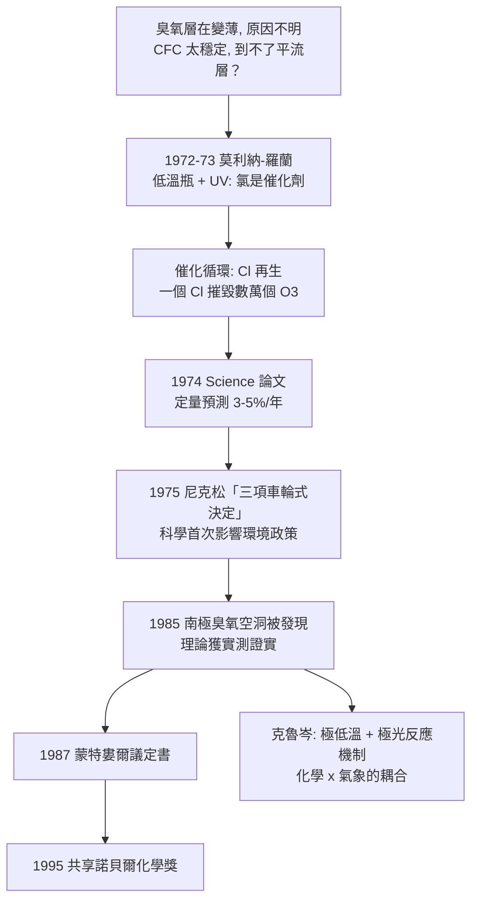

# 1995 · 克魯岑、莫利納與羅蘭——為地球的臭氧診脈

> 1995 諾貝爾化學獎：保羅·約瑟夫·克魯岑（Paul J. Crutzen，1933–2021，荷蘭）、馬里奧·何塞·莫利納（Mario José Molina，1943–2020，墨西哥）與 F. 舍伍德·羅蘭（F. Sherwood Rowland，1927–2012，美國）——表彰「其在大氣化學方面的研究，特別是對臭氧的形成與分解的化學的研究」。**化學第一次被用來預測並阻止一場全球性的環境災難。**

## 懸案（案情提要）

1970 年代初，有一個「冷掉的謎案」：

- **臭氧層（ozone layer）**：平流層約 20–35 km 高處的一層臭氧，吸收太陽的紫外線（尤其是 $\mathrm{UV-B}$），保護地面生物；
- 1960–70 年代，測量顯示**臭氧總量在下降**，但下降的原因不明——是自然循環？還是太陽活動？
- 更令人不安的是一個「化學上的直覺問題」：**CFC（氯氟碳化物，氟利昂）在大氣中極穩定**（有人估計壽命達數十年至上百年），因此「不可能到達平流層」。既然到不了，怎麼可能破壞臭氧？
- 而在 1970 年代的原始冷卻實驗中（於 $-78\,^\circ\mathrm{C}$ 的低溫瓶中），紫外線照射 $\mathrm{CF_2Cl_2}$ 竟產生了氯原子：

$$\mathrm{CF_2Cl_2} \xrightarrow{h\nu} \mathrm{CF_2Cl^\bullet} + \mathrm{Cl^\bullet}$$

**「低溫瓶裡能發生的事，在平流層的紫外環境下可能更快」——這個念頭需要被定量。**

偵辦人：莫利納與羅蘭（加州大學歐文分校），加上克魯岑（普朗克研究所的大氣化學家，其關鍵貢獻是**催化循環的理論框架**）。

## 前因

| 年份 | 事件 |
| --- | --- |
| 1933 | 克魯岑生於荷蘭阿姆斯特丹；1960 年取得博士學位（ Stockholm，關於化學動力學的量子理論）；1960–70 年代在美國工作（NOAA 的「大氣模擬計劃」，此時並非環境議題，而是研究臭氧的分布）；**1973 年回荷蘭，任普朗克研究所「化學與氣象研究所」的所長**。 |
| 1927 | 羅蘭生於美國特拉華州；1952 年於芝加哥大學取得博士學位（核物理化學）；1950s–60 年代在哥倫比亞大學研究**核化學與同位素**（他自建核反應爐並研究放射化學），後轉入加州大學歐文分校。 |
| 1943 | 莫利納生於墨西哥城；1961 年於墨西哥國立自治大學（UNAM）取得學位；1968 年赴加州理工學院取得物理化學博士學位，後加入羅蘭在歐文分校的實驗室。 |
| 1972–1973 | **莫利納在羅蘭實驗室的關鍵實驗**：以 UV 照射 CFC，測量臭氧的消耗率，並證明**氯原子是催化劑**（加入 $\mathrm{NO}$、$\mathrm{SO_2}$ 等已知抑制劑會改變速率）。 |
| 1974 | 莫利納與羅蘭發表《氯氟碳化物對臭氧的威脅》（*Stratospheric sink for chloromethanes: chlorine atom-catalysed destruction of ozone*，*Science*）。 |
| 1974–1978 | **科學—政治拉鋸戰**：美國工業界（化學製造商協會）強烈反對限制 CFC；**美國總統尼克森於 1975 年宣布「三項車輪式決定（three-pronged decision）」**：**停止使用**氟利昂作為噴霧髮膠、**逐步淘汰**作為冰箱冷媒、**研究**是否安全。**科學界第一次以「自我管理 + 行政公告」的方式影響環境政策。** |
| 1985 | **南極臭氧空洞被發現**（英國的 Farman 等人以 BAS 儀器測得春季臭氧總量暴跌 30–40%）——**莫利納的理論被大氣實測直接證實**。 |
| 1987 | **《蒙特婁爾議定書》**簽訂，全球逐步淘汰 CFC。 |
| 1995 | 三人共享諾貝爾化學獎。 |
| 1990s–2000s | 臭氧層逐步恢復（依 2018 年的聯合國報告，預計 2066 年左右回到 1980 年水平）；莫利納在墨西哥推動能源與環境政策，並創立**馬里奧·莫利納能源與環境中心**；克魯岑推廣「**人類世（Anthropocene）**」一詞，並早於 1980 年代提出「**核冬天（nuclear winter）**」概念。 |

## 調查

**偵查一：催化循環的發現——「氯原子是催化劑」。**

莫利納與羅蘭的機制：

$$\begin{aligned}
\text{① 光解：} &\quad \mathrm{Cl} + \mathrm{O_3} \rightarrow \mathrm{ClO^\bullet} + \mathrm{O_2} \\
\text{② 再生：} &\quad \mathrm{ClO^\bullet} + \mathrm{O} \rightarrow \mathrm{Cl^\bullet} + \mathrm{O_2} \\
\text{或} &\quad \mathrm{ClO^\bullet} + \mathrm{ClO^\bullet} + \mathrm{M} \rightarrow \mathrm{Cl_2O_3} + \mathrm{M} \xrightarrow{h\nu} 2\,\mathrm{Cl^\bullet} + 3\,\mathrm{O_2}
\end{aligned}$$

**關鍵**：$\mathrm{Cl^\bullet}$ 在循環末端**被再生**——**一個氯原子可以摧毀成千上萬個臭氧分子**：

$$\text{催化循環} \Rightarrow \text{臭氧的破壞速率} \propto [\mathrm{Cl^\bullet}]\ \text{而非}\ [\mathrm{CFC}]$$

**這正是「催化」的定義性特徵**（見 [1909-奧斯特瓦德與催化](1909-奧斯特瓦德與催化.md)）：改變反應路徑、而不被消耗。

**偵查二：定量——「有多少 CFC 會變成氯？」**

$$\text{從大氣進入平流層的 CFC 通量} \times \text{光解率} \xrightarrow{} \text{平流層中} \ [\mathrm{Cl^\bullet}]$$

$$\text{預測的臭氧損失} \approx 3\text{–}5\%\ /\text{年（1974 年的估計）}$$

**——這是化學第一次做出「全球尺度的定量預測」，並在十年後被實測證實。**

**偵查三：低溫瓶實驗——「在地球之外的條件下重現地球的問題」。**

$$\text{在 } -78\,^\circ\mathrm{C}\ \text{的玻璃瓶中，} \quad \mathrm{Cl_2} + \mathrm{O_3} \xrightarrow{254\ \mathrm{nm}} \mathrm{ClO^\bullet} + \mathrm{Cl_2O}$$

莫利納與羅蘭的實驗難點：**在 $-78\,^\circ\mathrm{C}$ 下，純臭氧會迅速分解**（壞半衰期僅約數十分鐘）。他們的解法是**用 $\mathrm{H_2O_2}$ 產生臭氧**（以減少壞損），並用化學捕獲法偵測產物。

$$\text{這個「在實驗室模擬平流層」的設計，是分子束與大氣化學結合的典範}$$

**偵查四：克魯岑的理論框架——「氧化氮與氫氧循環」。**

克魯岑在 1960–70 年代的理論工作建立了平流層臭氧的**總體模型**，並指出：

$$\text{臭氧的產生} \xrightarrow{\mathrm{O_2} + h\nu \rightarrow 2\,\mathrm{O}} \xrightarrow{\mathrm{O + O_2 + M \to O_3 + M}} \text{形成}$$

$$\text{臭氧的破壞} \xrightarrow{\mathrm{O_3} + h\nu \rightarrow \mathrm{O_2} + \mathrm{O}} \quad \text{（循環 I）}$$

$$\text{循環 II}：\quad \mathrm{O} + \mathrm{O_3} \rightarrow 2\,\mathrm{O_2}$$

**關鍵預測**：在平流層下方的**「NO$_x$ 循環」**會消耗臭氧，而高空（$>$ 30 km）則以 $\mathrm{O}$ 為主。**這個分層結構，後來成為解釋臭氧垂直分布的基礎**，也讓克魯岑能評估「CFC 增加會在哪裡造成什麼」的問題。

**偵查五：臭氧空洞的機制——「不是只有化學」。**

1985 年南極的觀測顯示，春季臭氧損失遠超化學模型的預測。**克魯岑與同事（及英國的 Farman）提出「**極低溫反應**」**機制**：**

$$\text{南極冬季：}\quad \text{極光產生的} \mathrm{ClO^\bullet} \xrightarrow{\text{二聚}} \mathrm{Cl_2O_3} \xrightarrow{h\nu} 2\,\mathrm{Cl^\bullet} + 3\,\mathrm{O_2}$$

$$\text{春季：}\quad \text{大量} \mathrm{Cl^\bullet} \xrightarrow{} \text{催化循環} \Rightarrow \text{臭氧暴滅式損失（30–40\%）}$$

**「化學模型 + 氣象條件（極低溫、極光、太陽自轉）」的耦合，才解釋了南極臭氧空洞。**這是「化學與氣象必須對話」的典範。

## 理論裁決

**判決一：臭氧破壞的催化循環方程組。**

$$\begin{aligned}
\mathrm{Cl} + \mathrm{O_3} &\rightarrow \mathrm{ClO} + \mathrm{O_2} \quad (k_1) \\
\mathrm{ClO} + \mathrm{O} &\rightarrow \mathrm{Cl} + \mathrm{O_2} \quad (k_2) \\
\mathrm{ClO} + \mathrm{ClO} + \mathrm{M} &\rightarrow \mathrm{Cl_2O_3} + \mathrm{M} \quad (k_3)
\end{aligned}$$

$$\text{臭氧的穩態產生/損失} \Rightarrow \frac{d[\mathrm{O_3}]}{dt} = P - L,\qquad L \propto [\mathrm{Cl}]\,[\mathrm{O_3}]\,k$$

**「臭氧的壽命」因此可以計算**：在平流層，$[\mathrm{O_3}]$ 較高時，壽命約數月到數年——**這個數字是今日氣候與臭氧耦合模式的基礎。**

**判決二：催化的環境依賴性。** 這個案子顯示，**同一個催化循環的效率強烈依賴環境**：

$$\text{同樣的} \mathrm{ClO}\ \text{循環：} \quad \text{在} \ 20\ \mathrm{km}\ \text{（} [\mathrm{O}] \text{高）走} \ k_2;\quad \text{在} \ 35\ \mathrm{km}\ \text{（極冷）走} \ k_3$$

**「化學的速率常數不是常數，而是環境的函數」——這是平流層科學最深刻的一課。**

**判決三：氣象—化學的耦合。** 南極臭氧空洞的機制顯示：

$$\text{氣象（極低溫、極光、氣旋）} \xrightarrow{} \text{改變化學路徑} \xrightarrow{} \text{改變臭氧} \xrightarrow{} \text{改變氣象（吸收 UV）}$$

**這個雙向的反饋（臭氧吸收 UV 影響溫度結構）使南極成為一個「化學—氣象」的耦合系統**——今日的「極區臭氧—氣候」耦合研究由此發軔。

**判決四：政策可由化學數據決定。** 本案最深遠的後果不在科學而在制度：

$$\text{化學模型} \xrightarrow{\text{定量預測}} \text{風險} \xrightarrow{\text{國際協議}} \text{全球禁令}$$

**這是「化學證據直接轉化為全球環境立法」的罕見案例**（蒙特婁爾議定書，1987），並在 1990 年代成為氣候變遷公約（京都議定書、巴黎協定）的方法論範本。

## 後果

| 領域 | 影響 |
| --- | --- |
| 環境政策 | 蒙特婁爾議定書與其後續修正案；全球 CFC 淘汰（今日的製冷劑改用 HFC、CO$_2$、氨、碳氫化合物）；**臭氧層預計於 2066 年左右恢復**。 |
| 大氣科學 | 「平流層化學」成為獨立學科；臭氧的全球監測網路；今日的「臭氧氣候耦合」研究。 |
| 醫學與公共衛生 | 紫外線與皮膚癌的關係（臭氧層與紫外線強度）；今日的「臭氧層恢復」的公共衛生效益評估。 |
| 科學政策 | 莫利納與克魯岑的公共角色：莫利納為墨西哥的能源與環境政策顧問；克魯岑推廣「**人類世**」一詞並提出「**核冬天**」概念。 |
| 科學史 | 1974–1985 年的「CFC 論戰」是科學與產業政治最著名的案例之一：科學家如何在沒有消費者、沒有明顯危機的情況下，说服社會承擔成本。 |

## 關聯

- [1909-奧斯特瓦德與催化](1909-奧斯特瓦德與催化.md)：本案是催化理論在環境尺度上的最大規模應用。
- [1956-鏈反應與爆炸](1956-鏈反應與爆炸.md)：氯的鏈式循環正是鏈反應理論的應用。
- [1986-李遠哲與分子束](1986-李遠哲與分子束.md)：基元反應的速率常數與能量分配，正是臭氧模型所需的數據來源。
- [1992-馬庫斯與電子轉移理論](1992-馬庫斯與電子轉移理論.md)：大氣中的電子／原子轉移反應。
- [1995-克魯岑與臭氧層](1995-克魯岑與臭氧層.md)：即本卷。
- [2023-量子點](2023-巴文迪與量子點.md)：以奈米材料作大氣污染物偵測，是今日的環境化學分支之一。
