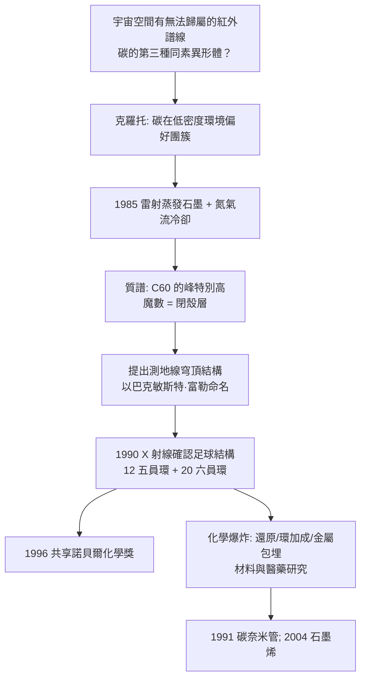

# 1996 · 克羅、克羅托與斯莫利——碳的第五種同素異形體

> 1996 諾貝爾化學獎：羅伯特·柯爾（Robert F. Curl，1933–2022，美國）、哈里·克羅托（Sir Harold Kroto，1939–2016，英國）與理查·斯莫利（Richard E. Smalley，1943–2005，美國）——表彰「其發現碳之新形式：富勒烯」。**碳有第三種（其實更多）同素異形體：足球。**

## 懸案（案情提要）

1985 年之前，人們以為碳只有兩種同素異形體：

- **金剛石**（$\mathrm{sp^3}$ 網狀固體，最硬）
- **石墨**（$\mathrm{sp^2}$ 層狀軟體）

而 1960 年代以來，**第三種可能性已在天體物理學界被提出**：宇宙空間有大量未辨識的紅外線吸收譜線，若干譜線無法用任何已知的碳化合物解釋——**天文学家懷疑碳可能存在第三種同素異形體，一種能形成球狀籠狀結構的分子**（因為球狀結構能產生特徵的振動譜）。

**挑戰是顯而易見的**：若這種分子在宇宙空間大量存在，它在實驗室裡應該也能做出來。**但沒有人知道它是什麼結構，甚至不知道它有多少碳原子。**

偵辦人：斯莫利與柯爾（萊斯大學，用雷射蒸發石墨）、克羅托（蘇塞克斯大學，以** astrophysical chemistry（天體化學）**的直覺指出「碳應該偏好形成團簇」）。

## 前因

| 年份 | 事件 |
| --- | --- |
| 1939 / 1933 / 1943 | 克羅托生於英國赫爾（Hull），其父為埃及僑民；柯爾生於美國阿拉斯加；斯莫利生於美國俄亥俄州阿克倫。 |
| 1960s–70s | **克羅托**在蘇塞克斯（與 **David Williams** 等人）研究宇宙空間的化學：分析星雲與星雲體的光譜，發現許多無法歸屬的譜帶；**他主張碳在低密度環境中會形成「團簇（cluster）」而非長鏈**——這正是富勒烯思想的先聲。 |
| 1980 | 克羅托在《新科學家》（*New Scientist*）發表〈天體化學：新領域〉等文章，主張應以化學的觀點研究星際空間。 |
| 1984 | 克羅托在萊斯大學訪問期間，與斯莫利、柯爾討論此問題；1985 年 8 月在弗吉尼亞州的**「三天之聚會（three-day meeting）」**上決定用**雷射蒸發石墨**來嘗試。 |
| 1985-08 | **關鍵實驗**：用 Nd:YAG 雷射聚焦於石墨靶，蒸發出的碳蒸氣在氮氣流中冷卻；**質譜分析顯示除了 $\mathrm{C_60}$ 的峰（$m/z = 720$）外，還有 $\mathrm{C_70}$、$\mathrm{C_2n}$ 等一系列的峰**。 |
| 1985-11 | 以質譜確證 $\mathrm{C_60}$ 的存在，並**提出其結構為「富勒烯（buckminsterfullerene）」**——以建築師巴克敏斯特·富勒（Buckminster Fuller）設計的**測地線穹頂（geodesic dome）**命名。 |
| 1986 | **晶體結構的確認**（Kroto 等人以 X 射線確認 $\mathrm{C_60}$ 的足球結構）；同年 **Kroto 與 Smalley 等人提出「微型足球（football）」模型**。 |
| 1990 | **C$_{60}$ 的化學被系統開發**（還原反應、添加反應、球烯衍生物）；1991 年 Smalley 等人製得**碳奈米管**。 |
| 1996 | 三人共享諾貝爾化學獎。 |
| 2000s | 斯莫利是**奈米科技的倡導者**（「奈米」一詞的推廣者之一）；克羅托推廣科普與天文化學。 |

## 調查

**偵查一：雷射蒸發——「讓碳自己找形狀」。**

$$\text{石墨靶} \xrightarrow{\text{Nd:YAG 雷laser 聚焦}} \text{碳蒸氣（} \sim 4000\ \mathrm{K}\text{）} \xrightarrow{\text{氮氣流冷卻}} \text{碳團簇}$$

$$\text{關鍵設計}：\ \text{氮氣流的密度與壓力決定冷卻速率} \xrightarrow{} \text{決定團簇的大小}$$

**這是一個「用物理條件篩選化學物種」的實驗**：若降溫太快，只得到小團簇（$\mathrm{C_2}$、$\mathrm{C_3}$）；若降溫合適，則形成 $\mathrm{C_{60}}$ 這種「閉殼層」的穩定魔數。

**偵查二：質譜的「魔數」——「60 是怎麼來的」。**

$$\text{質譜顯示} \quad \mathrm{C_{60}},\ \mathrm{C_{70}},\ \mathrm{C_{72}},\ \mathrm{C_{76}} \dots$$

$$\text{但} \quad \mathrm{C_{60}} \text{ 的峰特別高} \Rightarrow \text{「閉殼層」的穩定性}$$

**「魔數」的邏輯**：對碳團簇，電子數與幾何閉殼層一致時最穩定。$\mathrm{C_{60}$ 是一個**截斷二十面體（truncated icosahedron）**，恰有 12 個五員環與 20 個六員環，每個碳與三個碳相連（$\mathrm{sp^2}$，平面三角形）。

$$\text{對應電子數規則}：\ \mathrm{C}_{60} \ \text{有} \ 60\times 4 = 240 \text{個價電子} \xrightarrow{\text{加 30 個}} \text{閉殼層} \approx 2(60+1)^2 = 3782 \text{（近似）}$$

**這套「魔數 = 幾何閉殼層」的直覺，源自 1960 年代的原子核物理與_clusters_**——**化學家借用了核物理的思考方式**（克羅托本人是核物理出身）。

**偵查三：X 射線的結構證明——「足球」。**

1990 年代的單晶 X 射線研究（各團隊競速）確認：

$$\mathrm{C_{60}} = \text{直徑約 } 1\ \mathrm{nm}\ \text{的球形籠}; \quad \text{鍵長} \approx 1.40\ \text{Å（短）與}\ 1.45\ \text{Å（長）}$$

$$\text{內接於} \ \text{截斷二十面體}; \quad \text{共} \ 12\ \text{個五員環} + 20\ \text{個六員環}$$

**「足球」的名稱由此傳開（buckyball）**，而 1990 年的** fullerene 命名競賽**最終由 IUPAC 建議採「富勒烯（fullerene）」，用以涵蓋 $\mathrm{C_{60}$、$\mathrm{C_{70}$ 及其同族。

**偵查四：化學的爆發——「把球變成化學品」。**

$$\mathrm{C_{60}} \xrightarrow{\text{還原}} \mathrm{C_{60}^{6-}}\ (\text{鹽})\ \xrightarrow{}\ \text{電子傳遞材料}$$

$$\mathrm{C_{60}} \xrightarrow{\text{光照/氧化}} \text{功能性衍生物} \quad (\text{羥基化、環加成、聚合})$$

$$\text{金屬富勒烯}：\ \mathrm{C_{60}} + \mathrm{M} \to \mathrm{M@C_{60}}\ (\text{金屬被封在籠內})$$

$$\text{富勒烯聚合物}：\ \text{共聚合} \to \text{「有機金屬」實為}\ \text{高分子（} \mathrm{C_{60}}\text{-鏈）}$$

**「碳的三種同素異形體」至此完整：鑽石（網狀）、石墨（層狀）、富勒烯（球狀）——再加碳奈米管（管狀）與石墨烯（片狀）。**

## 理論裁決

**判決一：閉殼層魔數——「碳的幾何學」。**

$$\text{閉殼層團簇的電子數} \approx 2(n+1)^2\ \ (\text{球形近似})\quad\Longrightarrow\quad n = 60\ \text{時：} \ 2\times61^2 = 7442 \approx 2\times(4\times60 + 30)$$

$$\text{精確規則}：\ \text{每個碳貢獻 3 個 } \pi\text{ 電子（共 } 180\ \text{個），} \text{加 30 個電子填满} \ 15 \text{ 個} \pi\text{ 鍵級軌域}$$

**這套「魔數 = 幾何 + 電子」的推理，是化學中把數學用到最漂亮的一次之一。**

**判決二：結構的「建築學命名」。** 用**巴克敏斯特·富勒的測地線穹頂**來命名與想像 $\mathrm{C_{60}$，是把數學（黃金比例的分割）與建築（穹頂）與化學（分子）串起來的著名例子——**這正是分子建模時代的開端**：今日的化學家仍在用球棍模型、拓撲圖與計算機繪圖來「想像」分子。

**判決三：碳的「多形性」成為材料科學的軸心。**

$$\text{碳的四種主要形態}：\ \underbrace{\mathrm{sp^3}}_{\text{鑽石}} \quad \underbrace{\mathrm{sp^2}}_{\text{石墨、石墨烯}} \quad \underbrace{\text{捲曲的} \mathrm{sp^2}}_{\text{富勒烯}} \quad \underbrace{\text{捲曲的} \mathrm{sp^2}}_{\text{碳奈米管}}$$

$$\text{同一元素、同一電子数，} \quad \text{因「幾何」不同而性質迥異}$$

**這是「結構決定性質」在元素層級的最終版**（承接 [1954-鮑林與化學鍵](1954-鮑林與化學鍵.md) 的鍵理論）。

**判決四：富勒烯的電子結構——「分子版本的金屬」。**

$$\mathrm{C_{60}} \text{ 有} \ 240 \text{ 個價電子} \xrightarrow{\text{去局域化}} \text{相當於「一維金屬」的能帶}$$

$$\text{結果}：\ \text{導電性}、\ \text{超導性（鹼金屬-doped } \mathrm{C_{60}}\text{，} T_c \sim 18\ \mathrm{K}\text{）}、\ \text{光電效應}$$

**「分子金屬」的概念由此誕生**，並在 1990 年代的「分子電子學」中成為核心對象。

## 後果

| 領域 | 影響 |
| --- | --- |
| 材料科學 | 富勒烯與碳奈米管用於複合材料（提高強度與導電性）、有機太陽能電池、鋰電池負極、醫療影像（_ENDO_ 造影劑）。 |
| 電子學 | 富勒烯的電子性質是「分子電子學」的第一批材料；今日的有機半導體（OFET）與柔性電子，源頭可追溯至此。 |
| 醫學 | **富勒烯衍生物的抗氧化與光動力治療**（$\mathrm{C}_{60}$ 的自由基清除能力）；與抗癌研究。 |
| 科學文化 | 斯莫利是**「奈米科技」一詞最重要的推廣者**（與德雷克爾（Eric Drexler）於 1986 年發表《Engines of Creation》）；富勒烯的故事成為「基礎研究能帶來什麼」的科普經典。 |
| 天文化學 | 克羅托的「天體化學」開創了以分子光譜研究宇宙的學科；今日已知的數百種星際分子（見 [1971-赫茨貝格與分子光譜](1971-赫茨貝格與分子光譜.md)）即是這條線。 |

## 關聯

- [1954-鮑林與化學鍵](1954-鮑林與化學鍵.md)：雜化軌域理論是理解 $\mathrm{C_{60}}$ 中每個碳的 $\mathrm{sp^2}$ 與彎曲 $\pi$ 系統的基礎。
- [1971-赫茨貝格與分子光譜](1971-赫茨貝格與分子光譜.md)：天體光譜的分子鑑定——克羅托問題的直接方法論背景。
- [1976-利普斯科姆與硼烷](1976-利普斯科姆與硼烷.md)：多中心鍵與「魔數」的思考方式；霍夫曼在利普斯科姆實驗室的訓練（見 [1981-福井與前沿軌域](1981-福井與前沿軌域.md)）。
- [1983-陶布與電子轉移](1983-陶布與電子轉移.md)：富勒烯作為電子轉移與光誘導電荷分離的系統。
- [1996-柯爾與富勒烯](1996-柯爾與富勒烯.md)：即本卷。
- [2017-杜布歇與冷凍電顯](2017-杜布歇與冷凍電顯.md)：富勒烯與碳奈米管的結構今日主要以冷凍電顯解析。
