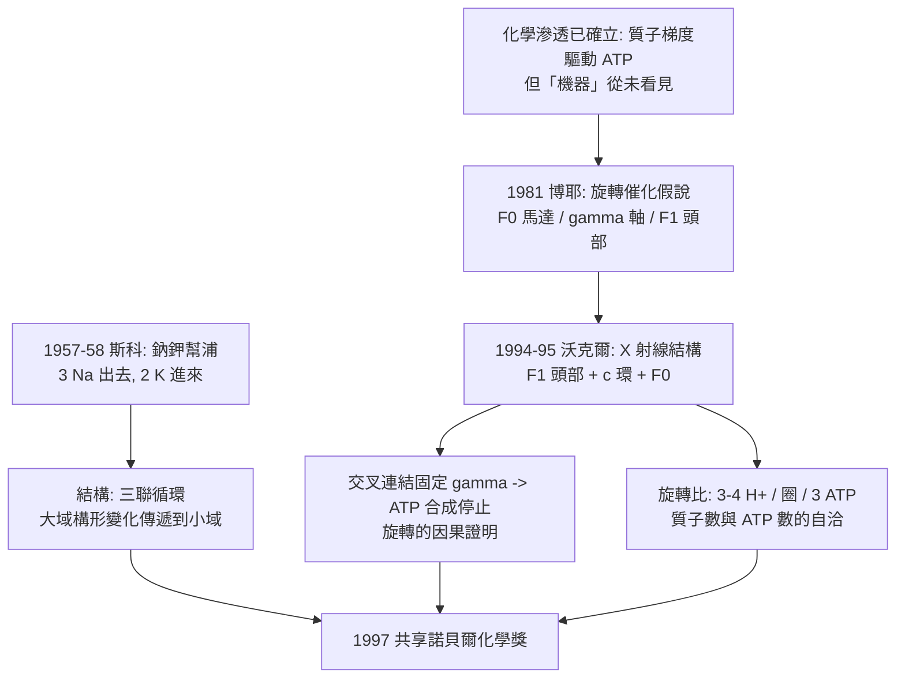

# 1997 · 博耶、沃克爾與斯科——生命引擎的齒輪

> 1997 諾貝爾化學獎（共享）：保羅·D·博耶（Paul D. Boyer，1918–2018，美國）、約翰·E·沃克爾（John E. Walker，1941– ，英國）與延斯·克里斯蒂安·斯科（Jens Christian Skou，1918–2018，丹麦）——表彰「其對 ATP 合成酶之旋轉催化機制，以及鈉鉀幫浦之發現的貢獻」。**化學家終於用結構「看見」了那台分子機器。**

## 懸案（案情提要）

1990 年代的生物能量學，剩下一個「已經有了答案、但還沒有被看見」的問題：

- **米切爾的化學滲透**（見 [1978-米切爾與化學滲透](1978-米切爾與化學滲透.md)）已經確立：呼吸鏈建立質子梯度，梯度驅動 ATP 合成（$\Delta p = \Delta\psi - \frac{2.303RT}{F}\Delta\mathrm{pH}$）；
- 但**梯度究竟是怎麼變成 ATP 的？**機制被描繪為「質子流經一個膜上的酵素」，但：
  - 那個酵素（**ATP 合成酶**）的結構如何？
  - 質子流的**能量如何驅動化學鍵的形成**？這是「機械能 → 化學能」的轉換，本質上是一個「分子機械」問題；
  - 為什麼 ATP 合成酶有那麼多零件（$\mathrm{F_0}$、$\mathrm{F_1}$、$\mathrm{c}$ 環、$\alpha_3\beta_3\gamma\delta\varepsilon$）？每一件做什麼？
- 另一樁案子：**鈉鉀幫浦**——每個細胞都靠它維持離子梯度與膜電位（這是米切爾機制的「原電池」）。它**每消耗一個 ATP 排出 3 個 $\mathrm{Na^+}$、吸入 2 個 $\mathrm{K^+}$**——**這個奇特的 3:2 比例是怎麼实现的？**

偵辦人：博耶（提出「旋轉催化」機制）、沃克爾（解出 ATP 合成酶的結構）、斯科（發現鈉鉀幫浦）。

## 前因

| 年份 | 事件 |
| --- | --- |
| 1918 / 1918 / 1941 | 斯科生於丹麦 Lemvig；博耶生於美國犹他州 Salt Lake City；沃克爾生於英國哈拉。 |
| 1940s–50s | 斯科在哥本哈根大學（其導師為 **Alexander (A.)**）研究**呼吸酵素與生物能學**，1957 年發現**鈉鉀幫浦（$\mathrm{Na^+/K^+}$ ATPase）**：在 $\mathrm{K^+}$ 存在下，碎片化的膜製備物能將 ATP 水解並驅動 $\mathrm{K^+}$ 運輸；1958 年他發現該酵素的**運輸方向可被 $\mathrm{Na^+}$ 反轉**——首次證明「同一酵素可逆運作」。 |
| 1950s–60s | 博耶在威斯康辛大學研究**碳酸酐酶**與 ATP 的羧化反應（1950 年代的「ATP 依賴的羧化」發現），並發展 ATP 的 **$P$/$N$ 命名法**（用以區分 ATP 上的兩個磷）。 |
| 1981 | **博耶的「旋轉催化（rotational catalysis）」假說**：ATP 合成酶由三個旋轉部件構成——$\alpha_3\beta_3$（靜止的 $\mathrm{F_1}$）、$\gamma$（旋轉軸）、$c$ 環（旋轉的 $\mathrm{F_0}$）；質子流驅動 $c$ 環旋轉，帶動 $\gamma$ 轉動，$\alpha_3\beta_3$ 的構形隨之變化，催化 ATP 的合成。 |
| 1980s | 沃克爾（ MRC 劍橋 LMB，見 [1962-佩魯茨與血紅蛋白](1962-佩魯茨與血紅蛋白.md)）以**兩維晶體學**（由其同事在 LMB 建立的**二維晶體學方法**）在蛋白質晶體上取得**多個**衍生物，並以**同晶置換**解相位。 |
| 1994 | **沃克爾發表 ATP 合成酶的結構**（$2.8\ \text{Å}$，$\mathrm{F_1}$ 部分），首次看見 $\alpha_3\beta_3$ 的球狀排列與中央的 $\gamma$ 軸；1995 年再發表含 $c$ 環與 $\mathrm{F_0}$ 的完整結構。 |
| 1994–1995 | **沃克爾與同事的電子顯微鏡與交叉連結實驗**證實**旋轉**：以 $\mathrm{F_1}$ 與 $\gamma$ 之間的**短距離交叉連結（18 Å）**固定 $\gamma$，旋轉即被完全阻斷——**這是「旋轉催化」最直接的實驗證明**。 |
| 1997 | 三人共享諾貝爾化學獎。 |

## 調查

**偵查一：ATP 合成酶的結構——「看見那台機器」。**

結構揭示了三個部件的分工：

$$\underbrace{\alpha_3\beta_3\ (\mathrm{F_1},\ \text{頭部，催化)}}_{3\ \text{個}\ \alpha\ (\text{不對稱，NTP 結合位})} + \underbrace{\gamma\ (\text{中央軸})}_{\text{旋轉}} + \underbrace{c\text{ 環} + a\ (\mathrm{F_0},\ \text{膜內，馬達})}_{10\text{–}15\ \text{個} c\ \text{子}}$$

$$\text{ATP 合成} = \text{質子流} \xrightarrow{c\text{ 環}} \text{旋轉} \xrightarrow{\gamma} \text{頭部構形變化} \xrightarrow{} \text{ADP} + \mathrm{P_i} \to \mathrm{ATP}$$

**「旋轉催化」的核心機制**：$\mathrm{F_1}$ 的三個 $\beta$ 次單元各自處於不同構形（$\mathrm{L}$、$\mathrm{T}$、$\mathrm{O}$），$\gamma$ 軸旋轉使它們依序改變構形，ATP 便在特定構形下被合成並釋出：

$$\mathrm{L} \xrightarrow{\gamma\ \text{旋轉}} \mathrm{T} \xrightarrow{} \mathrm{O} \ (\text{釋出 ATP}) \xrightarrow{} \mathrm{L} \cdots$$

**偵查二：交叉連結實驗——「把旋轉綁住，看反應停不停」。**

$$\text{若} \ \gamma\ \text{真的旋轉} \Rightarrow \text{把} \ \gamma \text{與} \alpha_3\beta_3 \text{用短距離交叉連結固定} \Rightarrow \text{ATP 合成應完全停止}$$

$$\text{實測：ATP 合成速率歸零} \quad \checkmark$$

**這是 1990 年代生物化學最乾淨的因果實驗之一**——不只觀察到旋轉，而是**干預旋轉並看到功能消失**。

**偵查三：質子流與旋轉的耦合——$c$ 環的馬達。**

$$\mathrm{F_0} \text{ 的} a\ \text{次單元含半通道}；\quad c\ \text{環的} \mathrm{Glu219}\ \text{（或 His245）與之配對}$$

$$\mathrm{H^+} \text{ 通過半通道} \xrightarrow{} \text{中和} \mathrm{Glu219} \text{的負電荷} \xrightarrow{} c\ \text{環旋轉一步（} \sim 120^\circ \text{）}$$

$$\text{每旋轉一圈（} c\ \text{環 10–15 個子）} \Rightarrow \text{約 } 3\text{–}4\ \text{個} \mathrm{H^+} \text{通過} \Rightarrow \text{約 } 3\ \text{個 ATP}$$

$$\frac{3\ \mathrm{ATP}}{10\text{–}15\ \mathrm{H^+}} \sim 3\ :\ 10$$

**「旋轉比」的量化**是本案最漂亮的部分：質子數、旋轉次數、ATP 產量三者必須自洽——**這正是 1990 年代的結構數據所強迫提出的精密化學計量學**。

**偵查四：鈉鉀幫浦的機制——「3:2 的秘密」。**

$$\mathrm{Na^+/K^+\text{-ATPase}}：\ 3\,\mathrm{Na^+}\ (\text{胞外}) + 2\,\mathrm{K^+}\ (\text{胞內}) + \mathrm{ATP} + \mathrm{H_2O} \rightarrow \mathrm{ADP} + \mathrm{P_i} + \cdots$$

**結構（2 個 $\alpha$、2 個 $\beta$、2 個 $\gamma$ 次單元）顯示**：ATP 的水解驅動**大的胞內域（$\beta$）的構形變化**，經由 $\alpha$ 次單元的「三聯運動」傳遞到**小的胞外域（$\beta$）**，使 Na/K 結合位與 Na 的釋放位**交替暴露**：

$$\text{三聯循環}：\ \mathrm{E1}\ (\text{高親和 Na}) \to \mathrm{E2}\ (\text{低親和 Na，釋放 Na}) \to \mathrm{E2P} \ (\text{結合 K}) \to \mathrm{E1}\ (\text{釋放 K})$$

**「一個 ATP 水解的化學能，如何驅動一次幾何上的大移動」——這是旋轉催化模型的第二個實例**，並解釋了 3:2 的不對稱比例。

## 理論裁決

**判決一：旋轉催化的能量傳遞鏈。**

$$\text{化學能} \to \text{質子梯度} \to \text{旋轉機械功} \to \text{構形變化} \to \text{化學鍵形成}$$

$$\text{效率} \approx 90\text{–}95\%\ (\text{ATP 合成酶被稱為「自然界效率最高的機器」})$$

**「化學能 ↔ 機械能」的轉換在分子尺度上被實現**——這是人類-made 引擎（蒸汽機、電動機）之外的第三種動力機。

**判決二：三聯運動（three-step movement）——ATP 合成酶的傳動。**

$$\gamma\ \text{軸的偏心旋轉} \xrightarrow{} \begin{cases}\alpha\ \text{次單元：} \text{開口/閉合} \\ \beta\ \text{次單元：} \text{NTP 結合位開合} \\ \text{樞軸：} \text{旋轉軸的偏心運動}\end{cases}$$

$$\text{偏心旋轉（eccentric rotation）} \Rightarrow \text{構形的「非對稱」驅動}$$

**「偏心」是關鍵**：若 $\gamma$ 只是繞自己的軸對稱旋轉，就無法驅動 $\beta$ 的非對稱構形變化——**結構揭示了機制的幾何關鍵**。

**判決三：旋轉比——結構與化學計量學的交叉驗證。**

$$\frac{n_{\mathrm{H^+}}}{n_{\mathrm{ATP}}} = \frac{n_{\mathrm{c\ ring}} \times (\mathrm{H^+/c\ step})}{3} \approx \frac{10\times 1}{3} \sim \frac{14\times 1}{3}$$

**這是一個「結構數據必須與化學計量吻合」的檢驗**——吻合即證明機制正確；若不吻合，就表示有未發現的質子通道或耦合機制（事實上正是 2010 年代 ATP 合成酶的高解析結構研究才補齊的細節）。

**判決四：主—客式的「運輸機制」。**

$$\text{大型胞內域} \to \text{傳動柱（} \alpha\text{、} \gamma\text{）} \to \text{小型胞外域}$$

**這與超分子化學的「主—客」（見 [1987-克拉姆與超分子化學](1987-克拉姆與超分子化學.md)）同構**：ATP 合成酶與鈉鉀幫浦都是「由大域、小域與傳動件組成的機器」，靠構形的交替開放完成循環工作。

**這是 1990 年代「分子機器」觀念在生物系統中的成熟表述**，並在 2016 年的諾貝爾獎（人工分子機器）中被正式命名（見 [2016-索瓦熱與分子機器](2016-索瓦熱與分子機器.md)）。

## 後果

| 領域 | 影響 |
| --- | --- |
| 生物能量學 | ATP 合成機制定案；ATP 合成酶被稱為「生命分子界的 motor」，是結構生物學、動力學與化學計量學三者交會的典範。 |
| 醫學 | ATP 合成酶與鈉鉀幫浦是藥物標靶（如哇哇（vancomycin）對細菌細胞壁的作用機制、**寡黴素 ouabain** 抑制鈉鉀幫浦）；心臟衰竭治療中的強心苷類即作用於鈉鉀幫浦。 |
| 分子生物學 | 「分子機器」的生物版本；且這些蛋白質是**教科書級的膜蛋白結構**，帶動了整個膜蛋白結構生物學。 |
| 化學 | 「化學能 ↔ 機械能」的分子機器觀念，直接影響 1990 年代末至 2010 年代的**人工分子馬達**研究（費寧加的 Feringemotor 等）。 |
| 科學史 | 沃克爾是兩度進入諾獎視野的科學家（1997 化學獎、2002 化學獎的 DNA 結構工作，見 [2002-田中與蛋白質質譜](2002-田中與蛋白質質譜.md)），並長期主持劍橋 MRC LMB。 |

## 關聯

- [1962-佩魯茨與血紅蛋白](1962-佩魯茨與血紅蛋白.md)：X 射線結構生物學的傳統；沃克爾是這條線的當代繼承者。
- [1978-米切爾與化學滲透](1978-米切爾與化學滲透.md)：本案是化學滲透的「機制結案卷宗」。
- [1987-克拉姆與超分子化學](1987-克拉姆與超分子化學.md)：主—客與分子機器的概念來源。
- [1997-博耶與ATP合成酶](1997-博耶與ATP合成酶.md)：即本卷。
- [2016-索瓦熱與分子機器](2016-索瓦熱與分子機器.md)：人工版本的旋轉機器。
- [2009-約納特與核糖體](2009-約納特與核糖體.md)：另一台分子機器——核糖體的肽轉移酶活性中心由 rRNA 承擔。
