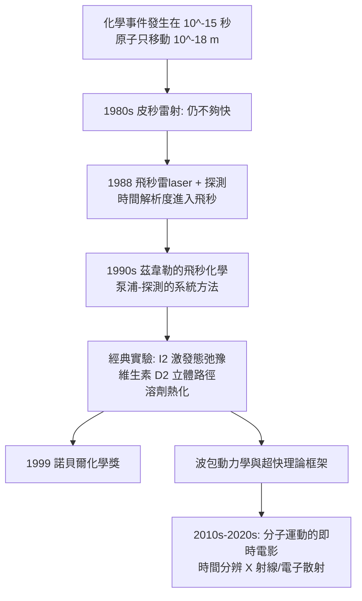

# 1999 · 茲韋勒與飛秒化學——拍下鍵斷裂的那一瞬間

> 1999 諾貝爾化學獎：艾哈邁德·哈桑·茲韋勒（Ahmed Hassan Zewail，1946–2016，埃及／美國）——表彰「其對飛秒化學之研究」。**化學第一次能「錄影」鍵的斷裂與形成。**

## 懸案（案情提要）

1990 年代的化學，有一個「拍攝」上的不可能：

- 反應的時間尺度：一般的化學反應是毫秒到秒；快反應是微秒（見 [1967-極快反應](1967-極快反應.md)）；
- 但**真正的化學事件**——電子被激發、鍵被拉長、鍵斷裂——發生在 **$10^{-15}$ 秒（飛秒）** 的尺度；
- 在飛秒尺度上，原子移動的距離只有：$$v \times \tau \sim 10^{-3}\ \mathrm{m/s} \times 10^{-15}\ \mathrm{s} = 10^{-18}\ \mathrm{m}$$（即**原子直徑的萬分之一**）；
- 而當時可用的最快工具是**皮秒雷射**（1980 年代末），且光化學的理論框架（如何解讀超快訊號）幾乎不存在。

**懸案的具體形式**：當一個分子吸收一個光子，它「接下來」會發生什麼？能量去了哪裡？鍵是立刻斷裂，還是先經過一個「扭曲的過渡態」？分子如何把能量分給周圍的溶劑？

偵辦人：茲韋勒。他發明了**飛秒泵浦—探測光譜**，並且**在 1990 年代建立了一整套「超快光化學」的理論框架**——他稱之為「**飛秒化學（femtochemistry）**」。

## 前因

| 年份 | 事件 |
| --- | --- |
| 1946 | 茲韋勒生於埃及坦哈（ Alexandria）。 |
| 1967 | 亞歷山大大學（Alexandria）理學士；赴賓夕法尼亞大學攻讀博士，1974 年取得博士學位（隨 **Robin Hochstrasser**）。 |
| 1974–1978 | 在威斯康辛大學（麥迪遜分校）與 **Robin Hochstrasser** 合作研究**超快光譜（picosecond spectroscopy）**——建立「**泵浦—探測（pump–probe）**」的技術雛形。 |
| 1978–1989 | 亞利桑那州立大學；1980 年代中期轉向**超快雷射**（與 **Paul (F.)**、**Jeff (G.)** 等人合作）；1988 年發表飛秒雷射探測鈣線的論文。 |
| 1990s | 加州理工學院（Caltech）；建立**飛秒化學**的研究方向；1990s 中期完成多項經典實驗。 |
| 1999 | 獲諾貝爾化學獎——**首位獲諾貝爾科學獎的埃及人與阿拉伯人**，首位獲化學獎的非洲人。 |
| 2000s | 任 Caltech 的「Linus Pauling 化學物理講座」教授（首位獲此職位者），並推動**超快科學中心**的成立。 |
| 2016 | 逝於帕薩迪納。 |

## 調查

**偵查一：泵浦—探測——「用兩道光做高速攝影」。**

$$\text{① 泵浦脈衝（} \sim 100\ \mathrm{fs}\text{）} \xrightarrow{} \text{把分子打到激發態（} \mathrm{S_1}, \mathrm{S_2}, \mathrm{S}_n \text{）}$$

$$\text{② 探測脈衝（延遲 } \tau \text{）} \xrightarrow{} \text{測量樣品的吸收/螢光}$$

$$\text{③ 掃描 } \tau \text{（以皮秒或飛秒步進）} \xrightarrow{} \text{得到} \ \textbf{時間吸收譜}$$

$$\boxed{\Delta A(\tau)\ \text{就是「化學的影片」}}$$

**關鍵在時間解析度**：若脈衝寬度為 $\delta$，則時間解析度即 $\delta$——飛秒雷射把 $\delta$ 從皮秒壓到飛秒，**於是能看到的不只是「最終產物」，而是中間的每一個狀態**。

**偵查二：能量去向的追蹤——「分子吸收光子之後」。**

以紫外激發 $\mathrm{I_2}$（碘分子）為例，茲韋勒等人觀察到：

$$\mathrm{I_2} + h\nu \xrightarrow{\text{泵浦}} \mathrm{I_2}(\text{激發態})$$

$$\text{觀測到的時間序列}：\ \text{紫外吸收恢復} \to \text{可見吸收出現（波長依賴）} \to \text{衰減}$$

$$\text{新發現}：\ \text{激發態的} \mathrm{I_2} \ \text{在} \sim 100\ \mathrm{fs}\ \text{內弛豫到} \ \text{「波長依賴的激發態」（即分離的} \mathrm{I}^*(v',j')\text{）}$$

**這是第一次看到「超快能量弛豫」的完整時間序列**，並揭示了**波長依賴性（wavelength-dependent dynamics）**——不同的激發態走不同的路。

**偵查三：過渡態的「直接觀測」——波拉尼規則的實驗檢驗。**

維生素 D$_2$ 的光化學開環（見 [1928-溫道斯與維生素D](1928-溫道斯與維生素D.md)）是選擇定則的教科書案例（見 [1981-福井與前沿軌域](1981-福井與前沿軌域.md)）。茲韋勒以飛秒光譜追蹤：

$$\text{維生素 D}_2 \xrightarrow{h\nu} \text{前維生素 D}_2 \xrightarrow{\Delta} \text{維生素 D}_2$$

$$\text{觀測}：\ \text{不同的初始波長} \xrightarrow{} \text{走不同的路徑、產生不同的立體產物比例}$$

**這是選擇定則的「超快實驗檢驗」**——立體化學的選擇性由「動量守恆」決定，而動量守恆在飛秒時間窗內被直接量到。

**偵查四：溶劑的參與——「熱是怎麼來的」。**

$$\text{激發態分子} \xrightarrow{\text{把能量傳給周圍溶劑}} \text{溶劑局部加熱}$$

**茲韋勒以時間分辨的紅外（瞬態吸收光譜）量到「溶劑的溫度波」**，證明能量傳遞過程中確實存在一個局域的「熱」階段——**這是化學動力學中「摩擦力」概念的分子級實證**。

**偵查五：從實驗到理論——「超快光化學的理論框架」。**

茲韋勒在 1990 年代建立了描述超快過程的語言：

$$\text{泵浦—探測訊號} \xrightarrow{\text{模型}} \text{多個耦合的指數函數之和}$$

$$\Delta A(\tau) = \sum_i a_i e^{-t/\tau_i}\quad(\text{在更複雜的系統中含振盪項})$$

$$\text{「波包（wavepacket）」的觀念}：\ \text{激發態被視為在勢能面上運動的波包}$$

**這套語言後來成為超快分子動力學（ab initio surface hopping、quantum wave packet dynamics）的標準語言**。

## 理論裁決

**判決一：時間解析度的物理定義。**

$$\delta t \sim \frac{\delta E}{\hbar} \quad\text{（能量不確定性給出的時間不確定性）}$$

$$\text{飛秒脈衝} \ (\delta E \sim 0.1\ \mathrm{eV})\ \Rightarrow\ \delta t \sim 0.1\ \mathrm{eV}/0.66\ \mathrm{eV\cdot fs} \approx 0.15\ \mathrm{fs}$$

$$\text{時間解析度的極限} = \text{脈衝寬度（受頻譜寬度限制）}$$

**這解釋了為何「更短的光」＝「更細的時間刻度」**——因為頻率與時間是共軛的。

**判決二：激發態的波包動力學。**

$$\Psi(t) = \sum_n c_n\, \psi_n\, e^{-iE_n t/\hbar} \xrightarrow{\text{垂直於表面的偶極耦合}} \text{波包沿勢能面移動}$$

$$\text{觀測}：\ \Delta A(\tau) \text{ 中的振盪頻率} \Rightarrow \text{波包在兩個勢能面之間的「拍頻」}$$

$$\Omega = \frac{E_2 - E_1}{\hbar}\quad\Rightarrow\quad \text{可直接量得能階差}$$

**這使超快光譜成為「能階的精密量測工具」**。

**判決三：溶劑動力學——「摩擦力的可見形式」。**

$$\text{激發態} \xrightarrow{\text{超快內轉換}} \text{振動能弛豫} \xrightarrow{\text{能量傳遞}} \text{溶劑加熱} \xrightarrow{} \text{熱擴散}$$

$$\text{每一步都有各自的時間常數} \Rightarrow \Delta A(\tau)\ \text{呈多指數行為}$$

**「能量從分子到溶劑的旅程」被拆成四個可測的階段**——這是化學動力學最細緻的一次時間解析。

**判決四：立體化學的動態學解釋。** 以維生素 D$_2$ 為例：

$$\text{激發態} \xrightarrow{\text{兩條平行的出口}} \begin{cases}\text{順式路徑} \to \text{順式產物}\\\text{反式路徑} \to \text{反式產物}\end{cases}$$

$$\text{產物比例} \approx \text{波的干涉結果} \Rightarrow \text{「立體化學是波動力學的產物」}$$

**這把選擇定則（靜態的對稱性規則）與波動力學（動態的相位干涉）統一起來**——是 1980–90 年代化學理論最漂亮的一次整合。

## 後果

| 領域 | 影響 |
| --- | --- |
| 光化學 | 超快光譜成為化學的標準工具；光化學反應的機制（光解、環化異構化、光致電子轉移）被逐步揭示。 |
| 生物光化學 | 視覺的初階光化學（視紫紅質的 $\sim 100\ \mathrm{fs}$ 異構化）、光合作用的天線能量傳遞（$\sim$ 皮秒到飛秒），皆以飛秒光譜研究。 |
| 能源 | 光催化劑的光生載體動力學（分離電荷的時間尺度決定效率）、染料敏質太陽能電池。 |
| 理論 | 「波包動力學」「非adiabatic 動態」成為理論化學的重要分支（與卡普拉斯、列維特等人的工作相接，見 [2013-卡普拉斯與多尺度模擬](2013-卡普拉斯與多尺度模擬.md)）。 |
| 文化 | 茲韋勒是**阿拉伯世界科學合法性的象徵**——首位獲諾貝爾科學獎的阿拉伯人與非洲人；他的故事在埃及與整個中東地區是巨大的科學勵志象徵。 |

## 關聯

- [1967-極快反應](1967-極快反應.md)：極快反應的時間解析度之爭；茲韋勒把尺度推到飛秒。
- [1928-溫道斯與維生素D](1928-溫道斯與維生素D.md)：維生素 D 的光化學是茲韋勒的經典實驗之一。
- [1981-福井與前沿軌域](1981-福井與前沿軌域.md)：選擇定則在飛秒尺度獲得動態學的驗證。
- [1986-李遠哲與分子束](1986-李遠哲與分子束.md)：反應動力學的另一個分支（分子束給出空間資訊，飛秒給出時間資訊）。
- [1999-茲韋勒與飛秒化學](1999-茲韋勒與飛秒化學.md)：即本卷。
- [2017-杜布歇與冷凍電顯](2017-杜布歇與冷凍電顯.md)：結構生物學的時間解析版本。
