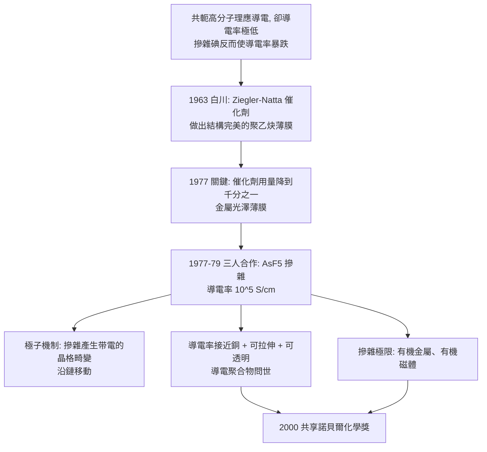

# 2000 · 黑格、麥克迪爾米德與白川英樹——讓塑料導電

> 2000 諾貝爾化學獎：艾倫·黑格（Alan J. Heeger，1936– ，美國）、艾倫·麥克迪爾米德（Alan G. MacDiarmid，1927–2007，美國／紐西蘭）與白川英樹（Hideki Shirakawa，1936– ，日本）——表彰「其對導電聚合物的發現與開發」。**塑膠第一次能導電，電子從此可以在分子鏈上奔跑。**

## 懸案（案情提要）

1970 年代的材料科學，有一個「物理學家與化學家的marriage」問題：

- **金屬能導電**（因為有自由電子），**塑膠不能**（因為電子都綁在鍵上）；
- 但金屬的加工性差（不透明、脆、難以做成薄膜與纖維）；
- 反過來，**高分子有金屬沒有的優點**：輕、可加工、柔韌、可做成薄膜——**如果能讓它導電，就兩全其美**；
- 理論上並非不可能：**共軛高分子**（如聚乙炔 $\mathrm{(CH{=}CH)_n}$）有交替的單雙鍵，電子可以在鏈上離域。但實驗上，這些聚合物的導電率極低（比金屬差十幾個數量級）——**「共軛」不等於「導電」**；
- 而且有一個奇怪的現象：**當在聚乙炔中摻入某些雜質（如碘、碘化銀）時，導電率不是上升，而是暴跌。**

偵辦人：黑格（發現摻雜的奇異行為，並解釋其機制）、白川英樹（用催化劑做出結構完美的聚乙炔薄膜）、麥克迪爾米德（把摻雜的概念推到金屬的極限）。

## 前因

| 年份 | 事件 |
| --- | --- |
| 1936 | 黑格生於美國密蘇里州；麥克迪爾米德生於紐西蘭（後入美國籍）；白川英樹生於日本東京。 |
| 1950s–60s | 黑格在**賓夕法尼亞大學**研究聚合物的光學與電學性質（**高分子半導體**的先驅工作），1962 年發表共軛高分子的導電研究。 |
| 1963 | **白川英樹**在東京工業大學（牧野富太郎研究室）用 **Ziegler–Natta 催化劑**（見 [1963-齊格勒與納塔](1963-齊格勒與納塔.md)）聚合乙炔，得到**結構極佳的聚乙炔薄膜**（cis-trans 高度有序）——**這是黑格與麥克迪爾米德的實驗所缺的材料**。 |
| 1967 | **麥克迪爾米德**在東京工業大學（與白川合作）發現**「摻雜」（doping）**：把聚乙炔曝露於 $\mathrm{I_2}$、$\mathrm{AsF_5}$ 等電子接受劑或供應劑，導電率大幅改變——**但「碘摻雜」的結果反而是導電率下降**，成為謎題。 |
| 1977 | **白川**發現催化劑用量若超過千倍（即催化劑與單體比約 $10^{-3}$），就能做出**金屬般光澤的聚乙炔薄膜**——**關鍵在催化劑的「量」**。 |
| 1977–1979 | 三人合作（白川提供材料，麥克迪爾米德與黑格做摻雜與量測）：**發現用 $\mathrm{AsF_5}$ 等強氧化劑摻雜的聚乙炔，導電率可達 $\sim 10^5\ \mathrm{S/cm}$**（比銅僅低數十倍）；並在紐約的**國際電話電報公司（ITT）**實驗室與黑格合作，觀察到**摻雜後的聚乙炔在拉伸時導電率增加**——這是「導電聚合物可拉伸」的關鍵觀測。 |
| 1979 | 紐約市議會的 Galerie H（**Arne (B.)** 等藝術家）與黑格、麥克迪爾米德合作，製作了**第一個導電聚合物藝術品**（如《Beth Israel》），是科學與藝術結合的著名事件。 |
| 2000 | 三人共享諾貝爾化學獎。 |
| 1980s–2000s | 導電聚合物的應用：**ITO 替代（透明導電膜）**、抗靜電塗層、有機發光元件（OLED）、可印刷電子、鋰電池導電添加劑（聚乙炔 $\mathrm{(CH)_x}$ 與 $\mathrm{C}_{60}$ 的複合）。 |
| 2000s | 白川與麥克迪爾米德獲**「京都獎」**（2001）與**「日本國際獎」**等；白川因 2015 年的學術不端爭議而於 2019 年辭去日本科學院會員等職位（此為諾獎得主的科學倫理案例）。 |

## 調查

**偵查一：白川的關鍵發現——「催化劑的量」。**

$$\text{催化劑}/\text{單體} \sim 10^{-3} \quad\Longrightarrow\quad \text{高度有序的} \ \textbf{金屬光澤}\ \text{聚乙炔薄膜}$$

$$\text{催化劑}/\text{單體} \sim 10^{-2}\ \text{（常見用量）} \Longrightarrow\quad \text{無定形、多缺陷、不導電的黑色粉末}$$

**這是一個「反直覺」但極其重要的細節**：催化劑過多會「毒化」聚合，使生長出的鏈短而無序。**材料的性能取決於聚合物的「結構完美度」，而不只是化學組成。**

**偵查二：摻雜的機制——「把電子塞進鏈裡」。**

$$\text{共軛鏈} \xrightarrow{\text{氧化（} \mathrm{AsF_5}\text{）}} \text{正電荷（} \mathrm{P}^+\text{）的極子（polaron）}$$

$$\mathrm{P}^+ = (\text{鏈上的一個正電荷} + \text{局域的晶格畸變})$$

$$\text{摻雜後} \Rightarrow \text{沿鏈移動的} \textbf{極子（polaron）}\ \text{（帶電的「 quasiparticle」）}$$

**極子的質量約為電子的數十倍，但移動速度相當——這解釋了為什麼導電率很高卻不如金屬。**

**偵查三：導電聚合物與金屬的比較——「分子尺度金屬」。**

| 性質 | 金屬 | 摻雜聚乙炔 |
| --- | --- | --- |
| 導電率 | $\sim 10^5$–$10^6\ \mathrm{S/cm}$ | $\sim 10^5\ \mathrm{S/cm}$（$\mathrm{AsF_5}$ 摻雜） |
| 密度 | 高 | **極低** |
| 可拉伸 | 差 | **佳（拉伸時導電率增加）** |
| 加工性 | 差 | 好（溶液塗佈、捲曲） |
| 顏色 | 不透明 | **可透明（薄膜）** |

**「導電塑料」這個夢想在 1977 年實現**——這是材料科學史上最直接的一次「夢想成真」。

**偵查四：麥克迪爾米德的極限實驗——「摻雜到金屬」。**

$$\text{以 } \mathrm{AsF_5} \text{ 摻雜聚乙炔} \xrightarrow{} \text{導電率} \sim 10^5\ \mathrm{S/cm} \quad (\text{已接近銅})$$

$$\text{更極端的摻雜} \xrightarrow{} \text{材料出現} \textbf{磁性} \text{（世界首例「有機磁性體」）}$$

**「有機金屬」與「有機磁體」——這是摻雜理論的兩個巔峰**，並為後來的有機電子學與自旋電子學開了門。

## 理論裁決

**判決一：導電聚合物的物理圖像——「一維金屬」。**

$$\text{共軛鏈的} \pi\ \text{電子系統} \xrightarrow{\text{摻雜}} \text{部分填充的能帶}$$

$$\text{與金屬的差異}：\ \text{電子被「陷」在} \textbf{極子（polaron）}\text{裡} \Rightarrow \text{有效質量大} \Rightarrow \text{遷移率較低}$$

$$\text{極子的定義}：\ \text{電荷} + \text{伴隨的晶格畸變};\qquad E_p = \frac{1}{2} k x_0^2,\qquad q_e = -\partial E_p/\partial x$$

**「電子拖著晶格一起走」——這是導電聚合物的關鍵物理，也是它與金屬的根本差異。**

**判決二：摻雜的雙重性——「供體與受體」。**

$$\text{氧化型摻雜（受體）}：\ \mathrm{AsF_5} + (\mathrm{CH})_x \to (\mathrm{CH}^{0.06}_x)^+[\mathrm{AsF_6}^-]_{0.06} \quad (\text{正電性})$$

$$\text{還原型摻雜（供體）}：\ (\mathrm{CH})_x + \mathrm{Na} \to (\mathrm{CH}^-)_x[\mathrm{Na}^+] \quad (\text{負電性})$$

$$\text{兩者皆可導電} \Rightarrow \text{「摻雜」的本質是改变鏈的} \textbf{填充能帶}\text{（} n\text{ 型或} p\text{ 型）}$$

**這套「以化學改變電子的填充」的觀念，與半導體工業的「摻雜」完全同源**，卻是在**分子尺度**上實現的。

**判決三：結構決定性能——「聚合物的『金屬性』來自完美」。**

$$\text{催化劑過量} \Rightarrow \text{缺陷多} \Rightarrow \text{π 系統中斷} \Rightarrow \text{導電率暴跌}$$

**「鍵的共軛」是必要條件，「結構的連續」是充分條件**——這是一個對材料科學極其重要的教訓，也是今日「石墨烯 vs 石墨」（缺陷對導電率的影響）的先聲。

**判決四：從發現到應用的產業鏈。**

$$\text{導電聚合物} \xrightarrow{\text{摻雜}} \text{可印刷導電油墨} \xrightarrow{} \text{柔性電子、電容觸控、感測器}$$

$$\text{導電高分子的第一個大規模商業應用}：\ \textbf{透明導電膜（ITO 的替代）}\text{、抗靜電劑、以及鋰電池的導電添加劑}$$

**「塑膠導電」從一個物理學家的怪問題，變成了材料產業的一個分支。**

## 後果

| 領域 | 影響 |
| --- | --- |
| 電子與材料 | 導電高分子用於 OLED（發光層與電極材料）、有機光伏、可印刷電子、柔性電路、抗靜電材料。 |
| 能源 | 鋰離子電池的導電添加劑（聚乙炔與 $\mathrm{C}_{60}$）、染料敏質太陽能電池的電洞傳輸層。 |
| 生物醫學 | 導電高分子用於生物電子介面、柔性電子器件、穿戴式健康監測；「電子皮膚」與神經介面的材料基礎。 |
| 科學文化 | 1979 年紐約的導電聚合物藝術品，與 1986 年麥克迪爾米德於諾貝爾演講中展示「合成金屬」（從多空穴摻雜的聚合物拉出超導線）——**科學與藝術、科學與企業的雙重示範**。 |
| 科學倫理 | 白川英樹 2015–2019 年的學術不端指控與其辭職，是諾貝爾獎得主在科學誠信上的重大案例。 |

## 關聯

- [1963-齊格勒與納塔](1963-齊格勒與納塔.md)：白川用的正是 Ziegler–Natta 催化劑——本案是它的「應用續篇」。
- [1950-迪爾斯與阿爾德](1950-迪爾斯與阿爾德.md)：共軛雙烯的聚合，正是形成共軛高分子的第一步。
- [1996-柯爾與富勒烯](1996-柯爾與富勒烯.md)：富勒烯與碳奈米管是導電碳材料的另一支，並與聚乙炔共同構成「碳的導電家族」。
- [2019-古迪納夫與鋰離子電池](2019-古迪納夫與鋰離子電池.md)：導電添加劑與集流體材料。
- [2000-白川英樹與導電聚合物](2000-白川英樹與導電聚合物.md)：即本卷。
