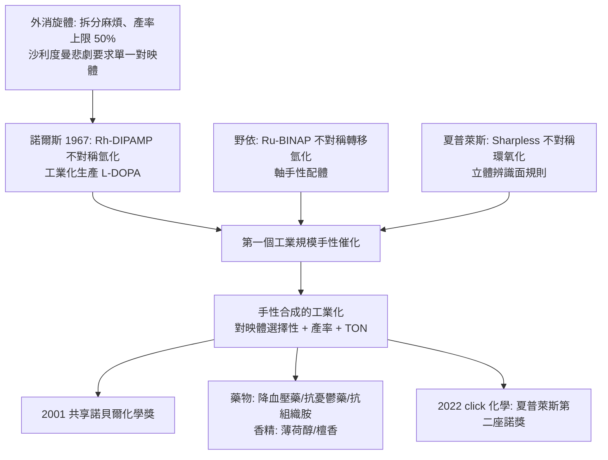

# 2001 · 諾爾斯、野依與夏普萊斯——手性合成的工業化

> 2001 諾貝爾化學獎（共享）：威廉·諾爾斯（William S. Knowles，1917–2015，美國）、野依良治（Ryoji Noyori，1938– ，日本）與卡爾·巴里·夏普萊斯（Karl Barry Sharpless，1941– ，美國）——表彰「其對手性化合物合成的貢獻」。**化學家終於能「只做出一隻手」的分子。**

## 懸案（案情提要）

1970–80 年代的藥物與香料工業，有一個極其昂貴的問題：

- **分子有「左右手」**（見 [1902-費歇爾與醣類偵探學](1902-費歇爾與醣類偵探學.md)）：$(R)$ 與 $(S)$ 是不同的分子，物理性質幾乎相同，但**生物活性可能完全不同**；
- 天然產物常是「手性純」的（例如 $(L)$-胺基酸、$(S)$-乳酸），但化學合成的產物是**外消旋體（racemate）**；
- 分離外消旋體（拆分）麻煩、耗時、產率上限 50%；
- 更大的問題在藥物史上的慘案：**沙利度胺（thalidomide，1961）**——$(R)$ 異構物是鎮靜劑，$(S)$ 異構物有致畸作用；而當時的藥品是外消旋體，**兩種都進入人体**。此後歐美藥政當局要求新藥必須以單一對映體開發；
- 而當時能用的方法只有：**酵素拆分（生物催化，產率有限）}、**或**用現成的手性「工具分子」做誘導**（效率低、浪費）**。

**懸案：能不能用催化劑，直接、選擇性地造出想要的對映體？**

偵辦人：諾爾斯（烯烴的「不對稱氫化」）、野依（羰基的「不對稱氫化」與「不對稱轉移氫化」）、夏普萊斯（烯丙醇的「不對稱氧化」）。

## 前因

| 年份 | 事件 |
| --- | --- |
| 1917 / 1938 / 1941 | 諾爾斯生於美國密蘇里州；野依良治生於日本 Kobe；夏普萊斯生於美國賓州。 |
| 1950s–60s | 諾爾斯在**孟山都（Monsanto）**研究以**手性 Rh 錯合物（DuPont 製備的 $\mathrm{Rh}$–$(R,R)$-DIPAMP）**進行的烯烴不對稱氫化，1967 年他與同事報導了**第一個工業規模的不對稱催化合成**（生產 **L-DOPA**，治柏金遜症藥物），並分離出對映體——**這是手性催化工業的開端**。 |
| 1960s–70s | 野依良治在京都大學研究**「手性試劑誘導」的反應**（1965 年以 $\mathrm{LiAlH_4}$ 與手性胺處理酮，得到高光學純度的醇），並發展了**手性二胺（diamine）**配體（如 **BINAP**）。 |
| 1980s | 野依與其合作者發展**「不對稱轉移氫化」**：以**甲酸／甲酸銨**為氫源，以**手性 Ru–BINAP 錯合物**催化酮的還原，得到手性醇——**這是「不對稱氫化」的更廣版本**（可還原酮而非僅烯烴）。 |
| 1980–1990 | 夏普萊斯在史丹福（與 **Sharpless rule**）發展**烯丙醇的不對稱氧化**：以 $\mathrm{Ti(OiPr)_4}$、**二乙基酒石酸酯（DET）**與**過氧化氫／叔丁基過氧化氫**進行 Sharpless 不對稱環氧化。**1980 年他提出「Sharpless 不對稱環氧化」的通用規則：底物的「立體辨識面」決定哪一面被氧化。** |
| 1991 | 夏普萊斯與其合作者（**Katsuki**）發表**不對稱羥基化（Sharpless 不對稱羥基化）**，用 $\mathrm{Ru}$ 催化劑實現烯丙醇的選擇性羥基化。 |
| 2001 | 三人共享諾貝爾化學獎。 |
| 2000s–2010s | 野依（2001）與夏普萊斯（2001、2022）獲頒**「京都獎」**；夏普萊斯並以「**click 化學**」（見 [2022-貝爾托西與點擊化學](2022-貝爾托西與點擊化學.md)）與「不對稱催化」兩度獲諾獎。 |

## 調查

**偵查一：不對稱氫化——「催化劑上面掛一個『手』」。**

$$\text{烯烴} + \mathrm{H_2} \xrightarrow[\text{手性 Rh 錯合物}]{} \text{手性烷烴}$$

$$\text{催化循環}：\ \mathrm{Rh{-}H}\ \text{加成} \xrightarrow{} \text{金屬—烷基} \xrightarrow{} \text{插入烯烴} \xrightarrow{} \text{還原消除，釋出} \textbf{手性產物}\ \text{並再生} \mathrm{Rh{-}H}$$

**立體選擇性的來源**：手性配體（$(R,R)$-DIPAMP）與 $\mathrm{Rh}$ 形成的錯合物，其兩側「不等價」——**底物只能從較開闊的一側接近，因此只形成一個對映體**：

$$\text{ee（enantiomeric excess）} = \frac{|R-S|}{R+S} \times 100\%$$

$$\text{工業上要求} \ > 99\%\ \text{ee（且產率}> 90\%）}$$

**偵查二：Sharpless 不對稱環氧化——「規則化的立體化學」。**

$$\text{烯丙醇} \xrightarrow[\mathrm{DET}]{\mathrm{Ti(OiPr)_4},\ \mathrm{tBuOOH}} \text{環氧醇}$$

**Sharpless 規則（本案的「速查表」）**：把烯丙醇畫成平面，$\mathrm{OH}$ 在右下、$\mathrm{C{=}C}$ 在中間，則：

$$\begin{array}{l}
\text{「上面」（上方，即遠離} \mathrm{CH_2OH}\ \text{的一側）}\\
\text{「下面」（下方，即} \mathrm{OH}\ \text{所在的一側）}
\end{array}$$

$$\text{加入} \ (+)\text{-DET} \Rightarrow \text{從上面進攻};\qquad \text{加入} \ (-)\text{-DET} \Rightarrow \text{從下面進攻}$$

**這是一個「只要畫對圖，就知道會得到哪個對映體」的規則**——**手性合成的可預測性在此達到頂點**，並使「不對稱合成」從手工藝變成可設計的工程。

**偵查三：不對稱轉移氫化——「不用高壓氫氣的方案」。**

$$\text{酮} + \mathrm{HCOOH} \xrightarrow[\text{手性 Ru–BINAP}]{\text{甲酸銨，催化}} \text{手性醇} + \mathrm{CO_2}$$

$$\text{優點}：\ \text{不需要} \mathrm{H_2}\ \text{氣瓶、壓力反應器、可溶於水、易放大}$$

**野依的 BINAP 配體**是一個(axially chiral)（軸手性）的聯萘骨架：

$$\text{軸手性}：\ \text{兩個芳環因位阻而不能自由旋轉} \Rightarrow \text{「凍結的手性」}$$

**軸手性配體是 2000 年代手性催化的主流**（今日的 BINAP、SEGPHOS、Josiphos 等）。

**偵查四：從克數到噸數——「工業可行性的三道門」。**

$$\text{① 對映體選擇性} \ (> 99\%\ \text{ee}); \qquad \text{② 產率} \ (> 90\%); \qquad \text{③ 催化劑的} \mathrm{TON} \ (\text{轉化數} > 10^4\text{–}10^6)$$

$$\text{TON} = \frac{\text{產物莫耳數}}{\text{催化劑莫耳數}}$$

**「TON 不夠高，催化劑就會比產品更貴」——這是手性催化從學術走向工業的核心瓶頸**，也是野依與夏普萊斯獲獎的關鍵理由：**不是「能做到」，而是「做得起來」。**

## 理論裁決

**判決一：手性催化的立體化學原理——「不對稱環境」。**

$$\text{催化劑的三維} \xrightarrow{} \text{底物的兩面「不等價」} \xrightarrow{} \text{只走一條路}$$

$$\text{這是} \ \textbf{克拉克的「立體專一性」原理}\text{的工業化實現}$$

**回想 1975 年克拉克與普雷洛格（見 [1975-康福思與普雷洛格](1975-康福思與普雷洛格.md)）的問題：「酵素為何能分辨分子的左右？」——手性催化劑給出了化學的回答：**

$$\text{不對稱催化劑} = \text{「人工酵素」的立體環境}$$

**判決二：Sharpless 規則——「把立體化學變成可查表的操作」。**

$$\text{規則}：\ \text{以} \ (+)\text{-DET} \Rightarrow \text{從「上面」進攻}; \qquad (-)\text{-DET} \Rightarrow \text{從「下面」進攻}$$

**這種「只要會畫圖就會做」的規則，是化學能給人類的最好禮物之一**——它把千頁的立體化學文獻壓縮成一張紙。

**判決三：不對稱催化的經濟學——「TON 才是工業的門檻」。**

$$\text{手性合成的實用性} = \underbrace{\text{ee}}_{\text{選擇性}} \times \underbrace{\text{產率}}_{\text{效率}} \times \underbrace{\text{TON}}_{\text{成本}} \times \underbrace{\text{配體易得}}_{\text{可規模化}}$$

$$\text{1990 年代的手性催化體系} \xrightarrow{} \text{配體的「工業化合成」} \xrightarrow{} \text{成本下降} \xrightarrow{} \text{TON 提升} \xrightarrow{} \text{手性藥物普及}$$

**「配體的合成」是手性催化產業鏈中最容易被忽略、卻最關鍵的一環。**

**判決四：軸手性的復興。**

$$\text{軸手性}（\text{atropisomerism}）：\ \text{绕单键的旋转被位阻"锁住"} \Rightarrow \text{可分离的稳定对映体}$$

$$\text{_bins：} \quad \text{軸手性} + \text{金属} \xrightarrow{} \text{高度稳定的催化剂（可回收、可放大）}$$

**軸手性今日是手性催化的主流**（BINAP、SEGPHOS 等），並在藥物（如 axially chiral drugs）與材料（液晶）中扮演重要角色。

## 後果

| 領域 | 影響 |
| --- | --- |
| 藥物 | **單一對映體藥物**成為主流：降血壓藥（ $\beta$-阻斷劑）、抗憂鬱藥、抗組織胺藥、減充血劑等；L-DOPA（柏金遜症）是最早的工業實例。 |
| 香精香料 | 單一對映體的香精（薄荷醇、檀香、茉莉香內酯）使香水工業得以「完全複製天然品」。 |
| 農業化學 | 除草劑（如 aryloxyphenoxypropionate 類）的手性版本，減少了用量與環境負擔。 |
| 學術 | 「不對稱合成」成為有機化學的核心分支；2010 年代的「光催化不對稱反應」是最新一代（以光而非金屬為驅動）。 |
| 科學制度 | 諾爾斯在孟山都工作 40 年（1922–1967），**是工業實驗室做出諾獎級科學的典範**；野依與夏普萊斯則分別代表日本與美國的學術體系。 |

## 關聯

- [1902-費歇爾與醣類偵探學](1902-費歇爾與醣類偵探學.md)：D/L 命名與立體異構的起點；本案的「手性」概念即其工業化。
- [1969-巴頓與構象分析](1969-巴頓與構象分析.md)：構象與立體控制的理論基礎。
- [1975-康福思與普雷洛格](1975-康福思與普雷洛格.md)：立體專一性原理與普雷洛格規則——手性催化的理論祖宗。
- [1981-福井與前沿軌域](1981-福井與前沿軌域.md)：對稱性與軌域——理解「為何某一面會被進攻」的量化語言。
- [2001-諾爾斯與手性催化](2001-諾爾斯與手性催化.md)：即本卷。
- [2022-貝爾托西與點擊化學](2022-貝爾托西與點擊化學.md)：夏普萊斯的第二座諾獎，與手性催化並列為他對「合成方法學」的兩大貢獻。
