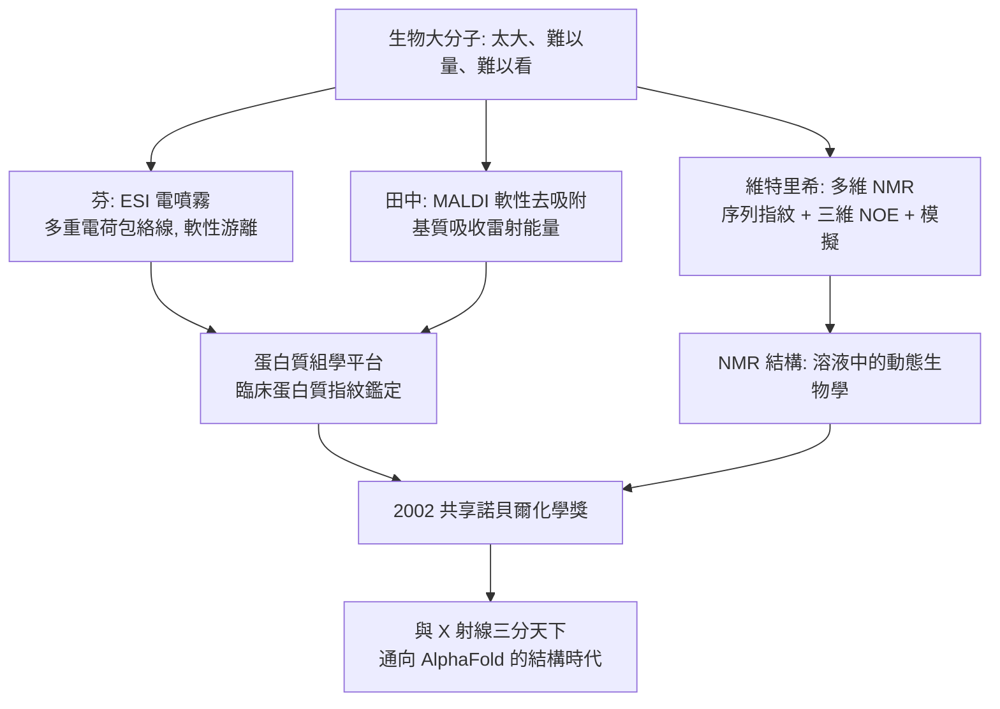

# 2002 · 芬、田中與維特里希——看清巨分子的三把顯微鏡

> 2002 諾貝爾化學獎：約翰·本尼特·芬（John Bennett Fenn，1917–2010，美國）、田中耕一（Koichi Tanaka，1959– ，日本）與庫爾特·維特里希（Kurt Wüthrich，1938– ，瑞士）——表彰「其對生物大分子之軟性去吸附離子化質譜方法之開發，以及其對核磁共振測定生物大分子三維結構之貢獻」。**三種方法同時成熟，讓生命科學進入「結構時代」。**

## 懸案（案情提要）

1990 年代末的生物化學，有一個「測不準」與「看不見」的雙重困境：

- **質譜（mass spectrometry）**：極靈敏（可達 zeptomole 量級）、可做「身份鑑定」，但**質譜不給結構**——它只告訴你分子量與碎片，無法告訴你三維形狀；
- **NMR**：能給「局部結構」（誰靠近誰），但**訊號重疊**，且靈敏度低（傳統 NMR 需要大量樣品或濃縮物）；
- **X 射線**：能給完整結構，但需要**能結晶的樣品**——而許多蛋白質不能結晶；
- 此外，生物大分子的**分子量巨大**（蛋白質 10–100 kDa、核酸更高、複合體更大），這讓質譜的碎片分析與 NMR 的譜圖解析都極困難。

**懸案的具體形式：如何讓這些巨分子「可以被量、可以被看、可以被鑑定」？**

偵辦人：芬（**電噴霧質譜，ESI**）、田中（**軟性去吸附離子化，MALDI**）、維特里希（**多維 NMR 的生物應用**）。

## 前因

| 年份 | 事件 |
| --- | --- |
| 1917 / 1959 / 1938 | 芬生於美國紐約；田中耕一生於日本富山縣；維特里希生於瑞士 Arbon。 |
| 1980s–90s | **田中耕一**在**日本三菱化成工業（Mitsubishi Kasei）**研究「軟性雷射解吸」：以雷射照射樣品與基質的混合物，使蛋白質**完整地、不碎裂地**釋出。1987 年他提出**MALDI（基質輔助雷射解吸／游離）**；1994 年發表「**巨大分子的軟性去吸附」**論文，提出「軟性」概念。 |
| 1980s | **芬**在耶魯研究**電噴霧（electrospray）**：將溶液中的大分子帶電並「甩」入真空，發現**蛋白質並不碎裂**，而是以**多重電荷**的形式存在： |

$$\mathrm{M} + z\,\mathrm{H}^+ \rightarrow [\mathrm{M}+z\mathrm{H}]^{z+}$$

$$\text{觀察到的} \ m/z \text{ 是一組「包絡線」} \Rightarrow \text{可反推分子量} \Rightarrow \textbf{連續電荷包絡線（deconvoluted）可定出分子量}$$

**1994 年，芬以 ESI 質譜分析了一個蛋白質——這在當時是轟動性的事件。**（他把諾貝爾獎金的一半捐給了一所Trinity College Cambridge 的「Fenn 基金」——英國的諾貝爾獎金幾乎全數流向美國的案例，使他的捐贈成為名言。）

| 1980s–90s | **維特里希**在蘇黎世 ETH 發展**多維 NMR 對蛋白質的應用**：以**序列專一性**的脈衝序列（利用 ${}^{15}\mathrm{N}$、${}^{13}\mathrm{C}$ 標記）獲得蛋白質的序列指紋，再以**三維 NOESY** 獲得距離約束，最後以**距離幾何模擬（distance geometry）**與**分子動力學**計算三維結構。 |
| 1985–1994 | 維特里希的小組相繼解出數十個蛋白質的 NMR 結構（含首個完整的蛋白質 NMR 結構）；**1990 年代，NMR 結構的數量快速增加**。 |
| 2002 | 三人共享諾貝爾化學獎。 |
| 2000s | 維特里希推動 **PDB** 的 NMR 結構存檔標準化；田中的 MALDI 推動蛋白質的「質譜指紋」鑑定（臨床診斷）；ESI 成為蛋白質組學的核心平台。 |

## 調查

**偵查一：ESI——「把大分子安全地帶進真空」。**

$$\text{溶液中的蛋白質} \xrightarrow{\text{高電壓毛細管}} \text{帶電液滴} \xrightarrow{\text{去溶劑}} \text{氣相離子}$$

$$\text{關鍵}：\ \text{大分子在去溶劑過程中「維持完整性」} \Rightarrow \text{可觀察到} [\mathrm{M}+z\mathrm{H}]^{z+}\ \text{的多重電荷包絡線}$$

$$\text{去卷積（deconvolution）}：\ \text{從包絡線反推} M \quad\text{與} \quad z_{\text{平均}}$$

**「軟性」的意義**：傳統的電子撞擊游離（EI）會把分子打碎，無法用於蛋白質；ESI 與 MALDI 都屬**軟性游離**——這是質譜能進入生物學的關鍵。

**偵查二：MALDI——「用雷射把蛋白質推出來」。**

$$\text{樣品 + 基質（如} \text{2,5-二羥基苯甲酸）} \xrightarrow{\text{雷射脈衝}} \text{單次電荷的} \ [\mathrm{M}+H]^+ \text{（少量碎裂峰）}$$

$$\text{基質的作用}：\ \text{吸收雷射能量並把能量傳給蛋白質} \Rightarrow \text{「軟」的游離}$$

**MALDI 的优势是「鹽的容忍度」**——生物樣品的鹽份極高，MALDI 可直接處理。**MALDI-TOF 質譜成為微生物與臨床病原菌鑑定的標準工具**（今日的 MALDI-TOF 菌種鑑定已取代部分培養流程）。

**偵查三：NMR 的生物化學解讀——「序列 + 距離」。**

維特里希的方案：

$$\text{① 序列指紋譜}（\text{以} ^{15}\mathrm{N}\text{或}^{13}\mathrm{C}\text{標記的} \text{COSY/TOCSY/HNCA）}\ \Rightarrow\ \text{序列指紋的指派}$$

$$\text{② 三維 NOESY} \Rightarrow \text{距離約束集} \left\{ r_{ij} \right\}$$

$$\text{③ 距離幾何/分子動力學} \xrightarrow{} \text{三維結構}$$

$$\text{關鍵約束}：\quad \underbrace{r_{ij} < 5\ \text{Å}}_{\text{強的} \mathrm{NOE}} \ \text{提供} \textbf{局部骨架};\quad \underbrace{\text{共價/disulfides}}_{\text{長期約束}}$$

$$\text{驗證}：\ \text{化學位移預測值}（\text{由結構算出）}\ \text{vs}\ \text{實測值} \Rightarrow \text{結構品質的統計檢驗}$$

**「由結構回算化學位移再與實測比較」——這是 NMR 結構的自證機制**（與 X 射線的 $R$ 值類似）。

**偵查四：三種方法的三分天下。**

| 方法 | 給出什麼 | 限制 |
| --- | --- | --- |
| **ESI-MS / MALDI** | 分子量、純度、指紋鑑定 | 不給三維結構（但可給**化學修飾位點**） |
| **NMR** | 小中型蛋白質（$<30$–$40\ \mathrm{kDa}$）的解算度高的三維結構、**動力學** | 需同位素標記、需大量時間 |
| **X 射線** | 任何能結晶的蛋白質的高解析結構 | 需晶體、靜態 |

**三者在 2000 年代初達到互補的平衡**——這就是 2002 年諾貝爾獎的深意：**同時給出「量的方法（質譜）」與「結構的方法（NMR）」。**

## 理論裁決

**判決一：「軟性游離」的概念。**

$$\text{硬性游離（EI）}：\ E_{\text{電子碰撞}} \gg E_{\text{鍵}} \Rightarrow \text{碎裂};\qquad \text{軟性游離（ESI/MALDI）}：\ \text{能量恰好「脫離」而不斷鍵}$$

$$\text{這是一個純粹的物理化學設計問題}：\ \text{如何用適當的能量耦合方式，把分子「完整地」送到氣相}$$

**「軟性」這個詞如今是蛋白質質譜的通用術語**——這是 2002 年諾貝爾獎最被低估的語言貢獻。

**判決二：多重電荷的資訊量。**

$$\text{ESI 的電荷包絡線} \Rightarrow \begin{cases}\text{分子量} M\\ \text{電荷數} z\\ \text{（隱含）分子形狀資訊：}\ \text{電荷數與} \textbf{緊密程度}\ \text{相關}\end{cases}$$

$$\text{緊密（緊密球狀）蛋白質} \Rightarrow \text{電荷較少（} z \sim 10\text{–}20\text{）};\qquad \text{鬆散} \Rightarrow z \text{ 較多}$$

**「質譜的電荷分布其實是分子形狀的指紋」——這是 2000 年代「形狀化質譜（ion mobility mass spectrometry）」的起點。**

**判決三：NMR 結構的自證性。**

$$\text{由結構計算的化學位移} \quad \longleftrightarrow \quad \text{實測的化學位移}$$

$$\text{兩者的一致性} \Rightarrow \text{結構正確};\qquad \text{不一致} \Rightarrow \text{結構需修正}$$

**這是「用獨立物理量交叉驗證」的方法論典範**，與 X 射線的 $R$ 因子（$R_{\text{free}}/R_{\text{work}}$，見 [1962-佩魯茨與血紅蛋白](1962-佩魯茨與血紅蛋白.md)）並列。

**判決四：方法學的「乘法效應」。**

$$\text{當三種方法同時成熟} \Rightarrow \text{結構生物學的成本驟降} \Rightarrow \text{「結構時代」來臨}$$

$$\text{2000 年代中期}：\ \text{PDB 中的結構數從數千增至數萬；} \quad \text{2010 年代}：\ \text{結構組學（structural genomics）}$$

**這為 2024 年的 AlphaFold（見 [2024-貝克與蛋白質設計](2024-貝克與蛋白質設計.md)）鋪平了道路：若沒有足夠多、樣本足夠的已知結構作為訓練資料，AI 預測無從談起。**

## 後果

| 領域 | 影響 |
| --- | --- |
| 蛋白質組學 | 質譜是蛋白質組學的核心平台（今日的定量蛋白組學以標記質譜為主）。 |
| 臨床診斷 | **MALDI-TOF 菌種鑑定**（臨床微生物學的革命）；血漿蛋白質譜用於癌症篩檢（如 Ovarian 檢測的歷史）。 |
| 結構生物學 | NMR 成為「無法結晶的蛋白質」與「蛋白質動力學」的唯一可靠工具；今日的 NMR 結構佔 PDB 的約 15–18%。 |
| 生物資訊 | 質譜與 NMR 的資料庫（ProteomeXchange、PDB 的 NMR 存檔）成為演算法開發的燃料。 |
| 科學制度 | 芬把半數獎金捐給英國，是「科學的國家平衡」議題的著名案例；田中是日本工業實驗室（**而非大學**）做出諾獎級研究的代表。 |

## 關聯

- [1959-海羅夫斯基與極譜](1959-海羅夫斯基與極譜.md)：電化學量測的另一支；芬的 ESI 同樣是「把溶液中的分子搬到可量測的環境」的技術。
- [1962-佩魯茨與血紅蛋白](1962-佩魯茨與血紅蛋白.md)：X 射線結構的方法學基準，與 NMR 結構互為驗證。
- [1984-梅里菲爾德與固相合成](1984-梅里菲爾德與固相合成.md)：蛋白質的「化學製造」提供了質譜與 NMR 的研究材料。
- [1991-恩斯特與NMR](1991-恩斯特與NMR.md)：多維 NMR 的工具基礎；維特里希把它帶入生物學。
- [2002-田中與蛋白質質譜](2002-田中與蛋白質質譜.md)：即本卷。
- [2017-杜布歇與冷凍電顯](2017-杜布歇與冷凍電顯.md)：結構生物學的第三條腿。
- [2024-貝克與蛋白質設計](2024-貝克與蛋白質設計.md)：三種方法累積的結構資料，最終成為 AI 預測的燃料。
