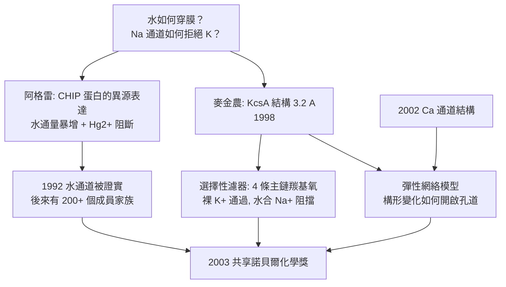

# 2003 · 阿格雷與麥金農——細胞的閥門

> 2003 諾貝爾化學獎：彼得·阿格雷（Peter Agre，1949– ，美國）與羅德里克·麥金農（Roderick MacKinnon，1956– ，美國）——表彰「其對細胞膜上通道之發現與結構研究」。**水如何穿過膜？鈉離子如何被選擇？——答案在原子層級。**

## 懸案（案情提要）

1980–90 年代的生物學，有兩個「最基本卻最神秘」的問題：

- **水**：細胞膜由磷脂雙層構成，內部是疏水的。**那麼水分子怎麼進出細胞？**細胞體積的 60–70% 是水，物質的運輸、滲透壓、體積調節全靠它。如果水只能緩慢擴散，細胞就無法快速體積調控。
- **離子選擇性**：神經細胞的動作電位依賴 $\mathrm{Na^+}$ 通道（快速開啟）與 $\mathrm{K^+}$ 通道（延遲開啟）。**一個通道怎麼只讓 $\mathrm{Na^+}$ 通過、卻把稍小的 $\mathrm{K^+}$ 拒之門外？**（這是「選擇性濾器」的問題，其機制在 1990 年代之前完全沒有答案。）
- 更根本的問題：**這些「通道」是什麼樣的分子？**它們是蛋白質嗎？它們如何做到「開」與「關」？

偵辦人：阿格雷（**水通道蛋白 aquaporin**）與麥金農（**$\mathrm{K^+}$ 通道的結構**）。

## 前因

| 年份 | 事件 |
| --- | --- |
| 1949 / 1956 | 阿格雷生於美國北卡羅來納州；麥金農生於美國緬因州。 |
| 1980s | 阿格雷在**約翰霍普金斯大學**（醫學院）研究**紅血球膜蛋白**；1988 年發現 CHIP（**channel intrinsic protein**）家族；1991 年在爪蟾卵母細胞中**異源表達 CHIP 並證明其為水通道**——**「水通道」的存在被證實**。 |
| 1991–1992 | 阿格雷在芝加哥大學的歐洲分子生物學實驗室（EMBL）訪問期間，聽到同事談起水通道的概念；回國後迅速在蛙卵母細胞中異源表達 CHIP28，並以水通量與 $\mathrm{Hg^{2+}}$ 阻斷實驗完成驗證。 |
| 1990s | **麥金農**在哥倫比亞大學（後為 Rockefeller）以**X 射線結晶學**研究** Streptomyces lividans 的 $\mathrm{K^+}$ 通道（KcsA）**：1998 年發表 **$3.2\ \text{Å}$ 的結構**——**第一個高解析的離子通道結構**。 |
| 1993–1998 | KcsA 的結構歷經四年的相位求解（用重原子法與同晶置換，方法源自佩魯茨，見 [1962-佩魯茨與血紅蛋白](1962-佩魯茨與血紅蛋白.md)）。 |
| 1998–2002 | 麥金農與其合作者解出**鈣離子通道（CaV1.1 的 $\alpha_1$ 次單元）**（2002）與其他通道；並發展出**「通道的 selectivity filter」的物理圖像**。 |
| 2003 | 兩人共享諾貝爾化學獎。 |
| 2004 | 阿格雷與其合作者發表**水通道的原子結構**（利用麥金農的 X 射線技術）。 |

## 調查

**偵查一：CHIP 的鑑定——「從紅血球膜蛋白到水通道」。**

$$\text{步驟}：\ \text{紅血球膜蛋白（CHIP28）} \xrightarrow{\text{純化}} \xrightarrow{\text{重組到脂雙層}} \xrightarrow{\text{測水通量}}$$

$$\text{關鍵對照}：\ \text{若確實是水通道} \Rightarrow \text{有} \mathrm{Hg}^{2+}\ \text{時通量被抑制（半胱胺酸残基結合）}$$

$$\text{結果}：\ \text{異源表達的 CHIP 使卵母細胞的水通量暴增} \Rightarrow \textbf{水通道被證實}$$

**「用外源表達 + 阻斷實驗」證明功能**——這是 1980–90 年代膜蛋白功能鑑定的主流策略（今日的 CRISPR 敲除與過表達是同一套邏輯）。

**偵查二：KcsA 的結構——「看清選擇性濾器」。**

$\mathrm{K^+}$ 通道的關鍵特徵：

$$\underbrace{\text{選擇性濾器}}_{\text{選擇性濾器（signature sequence）：TVGYG}} \quad \text{位於} \ \text{膜的} \textbf{外側}$$

**結構揭示的機制（麥金農的圖像）**：

$$\text{四個} \mathrm{TVGYG}\ \text{序列} \xrightarrow{} \text{四條主鏈羰基氧} \xrightarrow{} \underbrace{\text{環狀排列}}_{\text{一個籠子}}$$

$$\mathrm{K^+}\ \text{落入籠中時} \xrightarrow{\text{脫水}} \text{由} \mathrm{K^+}\text{（裸離子）與} \mathrm{H_2O}\text{（籠中）交換} \xrightarrow{} \text{逐級脫水} \Rightarrow \textbf{裸離子通過}$$

$$\boxed{\text{選擇性來自「尺寸恰好配合的裸離子」} \ne \text{水合離子}}$$

**這解釋了為何 $\mathrm{K^+}$（水合半徑 1.25 Å）能通過，而 $\mathrm{Na^+}$（水合半徑 1.8 Å）不能**——**因為通道的濾器尺寸恰好讓**脫水的** $\mathrm{K^+}$ 通過，卻讓水合的 $\mathrm{Na^+}$ 通過不了**。

**偵查三：Na$^+$ 通道的對比——「同一個問題的另一個答案」。**

$$\mathrm{Na^+}\ \text{通道的選擇性濾器}：\ \text{带負電的残基（Glu, Asp）與} \mathrm{Na^+}\ \text{配位}$$

$$\text{即}：\ \text{「化學選擇性」（靠電荷）} \quad \text{vs}\quad \text{K^+}\ \text{的「幾何選擇性」（靠尺寸）}$$

**「離子選擇性的兩種原理」——這是本案最漂亮的對比，也是膜生理學的教科書內容。**

**偵查四：通道的「閘門」與構形變化。**

$$\text{配體門控}：\ \text{受體結合} \to \text{構形變化} \to \text{孔道開啟}$$

$$\text{機械模型}：\ \text{像} \textbf{閥門/活塞/蝶閥}\ \text{一樣的構形變化} \xrightarrow{} \text{選擇性通導}$$

**麥金農的「彈性網絡（elastic network）」模型**：通道蛋白的各部分由彈性鏈相連，局部的構形變化透過彈性耦合傳遞而開啟孔道——**這是 2013 年諾貝爾獎的「多尺度模擬」思想在生物膜上的先聲**（見 [2013-卡普拉斯與多尺度模擬](2013-卡普拉斯與多尺度模擬.md)）。

**偵查五：水通道的「單分子水線」。**

$$\text{水通道的孔道} \xrightarrow{\text{含} \mathrm{Ar/R}\ \text{基序}} \text{形成} \textbf{單分子水線（single file）}$$

$$\text{水分子一個接一個地通過} \Rightarrow \text{通量極高（} \sim 10^9\ \text{水分子/秒）}$$

## 理論裁決

**判決一：選擇性濾器的結構機制。**

$$\underbrace{\mathrm{TVGYG}}_{\text{選擇性濾器序列}} \xrightarrow{} \text{主鏈的} \mathrm{C{=}O} \xrightarrow{} \underbrace{\text{8 個氧原子構成的「篩子」}}_{\text{配位場}}$$

$$\text{脫水能垒}：\ \mathrm{K^+}\text{ 的脫水自由能} \approx -322\ \mathrm{kJ/mol};\qquad \mathrm{Na^+} \approx -406\ \mathrm{kJ/mol}$$

$$\text{篩子的配位場提供} \approx -300\text{–}400\ \mathrm{kJ/mol}\ \text{的} \textbf{補償能量，恰好只對} \mathrm{K^+}\ \text{足夠}$$

**「由蛋白質提供的能量與離子脫水的能量精確匹配」——這是選擇性濾器的完整物理**，並解釋了為何選擇性如此高（$\mathrm{K^+}/\mathrm{Na^+}$ 選擇性可達 $10^3$）。

**判決二：化學選擇性 vs 幾何選擇性。**

| | $\mathrm{K^+}$ 通道 | $\mathrm{Na^+}$ 通道 |
| --- | --- | --- |
| 濾器化學 | 中性（主鏈羰基氧） | **帶負電（Glu/Asp）** |
| 機制 | 尺寸與脫水能量匹配 | 靜電配位 |
| 選擇性來源 | 幾何 | 化學 |

$$\text{這是「同一個物理問題的兩種解法」——化學與結構生物學的教科書對照}$$

**判決三：通道的開關是「構形變化」，不是「孔洞被堵住」。**

$$\text{麥金農的彈性網絡模型}：\ \text{蛋白質的各原子由彈性網絡相連；} \quad \delta r_i \Rightarrow \delta r_j = \sum_k K_{ij}\delta r_k$$

$$\text{因此：局部的配體結合} \xrightarrow{} \text{彈性耦合} \xrightarrow{} \text{孔道構形改變} \xrightarrow{} \text{開/關}$$

**「通道不是一個洞加一個塞子，而是一個會變形的彈性網絡」——這是 1990 年代末最重要的生物物理洞見之一**，並成為今日 GPCR（見 [2012-萊夫科維茨與克比爾卡](2012-萊夫科維茨與GPCR.md)）與機械通道（mechanosensitive channel）研究的共同框架。

**判決四：通道生物學的醫學意義。**

$$\text{通道病（channelopathy）}：\ \text{基因突變} \Rightarrow \text{通道功能異常} \Rightarrow \text{疾病}$$

$$\text{例子}：\ \text{囊性纖維化（} \mathrm{CFTR}\ \text{是} \mathrm{Cl^-}\ \text{通道）}、\text{長 QT 綜合徵（} \mathrm{K^+}\ \text{或} \mathrm{Na^+}\ \text{通道）}、\text{偏頭痛的家族性hemiplegic migraine（} \mathrm{Ca}^{2+}\ \text{通道）}$$

**「離子通道」從生理學的細節變成藥理學的主戰場**——今日約 20% 的藥物以離子通道為標靶。

## 後果

| 領域 | 影響 |
| --- | --- |
| 生理與醫學 | 通道病診斷（基因檢測）、離子通道藥物（$\mathrm{K^+}$ 通道阻斷劑用於高血壓與心律不整；$\mathrm{Ca}^{2+}$ 通道阻斷劑用於高血壓與偏頭痛）。 |
| 膜生物學 | 「通道與運輸體」成為膜生物學的核心；水通道（aquaporin）家族今日已知有 300 多個成員，與腎臟的水再吸收、腦的水運動、植物的氣孔關閉等相關。 |
| 生物物理 | 彈性網絡模型成為膜蛋白構形變化的通用框架；為 2013 年的多尺度模擬諾獎鋪路。 |
| 科學制度 | 麥金農是「以結構解決生理問題」的典範；他亦長期擔任《Nature》的編輯（2013–2019），對科學傳播與出版倫理有影響。 |

## 關聯

- [1962-佩魯茨與血紅蛋白](1962-佩魯茨與血紅蛋白.md)：X 射線結構生物學的方法論；麥金農的 KcsA 是其直系後代。
- [1964-霍奇金與X射線晶體學](1964-霍奇金與X射線晶體學.md)：生物大分子結構的技術傳統。
- [1978-米切爾與化學滲透](1978-米切爾與化學滲透.md)：離子梯度與通道共同構成細胞的「電化學系統」——通道是米切爾機制的「閥門」。
- [2003-阿格雷與水通道](2003-阿格雷與水通道.md)：即本卷。
- [2012-萊夫科維茨與GPCR](2012-萊夫科維茨與GPCR.md)：GPCR 的構形變化機制，正是彈性網絡模型的另一個成功案例。
- [2013-卡普拉斯與多尺度模擬](2013-卡普拉斯與多尺度模擬.md)：彈性網絡思想的理論化與計算化。
