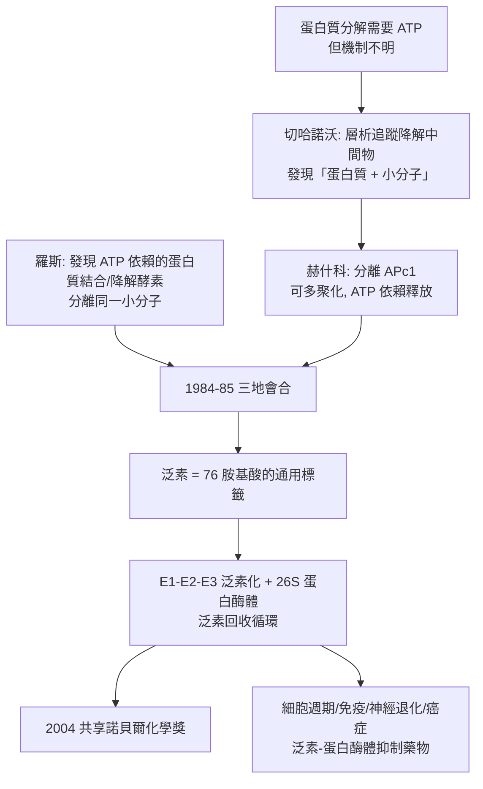

# 2004 · 切哈諾沃、赫什科與羅斯——細胞的垃圾處理廠

> 2004 諾貝爾化學獎：阿龍·切哈諾沃（Aaron Ciechanover，1965– ，以色列）、阿夫拉姆·赫什科（Avram Hershko，1944– ，以色列／匈牙利）與歐文·羅斯（Irwin Rose，1926–2015，美國）——表彰「其發現泛素介導的蛋白質降解」。**細胞如何處置磨損的蛋白質？答案是一套帶標記的「回收系統」。**

## 懸案（案情提要）

1980 年代的細胞生物學，有一個「帳目不平衡」：

- 細胞裡的蛋白質不斷被合成（每日數百克）也不斷被分解（每日數百克）——**「蛋白質周轉」的總量很大，但當時沒有任何方法能測出「分解速率」**；
- 酵素研究的黃金法則（費歇爾，見 [1902-費歇爾與醣類偵探學](1902-費歇爾與醣類偵探學.md)）是「**酵素的專一性**」——那麼，**分解蛋白質的酵素該認得什麼？**
- 1970 年代的一個實驗發現了驚人的線索：**在**extract**（細胞萃取液）中，** ATP 的存在竟能「保護」蛋白質不被分解**。這意味著分解需要「能量」——但當時完全不知道機制；
- 而更重要的一個謎團是：**分解後的胺基酸去了哪裡？**既然胺基酸可以被回收再使用，細胞就必須「知道」哪些胺基酸是外來的（該分解）、哪些是自己的（該保留）。

偵辦人：切哈諾沃與赫什科（以色列理工學院）與羅斯（費城 Fox Chase 癌症中心）。他們找到了那個「標記」。

## 前因

| 年份 | 事件 |
| --- | --- |
| 1965 / 1944 / 1926 | 切哈諾沃生於以色列海法；赫什科生於匈牙利卡爾瓦德；羅斯生於美國紐約。 |
| 1970s–80s | 赫什科在費城 Fox Chase（師從 **Irwin Rose**）研究**細胞萃取液中的蛋白質降解**；發現 **ATP 依賴性**的降解系統。 |
| 1980–1983 | 切哈諾沃（博士後）加入赫什科實驗室；以**層析（等電點與大小）**追蹤降解中間物，發現一種**「小分子 + 蛋白質」的複合體**，經 ATP 作用後，蛋白質被降解而小分子被釋放。 |
| 1983–1984 | 赫什科與切哈諾沃分離出那個**小分子**（他們稱之為 **APc1**），並發現**它可以連接多個蛋白質**（形成「多聚」）——**這就是泛素（ubiquitin）**。 |
| 1984–1985 | **羅斯**（獨立地、在費城）發現一種**細胞內的酵素**，能結合並降解蛋白質，並且**需要 ATP**；他把那個結合蛋白質的小分子分離出來，證明它與以色列團隊的 APc1 **是同一個分子**——**「泛素」的發現由三地獨立完成並在 1984 年會合**。 |
| 1986 | 泛素基因被定序，確認泛素是 76 個胺基酸的蛋白質，**在哺乳動物與酵母間高度保守**。 |
| 2004 | 三人共享諾貝爾化學獎。 |
| 2000s | 泛素系統被廣泛研究：**蛋白質降解的「泛素—蛋白酶體」路徑**、其他修飾（磷酸化、乙醯化、甲基化——「分子開關」語言）；2004 年因泛素系統與癌症的關聯，**霍夫曼（Drug Discovery Award）與克雷格（Krebs）**（同獲 2004 年醫學獎）被視為相關的「科學對話」；2011 年格雷克（Gregg）與奧斯（Ohsawa）另獲醫學獎。 |
| 2016–2020s | 泛素系統在免疫、細胞週期、神經退化疾病（帕金森、阿茲海默）中的作用；以及**泛素-蛋白酶體抑制藥物**的開發。 |

## 調查

**偵查一：ATP 依賴性的發現——「為什麼分解需要能量」。**

$$\text{若蛋白質水解（} \mathrm{H_2O} \text{斷肽鍵）在熱力學上很容易，} \quad \text{為何需要 ATP？}$$

$$\text{答案}：\ \text{降解的} \textbf{選擇性}\text{與} \textbf{標記}\text{需要能量；ATP 參與「標記」這一步}$$

**偵查二：APc1 的發現——「那個抓著蛋白質的小分子」。**

$$\text{降解中間物} \xrightarrow{\text{層析}} \text{一個「蛋白質 + 小分子」的複合體}$$

$$\text{關鍵觀察}：\ \text{該小分子可與多種不同蛋白質結合} \Rightarrow \textbf{它是通用的「標籤」}$$

**偵查三：三地會合——「APc1 = 泛素」。**

| 團隊 | 貢獻 |
| --- | --- |
| 赫什科與切哈諾沃（以色列） | 分離 APc1，證明其可多聚化並被 ATP 依賴的系統釋放 |
| 羅斯（美國） | 發現 ATP 依賴的蛋白質結合與降解酵素，分離出同一小分子 |
| 其他研究團隊 | 同期獨立提出「蛋白質被標記再被降解」的機制 |

$$\text{1984–85 年}：\ \text{三方證明 APc1 與羅斯的「小分子」為同一物質} \xrightarrow{} \textbf{泛素（ubiquitin）}$$

**偵查四：泛素的結構與「通用的分子標籤」。**

$$\text{泛素} = 76\ \text{個胺基酸};\quad M \approx 8.6\ \mathrm{kDa};\qquad \text{（無二硫鍵）} \xrightarrow{} \text{含內部} \mathrm{His}\ \text{與末端} \mathrm{Gly}\text{（} \mathrm{C}\text{-端} \mathrm{Gly76}\text{）}$$

$$\text{泛素的序列} \xrightarrow{} \text{在哺乳動物與酵母之間幾乎完全相同（} \sim 76\%\ \text{相同）}$$

**「如此保守的序列，卻被貼到千差萬別的蛋白質上」——這說明標記機制是古老的、演化上極重要的。**

**偵查五：泛素—蛋白酶體路徑的完整流程。**

$$\begin{aligned}
\text{① 活化：} &\quad \mathrm{E1} + \mathrm{ATP} \to \mathrm{E1{-}Ub} + \mathrm{AMP} + \mathrm{PP_i} \\
\text{② 轉移：} &\quad \mathrm{E2} + \mathrm{E1{-}Ub} \to \mathrm{E2{-}Ub} \\
\text{③ 連接：} &\quad \mathrm{E2{-}Ub} + \text{底物{-}NH_2 \xrightarrow{\mathrm{E3}} \text{底物}{-}NH{-}CO}{-}Ub\ (\text{異肽鍵}) \\
\text{④ 辨識：} &\quad \mathrm{E3}\ (\text{多聚化的辨識複合體})\ \text{辨認} \ \textbf{泛素鏈的形狀} \\
\text{⑤ 降解：} &\quad \text{26S 蛋白酶體} \xrightarrow{} \text{泛素回收} + \text{胜肽片段}
\end{aligned}$$

**「泛素鏈的形狀」（K48 直鏈 = 降解訊號；K63 直鏈 = 非降解訊號，如 DNA 修復與訊息傳遞）——這是 2000 年代的重要發現。**

## 理論裁決

**判決一：蛋白質降解需要「標記」，而非「辨認」。**

$$\text{傳統想法}：\ \text{酵素辨認底物的特徵序列}$$

$$\text{泛素系統}：\ \text{底物被} \textbf{貼上標籤}\text{，降解機器只認標籤，不認底物}$$

$$\boxed{\text{「通用標籤」把「辨認無限多底物」化為「辨認一種標籤」}}$$

**這是生物學資訊處理的一次根本簡化**，其效率遠高於「每種蛋白質配一個專一酵素」。

**判決二：ATP 的角色——「標記需要能量」。**

$$\mathrm{E1} + \mathrm{ATP} \rightarrow \mathrm{E1{-}Ub} + \mathrm{AMP} + \mathrm{PP_i}$$

$$\text{水解} \mathrm{PP_i} \text{ 的驅動力} \Rightarrow \text{「泛素化」在熱力學上是有向的}$$

**能量不是用在「切斷胜肽鍵」（那很便宜），而是用在「選擇要切哪一個」。**這解釋了 1970 年代那個謎團：為什麼降解需要 ATP。

**判決三：泛素鏈的拓撲即訊號。**

$$\underbrace{\text{K48 直鏈}}_{\text{降解訊號}} \quad \text{vs} \quad \underbrace{\text{K63 直鏈}}_{\text{DNA 修復、訊息傳遞、自噬}} \quad \text{vs} \quad \underbrace{\text{單一泛素}}_{\text{內吞、膜運輸}}$$

$$\text{同一個標籤分子，因「鏈的形狀」而被讀出不同的指令}$$

**這是「分子資訊」的精巧設計——以拓撲承載語義**，今日的「泛素代碼（ubiquitin code）」研究正建立在這個觀念上。

**判決四：蛋白酶體——「降解機器」。**

$$\text{26S 蛋白酶體} = \underbrace{\text{20S 核心（催化）}}_{\text{桶狀、含 6 個次單元}} + \underbrace{\text{19S 蓋帽}}_{\text{辨識泛素鏈、去摺疊、卸載泛素}}$$

$$\text{蛋白酶體催化機制}：\ \text{催化} \mathrm{Thr} \text{ 的} \gamma\text{-内酯} \xrightarrow{} \text{切割產物} \to \text{胜肽片段}$$

**「垃圾桶」的機器結構與機制，是結構生物學的經典課本素材**（2017 年的冷凍電顯技術大量用於蛋白酶體的結構研究）。

## 後果

| 領域 | 影響 |
| --- | --- |
| 細胞生物學 | 蛋白質周轉的調控（細胞週期的「退出（exit）」機制）；今日細胞生物學的「蛋白質穩定性」章節以泛素系統為核心。 |
| 醫學 | **泛素—蛋白酶體抑制藥物**（硼替佐米、卡非佐尼）用於多發性骨髓瘤；帕金森氏症與阿茲海默症的蛋白聚集與泛素系統相關；自噬（autophagy）機制研究。 |
| 免疫 | 免疫球蛋白的抗體多樣性生成（V(D)J 重組後，抗原活化引發的細胞增殖依賴泛素系統調控的抑制分子，如 $\mathrm{p}^{27}$）；因此泛素系統是「免疫檢查點」藥物（PD-1/PD-L1）的上游背景。 |
| 化學 | 泛素系統的化學工具（泛素化的生物素標記、化學合成泛素擬肽）成為化學與生物學的介面研究。 |
| 科學史 | 2004 年的「化學獎給了生物學問題」曾引起科學界對諾獎分類的討論（泛素是蛋白質降解的機制，屬於生物化學）；同時也說明化學獎的邊界並非按學科劃分，而是按**貢獻的性質**。 |

## 關聯

- [1946-薩姆納與酵素結晶](1946-薩姆納與酵素結晶.md)：酵素的蛋白質身分——泛素系統的前提。
- [1955-迪維尼奧與催產素](1955-迪維尼奧與催產素.md)：胜肽的合成與序列，讓泛素（76 個胺基酸）的確認與改造成為可能。
- [1972-安芬森與核糖核酸酶](1972-安芬森與核糖核酸酶.md)：序列決定構形——泛素的多聚化與構形改變（E3 的辨識）正是同一原理。
- [1984-梅里菲爾德與固相合成](1984-梅里菲爾德與固相合成.md)：合成泛素及其擬肽，是「用化學做泛素化研究」的必備工具。
- [2004-切哈諾沃與泛素](2004-切哈諾沃與泛素.md)：即本卷。
- [2015-林達爾與DNA修復](2015-林達爾與DNA修復.md)：DNA 修復中的泛素訊號（K63 鏈）——本案機制的延伸。
