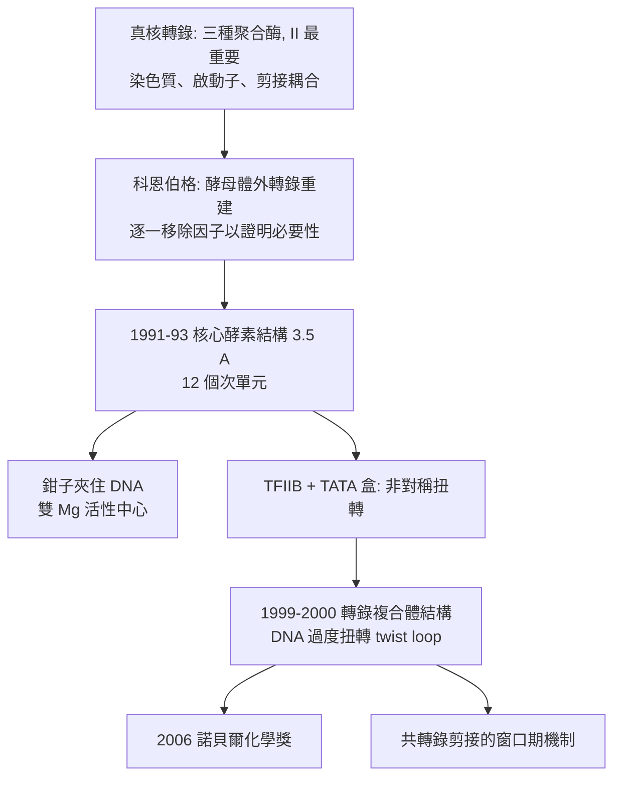

# 2006 · 科恩伯格與真核轉錄——生命的最後一道工序

> 2006 諾貝爾化學獎：羅傑·科恩伯格（Roger D. Kornberg，1943– ，美國）——表彰「其對真核轉錄之分子基礎的研究」。**RNA 聚合酶 II 如何讀出 DNA 的訊息、並在正確的位置加上標記？**

## 懸案（案情提要）

1980–90 年代的分子生物學，有一塊巨大的空白：

- **中心法則的細節**：DNA → RNA 是「轉錄」——但**轉錄是怎麼發生的？**
  - 在細菌體內，這已被 1969 年的 **J. (R.)** 與其同事研究得相當清楚（RNA 聚合酶的「起始、延伸、終止」三階段，見 [1967-極快反應](1967-極快反應.md) 的動力學語言）；
  - 但**真核生物**（酵母、動物、植物）的轉錄機制卻完全不同：**RNA 聚合酶有 I、II、III 三種**，其中 **RNA 聚合酶 II** 負責轉錄所有**蛋白質編碼基因**與多種 snRNA——**它是細胞裡最重要的酵素**；
- 而真核轉錄的難度遠超細菌：
  1. **DNA 以染色質形式存在**，聚合酶必須先**穿過核小體**（見 [1988-光合作用反應中心](1988-光合作用反應中心.md) 對染色質結構的認識）才能碰到 DNA；
  2. 轉錄**起點**的選擇需要辨識特定的**啟動子序列**，並需要大量**轉錄因子**（general transcription factors）協作；
  3. **RNA 需要加工**：$5'$ 端加帽、$3'$ 端加上 poly(A) 尾、**以及剪接**（移除內含子）——這些「後加工」本身也需要酵素系統；
  4. 而且**真核的轉錄與剪接是耦合的**（co-transcriptional splicing）——**一邊轉錄、一邊剪接**，這在細菌中是沒有的；
- 核心懸案：**RNA 聚合酶 II 的三維結構是什麼？它如何辨識啟動子？催化機制是什麼？**

偵辦人：羅傑·科恩伯格（華盛頓大學，後於史丹福）——他以 X 射線結晶學解決了這些問題。

## 前因

| 年份 | 事件 |
| --- | --- |
| 1943 | 科恩伯格生於美國密蘇里州聖路易斯；其父 Arthur Kornberg 是諾貝爾醫學獎得主（1959 年，DNA 聚合酶）。 |
| 1950s–70s | 科恩伯格在華盛頓大學研究**細菌 DNA 聚合酶**（與父親 Arthur 合作，1967 年 Arthur 因 DNA 合成的工作獲醫學獎）；**1970 年代轉向真核生物學**，研究**酵母的染色質與轉錄**。 |
| 1980s | 以**酵母（Saccharomyces cerevisiae）**為模型系統研究轉錄；建立了**體外轉錄系統**（以核糖體 RNA 基因的啟動子為模板，加入轉錄因子與 RNA 聚合酶 II，可在試管中產生正確起始的 RNA）。 |
| 1985–1991 | 科恩伯格實驗室逐步**純化並重組**轉錄所需的全部因子（轉錄因子 A、B、E、F、H、TFIIH 等），並於 **1991 年取得**催化酵母 RNA 聚合酶 II 核心酵素的高解析晶體（$3.5\ \text{Å}$，含 12 個次單元）。 |
| 1993 | 發表 **RNA 聚合酶 II 的晶體結構**（*Nature*，1993）——**真核轉錄的結構基礎**；同年獲**Gairdner 獎**。 |
| 1996–1999 | 解析 RNA 聚合酶 II 與**轉錄因子 TFIIB** 形成的「前起始複合體（pre-initiation complex）」的結構；1999 年解析 **RNA 聚合酶 II 與 DNA 及 RNA 的三元複合體**結構，揭示催化機制。 |
| 2000 | 科恩伯格與同事解析**酵母 RNA 聚合酶 II 在轉錄時的結構**（含 DNA 模板、新生 RNA、$\mathrm{Mg^{2+}}$），並**觀察到「DNA 過度扭轉（DNA scrunching）」**現象。 |
| 2006 | 獲諾貝爾化學獎。 |
| 2008 | 科恩伯格當選為**美國國家科學院院士**（其他成員包括其父 Arthur）。 |

## 調查

**偵查一：體外重建——「把整個系統搬進試管」。**

$$\text{酵母核糖體 RNA 基因啟動子 DNA} + \text{轉錄因子 (TFIIA, B, E, F, H)} + \mathrm{RNA\ Pol\ II} \xrightarrow{\mathrm{NTP}} \text{正確起始的 RNA}$$

$$\text{關鍵}：\ \text{只有當所有因子齊備且比例正確，才會產生正確的轉錄產物}$$

**這套「體外重建」是分子生物學最有力的因果論證形式**：逐一移除任一因子，轉錄即停止——**它證明了每個因子的必要性**。

**偵查二：核心酵素的結構——「一台 12 件零件的機器」。**

$$\mathrm{RNA\ Pol\ II}\ \text{核心（} \sim 12\ \text{個次單元，} \sim 200\ \mathrm{kDa}\text{）}$$

$$\underbrace{\mathrm{Rpb1}, \mathrm{Rpb2}}_{\text{最大次單元，構成骨架}} + \underbrace{\mathrm{Rpb3}, \mathrm{Rpb11}}_{\text{次單元}} + \underbrace{\mathrm{Rpb4}, \mathrm{Rpb7}}_{\text{組成「鉗子（clamp）」}} + \underbrace{\mathrm{Rpb5}, \mathrm{Rpb6}}_{\text{錯合在活性中心附近}} + \underbrace{\mathrm{Rpb8}, \mathrm{Rpb9}}_{\text{靠近活性中心}}$$

$$\underbrace{\mathrm{Rpb10}, \mathrm{Rpb12}}_{\text{次單元，} \mathrm{Zn}\text{ 結合}}$$

**結構揭示的三個關鍵特徵**：

1. **「鉗子（clamp）」**：$\mathrm{Rpb4/Rpb7}$ 形成的鉗子**環繞 DNA**，把模板固定在活性中心——**這解釋了為何真核轉錄需要這麼大的酵素**（DNA 走過活性中心時必須被夾住）；
2. **活性中心**：兩個 $\mathrm{Mg^{2+}}$ 與催化天冬醯胺的支鏈羧基共同活化核苷三磷酸——**與細菌 RNA 聚合酶的「$NAD$ 帶鎂」催化模型同源**；
3. **「鉸鏈（hinge）」**：$\mathrm{Rpb1}$ 的兩半之間有一個鉸鏈，**轉錄時可開合**。

**偵查三：啟動子辨識——「DNA 在哪裡彎折」。**

$$\mathrm{TFIIB}\ \text{的兩個} \textbf{同源重複結構域（tandem repeats）} \xrightarrow{} \text{各別辨識} \mathrm{TATA}\ \text{盒的兩半}$$

$$\text{結構顯示}：\ \mathrm{TFIIB}\ \text{的兩個半把它辨識的} \mathrm{TATA}\ \text{序列} \textbf{以非對稱方式扭轉（asymmetric distortion）}$$

$$\text{這個扭轉是「啟動子」的物理定義} \xrightarrow{} \text{聚合酶以「DNA 過度扭轉」的方式讀取下游序列}$$

**「啟動子不是一段序列，而是一個被扭轉的構形」——這是 1990 年代末結構生物學最深刻的洞見之一。**

**偵查四：DNA 過度扭轉（DNA scrunching）。**

$$\text{轉錄起始時}：\ \text{DNA 被拉入活性中心} \xrightarrow{} \text{在} \mathrm{F}_{10}\ \text{處產生一個} \textbf{扭轉環（twist loop）}$$

$$\text{特徵}：\ \text{DNA 的} +1\ \text{位置被拉入，而} +2\ \text{位置仍在入口外}$$

$$\text{機制意義}：\ \text{這解釋了「啟動子下游序列為何影響轉錄起始位點」——聚合酶在「試探」下游 DNA}$$

$$\text{這是 RNA 聚合酶 II 特有的機制（細菌 RNA 聚合酶用} \textbf{轉位（translocation）}\text{與 rho 因子）}$$

**偵查五：轉錄與剪接的耦合——「同時進行」。**

$$\text{轉錄} \xrightarrow{\text{新 RNA 從出口露出}} \text{剪接因子結合} \xrightarrow{} \text{共轉錄剪接}$$

$$\text{機制}：\ \text{剪接因子的招募需要新 RNA 的長度（} \sim 20\text{–}30\ \mathrm{nt}\text{）以「抓取」下游外顯子}$$

**「轉錄的速度決定了剪接能否在窗口期內完成」——這解釋了為何某些突變會同時影響剪接效率與表型。**

## 理論裁決

**判決一：真核轉錄的「四層結構」。**

$$\underbrace{\text{染色質}}_{\text{可及性}} \xrightarrow{} \underbrace{\text{轉錄因子}}_{\text{啟動子辨識}} \xrightarrow{} \underbrace{\text{聚合酶 II}}_{\text{催化}} \xrightarrow{} \underbrace{\text{RNA 加工}}_{\text{加帽/剪接/加尾}}$$

**「真核基因表現是多層的、分散的調控」——這是本案結構工作最重要的生物學後果**：一個基因的表現可以在四個層次分別被調節。

**判決二：啟動子的結構定義。**

$$\text{啟動子} \ne \text{一段序列};\qquad \text{啟動子} = \text{「被扭轉成特定構形的 DNA 序列區段」}$$

$$\text{證據}：\ \text{若啟動子的} \mathrm{TATA}\ \text{序列突變} \Rightarrow \text{扭轉消失} \Rightarrow \text{轉錄起始位點漂移}$$

**這解釋了為何啟動子突變的表型常是「位置漂移」而非「完全失活」**——**啟動子是一個構形，突變把它「扭歪」了**。

**判決三：過度扭轉與「起始位點選擇」。**

$$\text{聚合酶以} +1\ \text{為起點，} +2 \text{仍在入口外} \xrightarrow{} \textbf{「試探」下游序列}$$

$$\text{序列偏好} \xrightarrow{} \text{決定實際起始位置（相差 1–2 個核苷酸）}$$

**「起始位點不是被指定的，而是被「搜尋」出來的」——這在基因表現調控中有重大意義。**

**判決四：與其他諾獎線的接點。**

$$\text{染色質} \leftarrow \text{見} \ [1988-\text{光合作用反應中心}]\text{（核小體結構）};\qquad \text{剪接} \leftarrow \text{見} \ [1989-\text{奧特曼與RNA催化}]$$

$$\text{聚合酶的} d\ \text{軌域與金屬} \leftarrow \text{見} \ [1966-\text{馬利肯}]\text{（MO 理論）}$$

**科恩伯格的工作，是把「核物理（衰變）」→「結構生物學（核小體）」→「RNA 催化（剪接）」→「理論化學（活性中心）」串成一條完整線索的關鍵一環。**

## 後果

| 領域 | 影響 |
| --- | --- |
| 轉錄生物學 | 真核轉錄的分子機制定案；**轉錄因子**（TFIIH 的 ATP 依賴 DNA 解旋酶功能等）的作用被結構闡明。 |
| 醫學 | 許多癌症與遺傳疾病涉及轉錄調控異常（Pol II 相關的腫瘤抑制基因、$\mathrm{TBP}$ 突變引起的脊髓小腦共濟失調）；**Pol II 抑制劑（α-amanitin）**是實驗室常用工具。 |
| 結構方法學 | 「複合體的crystals」的策略：把複合體中某一部件**突變化**（如用 T3 轉錄因子替換 TBP）以促進結晶——**「用遺傳學解決化學的難題」**，是本案最值得記錄的技術思想。 |
| 科學史 | 科恩伯格與其父 Arthur 皆為諾獎得主（父子檔）；他亦長期擔任《Science》與 PNAS 的編輯，推動科學出版倫理。 |

## 關聯

- [1967-極快反應](1967-極快反應.md)：轉錄的動力學語言（起始、延伸、終止的速率常數）。
- [1988-光合作用反應中心](1988-光合作用反應中心.md)：染色質與核小體的結構，是轉錄的物理前提。
- [1989-奧特曼與RNA催化](1989-奧特曼與RNA催化.md)：剪接的催化機制（核酶）——本案「轉錄—剪接耦合」的另一半。
- [1997-博耶與ATP合成酶](1997-博耶與ATP合成酶.md)：以結構解決機制的同一代典範。
- [2006-科恩伯格與轉錄](2006-科恩伯格與轉錄.md)：即本卷。
- [2009-約納特與核糖體](2009-約納特與核糖體.md)：轉錄的產物——核糖體——是基因表現的最後一步。
