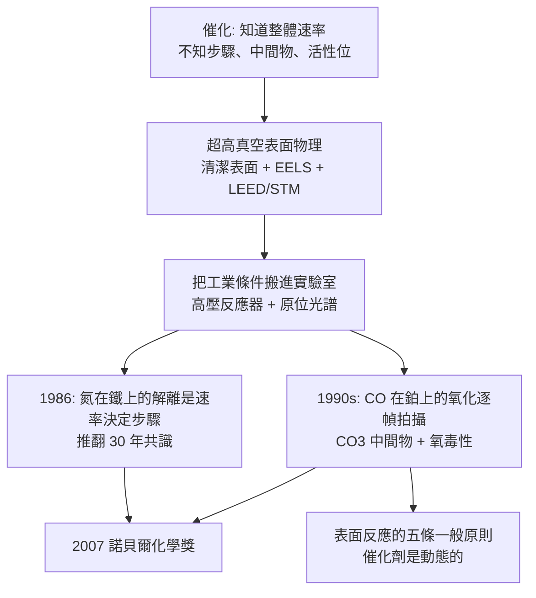

# 2007 · 埃特爾與表面化學——把催化劑的工作逐幀拍下

> 2007 諾貝爾化學獎：格哈德·埃特爾（Gerhard Ertl，1936– ，德國）——表彰「其對固體表面化學過程之研究」。**化學催化不再是黑箱：每一個中間步驟都被拍成照片。**

## 懸案（案情提要）

2000 年前後的催化化學，有一個「描述性」的尷尬：

- 催化劑是工業的支柱（合成氨、煉油、汽車排氣淨化、燃料電池），但**催化劑「是什麼」在原子層次上幾乎是未知的**；
- 人們知道反應的整體速率，但**不知道反應是分幾步、中間體是什麼、哪一步是「速率決定步驟」**；
- 更糟的是，**催化劑在工作時會變**：金屬表面會被還原、氧化、積碳、覆蓋氧化物或生成表面羥基；**「真正的活性位」可能是反應中才形成的、而且會移動**；
- 表面科學本身也缺一套「能在工業條件下看見表面反應」的工具——因為工業催化需要在高壓、高溫、有毒氣體中進行，與超高真空的表面物理實驗條件天差地別。

偵辦人：埃特爾——**他建立了一整套「在真實條件下研究表面反應」的方法學**，並用它逐幀拍下了最重要的工業反應之一：**一氧化碳在鉑上的氧化**。

## 前因

| 年份 | 事件 |
| --- | --- |
| 1936 | 埃特爾生於德國斯圖加特（Schwäbisch Gmünd）。 |
| 1950s–60s | 於斯圖加特大學取得學位並任教（後任斯圖加特大學教授），研究吸附與表面反應；1960 年代起建立超高真空表面實驗方法。 |
| 1960s–70s | **建立超高真空表面物理的方法**（清潔表面的製備：閃蒸、裂解、氧化；電子能譜測量）；研究**吸附物的表面振動光譜**（**EELS，電子能量損失光譜**）——**首次能在表面上「看見」分子的振動模式**，即「表面上真的有這個物種」的證據。 |
| 1970s | 研究**甲烷在金屬上的分解**、**CO 在鎳上的解離吸附**等，逐步建立「表面反應的步驟序列」概念。 |
| 1980s–90s | 發展**技術**：高壓反應器（可在 $10^{-10}$–$10^{10}\ \mathrm{Pa}$ 的壓力範圍研究表面反應）、**紅外光譜的高靈敏度原位測量**（以傅立葉轉換紅外光譜與二維相關技術）、低能電子衍射、**掃描隧道顯微鏡（STM）**。 |
| 1986–1987 | **發現氮在鐵上的解離吸附是合成氨的速率決定步驟**——這是一個諾獎級的發現：**用測量結果挑戰了長久以來的共識**（當時人們認為 N$_2$ 的解離是「非活化」的、因此不是瓶頸）。 |
| 1990s | 與 **Ross（Kenneth N.）** 合作，以**時間分辨光譜**在**毫秒尺度**上「看見」CO 在鉑上的氧化過程：$\mathrm{CO} + \mathrm{O_2} \to \mathrm{CO_2}$ **不是一步完成**，而是經過 $\mathrm{CO_2}$ 與表面碳酸鹽（$\mathrm{CO_3}$）中間物，並有「氧毒性」（氧過量時表面被氧化而失活）的現象。 |
| 2000s | 埃特爾的方法擴展到**高壓下的表面科學**；**2007 年**獲諾貝爾化學獎。 |
| 2010s | 他是「表面科學」成為獨立學科的推手之一；2014 年為慶祝其 80 歲生日的專著《*Solid Surfaces and Interfaces*》相關的 Ehrlich 獎章（Hermann (H.) **Ehrlich** 是他的學生）。 |

## 調查

**偵查一：把工業條件搬進實驗室。**

$$\text{超高真空（} 10^{-10}\ \mathrm{Pa}\text{）} \xrightarrow{} \text{真實條件（} 10^{5}\ \mathrm{Pa},\ 500\ \mathrm{K}\text{）}$$

$$\text{核心技術}：\ \text{高壓反應器} + \text{原位光譜} + \text{表面清潔與再生}$$

**「表面科學的最大挑戰是『工業條件 vs 真空條件』的鴻溝」——埃特爾的整個職業生涯都在填這條溝。**

**偵查二：EELS——「看見表面上的分子振動」。**

$$\text{入射電子} \xrightarrow{} \text{表面} \xrightarrow{} \text{非彈性散射} \xrightarrow{} \text{能量損失譜}$$

$$\text{能量損失} = \text{分子的振動量子} \Rightarrow \textbf{直接辨識表面上的化學物種}$$

**這是「表面上的分子身份鑑定」的第一個通用工具**——比傳統的紅外光譜（需樣品是薄膜）在超高真空下靈敏得多。

**偵查三：氮的解離——「推翻共識的發現」。**

$$\mathrm{N_2(g)} + 2\,\mathrm{*}\ (\text{表面空位}) \rightleftharpoons \mathrm{N_2^*} \xrightarrow{\text{解離}} 2\,\mathrm{N^*}$$

$$\text{解離能障} \approx 1.3\text{–}1.7\ \mathrm{eV}\ (\text{在 Fe(111) 表面})$$

$$\boxed{\text{發現}：\ \text{雖然} \mathrm{N_2}\ \text{解離是「非活化」的，但它是} \textbf{速率決定步驟}\text{，因為} \mathrm{N}\ \text{被} \textbf{牢牢吸附}\text{，表面被氮覆盖（poisoning）}}$$

**這解釋了哈伯法的真正瓶頸**（見 [1918-哈伯與合成氨](1918-哈伯與合成氨.md)）：不是氮太難活化，而是**氮的吸附太強，把表面占滿了**。這個結論直接指導了工業催化劑的設計（助催化劑、活性位分離）。

**偵查四：時間分辨光譜——「拍下反應的每一步」。**

$$\text{毫秒級時間分辨的紅外/質譜} \xrightarrow{} \text{表面中間物的寿命與濃度}$$

$$\text{以 CO 在 Pt 上的氧化為例}：\ \mathrm{CO(g)} + \mathrm{O_2(g)} \to \mathrm{CO_2(g)}$$

$$\text{實測的中間物序列}：\ \mathrm{CO} \xrightarrow{+\mathrm{O_2}} \mathrm{CO_2}\ (\text{氣相}) \quad\text{與}\quad \mathrm{CO} + \mathrm{O^*} \to \mathrm{CO_2} \quad \text{（表面碳酸鹽} \mathrm{CO_3}\text{為中間物）}$$

$$\text{並發現「氧毒性」}：\ \mathrm{O_2}\ \text{過量時表面被氧化} \to \mathrm{PtO_x}\ \text{覆蓋} \to \text{活性骤降}$$

**「每一個步驟都有中間物證據、每一個中間物都有壽命數據」——這就是埃特爾式的「逐幀拍攝」。**

**偵查五：表面反應的「一般性原則」——五條規則。**

埃特爾在其諾貝爾演講中總結了表面反應的一般性原則（這是化學教科書級的總結）：

$$\begin{aligned}
\text{① }&\ \text{反應步驟可被分開研究（不同溫度、壓力、覆蓋度）}\\
\text{② }&\ \text{中間物可被鑑定（光譜）}\\
\text{③ }&\ \text{中間物的表面覆蓋度可測（紅外、定量）}\\
\text{④ }&\ \text{覆蓋度決定速率（動力學）}\\
\text{⑤ }&\ \text{催化劑在工作時會變（重建、燒結、 poisoning）}
\end{aligned}$$

**「第五條」是埃特爾最重要的洞見：催化劑不是靜態的。**這解釋了為何「用模型催化劑（單晶表面）在真空下研究」的結論常常無法直接用於工業——**真實催化劑是動態的、多相的、有歷史的。**

## 理論裁決

**判決一：表面反應的「速率決定步驟」方法論。**

$$\text{覆蓋度} \theta_i \xrightarrow{} \text{以} \mathrm{IR}\ \text{定量};\qquad \text{速率} = \prod_i f(\theta_i)$$

$$\text{逐步改變} \theta_i \ (\text{以覆蓋度調節})\ \Rightarrow\ \text{觀察速率如何隨之改變} \xrightarrow{} \textbf{判定哪一步是瓶頸}$$

**這是一個「以控制變因做因果推論」的典範**，與 2002 年科恩伯格的「逐一移除轉錄因子」異曲同工。

**判決二：覆蓋度與「毒化」效應。**

$$\mathrm{N_2^*}\ (\text{解離吸附}) \quad \text{佔滿表面} \Rightarrow \theta_{\mathrm{N}} \to 1 \Rightarrow \text{氫氣無法吸附} \Rightarrow \text{反應停止}$$

$$\boxed{\text{「毒化」的本質是「競爭吸附」——}\ \text{中間產物佔據了活性位}}$$

**這解釋了工業上為何要使用助催化劑（$\mathrm{K_2O}$、$\mathrm{Al_2O_3}$）：它們不是提高活性，而是「減少覆蓋、分散活性位」。**

**判決三：催化劑的動態性——「真正的工作中的催化劑」。**

$$\text{反應中的催化劑} \ne \text{反應前的催化劑}$$

$$\text{變化形式}：\ \text{表面重構}、\ \text{燒結（ sintering）}、\ \text{積碳/積氮}、\ \text{氧化態改變}、\ \text{表面羥基化}$$

$$\boxed{\text{「催化劑有壽命、有歷史、有記憶」}}$$

**這是 2000 年代催化研究的核心視角，也是「單原子催化」與「動態催化」研究的前提。**

**判決四：方法學的跨界——「把真空技術帶到真實世界」。**

$$\text{超高真空} + \text{清潔表面} + \text{單晶} \xrightarrow{\text{埃特爾的擴充}} \text{高壓} + \text{多相催化劑} + \text{原位光譜}$$

**這套方法後來成為「原位（in situ / operando）催化研究」的標準**，並在 2010 年代的「operando X 射線吸收光譜」時代全面發達。

## 後果

| 領域 | 影響 |
| --- | --- |
| 工業催化 | 合成氨、煉油（加氫脫硫）、排氣淨化（$\mathrm{NO_x}$ 還原）、燃料電池、乙烯聚合等催化體系的機制理解與改進。 |
| 材料科學 | 「催化劑在工作時會變」的觀念，促進了原位表征技術（operando XRD、XAS、拉曼）的發展。 |
| 能源 | 燃料電池與電解槽的表面機制；今日的「催化劑設計」有物理基礎。 |
| 科學史 | 埃特爾是「**把基礎物理搬到工業條件上**」的典範；他也以「德國科學重建」與「歐洲科學基金會（ESF）主席」的身份影響科學政策。 |

## 關聯

- [1909-奧斯特瓦德與催化](1909-奧斯特瓦德與催化.md)：催化理論的法典化——本案的百年後審。
- [1918-哈伯與合成氨](1918-哈伯與合成氨.md)：埃特爾發現的「氮解離是速率決定步驟」，正是哈伯法的瓶頸所在。
- [1932-朗繆爾與表面化學](1932-朗繆爾與表面化學.md)：表面化學的奠基者；埃特爾是他在德國的學術後裔。
- [1963-齊格勒與納塔](1963-齊格勒與納塔.md)：聚合催化劑的表面機構，至今仍是表面化學的重要課題。
- [1983-陶布與電子轉移](1983-陶布與電子轉移.md)：金屬表面的電子轉移，是表面反應的電子層次解釋。
- [2007-埃特爾與表面化學](2007-埃特爾與表面化學.md)：即本卷。
- [2021-利斯特與不對稱有機催化](2021-利斯特與不對稱有機催化.md)：另一種「把反應機制看清楚」的諾獎。
