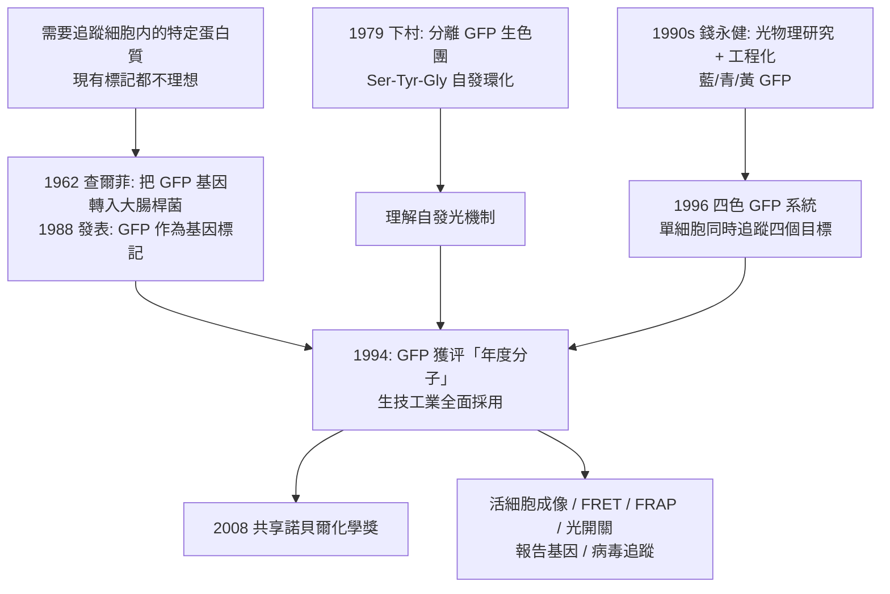

# 2008 · 下村、查爾菲與錢永健——GFP，水母的霓虹燈

> 2008 諾貝爾化學獎：下村脩（Osamu Shimomura，1928– ，日本）、馬丁·查爾菲（Martin Chalfie，1943– ，美國）與錢永健（Roger Y. Tsien，1952–2016，美國）——表彰「其發現綠色螢光蛋白（GFP）並對其廣泛應用的貢獻」。**一盞燈，可以裝進任何細胞裡。**

## 懸案（案情提要）

1980–90 年代的生物學，有一個「追蹤分子」的終極需求：

- 生物學家想知道**某個特定蛋白質在細胞裡何時、何地、做什麼**。方法之一是「**標記**」：把目標蛋白質接上一個可偵測的標記；
- 理想的標記物應該：**只發光、不需外加任何東西、能在活細胞中發光、且發光位置就是它所在的位置**；
- 現有的選項都不理想：放射性標記（無法在活細胞追蹤）、酵素標記（需外加底物）、螢光蛋白（**從螢光蟲來的 GFP** 已在 1960 年代被分離，但**需要外加底物（FLRP）才會發光**，而且只有綠色一種）；
- 核心問題：**能不能找到一種「自發光」的蛋白質，不需要底物、不需要酵素、直接自發螢光？**

偵辦人：下村脩（從水母中找出 GFP 並分離出它的生色團）、查爾菲（把 GFP 用作基因標記的示範者）、錢永健（發現並工程化多種不同顏色的 GFP）。

## 前因

| 年份 | 事件 |
| --- | --- |
| 1928 / 1943 / 1952 | 下村生於日本大阪；查爾菲生於美國；錢永健生於美國。 |
| 1950s–60s | 下村在名古屋大學研究**螢光素（luciferin）與螢光酵素**（他發現了螢光素是**一種咪唑並苯酮（imidazopyrazinone）**，這是生物發光化學的重大發現），並在 1960 年代轉向**水母的生物發光**（他研究發光水母 *Aequorea victoria*，注意到其發光集中在**傘緣的「緣細胞（lens cells）」**，並推測水母是把光傳遞給了全身的蛋白質）。 |
| 1962 | 查爾菲在美國國立衛生研究院（NIH）研究神經元的骨架蛋白（作為神經生長因數的受體）；**他聽說了 GFP 的分離（1961 年，下村與 colleagues）**，並想到：**「如果 GFP 能在細菌中表現，我就能用它來標記細菌的基因表現」**。 |
| 1962–1979 | 下村與其同事從水母中分離出**GFP**（稱之為 aequorin 系統中的「綠色蛋白質」）；**1979 年**，下村成功分離出 GFP 的**生色團（chromophore）**，確定它是一個**共軛的咪唑環與酚環構成的發色團**（由絲氨酸、酪胺酸與谷氨酸自發環化而成）——**這是 GFP 能自行發光的原因**。 |
| 1985–1996 | **查爾菲的示範**：將 GFP 的基因（$\mathrm{gfp}$）接入 LacZ 載體，轉入 *E. coli*，**在大腸桿菌中表現出綠色螢光**——**GFP 作為基因標記的第一個示範**（1988 年在 *PNAS* 與 *Journal of Molecular Biology* 發表）。 |
| 1990s | **錢永健**研究 GFP 的光物理：發現**其螢光壽命長（發光後仍持續數秒）、量子產率高**（約 0.79）、且**可以用金屬離子（$\mathrm{Ca^{2+}}$、$\mathrm{Mg^{2+}}$）與 pH 影響光譜**。 |
| 1994–1996 | **錢永健與同事發現並工程化「藍色、青色、綠色、黃色」等不同顏色的 GFP**（源自不同的水母、海葵與珊瑚；**1996 年的「四色 GFP 系統」**讓一個實驗室可同時追蹤四個目標蛋白）。 |
| 2008 | 三人共享諾貝爾化學獎。 |
| 2000s–2010s | GFP 成為**生物技術的標準工具**：報告基因、活細胞成像（FRET、FRAP）、蛋白質相互作用、轉殖因子標記（$E. coli$ 乳糖操縱組的 $\mathrm{GFP}$ 報告基因，讓細菌在有葡萄糖時發光）；**2012 年 GFP 衍生自發光（iGlue）使 GFP 成為「光開關」**；錢永健也發明了 mTFP、mOrange、mKate 等系列。 |
| 2016 | 錢永健逝於紐約（死於癌症與自殺的合併）；他也是**「better world」新型抗生素的研究者之一**。 |

## 調查

**偵查一：生色團的發現——「為什麼它會自己發光」。**

$$\underbrace{\text{Ser}_{65}\text{-Tyr}_{66}\text{-Gly}_{67}}_{\text{連續三個殘基}} \xrightarrow{\text{環化 + 氧化 + 脱水}} \underbrace{\text{咪唑並苯酮發色團}}_{\text{共軛於咪唑環 + 酚環}}$$

$$\text{ GFP 的成熟} = \text{摺疊（} \beta\text{-桶）} \xrightarrow{} \text{發色團成熟（需} \mathrm{O_2}\text{）}$$

**「生色團由蛋白質自身的三個殘基自發形成」——這是 GFP 能「自發光」且不需要任何外加物的根本原因**，也是 1990 年代 GFP 工程化的理論基礎。

**偵查二：GFP 的光物理——「為什麼它這麼好用的」。**

$$\text{關鍵性質}：\begin{cases}\text{量子產率} \phi \approx 0.79\ (\text{高})\\ \text{消光係數} \approx 22{,}000\ \mathrm{M^{-1}cm^{-1}}\ (\text{高吸收})\\ \text{螢光壽命} \approx 3\ \mathrm{s}\ (\text{長，可用於 FRAP/FRET）}\\ \text{寬泛的激發光譜（可被單光子激發）}\end{cases}$$

$$\text{總 brightness} = \phi \times \varepsilon \quad\Longrightarrow\quad \text{單個分子在室溫下即可被偵測}$$

**「單分子可見光」是 GFP 的驚人特性**——這使得「追蹤單一蛋白質分子」成為可能。

**偵查三：工程化——「從單色到多色」。**

$$\text{綠色 GFP（wt）} \xrightarrow{\text{點突變}} \begin{cases}\text{藍色（BFP）}：\ \text{第 66 位 Tyr}\to\text{His}\\ \text{青色（CFP）}：\text{第 66 位 Tyr}\to\text{Trp}\\ \text{黃色（YFP）}：\text{第 203 位}\to\text{其他}\end{cases}$$

$$\text{更進一步}：\ \text{「成熟加速」突變} \xrightarrow{} \text{在} \ ^{30}\mathrm{K} \text{ 的條件下即可摺疊並發光}$$

**「GFP 可以在 4 °C 的細胞中立刻發光」——這是「成熟加速」的關鍵工程成果**，讓 GFP 成為活細胞成像的實用工具。

**偵查四：從標記到開關——「用光控制分子」。**

$$\text{2012 年：} \quad \text{GFP} \xrightarrow{\text{突變 + 光}} \begin{cases}\text{開啟（亮）}\\ \text{關閉（暗）}\end{cases}$$

$$\text{今日：}\ \text{光誘導二聚（optogenetics）與} \textbf{化學遺傳光學（chemogenetics）}$$

**偵查五：查爾菲的示範——「為什麼這個工具會火遍全世界」。**

$$\text{1994 年，} \text{GFP 被} \textbf{評為「年度分子」}（Science magazine 的 Molecule of the Year）}$$

$$\text{原因}：\ \text{簡單（一個基因）、通用（任何物種）、無需試劑、可定量、可做活細胞}$$

$$\boxed{\text{GFP 的重要性不在於它的結構，而在於它把「看見分子」變得} \textbf{-trivial}}$$

## 理論裁決

**判決一：GFP 的「自發光」機制。**

$$\text{發色團形成}：\ \mathrm{Ser}_{65}{-}\mathrm{Tyr}_{66}{-}\mathrm{Gly}_{67} \xrightarrow[\mathrm{O_2}]{\text{自發環化}} \text{咪唑並苯酮（產氧）}$$

$$\text{發光}：\ \text{發色團} \xrightarrow{h\nu\ (\text{藍紫吸收})} \text{激發態} \xrightarrow{} \text{螢光（綠）} + \text{光子}$$

$$\text{關鍵}：\ \text{發色團被埋在} \ \beta\text{-桶的} \textbf{防水核心}\ \text{内，} \Rightarrow \text{氧氣難以接近} \Rightarrow \text{未成熟的 GFP 不發光}$$

$$\text{這解釋了「成熟」的必要性}：\ \text{先摺疊（保護核心）} \to \text{再讓氧氣進入} \to \text{發色團形成}$$

**判決二：GFP 蛋白桶（β-can）的結構—功能對應。**

$$\text{GFP 的} \beta\text{-桶（11 條} \beta\text{-股）} \xrightarrow{} \text{包覆發色團} \xrightarrow{} \text{提供} \textbf{剛性} \text{與} \textbf{電子環境}$$

$$\text{工程化原則}：\ \text{改變} \beta\text{-桶的} \textbf{第 66 位附近} \Rightarrow \text{改變發色團的} \textbf{電子環境} \Rightarrow \text{改變} \lambda_{\max} \text{與量子產率}$$

$$\text{這是「用蛋白質骨架 tune 小分子光學」的典範——後來應用於} \textbf{熵感探針}（$\text{如 } \mathrm{GFP}\text{ 的} pH\text{ 感測變體）與}\ \textbf{鈣指示器（GCaMP）}$$

**判決三：GFP 作為「可移植的模組」。**

$$\text{GFP 的關鍵設計}：\ \text{無需底物} \xrightarrow{} \text{只需} \mathrm{O_2}\ \text{與} \mathrm{GFP}\text{基因}$$

$$\text{因此「把 GFP 融接到目標蛋白上」} \xrightarrow{} \text{即得一個可追蹤的標記}$$

$$\text{而由於 GFP 基因可在} \textbf{任何生物體中表現}\text{（細菌、植物、果蠅、斑馬魚、小鼠）} \Rightarrow \textbf{「任何蛋白質都能在任何生物體中被看見」}$$

**「可移植性」是 GFP 勝出的關鍵**——與其說它是「一個蛋白質」，不如說它是「蛋白質世界裡的 USB 標準」。

**判決四：從標記到開關與感測——「GFP 平台的擴張」。**

$$\begin{aligned}
\text{報告基因} &：\ \text{用 GFP 指示基因表現}\\
\text{活細胞成像} &：\ \text{融合 GFP 追蹤蛋白質的位置與移動}\\
\text{FRET} &：\ \text{兩個 GFP 的能量轉移} \Rightarrow \text{量測分子間距離（} \sim 10\ \mathrm{nm}\text{）}\\
\text{FRAP} &：\ \text{漂白後的回復} \Rightarrow \text{量測蛋白質的移動性}\\
\text{光開關 / 光活化} &：\ \text{以光控制 GFP 的開與關}\\
\text{鈣指示器} &：\ \text{GCaMP} \Rightarrow \text{活細胞的} \mathrm{Ca^{2+}}\ \text{訊號}\\
\text{光遗传学} &：\ \text{通道蛋白與 GFP 的組合} \Rightarrow \text{以光控制神經元}
\end{aligned}$$

## 後果

| 領域 | 影響 |
| --- | --- |
| 生物技術 | GFP 是**分子生物學最廣泛使用的工具**；今日實驗室中的 GFP 幾乎無處不在（報告基因、活細胞成像、病毒追蹤、CRISPR 篩選的報告）。 |
| 醫學 | GFP 標記的病毒與細菌可用於追蹤感染過程；GFP 標記的治療性細胞用於追蹤移植後的歸巢；**GFP 報告基因的 AAV 載體**用於臨床試驗的基因治療監測。 |
| 神经科學 | 與通道蛋白（channelrhodopsin）結合，開啟**光遺傳學（optogenetics）**——2010 年代的神經科學革命。 |
| 化學 | GFP 的光物理研究（錢永健）建立了一門「蛋白質光化學」；今日的**生物感測器**（以 GFP 為基底的 $\mathrm{Ca^{2+}}$、$\mathrm{H^+}$、$\mathrm{Cl^-}$ 指示器）皆源於此。 |
| 科學史 | 下村是**「從自然界的意外發現中提煉工具」**的典範（水母的發光被轉化為全球實驗室的基本工具）；三人共享 2008 年獎，體現了「發現 → 應用 → 拓展」三階段的完整鏈條。 |

## 關聯

- [1902-費歇爾與醣類偵探學](1902-費歇爾與醣類偵探學.md)：費歇爾的「鎖與鑰」在此以 GFP 的生色團成熟機制再次出現（發色團被核心保護）。
- [1966-馬利肯與分子軌域](1966-馬利肯與分子軌域.md)：GFP 發光色團的電子結構（激發態弛豫、系際交叉、量子產率）的量子描述。
- [1989-奧特曼與RNA催化](1989-奧特曼與RNA催化.md)：發色團的「自發形成」與核酶的「自發催化」是同一種生物化學的浪漫。
- [2008-下村脩與GFP](2008-下村脩與GFP.md)：即本卷。
- [2017-杜布歇與冷凍電顯](2017-杜布歇與冷凍電顯.md)：GFP 與其融合蛋白是冷凍電顯結構研究中最常見的「分子尺」標籤。
