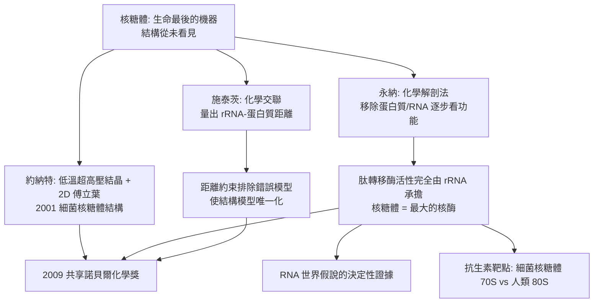

# 2009 · 約納特、施泰茨與永納——生命的最後一台機器

> 2009 諾貝爾化學獎：萬卡特拉曼·拉馬克里希南·約納特（Venkatraman Ramakrishnan，1952– ，美國／印度）、托馬斯·阿爾弗雷德·施泰茨（Thomas A. Steitz，1947– ，美國）與阿達·沃爾特・永納（Ada E. Yonath，1939– ，以色列）——表彰「其對核糖體結構與功能之研究」。**蛋白質的合成——生命的最後一步——被完整看清。**

## 懸案（案情提要）

2000 年代初的分子生物學，有一台「機器」的結構從未被看見：

- **核糖體**：把 mRNA 的訊息讀出來、並把胺基酸接成蛋白質的分子機器。它是**細胞中最大的 RNA—蛋白質複合體**（細菌型約 2.5 MDa，真核型約 4.5 MDa）；
- 它的功能早被知道（1960 年代的「核糖體是肽合成的工廠」），但**結構完全未知**——它太大、太大膽、不對稱、且在工作中不斷變形，**X 射線結晶幾十年沒有成功**；
- 而它的機制問題更深：
  1. **mRNA 是如何被「讀」的？**密碼子與 tRNA 之間的辨識，精度高達每 $10^4$–$10^5$ 個核苷酸才出一次錯——**這比複製的精度還高**；
  2. **肽鍵是怎麼形成的？**肽轉移反應在熱力學上是「上坡」的（需要能量）；
  3. **核糖體是酵素嗎？**它居然有催化功能——那麼它的催化中心在哪？
- 這三個問題的答案，指向同一個驚人結論：**核糖體的催化功能由 rRNA 執行，而非蛋白質。**

偵辦人：施泰茨（約納特與永納在 2009 年共享此獎）。

## 前因

| 年份 | 事件 |
| --- | --- |
| 1952 / 1947 / 1939 | 約納特生於印度恰蒂加爾（後入美國）；施泰茨生於美國密爾沃基；永納生於耶路撒冷（家庭為猶太人，幼年在西班牙流亡）。 |
| 1970s–80s | 永納在耶路撒冷希伯來大學研究**核糖體的化學**（蛋白質的化學修飾、rRNA 的序列）；**1980s 以化學方法大量製備核糖體的 rRNA**（這是結構研究的關鍵前提）；**1990s 建立核糖體的「化學解剖法」**（以酵素逐步移除蛋白質與 rRNA，觀察功能如何喪失）。 |
| 1980s–90s | 施泰茨在耶魯研究**核糖體蛋白質與 rRNA 的相互作用**；以**交聯實驗**（如以 $\mathrm{Fe}^{2+}$／自由基切換的化學交聯）測量 rRNA 與蛋白質的距離——**為結構研究提供關鍵的距離約束**。 |
| 1990s–2000s | 約納特在**威斯康辛大學的生化學研究所**研究**大分子的生物物理學**（X 射線散射、電子顯微鏡）；**1990 年代發展出「用 2D 傅立葉投影 + 3D 重建」求解核糖體結構的方法**，並用**低溫超高壓（cryo高压）**等技巧解決結晶難題。 |
| 1998–2001 | **約納特與同事終於取得細菌核糖體的晶體**（$5.5$–$5.7\ \text{Å}$）並解出結構（2001 年 *Nature*）；**2000–2001 年，永納的團隊解出真核核糖體（大亞基）的高解析結構**（$5.0\ \text{Å}$，2001 年 *Science*），並**首次看到「核糖體的活性位附近沒有蛋白質」**——肽轉移酶的催化中心全由 rRNA 構成。 |
| 2009 | 三人共享諾貝爾化學獎。 |
| 2000s–2010s | 核糖體結構成為**結構生物學的旗艦案例**（PDB 中結構數量最多的複合體之一）；其研究成為**抗耐藥菌新藥**（細菌核糖體與人類核糖體的差異是抗生素選擇性的來源）與**核糖體生物學**的基礎。 |

## 調查

**偵查一：結晶——「如何讓一台會動的機器結冰」。**

$$\text{核糖體的結晶難題}：\ \text{太大}、\ \text{不對稱}、\ \text{異質（多個-copy state）}、\ \text{易解離}$$

$$\text{解法}：\begin{cases}\text{生物化學}：\ \text{純化單一狀態的核糖體}（\text{如} \text{用} \mathrm{Mg}^{2+}\text{ 穩定）}\\ \text{物理}：\ \text{低溫}（\sim 100\ \mathrm{K}）\xrightarrow{} \text{抑制運動};\quad \text{高壓（} \sim 100\ \mathrm{MPa}\text{）}\xrightarrow{} \text{穩定構形}\\ \text{技術}：\ \text{以} \mathbf{2D}\ \text{傅立葉投影進行分子替换}\end{cases}$$

**「低溫超高壓結晶」是核糖體結構史上的關鍵技術**，今日的「蛋白質結晶學」已把它標準化（冷卻高壓裝置）。

**偵查二：交聯實驗——「量出誰離誰多遠」。**

$$\text{以} \ \mathrm{Fe}^{2+}/\text{自由基} \ \text{切換的可裂解交聯試劑} \xrightarrow{} \text{交聯} \mathrm{rRNA}\text{與蛋白質}$$

$$\text{交聯效率} \propto e^{-r^{2}/r_0^{2}} \quad(\text{隨距離指數下降}) \xrightarrow{} \textbf{距離約束}$$

$$\text{這些約束} \xrightarrow{} \text{成為建構模型的硬性限制} \xrightarrow{} \text{排除錯誤模型}$$

**這是「用化學量測距離」——與 1962 年佩魯茨用重原子定位（見 [1962-佩魯茨與血紅蛋白](1962-佩魯茨與血紅蛋白.md)）、1982 年克盧格用交叉連結定膜蛋白位置（見 [1982-克盧格與電子顯微鏡](1982-克盧格與電子顯微鏡.md)）並列的結構手段。**

**偵查三：永納的「化學解剖」——「把零件一件件拆掉，看功能怎麼壞」。**

$$\text{核糖體} \xrightarrow{\text{移除某些蛋白質}} \text{部分活性保留} \xrightarrow{\text{移除 rRNA 片段}} \text{活性喪失}$$

$$\text{結論}：\ \text{肽轉移酶活性} \xrightarrow{} \textbf{完全由 rRNA 承擔}$$

**這是「RNA 世界」假說的決定性證據**（見 [1989-奧特曼與RNA催化](1989-奧特曼與RNA催化.md)）：如果最古老的、最核心的酵素是 RNA，那麼早期生命只需 RNA 一種分子。

**偵查四：密碼子辨識的機制——「精度的來源」。**

$$\text{核糖體的} \textbf{A、P、E 三位點（tRNA binding sites）}$$

$$\underbrace{\mathrm{A\ 位}}_{\text{位點 A（氨酰位）}} \quad \underbrace{\mathrm{P\ 位}}_{\text{位點 P（肽基位）}} \quad \underbrace{\mathrm{E\ 位}}_{\text{位點 E（出口位）}}$$

$$\text{密碼子—反密碼子辨識} \xrightarrow{} \text{結構上的「幾何檢查」（ribosome-induced codon recognition）}$$

$$\text{第一位置（wobble position）允許} \textbf{搖擺配對}\text{，以一個 tRNA 辨認多個密碼子}$$

$$\text{誤讀率} \sim 10^{-4}\text{–}10^{-5}\quad(\text{比 DNA 複製的} \sim 10^{-9}\ \text{還差；但因蛋白質合成只發生幾萬次，尚可接受})$$

**「搖擺配對（wobble）」——Crick 的規則在此有了結構的解釋。**

**偵查五：肽鍵形成——「能量從哪來」。**

$$\text{肽基—tRNA 的高能酯鍵} \xrightarrow{\text{轉移}} \text{肽鍵（ amide bond）} + \mathrm{tRNA}{-}\mathrm{OH}$$

$$\text{催化由} \mathrm{A}\text{ 位 rRNA（P site 的} \mathrm{A245}\text{ 等）} \xrightarrow{} \text{「斷言（deprotonate）} \mathrm{NH_2}\text{、穩定四面體中間體}}$$

$$\boxed{\text{核糖體是「核酶（ribozyme）」——史上最大的核酶}}$$

## 理論裁決

**判決一：核糖體是核酶。**

$$\boxed{\text{肽鍵形成的催化中心由} \mathrm{23S\ rRNA}\text{（細菌）構成，} \text{而非蛋白質}}$$

$$\text{意義}：\ \text{演化上最古老的酵素是 RNA} \xrightarrow{} \textbf{RNA 世界假說獲得決定性支持}$$

$$\text{並與} \ [1989-\text{奧特曼與RNA催化}]\ \text{（核酶發現）} \text{閉合成一條完整的邏輯鏈}$$

**判決二：密碼子辨識的「立體檢查」機制。**

$$\text{第一位置（wobble）} \xrightarrow{} \text{搖擺配對}\quad \text{（Crick 的搖擺假說獲得結構證實）}$$

$$\text{第二與第三位置} \xrightarrow{} \textbf{嚴格幾何檢查（Watson–Crick 配對 + A 位/ P 位的蛋白質輔助）}$$

$$\text{誤讀率的物理來源}：\ \text{翻譯的} \textbf{速度}\text{與} \textbf{忠實度} \text{之權衡}$$

$$\text{延伸}：\ \text{「核糖體速度的演化」是} \textbf{合成生物學}\text{（如} \textbf{「fast ribosome」}\text{）的目標——以提高翻譯速度製造高產量菌株}$$

**判決三：結構約束的三角驗證。**

$$\text{核糖體模型必須同時滿足}：\ \underbrace{\text{X 射線繞射資料}}_{\text{密度}} \quad \underbrace{\text{交聯距離}}_{\text{化學}} \quad \underbrace{\text{化學解剖的功能資料}}_{\text{生物學}}$$

$$\text{三者獨立而互補} \xrightarrow{} \textbf{唯一自洽的模型}$$

**這是現代結構生物學的標準工作流**：不是單靠「漂亮 pictures」，而是多個獨立證據的交會。**

**判決四：核糖體作為藥物標靶的結構基礎。**

$$\text{細菌核糖體} = 70S\ (50S + 30S);\qquad \text{人類} = 80S\ (60S + 40S)$$

$$\text{抗生素的選擇性來源}：\ \text{細菌的} \mathrm{23S\ rRNA}\ \text{與} \mathrm{16S\ rRNA}\ \text{與人類的不同} \Rightarrow \textbf{可選擇性結合}$$

$$\text{例如}：\ \text{四環黴素結合} \mathrm{23S\ rRNA}\text{的} \mathrm{H34}\ \text{位點};\ \text{大環內酯結合} \mathrm{23S}\ \text{的} \mathrm{8}\text{、} \mathrm{24}\text{位點}$$

**「以核糖體的結構差異設計抗生素」——這是結構生物學最直接的醫藥回報**，也是今日抗生素研發（尤其抗耐藥菌）的主戰略。

## 後果

| 領域 | 影響 |
| --- | --- |
| 結構生物學 | 核糖體是 PDB 中結構數量最多的蛋白質—RNA 複合體；「低溫超高壓結晶」與「化學交聯」成為結構生物學的標準技術。 |
| 演化生物學 | RNA 世界假說成為主流；「生命起源於 RNA 世界的實驗研究」（米勒—尤里式的實驗、原核的 RNA 複製品）獲得理論支持。 |
| 醫藥 | 抗生素的作用機制被完全闡明；**抗耐藥菌的新抗生素研發**（如新型大環內酯、oxazolidinone）以核糖體結構為基礎。 |
| 合成生物學 | 核糖體工程（提升翻譯效率）用於製造疫苗與治療性蛋白質；「人工核糖體」是生命起源研究的工具。 |
| 科學制度 | 三位得主分別代表美國（史丹福、耶魯、威斯康辛）與以色列（希伯來大學）；**約納特是首位獲諾貝爾科學獎的印度人**（他公開談及科學機會不平等的問題）。 |

## 關聯

- [1989-奧特曼與RNA催化](1989-奧特曼與RNA催化.md)：RNA 世界假說的提出與本案的最強證據（閉環）。
- [1962-佩魯茨與血紅蛋白](1962-佩魯茨與血紅蛋白.md)：X 射線結構生物學的方法論源頭。
- [1966-馬利肯與分子軌域](1966-馬利肯與分子軌域.md)：rRNA 的活性中心電子結構，需要分子軌域與量化方法描述。
- [1989-奧特曼與RNA催化](1989-奧特曼與RNA催化.md)：核酶。
- [2009-約納特與核糖體](2009-約納特與核糖體.md)：即本卷。
- [2024-貝克與蛋白質設計](2024-貝克與蛋白質設計.md)：核糖體的結構預測（AlphaFold 與核糖體的預測結構）——**預測與實測結構的比較，是 2020 年代結構生物學最時尚的驗證方式**。
