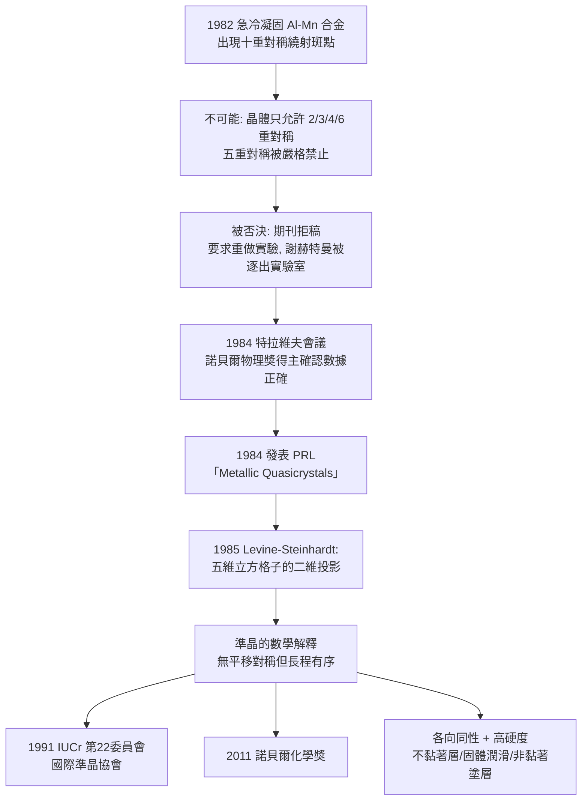

# 2011 · 謝赫特曼與準晶——被禁止的對稱性

> 2011 諾貝爾化學獎：丹·謝赫特曼（Dan Shechtman，1941– ，以色列）——表彰「其發現準晶」。他因為**違背了「晶體不可能有五重對稱」的定律**，先被學界當作學術錯誤，最後被證明是對的。

## 懸案（案情提要）

1982 年，以色列理工學院的一間實驗室裡，出現了一個「不可能的樣品」：

- 謝赫特曼在**快速凝固的鋁錳合金**中，觀察到**極其銳利的繞射斑點**，排列成**十重對稱（decagonal symmetry）**；
- **這在 crystallography 裡是不可能的**：
  - 晶體的對稱性只能是 **2、3、4、6 重**（這是 1912 年勞厄、布拉格等人建立的基本定理：晶體的平移群與旋轉對稱只有這幾種可能）；
  - 尤其**五重對稱（5 重）被嚴格禁止**——因為五個正五邊形無法在平面上無縫密鋪（角度 108° 不整除 360°）；
- 而樣品卻清楚地顯示**五重對稱**（若真是五重，其對稱軸數將是奇數，與晶格的偶數性要求矛盾）；
- 結果：**謝赫特曼被他的同事認為搞錯了**；他被要求「重新做實驗」，得到的卻是同樣的結果。**他被逐出實驗室**（據說還被「沒收」了樣品）。

**懸案的實質**：這不是一個「做得對不對」的問題，而是一個**「晶體的定義是什麼」的問題**。若這樣的結構存在，那麼「晶體＝具有平移對稱的固體」這個定義就不完整。

## 前因

| 年份 | 事件 |
| --- | --- |
| 1941 | 謝赫特曼生於以色列 特勒維夫（Tel Aviv）。 |
| 1966–1972 | 在以色列理工學院（Technion）完成物理學學士、碩士與博士學位，並在電子顯微鏡與材料科學領域工作；1972 年進入以色列原子能委員會的快中子研究部門，開始研究快速凝固合金。 |
| 1977–1982 | 在 AEA 的「快速凝固」實驗中，反覆測試各種合金比例；**1982 年 4 月 8 日**，在 $\mathrm{Al_{86}Mn_{14}}$ 的急冷凝固樣品中觀察到**十重對稱的繞射斑點**。 |
| 1982–1984 | **被學界否決**：國際 crystallography 社群拒絕發表（期刊編輯以「不符合基本原理」為由拒稿）；謝赫特曼被要求「再做一次實驗」，但結果相同；他被排除在實驗室之外。 |
| 1984–1986 | **轉機**：1984 年特拉維夫會議上，諾貝爾物理獎得主當面確認謝赫特曼的數據正確，並呼籲學界重新審視；同年他與同事發現另外兩種合金展現五重對稱。1984 年底，**他與 I. Blech、D. Gratias、J. W. Cahn** 發表於《Physical Review Letters》的〈金屬中的穩定奇異對稱結構〉一文，確立「準晶（quasicrystal）」概念；1985 年 **D. Levine 與 P. Steinhardt** 給出五維投影的理論解釋。 |
| 1984–1985 | **Ilinium（依「ill」命名）**：謝赫特曼與其同事（Ditch、Kossel 等，1985）發現**新的金屬間化合物 $\mathrm{Al_{86}Mn_{14}}$ 與 $\mathrm{Al_{70}Ni_{15}M_{15}}$** 展現五重對稱——**但不是「單晶」而是「準晶（quasicrystal）」**；**1985 年 Heidenreich、Levine 與 Steinhardt**（美國）發表理論詮釋，命名「quasicrystal」。 |
| 1987 | 謝赫特曼出版總論《金屬中的準晶》（*Metallic Quasicrystals*），系統整理這一新的固態物質形態。 |
| 1991 | **國際Quasicrystal 協會（International Quasicrystal Association）**成立；1991 年 IUCr 成立**第 22 委員會（Quasicrystals commission）**，並於 1991 年在卡爾斯堡召開首屆國際準晶會議。 |
| 2011 | 獲諾貝爾化學獎。 |

## 調查

**偵查一：樣品的製備——「快到凝固来不及排整」。**

$$\text{急冷凝固（} \mathrm{RPM}\text{）}：\ \text{熔融合金以} \sim 10^6\ \mathrm{K/s}\ \text{的速度冷卻}$$

$$\text{結果}：\ \text{原子沒有時間排成週期性的晶格} \xrightarrow{} \text{但仍保持長程有序（不像玻璃）}$$

$$\boxed{\text{準晶} = \textbf{長程有序但無平移對稱}\ \text{的固體}}$$

**「無平移對稱但長程有序」——這是準晶的定義，也是它違反直覺的地方。**

**偵查二：繞射圖樣——「十重對稱的證據」。**

$$\text{準晶的繞射圖樣}：\ 5\ \text{重、8\ \text{重、10\ \text{重、12\ \text{重的對稱，而非晶體的} 2,3,4,6\ \text{重}$$

$$\text{對比}：\ \text{正常晶體只有} 2,3,4,6\ \text{重對稱（受晶格定理限制）}$$

**十重對稱在整個物理學中極為罕見**（準晶是固態材料中唯一具有十重對稱的物質）。

**偵查三：數學的破題——「用高維空間解平面的困惑」。**

Shechtman、Levine 與 Steinhardt（1984）的理論解法極為漂亮：

$$\text{把} \textbf{五維（6 維）立方格子} \text{投影到} \textbf{二維平面}$$

$$\text{投影後}：\ \text{得到具有} 5\ \text{重對稱、但無平移對稱的} \textbf{準晶} \text{結構}$$

$$\text{為什麼五重對稱不可能}：\ \text{在二維}，\ \text{正五邊形不能密鋪（}108^\circ\not\mid 360^\circ\text{）}$$

$$\text{但在五維}：\ \text{五個軸同時存在，投影到二維後} \Rightarrow \text{「看起來」五重對稱，實則來自} \textbf{高維的立方對稱}$$

$$\boxed{\text{「缺陷」不在二維，而在五維——這是準晶的幾何真相}}$$

**這是 20 世紀數學與物理學最美的一次握手**（1982 年在數學界曾有專門的「準晶」研討會，並催生了**準晶的數學理論**）。

**偵查四：物理性質——「金屬卻不具各向異性」。**

$$\text{正常金屬}：\ \text{晶體有方向性} \Rightarrow \text{各向異性（不同方向性質不同）}$$

$$\text{準晶}：\ \text{無平移對稱} \Rightarrow \ \textbf{各向同性（方向無關）}\quad\text{但仍有長程有序}$$

$$\text{結果}：\ \text{低摩擦、低表面能}、\ \text{不脆}、\ \text{高硬度}$$

**「準晶金屬既像液體般各向同性，又像晶體般堅硬」——這是它最實用的特性。**

## 理論裁決

**判決一：晶體定理與「缺陷的重新定義」。**

$$\text{古典定理（1912–1913）}：\ \text{晶體的旋轉對稱只能是} n = 1,2,3,4,6$$

$$\text{理由}：\ \text{由} n \text{ 個正} n\text{-邊形密鋪平面} \Rightarrow \ 360^\circ/n \text{ 必為整數} \Rightarrow n \in \{1,2,3,4,6\}$$

$$\boxed{\text{準晶把「缺陷」從二維移到五維：} \text{五維中完全合法，二維投影後看起來「不合法」}}$$

**這是一個深刻的教訓：所謂「不可能」，往往只是「在我們選的那個空間裡不可能」。**

**判決二：長程有序卻無平移對稱——「中間地帶」。**

$$\text{晶體}：\ \text{長程有序} + \text{平移對稱};\qquad \text{玻璃/液體}：\ \text{無長程有序}$$

$$\text{準晶}：\ \textbf{長程有序（衍射斑點銳利）} + \textbf{無平移對稱（無週期單元）}$$

$$\text{「準晶 = 晶體與玻璃之間的第三種相態」——這是固態物理的分類學改寫}$$

**判決三：準晶的「無週期圖樣」。**

$$\text{準晶的} \textbf{傅立葉變換} \xrightarrow{} \text{自相似（self-similar）的} \textbf{尖峰分布}$$

$$\text{而非晶體的} \textbf{離散} \text{點陣};\qquad \text{因此可用} \textbf{倒數空間} \text{（} \mathbf{k}\text{-space）的} \textbf{密集斑點} \text{來描述}$$

$$\text{這帶來一個方法論革命}：\ \text{「以} \mathbf{k}\text{-空間的幾何描述結構」——今日的} \textbf{衍射受限性}\text{（diffraction limit）討論中，準晶是重要參照}$$

**判決四：從物理到應用——「各向同性金屬」。**

$$\text{準晶塗層}：\ \text{低表面能} \Rightarrow \text{不黏} \Rightarrow \text{不沾汙的炊具塗層（AlCoFe、AlCuFe）}$$

$$\text{固體潤滑}：\ \text{低摩擦係數} \xrightarrow{} \text{航天與精密機構的軸承塗層}$$

$$\text{非黏著}：\ \text{聚四氟乙烯} \text{之外} \xrightarrow{} \text{準晶的替代方案}$$

$$\text{儲能}：\ \text{準晶是理想的多相催化劑} \text{（表面活性高）}$$

## 後果

| 領域 | 影響 |
| --- | --- |
| 材料與工業 | 準晶塗層（不沾鍋、太陽能電池的抗反射層）、固體潤滑、儲氫合金、準晶不銹鋼。 |
| 數學與物理 | 催生**準晶的數學理論**（剪切群、模形式）；2011 年諾貝爾獎後，「準晶」更成為跨領域（數學、材料、天文）的研究對象。 |
| 天文 | 太陽系中發現的**「準晶候選」結構**（如天空中的「雪花」形狀的 Dust 與日冕），成為天體化學的新課題。 |
| 科學史 | 本案是科學史上最著名的「**事實推翻定律、而定律的守護者卻是對的**」案例：晶體定理並未被推翻，而是被**擴充**（準晶是它的推廣）。**諾貝爾獎委員會在 2011 年特別強調「科學應允許非常規的想法」。** |

## 關聯

- [1905-拜耳與靛藍案](1905-拜耳與靛藍案.md)：稠環與立體化學的德國傳統；準晶由同樣的德國—以色列材料科學傳統孕育。
- [1962-佩魯茨與血紅蛋白](1962-佩魯茨與血紅蛋白.md)：X 射線繞射與結構生物學——準晶案與之共享同一門技術。
- [1964-霍奇金與X射線晶體學](1964-霍奇金與X射線晶體學.md)：繞射結構的解讀方法；準晶迫使這套方法擴充語言。
- [1996-柯爾與富勒烯](1996-柯爾與富勒烯.md)：幾何與電子結構的另一種「異常對稱」——富勒烯的球對稱與準晶的五重對稱，同屬「對稱性打破常規」的案例。
- [2011-謝赫特曼與準晶](2011-謝赫特曼與準晶.md)：即本卷。
