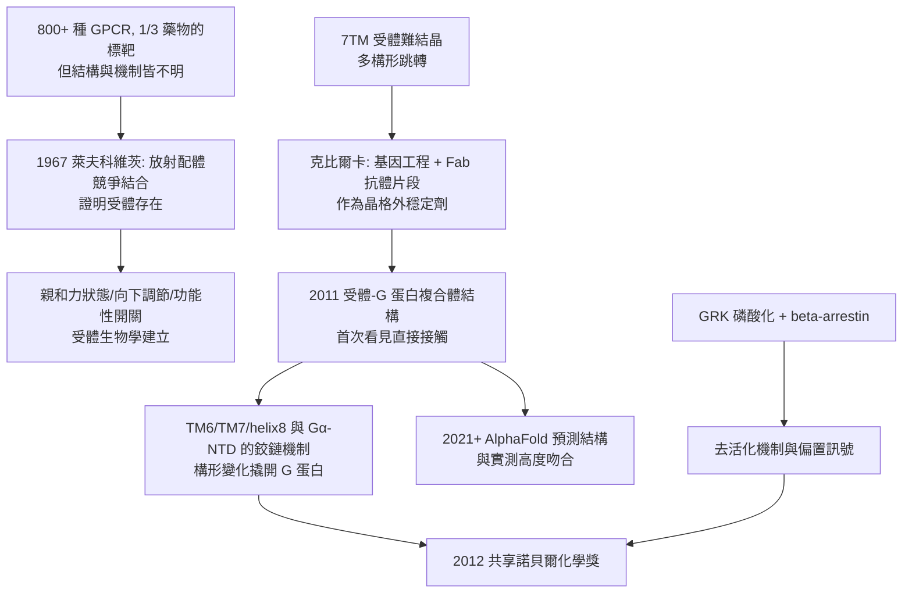

# 2012 · 萊夫科維茨與克比爾卡——受體如何接收訊號

> 2012 諾貝爾化學獎：羅伯特·萊夫科維茨（Robert J. Lefkowitz，1943– ，美國）與布萊恩·克比爾卡（Brian Kobilka，1955– ，美國）——表彰「其對 G 蛋白偶聯受體之研究」。**細胞最繁忙的「開關」終於被看見，並且看見了它「如何被關掉」。**

## 懸案（案情提要）

1970–90 年代的藥理學，有一個「數量上的尷尬」：

- **G 蛋白偶聯受體（GPCR）**是細胞訊息傳遞的最大族群：人類約有 800 多種 GPCR 亞型，負責對光、氣味、激素、神經傳遞物質等數百種訊號的反應；
- 它們**無一例外都是藥物標靶**：今日約 **三分之一的處方藥**作用於 GPCR（抗組織胺、$\beta$-阻斷劑、鴉片類、精神科藥物、阿茲海默症藥物…）；
- 但**它們的結構長期不明**——GPCR 是七次穿膜的膜蛋白（7TM），且**在沒有配體結合時會自發地在多個構形間跳轉**，極難結晶；
- 而更根本的機制問題：
  1. **配體結合後，受體如何「換檔」？**GPCR 沒有酵素活性，它必須「撬動」細胞內的 G 蛋白（$\mathrm{G}\alpha$）——**這個「分子開關」的機制是什麼？**
  2. **受體如何「被關掉」？**若只有「開」的機制而沒有「關」的機制，訊號將無法終止——**受體的「去活化(desensitization)」機制**（磷酸化與 $\beta$-arrestin 的結合）長期是黑箱；
  3. **配體如何進入受體的「口袋」？**藥物要結合的位点在膜內，藥物如何進去？
  4. **為什麼同一個受體會對不同配體有不同效應？**（完全激動劑、部分激動劑、逆向激動劑——**「偏向性（bias）」**。）

偵辦人：萊夫科維茨（受體生物學的建立者）與克比爾卡（結構的破解者）。

## 前因

| 年份 | 事件 |
| --- | --- |
| 1943 / 1955 | 萊夫科維茨生於美國紐約；克比爾卡生於美國明尼蘇達州。 |
| 1960s–70s | 萊夫科維茨在**杜克大學**任職，並與**馬丁·羅德貝爾（Martin Rodbell）**在**范德比爾特大學**共同進行開創性的**放射免疫測定**研究，建立「配體結合」的定量方法——他以**放射配體（radioligand）**測量受體的「結合位點數」與「親和力」。**1967 年他發現「外源配體」與「內源配體」競爭同一受體**——這是「受體存在」的證明，也是**受體生物學的開端**。 |
| 1970s–80s | 萊夫科維茨系統描繪**受體的「親和力狀態（affinity states）」**與「**向下調節（down-regulation）**」；1975–80 年代他與**索爾·科恩（Martin Rodbell）**提出「**受體—G 蛋白偶聯的『功能開關』**」概念，並以生化方法分離出「G 蛋白」。 |
| 1980s–90s | 克比爾卡在卡內基（Carnegie）研究所研究**$\beta$-腎上腺素受體（$\beta_{2}\mathrm{AR}$）**：1990–2000 年代，他以**基因工程、置換突變、傅立葉轉換紅外光譜（FTIR）**等手段研究受體的構形變化，並**用抗體 Fab 片段作為「晶格外穩定劑（crystallization chaperone）」**——這是破解 GPCR 結構的關鍵技術。 |
| 2000s | 克比爾卡團隊（與其合作者）持續用**小分子（PDB 的配體）與抗體 Fab**作為「晶格外穩定劑」，逐一取得不同配體結合態的受體晶體。 |
| **2011** | **克比爾卡團隊發表 $\beta_2$ 受體與**工程化 G 蛋白的複合體結構**（$3.5\ \text{Å}$）——**第一次看見受體與 G 蛋白的直接接觸**。 |
| **2012** | **萊夫科維茨與克比爾卡共享諾貝爾化學獎。** |
| 2012–2015 | 克比爾卡團隊解出**與 $\mathrm{G}\alpha$ 結合的受體結構**，並揭示**「偏向性訊號」的結構基礎**（不同配體穩定不同的中間構形）；2015 年他獲得**「Breakthrough Prize in Life Sciences」**。 |

## 調查

**偵查一：受體存在的證明——「競爭結合」。**

$$\text{放射標記配體（} {}^3\mathrm{H}\text{-配體）} + \text{膜製備物} \xrightarrow{} \text{結合量} \sim B_{\max}$$

$$\text{加入過量非標記配體} \xrightarrow{} \text{結合量骤降（競爭）} \Rightarrow \textbf{存在可飽和的立體專一結合位點}$$

$$\text{「可飽和 + 立體專一 + 高親和力」= \text{受體的三個判準}}$$

**「放射配體結合法」是 1960–90 年代藥理學的標準裝備**——它讓「受體」從概念變成可測量的對象。

**偵查二：結構的難題與「晶格外穩定劑」。**

$$\text{GPCR 的三重困難}：\begin{cases}\text{七次穿膜（跨膜區極疏水）}\\ \text{無配體時自發跳轉（多構形）}\\ \text{配體口袋在膜内、入口狹窄}\end{cases}$$

$$\text{克比爾卡的兩把鑰匙}：\begin{cases}\text{① 工程化}（\text{加入} \mathrm{N} \text{端、刪除} \mathrm{C} \text{端、用穩定突變} \mathrm{L} \to \mathrm{A}\text{）}\\ \text{② 晶格外穩定劑（Fab 抗體片段或小分子配體）}\end{cases}$$

$$\boxed{\text{「Fab 抗體片段」的作用}：\ \text{它不結合配體結合位，但能抓住受體的「外面」，阻止其回到低親和力的鬆散態}}$$

**「用抗體當支架」的智慧，是本案最值得記錄的技術思想。**

**偵查三：受體—G 蛋白的接觸面——「分子開關的鉸鏈」。**

$$\mathrm{GPCR}\ \text{的胞内端（TM6, TM7, helix 8）} \xrightarrow{} \text{與} \mathrm{G}\alpha\ \text{的} \textbf{N}\text{端螺旋（NTD）直接接觸}$$

$$\text{機制}：\ \text{配體結合} \xrightarrow{} \text{受體胞内腔擴大} \xrightarrow{} \text{胞内端的「鉸鏈」打開} \xrightarrow{} \text{形成} \textbf{G 蛋白結合凹槽（cavities）}$$

$$\text{於是} \mathrm{G}\alpha\ \text{的 NTD「掉入」凹槽} \xrightarrow{} \textbf{G 蛋白被撬開 GDP/GTP 交换的开关}$$

$$\boxed{\text{「受體不是酵素，但它是酵素的『啟動器』」——它用構形變化撬動另一個酵素}}$$

**偵查四：去活化的機制——「把開關關掉的機制」。**

$$\mathrm{GPCR}\xrightarrow{\text{配體結合}}\mathrm{GPCR}^*\xrightarrow{\text{GRK 磷酸化}}\mathrm{GPCR}{-}\mathrm{P}\xrightarrow{+\beta\text{-arrestin}}\textbf{去活化 + 訊號偏置}$$

$$\text{結果}：\ \text{① 受體不再與 G 蛋白偶聯};\qquad \text{② 訊號轉向} \beta\text{-arrestin 途徑（偏置訊號）}$$

**「同一個受體可以發出兩種不同的訊號，取決於它被『關掉』的方式」——這是 $\beta$-arrestin 偏置訊號（biased signaling）的發現，也是 2012 年諾貝爾獎講座的重要內容。**

**偵查五：結構預測的驗證——「用 AlphaFold 檢驗 2012 年的結構」。**

$$\text{2021 年以後}：\ \text{GPCR 的 AlphaFold 預測結構} \xrightarrow{\text{與} \ 2012\text{ 年的實測結構比較}} \text{高度吻合}$$

**這是 2020 年代結構預測的一次「事後驗證」**——AlphaFold 預測的多重膜蛋白結構與克比爾卡團隊十年間取得的數十個 GPCR 結構幾乎一致（僅在配體口袋與構形動態上有差異）。

## 理論裁決

**判決一：受體是「構形開關」，不是「配體識別器」。**

$$\text{受體的機制} \ne \text{「辨識配體」};\quad \text{而是} \textbf{「把配體的結合能轉換成自身的構形變化」}$$

$$\text{這就是} \ \textbf{結構傳訊（allostery）}\text{在膜受體上的表現}$$

$$\text{並與} \ [1969-\text{巴頓與構象分析}]\text{（構象分析的原理）、}[1997-\text{博耶與ATP合成酶}]\text{（構形驅動機器）} \text{同屬一個家族}$$

**判決二：偏置訊號——「配體不只帶來『開』，還帶來『開哪一種』」。**

$$\begin{array}{l}
\text{完全激動劑}：\ \text{受體的所有構形被 populated} \Rightarrow \text{G 蛋白訊號} + \text{arrestin 訊號}\\
\text{部分激動劑}：\ \text{只穩定部分構形} \Rightarrow \text{G 蛋白訊號較弱}\\
\text{逆向激動劑}：\ \text{穩定「不活化的中間構形」} \Rightarrow \text{G 蛋白訊號為負}\\
\text{偏置激動劑}：\ \text{偏愛} \ \textbf{arrestin}\ \text{構形} \Rightarrow \text{G 蛋白訊號弱而 arrestin 訊號強}
\end{array}$$

$$\boxed{\text{「同一受體，不同配體，不同訊號」——這是 2012 年諾貝爾獎最深遠的生物學意涵}}$$

**「配體不只打開開關，還決定開關往哪個方向轉」——這改變了藥理學的核心語言**，並直接導致「偏置配體」的藥物開發。

**判決三：結構傳訊的藥理學應用。**

$$\text{藥物設計}：\ \text{不只問「結合強度」} \Rightarrow \text{還要問「穩定哪個構形」}$$

$$\text{今日的 GPCR 藥物開發}：\ \text{以} \textbf{受體-G 蛋白複合體的結構}\text{為基礎，設計「穩定特定構形」的配體}$$

**「用結構設計偏置配體」是 2010 年代 GPCR 藥理學的核心策略**。

**判決四：方法論的傳承。**

$$\text{1990 年代}：\ \text{受體生物學（} \text{放射性配體} \text{）} \xrightarrow{} \text{結構}（\text{晶格外穩定劑} \text{）} \xrightarrow{} 2020\text{年代}：\text{AlphaFold 預測}$$

$$\text{這是「結構 → 機制 → 藥物」這條鏈條最成功的一次完整示範}$$

## 後果

| 領域 | 影響 |
| --- | --- |
| 藥理與藥物 | GPCR 結構成為**結構基礎藥物設計**的最大產出領域；今日已有數十個以 GPCR 結構為基礎設計的藥物進入臨床。 |
| 神經科學 | GPCR 訊號傳遞在神經系統中的多樣性（受體偏置是行為與藥理差異的重要來源）被重新理解。 |
| 免疫與發炎 | 趨化因子受體（CXR）等 GPCR 與發炎、腫瘤免疫相關。 |
| 結構生物學 | 「晶格外穩定劑」這一招沿用於許多其他膜蛋白（今日的 GPCR 結構數已逾 800 個）。 |
| 科學制度 | 萊夫科維茨是**美國心臟協會、中國科学院（外籍院士）等多個科學組織的主席**，是科學公民的典型；克比爾卡獲 2015 年突破獎，說明此領域的社會影響力。 |

## 關聯

- [1969-巴頓與構象分析](1969-巴頓與構象分析.md)：構象與構形的概念區分，是理解受體「構形開關」的基礎。
- [1959-海羅夫斯基與極譜](1959-海羅夫斯基與極譜.md)：放射配體與結合分析的技術血脈；受體的定量學由此建立。
- [1962-佩魯茨與血紅蛋白](1962-佩魯茨與血紅蛋白.md)：膜蛋白結構測定的技術源頭。
- [1997-博耶與ATP合成酶](1997-博耶與ATP合成酶.md)：構形變化驅動分子的另一個典範。
- [2012-萊夫科維茨與GPCR](2012-萊夫科維茨與GPCR.md)：即本卷。
- [2024-貝克與蛋白質設計](2024-貝克與蛋白質設計.md)：GPCR 的 AlphaFold 預測結構，把 2012 年開啟的結構基礎藥物設計推向全面自動化的時代。
