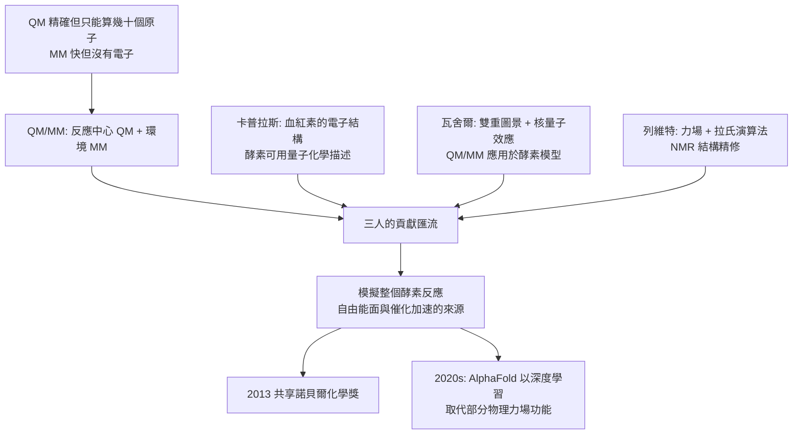

# 2013 · 卡普拉斯、列維特與瓦舍爾——跨越尺度的模擬

> 2013 諾貝爾化學獎：馬丁·卡普拉斯（Martin Karplus，1930– ，美國／奧地利）、邁可·列維特（Michael Levitt，1947– ，英國／以色列）與阿里耶·瓦舍爾（Arieh Warshel，1940– ，以色列／美國）——表彰「其對複雜化學體系之多尺度模型之發展」。**化學家終於能模擬真實的酵素反應。**

## 懸案（案情提要）

1990 年代的計算化學與結構生物學，有一道「尺度牆」：

- **量子力學（QM）**能給出電子層次的精確答案：鍵的形成與斷裂、催化機制、電子轉移——但**只能處理幾十個原子的系統**；
- **分子力場（MM，古典力場）**能處理幾萬、幾十萬個原子的系統（蛋白質、溶劑、膜），速度飛快——但**沒有電子、沒有成鍵與斷鍵、沒有反應性**；
- 而**酵素催化的核心問題恰恰跨越了這條牆**：
  - 反應中心只有幾個殘基（需 QM），但活性位由整個蛋白質的構形決定（需 MM）；
  - 蛋白質在反應中會**構形變化**（需 MD），而反應本身只有飛秒（需 QM）；
  - 溶劑效應、質子化態、水分子的參與——全都跨越尺度；
- 懸案的具體形式：**能不能寫出一個模型，既能算電子、又能算整個蛋白質、還能描述反應的發生？**

偵辦人：卡普拉斯、列維特與瓦舍爾——三位理論化學家，各自從不同角度接近同一面牆，最終在 1970–80 年代拼合。

## 前因

| 年份 | 事件 |
| --- | --- |
| 1930 / 1947 / 1940 | 卡普拉斯生於奧地利維也納（1938 年逃至美國）；列維特生於南非（後在以色列與英國成長）；瓦舍爾生於以色列。 |
| 1950s–60s | 卡普拉斯在哈佛大學取得博士學位（1950）並任教，長期研究生物分子（血紅素、核糖核酸酶）的量子化學。 |
| 1960s–70s | 卡普拉斯研究**生物分子的電子結構**：血紅素與肌紅蛋白的**磁性與電子自旋**（1960s）、**核糖核酸酶的質子轉移**（1969）——他首次證明**酵素的催化可以用量子化學描述**。 |
| 1960s–70s | 列維特在劍橋大學取得博士學位，於 1970 年代完成 DNA 與蛋白質的力學模型，並發展蛋白質的力學模型與 NMR 計算方法。 |
| 1960s–70s | 瓦舍爾在以色列 Weizmann 研究所（與其導師 **Gordon (G.)** ）研究**酵素的質子轉移**；**1968 年**他與其合作者提出**「經典的（classical） vs 量子的（quantum）」反應路徑之區分**，並於 **1970 年代**將 QM 與 MM 結合應用於**酵素模型（溶菌酶、胰蛋白酶）**——這是多尺度方法的先驅。 |
| 1970s–80s | **QM/MM 方法（combined quantum/classical）**逐步成形：把反應中心用 QM 描述，周圍用 MM 描述，兩者以「切割面（partition）」相連。 |
| 1980s–90s | 列維特發展 **NMR 結構精修的計算方法**（以拉氏演算法最小化能量）；卡普拉斯發展**蛋白質的量子與力學模型**；三人的工作交會於「**模擬生物分子反應**」這一共同目標。 |
| 2013 | 三人共享諾貝爾化學獎。 |
| 2010s | QM/MM 與 QM 計算已能模擬**酵素反應、通道的開合（2012 年的 GPCR 偏置訊號即為實例）、蛋白質摺疊（Rosetta 的去摺疊/摺疊模擬即 MM 之力）**；**2020 年代的 AlphaFold 則把「預測」推進到結構層級**（用深度學習取代物理力場的部分功能）。 |

## 調查

**偵查一：QM/MM 的切割——「把電子給反應中心，把環境給力場」。**

$$\underbrace{\hat{H} = \hat{H}_{\text{QM}} + \hat{H}_{\text{MM}} + \hat{H}_{\text{coupling}}}_{\text{總哈密頓量}}$$

$$\text{QM 區（活性位，} \sim 50\text{–}200 \text{ 原子）} + \text{MM 區（其餘，} \sim 10^4\text{–}10^5 \text{ 原子）}$$

$$\text{邊界的處理}：\ \text{電子嵌入（electron embedding）或} \ \text{經典嵌入（classical embedding）}$$

**這套方法的優雅之處在於「比例可調」**：

$$\text{把更多殘基納入 QM} \xrightarrow{} \text{更準但更慢};\qquad \text{把 QM 縮小} \xrightarrow{} \text{更快但可能漏掉長程電子效應}$$

**「誰該當 QM、誰該當 MM」是一個『化學判斷』而非演算法決定的事**——這正是本案得主的核心貢獻。

**偵查二：卡普拉斯的血紅素——「自旋與電子結構的橋」。**

$$\text{血紅素}（\mathrm{Fe}^{2+}\ \text{（低自旋）}）\xrightarrow{\text{配體環境變化}} \mathrm{Fe}^{2+}\ (\text{高自旋})$$

$$\text{磁性與} \mathrm{NMR} \text{的} \mathrm{p} \text{環電流位移} \xrightarrow{} \textbf{電子結構的直接量測}$$

$$\text{他證明}：\ \text{蛋白質的環境（ His、F 的配位）} \xrightarrow{} \text{決定金屬中心的電子態} \xrightarrow{} \text{決定} \mathrm{O_2}\ \text{的結合行為}$$

**「生物功能可以用量子化學解釋」——這是 1960 年代末的突破性結論。**

**偵查三：瓦舍爾的「雙重圖景」——「反應是經典的還是量子的」。**

$$\text{經典圖景（classical）}：\ \text{以 Born–Oppenheimer 近似，原子核在電子基態面上運動} \Rightarrow \text{需 QM 處理電子}$$

$$\text{量子圖景（quantum）}：\ \text{電子與原子核同時運動，} \Rightarrow \text{需處理} \textbf{核量子效應}$$

$$\boxed{\text{「核量子效應」在} \mathrm{H^+}\text{ 轉移中可能是決定性的（質子會波動、會隧穿、會與蛋白質的} \textbf{量子} \text{（振動模式）耦合）}}$$

**這是蛋白質中「質子隧道效應」的理論奠基**——它解釋了為何酵素的催化加速比化學模型預測的還要高出 $10^{8}$–$10^{15}$ 倍。

**偵查四：列維特的力學與 NMR——「用計算求出結構」。**

$$\text{蛋白質力場}：\ E = \sum_{\text{bonds}} k(r-r_0)^2 + \sum_{\text{angles}} K(\theta-\theta_0)^2 + \sum_{\text{dihedrals}} \sum_n \frac{V_n}{2}(1+\cos n\phi) + \sum_{ij} \epsilon_{ij}\left[\left(\frac{r_{ij}}{r_0}\right)^{-12}-\left(\frac{r_{ij}}{r_0}\right)^{-6}\right]$$

$$\text{拉氏優化}：\ \text{逐步下坡（energy minimization）} \xrightarrow{} \text{符合經驗距離約束與 NOE 的構形}$$

$$\text{列維特把} \textbf{拉氏演算法}\text{引入 NMR 結構精修} \xrightarrow{} \text{1990 年代} \textbf{NMR 結構數量暴增}$$

**「用物理優化取代人工建模」——這是 NMR 結構時代的技術基礎**（並直接支援了 2002 年維特里希的諾貝爾獎，見 [2002-田中與蛋白質質譜](2002-田中與蛋白質質譜.md)）。

**偵查五：走向「模擬整個反應」——從單點能到自由能面。**

$$\Delta G^\ddagger_{\text{enzyme}} \text{ 的計算}：\ \text{取樣} \xrightarrow{} \text{反應坐標} \xrightarrow{} \text{QM/MM} \xrightarrow{} \text{Umbrella sampling / Metadynamics}$$

$$\text{2013 年之後}：\ \text{酵素催化機制的「QM/MM 計算」成為} \textbf{常規手段}$$

## 理論裁決

**判決一：多尺度方法的物理骨架。**

$$\boxed{\text{總能量} = \underbrace{E_{\text{QM}}}_{\text{電子結構}} + \underbrace{E_{\text{MM}}}_{\text{構形} \text{與} \text{非鍵作用}} + \underbrace{E_{\text{耦合}}}_{\text{界面電荷與誘導偶極}}}$$

$$\text{物理分工}：\ \text{短程、高度局域化的電子重排} \xrightarrow{\text{QM}};\quad \text{長程、緩慢的構形運動} \xrightarrow{\text{MM}}$$

**「尺度決定方法」——這是 2013 年諾貝爾獎的核心命題**，它把「計算化學」從「用電腦算分子」提升為「用多套物理描述不同層次的世界」。

**判決二：核量子效應——「質子不是粒子，是波」。**

$$\text{在酵素中}，\ \mathrm{H^+}\ \text{的轉移可能涉及} \begin{cases}\text{質子隧穿（} \kappa \sim 10\text{–}20\text{）}\\\text{蛋白質振動模式與電子結構的耦合（vibrational coupling）}\end{cases}$$

$$\boxed{\text{這可解釋酵素加速達} \ 10^{8}\text{–}10^{15}\ \text{倍的部分來源}}$$

**「酵素不只是把反應物排好隊，它還『調頻』了反應的量子過程」——這是瓦舍爾的洞見。**

**判決三：蛋白質的力學與自由能面。**

$$\text{蛋白質不是剛體}：\ \text{它有} \ \textbf{構形集合（conformational ensemble）}$$

$$P(\mathbf{r}) \propto \exp\left(-\frac{U(\mathbf{r})}{k_B T}\right)$$

$$\text{酵素的催化} \approx \text{「用能量偏置（energetic bias）把系統推向過渡態的區域」}$$

**「酵素用自身的構形自由度『抽取』了自由能，降低了有效能障」——這是統計力學層級的催化圖像**，並與巴頓的構象分析（見 [1969-巴頓與構象分析](1969-巴頓與構象分析.md)）相呼應。

**判決四：從「解釋」到「預測」。**

$$\text{2013 年之前}：\ \text{計算用於} \textbf{解釋}\text{已知的結構與機制}$$

$$\text{2013 年之後}：\ \text{計算用於} \textbf{預測}\text{結合親和力、突變效應、藥效}$$

$$\text{2020 年代}：\ \text{AlphaFold}\xrightarrow{} \text{結構預測} \xrightarrow{} \text{「結構 → 作用機制 → 藥效」的預測鏈完整閉合}$$

**「卡普拉斯—列維特—瓦舍爾的方法，最終成為 AI 結構預測的物理對照與評分基準」——這是本案最長的因果鏈。**

## 後果

| 領域 | 影響 |
| --- | --- |
| 理論化學 | QM/MM 成為酵素機制研究的標準工具；「多尺度模型」成為化學的通用詞彙。 |
| 藥物設計 | 計算預測結合自由能與突變效應（自由能微擾動 FEP），大幅縮短先導化合物優化的週期。 |
| 結構生物學 | 力場與 NMR 精修（列維特）推動 1990–2000 年代的 NMR 結構大爆發。 |
| AI 科學 | AlphaFold 與 RoseTTAFold 把深度學習引入生物學；其物理啟發來自多尺度方法的直覺（**「局部準確、全球品質」**的原則）。 |
| 科學制度 | 三位得主分別代表美國（哈佛）、英國/以色列（劍橋）與以色列（Weizmann）；瓦舍爾與列維特皆為以色列裔，說明科學人才流動的雙向性。 |

## 關聯

- [1969-巴頓與構象分析](1969-巴頓與構象分析.md)：構象集合與構形自由能，是本案的物理背景。
- [1966-馬利肯與分子軌域](1966-馬利肯與分子軌域.md)：QM 方法的理論源頭。
- [1972-安芬森與核糖核酸酶](1972-安芬森與核糖核酸酶.md)：核糖核酸酶的質子轉移——卡普拉斯 1969 年的開創性 QM 計算。
- [1991-恩斯特與NMR](1991-恩斯特與NMR.md)：列維特的 NMR 精修方法把結構計算推向實用。
- [2002-田中與蛋白質質譜](2002-田中與蛋白質質譜.md)：NMR 結構的數量大爆發，正是列維特方法學的成果。
- [2013-卡普拉斯與多尺度模擬](2013-卡普拉斯與多尺度模擬.md)：即本卷。
- [2024-貝克與蛋白質設計](2024-貝克與蛋白質設計.md)：深度學習模型與物理多尺度方法的融合——本案思想的現代延伸。
